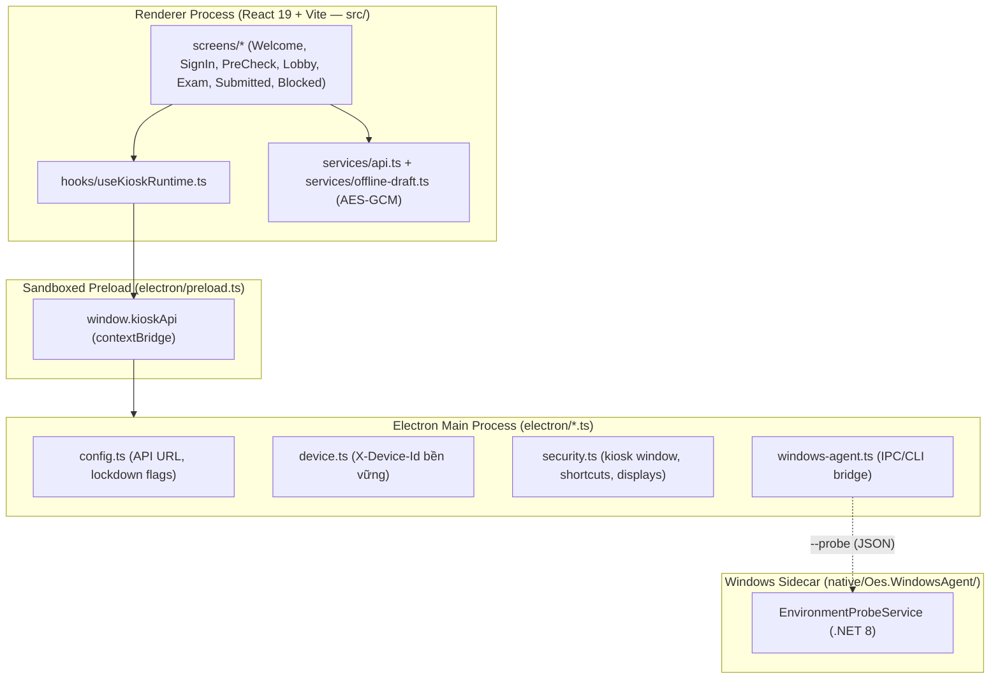

# Kiến Trúc Desktop Kiosk (`OralExam.DesktopKiosk`)

## 1. Kiến trúc 3 tầng tách biệt

## 2. Phân trách nhiệm từng thư mục

| Thư mục / Tệp | Vai trò | Công cụ biên dịch |
| :--- | :--- | :--- |
| `src/` | Giao diện thí sinh MF-04, gọi REST API, ghi âm `.webm`, nhật ký offline mã hóa | `vite.config.ts` + `tsconfig.app.json` |
| `electron/` | Cửa sổ Kiosk, bảo mật sandbox, khóa phím tắt, quản lý `deviceId`, cầu nối sidecar | `vite.electron.config.ts` + `tsconfig.node.json` |
| `native/Oes.WindowsAgent/` | Sidecar `.NET 8` chạy trên Windows để phát hiện đa màn hình, máy ảo (`VM_DETECTED`), điều khiển từ xa (`REMOTE_CONTROL`), tiến trình cấm (`DISALLOWED_PROCESS`) | `dotnet build` / `scripts/build-windows-agent.ps1` |
| `scripts/` | Tự động hóa build sidecar và kiểm chứng toàn bộ (`verify-kiosk.mjs`) | PowerShell / Node.js |
| `tests/` | Kiểm thử hợp đồng bảo mật và luồng MF-04 | `node --test` |
| `docs/` | Tài liệu kiến trúc và walkthrough nghiệm thu | Markdown |

## 3. Ràng buộc bảo mật quan trọng
- `electron/preload.ts` không có runtime import tương đối để `dist-electron/preload.cjs` luôn là 1 tệp độc lập trong Electron sandbox.
- `vite.electron.config.ts` xuất `dist-electron/main.cjs` và `dist-electron/preload.cjs` định dạng CommonJS, giữ `electron` và `node:*` ở chế độ external.
- `native/Oes.WindowsAgent` không đòi hỏi quyền Administrator và không sửa registry hệ điều hành để tránh xung đột trên laptop BYOD của sinh viên.
