# Walkthrough MF-04 — Electron Desktop Kiosk

## 1. Luồng chạy tổng quát

```mermaid
flowchart LR
  Login[Đăng nhập SV] --> Ticket[Lấy vé thi hiện tại]
  Ticket --> Mic[Test micro 30s >= 60 dB]
  Mic --> CheckIn[Điểm danh & nhận đề]
  CheckIn --> Questions[Làm bài theo từng câu]
  Questions --> Record[Ghi âm WebM + STT]
  Record --> Journal[Lưu AES-GCM IndexedDB]
  Journal --> R2[Upload Presigned R2]
  R2 --> Seal[Niêm phong SHA-256]
  Seal --> Submit[Nộp bài Persist-First]
  Submit --> Locked[0% lộ điểm & khóa thoát cho tới khi xác nhận]
```

## 2. Bản đồ tệp sau chuẩn hóa cấu trúc

| Lớp | Thư mục / Tệp |
| :--- | :--- |
| Electron Shell | `electron/main.ts`, `electron/preload.ts`, `electron/config.ts`, `electron/device.ts`, `electron/security.ts`, `electron/windows-agent.ts` |
| Native Windows Agent | `native/Oes.WindowsAgent/Oes.WindowsAgent.csproj`, `Program.cs`, `Models/AgentProbeResult.cs`, `Services/EnvironmentProbeService.cs` |
| Renderer Core | `src/main.tsx`, `src/App.tsx`, `src/vite-env.d.ts`, `src/styles/app.css` |
| Domain & Services | `src/types/mf04.types.ts`, `src/services/api.ts`, `src/services/offline-draft.ts` |
| Utils & Hooks | `src/utils/formatters.ts`, `src/utils/crypto.ts`, `src/hooks/useKioskRuntime.ts` |
| Screens | `src/screens/{Welcome,SignIn,WaitingTicket,PreCheck,Lobby,Exam,Submitted,Blocked}Screen.tsx` |
| Build & Scripts | `vite.config.ts`, `vite.electron.config.ts`, `tsconfig.json`, `tsconfig.app.json`, `tsconfig.node.json`, `scripts/verify-kiosk.mjs`, `scripts/build-windows-agent.ps1` |
| Tests | `tests/mf04-contract.test.mjs` |

## 3. Ranh giới bảo mật
- Chỉ cho phép vai trò `student`; Backend kiểm tra toàn bộ quyền sở hữu vé, thiết bị, trạng thái ca và độ toàn vẹn SHA-256 trước khi ghi nhận bài nộp.
- Kiosk không hiển thị điểm số và không mở phúc khảo tại phòng thi.
- Lockdown cấp ứng dụng kết hợp với `Oes.WindowsAgent` giúp phát hiện vi phạm ở mức môi trường mà không can thiệp phá vỡ hệ điều hành BYOD của sinh viên.
