# TỔNG HỢP MÔ TẢ 4 LUỒNG NGHIỆP VỤ CỐT LÕI (4 CORE MAIN FLOWS)
## HỆ THỐNG LUYỆN THI & ĐÁNH GIÁ VẤN ĐÁP BẰNG LLM (ORAL EXAM LLM SYSTEM)
### Đề Tài Tốt Nghiệp Capstone: FA26SE166 — Đại Học FPT TP.HCM (FPT SG)

> **Mã đề tài:** FA26SE166 | **Học kỳ:** Fall 2026 (FA26)  
> **Chuyên ngành:** Kỹ thuật Phần mềm (Software Engineering - SE) — Đại học FPT TP.HCM (FPT SG)  
> **Giảng viên hướng dẫn:** ThS. Nguyễn Thị Cẩm Hương (`huongntc2@fpt.edu.vn`)  
> **Đội ngũ kỹ sư thực hiện (4 thành viên):**  
> - 🧑 **Nguyễn Quang Thành:** Team Leader & Lead Backend Architect (Backend MF-01 + MF-02, Module Báo cáo Khảo thí FPT Excel .xlsx + PDF, Tích hợp hệ thống Clean Architecture)  
> - 🧑 **Nguyễn Trọng Tốt:** Backend Developer, AI Specialist & QA Lead (Dual Auth Google OAuth 2.0 + Tài khoản trường cấp, Backend MF-03, TOÀN BỘ Backend MF-04, Backend APIs vệ tinh Semester/Notification/User Mgmt, AI Core & Polly/DLQ, xUnit/NetArchTest)  
> - 🧑 **Phạm Nguyễn Đăng Hải:** DB Specialist & Frontend Developer (phụ trách Database 30 bảng PostgreSQL và dồn toàn lực phát triển Frontend; tuyệt đối không code C# Backend; Student Portal Dashboard, Lịch sử luyện tập & thi thử, UI Thi thử Voice-First MF-02, UI Duyệt đề MF-03, UI Ca thi & Thẩm định phúc khảo MF-04, User Mgmt FE-09, Semester CRUD FE-08)  
> - 🧑 **Lê Vũ Hoàng:** Lead Frontend Architect & Fullstack Coordinator (Kiến trúc Frontend Core React 19 + Tailwind v4, UI Luyện tập MF-01, Màn hình Kiosk phòng Lab MF-04, Màn hình Hậu kiểm Evidence Panel cho Giảng viên, Dual Auth UI, Notification in-app FE-11, Dashboard FE-10)  
> **Thư mục sơ đồ Draw.io:** [**`05_Source_Code/docs/05_diagrams/`**](../05_diagrams/)  
> • Tệp Master 4 Tabs: [`CAPSTONE_FA26SE166_4_MAINFLOWS_ACTIVITY_DIAGRAMS.drawio`](../05_diagrams/CAPSTONE_FA26SE166_4_MAINFLOWS_ACTIVITY_DIAGRAMS.drawio)

---

## BẢNG TỔNG QUAN 4 LUỒNG NGHIỆP VỤ

| Mã Luồng | Tên Luồng Nghiệp Vụ | Đối Tượng Sử Dụng | Chốt Chặn Kỹ Thuật Trọng Tâm |
|:---:|:---|:---|:---|
| **MF-01** | **Luyện tập vấn đáp tương tác** *(Interactive Practice)* | Sinh viên | Chọn chế độ Upfront (`[Per-Question On-Demand]` vs `[Full-Session Progressive]`); Per-Question cho phép chọn đơn/tổ hợp mức độ (`easy`, `medium`, `hard`), cấp câu 1 khi tạo phiên rồi bốc tiếp On-Demand qua `POST /api/v1/practice/sessions/{id}/next-question` không ép chốt trước số câu; Thuật toán Anti-3-Consecutive ngẫu nhiên có ràng buộc (tối đa 2 câu cùng mức trong 3 câu liên tiếp); Kích hoạt follow-up đào sâu A2 khi điểm ranh giới $4.0 \le \text{Score} \le 8.0$ (1–5 câu do Admin cấu hình, mặc định 2 câu); Full-Session bốc trọn gói 3–10 câu (`MinMixedPracticeQuestions = 3`, `MaxMixedPracticeQuestions = 10` do Admin cấu hình) chia đều tăng dần Dễ $\to$ Trung bình $\to$ Khó, TUYỆT ĐỐI KHÔNG có follow-up; Màn hình đệm sửa lỗi Code-Switching do Admin cấu hình (`transcript_buffer_seconds`, từ 10–300s, mặc định 60s); Cơ chế Timeout 5 phút không tương tác (`SessionInactivityTimeoutMinutes = 5`), ghi nhận `last_activity_at`, quá 5 phút tự động hoàn tất an toàn, trả HTTP 410 Gone, bảo toàn điểm; Luyện tập KHÔNG lưu audio, chỉ lưu bản transcript đã sửa vào `practice_answers`; Hàng đợi phòng thủ 4 tầng Zero Data Loss. |
| **MF-02** | **Thi thử vấn đáp bấm giờ** *(Timed Mock Exam)* | Sinh viên | Nguồn đề rút từ kho câu hỏi luyện tập chung (`practice_questions`); Hạn ngạch thi thử do Admin cấu hình (`max_mock_exams_per_day`), không khóa cứng K=3; Cấu trúc đề & phân bổ Bloom do Trưởng BM cấu hình; Sinh viên chỉ chọn môn và tùy chọn Có/Không Follow-up trước khi thi (AI hỏi theo nội dung ngữ cảnh bài nói, có follow-up thời lượng dài hơn do Trưởng BM cấu hình); Voice-First Gate khóa cứng ô gõ phím; Đồng hồ kép chống gian lận; Đệm sửa từ (cấu hình động `transcript_buffer_seconds`, 10–300s, mặc định 60s); Hết giờ tự nộp: câu chưa làm tính là bỏ trống, không chấm; KHÔNG lưu audio, chỉ lưu transcript vào `mock_exam_answers`; Chấm AI 2 pha (Fast-Path $<10$s / Async Fallback); Instant Feedback Scorecard chi tiết từng câu theo Rubric tại kết quả và Lịch sử thi. |
| **MF-03** | **Quản lý ngân hàng đề & Barem Rubric** *(Question Bank & Rubric Studio)* | Giảng viên & Trưởng Bộ Môn | **Giảng viên và Trưởng BM sử dụng AI sinh câu hỏi từ FLM Syllabus theo CLO** (hoặc soạn thủ công); Câu hỏi soạn thủ công (`source = 'manual'`) hỗ trợ đính kèm hình ảnh/sơ đồ kỹ thuật (`PNG/JPG/WEBP <= 5MB`, kiểm tra Magic Bytes `HTTP 413`/`415`, lưu `image_url` & `image_description` phục vụ chấm điểm đa phương thức Gemini Multimodal `inline_data`); Tick chọn lưu vào 2 kho: `practice_questions` và/hoặc `exam_questions`; Barem Rubric chuẩn hóa $\sum \equiv 10.0$đ; Model Answer $\ge 50$ ký tự; AI Calibration Simulator; Gửi lên cho Bộ Môn (`POST /api/v1/questions/batch-submit-review`, `SUBMITTED_FOR_REVIEW`); Trưởng Bộ Môn thẩm định và Phê duyệt (`APPROVED`) / Yêu cầu sửa (`NEEDS_REVISION`) / Từ chối loại hẳn (`REJECTED`) vào ngân hàng câu hỏi môn học; Backend Gate HTTP 422; ACID Transaction. |
| **MF-04** | **Thi thật phòng Lab, Công bố điểm & Phúc khảo nội bộ** *(Lab Exam, Audit & Internal Appeals)* | Sinh viên, Giám thị, Giảng viên & Trưởng Bộ Môn | Trưởng Bộ Môn khởi tạo kỳ thi (`OfficialExamSession`), gán môn thi, cấu hình ca thi (ghi phòng lab ngay trên ca, gán người coi thi là GV hoặc giám thị, danh sách thí sinh lấy từ lớp học đã có), cấu hình Follow-up môn thi trong kỳ thi (1–5 câu, mặc định 2 câu) và `ExamInputMode` (`VoiceOnly`, `VoiceWithTranscriptEdit`); Định danh vé thi bằng `ip_address`; Fullscreen Kiosk Lockdown (chặn F12, onblur $\ge 3$ lần đình chỉ thi); Hardware Mic-Check 30s $\ge 60$dB; Niêm phong âm thanh bằng mã băm SHA-256 stream trực tiếp lên Cloudflare R2 định danh `STT_MSSV.webm`; Nộp bài Persist First < 100ms với trạng thái `SUBMITTED`, Kiosk khóa màn hình TUYỆT ĐỐI 0% HIỆN ĐIỂM và không cho khiếu nại tại chỗ; AI chấm điểm ngầm chỉ dựa trên bản transcript qua BoundedChannel 1000 slots RAM, DLQ Replay 5m (Trưởng BM giám sát & kích hoạt replay); Chốt chặn AI Doubt Guard phân loại 2 nhóm: Nhóm 1 Đáng nghi ngờ (`is_suspicious == true` / `confidence_score < 0.70` hoặc fail) và Nhóm 2 Độ tin cậy cao; Giảng viên đối soát trên Evidence Panel (AudioURL, Transcript Whisper gốc, AI CoT) để nghe Waveform Player và chỉnh điểm kèm giải trình; Giảng viên Công bố điểm (Publish Grades) một lần duy nhất khi 100% sinh viên có điểm, kích hoạt One-Way Lock (HTTP 403); Sinh viên xem bảng điểm trên Student Portal (Xác nhận nhận điểm `ACKNOWLEDGED` HOẶC gửi đơn phúc khảo nội bộ `AppealRequest` trực tiếp trên hệ thống gán cho Trưởng Bộ Môn tiếp nhận và giao một Giảng viên khác chấm lại, One-Way Lock chừa đường cho GV được giao cập nhật điểm); Xuất báo cáo Khảo thí FPT cả file Excel (.xlsx) và file PDF có chữ ký số. |

---

## PHẦN 1. LUỒNG MF-01: SINH VIÊN LUYỆN TẬP VẤN ĐÁP TƯƠNG TÁC
*(MF-01: STUDENT INTERACTIVE PRACTICE PROCESS)*

* **Tài nguyên trực quan:** [Tệp sơ đồ Draw.io](../05_diagrams/MF01_Interactive_Practice.drawio) (4 Phân làn, 43 đỉnh, 48 cạnh, 5 nút kết thúc)

### 1.1. Mục Tiêu Nghiệp Vụ
Giúp sinh viên chủ động luyện phản xạ thi vấn đáp 1-1 với trợ lý ảo AI (Google Gemini 1.5 Flash). Hệ thống hỗ trợ linh hoạt cả hai phương thức trả lời (nói qua micro hoặc gõ phím), cung cấp màn hình đệm do Admin cấu hình (`transcript_buffer_seconds`, từ 10–300s, mặc định 60s) để sinh viên sửa lỗi nhận diện thuật ngữ CNTT tiếng Anh (*Code-Switching*), và trao quyền chọn chế độ làm bài linh hoạt ngay từ đầu:
- **Luyện từng câu theo yêu cầu [Per-Question On-Demand]:** Sinh viên chọn mức độ đơn lẻ (Dễ, Trung bình, Khó) HOẶC bất kỳ tổ hợp nào (ví dụ: `["easy", "medium"]`, `["easy", "hard"]`, `["medium", "hard"]`, `["easy", "medium", "hard"]`). Phiên luyện tập cấp câu hỏi đầu tiên (Câu 1) khi bắt đầu, sau đó sinh viên trả lời và gọi API lấy câu tiếp theo theo nhu cầu (On-Demand qua `POST /api/v1/practice/sessions/{id}/next-question`), không bắt buộc chốt trước số lượng câu hỏi. Áp dụng **thuật toán ngẫu nhiên có ràng buộc (Anti-3-Consecutive)**: trong bất kỳ chuỗi 3 câu hỏi chính liên tiếp nào, tối đa chỉ có 2 câu chung mức độ (khi 2 câu liền trước cùng độ khó, lần bốc tiếp theo bắt buộc chuyển sang mức khác trong danh sách đã chọn). Không lặp lại câu hỏi sinh viên đã làm trong phiên (`Id NOT IN (...)`). Sau mỗi câu trả lời, kích hoạt câu hỏi chuyên sâu đào sâu (A2) khi điểm số thuộc khoảng ranh giới $4.0 \le \text{Score} \le 8.0$ theo cấu hình hệ thống của Admin (`max_follow_up_questions`, từ 1–5 câu, mặc định 2 câu; nếu điểm $< 4.0$ hoặc $> 8.0$ thì mở Scorecard ngay).
- **Luyện trọn gói theo tiến trình [Full-Session Progressive]:** Sinh viên nhập số lượng câu hỏi muốn làm từ 3 đến 10 câu (ràng buộc bởi `MinMixedPracticeQuestions = 3` và `MaxMixedPracticeQuestions = 10` do Admin cấu hình trong `system_configs`). Hệ thống tự động chia theo tiến trình từ Dễ đến Khó: chia đều số câu cho 3 mức (Dễ, Trung bình, Khó), bốc trọn gói toàn bộ câu hỏi ngay khi khởi tạo phiên và sắp xếp thứ tự phát vấn tăng dần từ Dễ $\to$ Trung bình $\to$ Khó (nếu kho đề không đủ câu cho bất kỳ mức nào, trả `HTTP 400 Bad Request` tiếng Việt rõ ràng, không tạo phiên rác). Chế độ này trả lời liền mạch không bị ngắt quãng, **TUYỆT ĐỐI KHÔNG có câu hỏi follow-up**, hỗ trợ nộp từng câu hoặc nộp trọn gói qua `batch-answers` để AI chấm tổng thể và trả bảng điểm tổng kết.
- **Cơ chế Timeout 5 phút không tương tác (Session Inactivity Timeout):** Cấu hình động qua bảng `system_configs` (`SessionInactivityTimeoutMinutes = 5`, mặc định 5 phút). Hệ thống cập nhật thời điểm `last_activity_at` (TIMESTAMPTZ) sau mỗi tương tác của sinh viên (khởi tạo phiên, lấy câu tiếp theo, nộp câu trả lời). Áp dụng cho cả 2 chế độ: nếu sinh viên không có bất kỳ tương tác nào trong hơn 5 phút, hệ thống tự động kết thúc phiên an toàn (`status = "completed"`), bảo toàn 100% dữ liệu và điểm số các câu đã làm (với Full-Session: các câu chưa làm tính là bỏ trống 0 điểm). Mọi thao tác gọi API tiếp theo sẽ nhận mã lỗi **HTTP 410 Gone** (Session Timed Out).
- **Lưu trữ & Lịch sử:** Luyện tập **KHÔNG lưu audio**, chỉ lưu bản transcript đã sửa vào `practice_answers`. Sinh viên xem lại lịch sử luyện tập trên Student Portal (FE-02) cùng màn hình với lịch sử thi thử.

### 1.2. Bốn Phân Làn Trách Nhiệm (4 Swimlanes)
1. **Lane 1: Student (Sinh viên)**:
   - Chọn môn, chế độ làm bài (`[Per-Question On-Demand]` chọn đơn/tổ hợp độ khó, cấp câu 1 và lấy tiếp On-Demand không ép chốt trước số câu; hoặc `[Full-Session Progressive]` 3–10 câu chia đều Dễ $\to$ Khó) $\to$ Trả lời bằng giọng nói hoặc gõ phím $\to$ Rà soát và chỉnh sửa transcript trên màn hình đệm do Admin cấu hình (`transcript_buffer_seconds`, mặc định 60s) $\to$ Bấm xác nhận nộp $\to$ Xem bảng điểm Scorecard $\to$ Quyết định trả lời câu hỏi chuyên sâu đào sâu (nếu chọn `[Per-Question]`, tối đa theo cấu hình Admin `max_follow_up_questions`, 1–5 câu, mặc định 2 câu) hoặc gọi lấy câu mới On-Demand / kết thúc phiên. Chú ý tương tác trong vòng 5 phút để tránh Inactivity Timeout.
2. **Lane 2: React 19 Client UI & Audio/STT Engine (Giao diện Web & Xử lý Âm thanh)**:
   - Đọc to câu hỏi bằng Web Speech TTS $\to$ Thu âm và nhận diện giọng nói STT thời gian thực $\to$ Mở màn hình đệm kèm đồng hồ đếm ngược (do Admin cấu hình chung qua `system_configs` `TranscriptBufferSeconds`, từ 10–300s, mặc định 60s) $\to$ Điều hướng câu hỏi tiếp theo $\to$ Mở modal Scorecard và TTS đọc nhận xét phản hồi; hiển thị thông báo và scorecard bảo toàn điểm khi nhận HTTP 410 Gone.
3. **Lane 3: .NET 8 Backend API & PracticeHub (Backend API & Hàng đợi Chịu lỗi)**:
   - Tiếp nhận khởi tạo phiên, quản lý `last_activity_at`, bốc câu 1 cho Per-Question hoặc chia đều 3–10 câu cho Full-Session $\to$ Xử lý `POST /next-question` On-Demand với thuật toán Anti-3-Consecutive $\to$ Kiểm tra Lazy Inactivity Timeout (5 phút quá hạn tự hoàn tất phiên an toàn và trả HTTP 410 Gone) $\to$ Lưu bài nộp tức thì xuống PostgreSQL với `status = 'PENDING'` ($< 100$ms) $\to$ Đẩy task vào hàng đợi in-memory BoundedChannel (1000 slots) $\to$ Điều phối Polly Retry ($2^n$) và Dead-Letter Queue (DLQ) chấm bù $\to$ Cập nhật điểm chính thức và phát realtime qua SignalR PracticeHub.
4. **Lane 4: Gemini AI Grading & Worker Queue (Dịch vụ Chấm điểm AI)**:
   - Gemini 1.5 Flash phân tích câu trả lời theo barem Rubric 10.0 qua chuỗi suy luận CoT $\to$ Ép khuôn đầu ra JSON Schema $\to$ Trả về vector điểm tiêu chí, nhận xét định tính và sinh câu hỏi chuyên sâu đào sâu (trong chế độ `[Per-Question]`).

### 1.3. Diễn Giải Quy Trình Theo Từng Bước (Tên : Mục Đích)
* **Start Practice (`INIT`)**: Khởi đầu quy trình luyện tập vấn đáp từ trang môn học.
* **Select Subject & Config Upfront (`A01`)**: Sinh viên chọn Môn học và chế độ làm bài Upfront (`[Per-Question]` chọn mức độ, hoặc `[Full-Session Progressive]` chọn 3–10 câu).
* **Initialize Practice Session (`A02`)**: Giao diện gửi request khởi tạo phiên lên Backend và kết nối SignalR `/hubs/practice`.
* **Query Question Pool (`A03`)**: Backend truy vấn kho câu hỏi `practice_questions`, thiết lập `last_activity_at = NOW()`.
* **Pool Sufficient? (`D01`)**: Kiểm tra kho câu hỏi: nếu thiếu câu cho Full-Session $\to$ trả `HTTP 400 Bad Request` (`A04`) và kết thúc luồng (`F01`); nếu đủ $\to$ nạp câu hỏi (`A05`).
* **Display Question Card & TTS (`A05`)**: Hiển thị thẻ câu hỏi trên màn hình và đọc to qua Web Speech TTS.
* **Input Modality? (`D02`)**: Sinh viên lựa chọn phát biểu qua Micro (`A06`) hoặc gõ phím trực tiếp (`M01`).
* **Transcribe Stream Realtime (`A08`)**: Web Speech STT nhận diện tức thì dưới 0.5s không lưu file âm thanh.
* **Review Transcript Buffer (`A09`)**: Màn hình đệm 10–300s (mặc định 60s) cho phép rà soát và chỉnh sửa thuật ngữ CNTT tiếng Anh (Code-Switching).
* **Confirm Submission (`A10`)**: Sinh viên xác nhận nộp câu trả lời.
* **Session Mode? (`D03`)**: Phân nhánh: nếu `[Full-Session]` $\to$ lưu tạm vào state client (`A11`); nếu `[Per-Question]` $\to$ Persist-First ghi DB trạng thái `PENDING` dưới 100ms (`A12`).
* **Questions Done? (`D04`)**: Kiểm tra tiến độ Full-Session: nếu còn câu $\to$ chuyển câu tiếp theo (`A05`); nếu hết câu $\to$ nộp toàn bài batch-answers (`A26`).
* **Enqueue EvaluationTask (`A13`)**: Đưa tác vụ chấm vào BoundedChannel 1,000 slots RAM (`FullMode.Wait`).
* **Polly Status? (`D05`)**: Worker gọi Gemini 1.5 Flash: nếu retry thất bại quá 3 lần $\to$ cách ly DLQ (`A15`) và kết thúc nhánh (`F02`); nếu thành công $\to$ chấm Rubric CoT (`A16`).
* **Save GRADED Status (`A17`)**: Cập nhật điểm vào CSDL và phát sự kiện qua SignalR `/hubs/practice`.
* **Score in 4.0-8.0? (`D06`)**: Kiểm tra điều kiện câu hỏi phụ ở Per-Question: nếu điểm $4.0 \le \text{Score} \le 8.0$ $\to$ gợi ý câu hỏi đào sâu A2 (`A18`); nếu ngoài khoảng $\to$ mở Scorecard (`A19`).
* **Accept A2? (`D07`)**: Sinh viên chọn chấp nhận đào sâu $\to$ quay lại trả lời (`A05`); nếu từ chối $\to$ mở Scorecard (`A19`).
* **Next Step? (`D08`)**: Sau khi xem Scorecard (`A20`), sinh viên chọn lấy câu tiếp theo $\to$ kiểm tra Inactivity Timeout (`D09`); hoặc bấm hoàn tất phiên (`A25`) $\to$ kết thúc toàn bộ (`F04`).
* **Inactive > 5m? (`D09`)**: Kiểm tra thời gian không tương tác: nếu quá 5 phút $\to$ tự động đóng phiên, trả `HTTP 410 Gone` (`A23`) và kết thúc luồng (`F03`); nếu trong hạn 5 phút $\to$ bốc câu tiếp theo theo luật Anti-3-Consecutive (`A24`) $\to$ quay lại phát vấn (`A05`).
* **Save Batch Results & Summary (`A27`, `A28`, `A29`)**: Với Full-Session, lưu điểm tổng thể, hiển thị phân tích năng lực và kết thúc tại `F05`.

### 1.4. Phần A — Sơ Đồ Hoạt Động Liên Làn (OMG UML 2.5 Swimlane Activity Diagram)

Sơ đồ Mermaid dưới đây tái hiện đầy đủ và chính xác 100% cấu trúc 4 Swimlanes, 43 đỉnh toán học, các ký hiệu OMG UML 2.5 (Initial `((●))`, Action bo tròn `(["..."])`, Object Node `["[...]"]`, Decision `{"...?"}` kèm điều kiện bảo vệ `|"[guard]"|`, Flow Final `((⊗))` và Activity Final `(((◉)))`) đồng bộ với tệp `MF01_Interactive_Practice.drawio`:

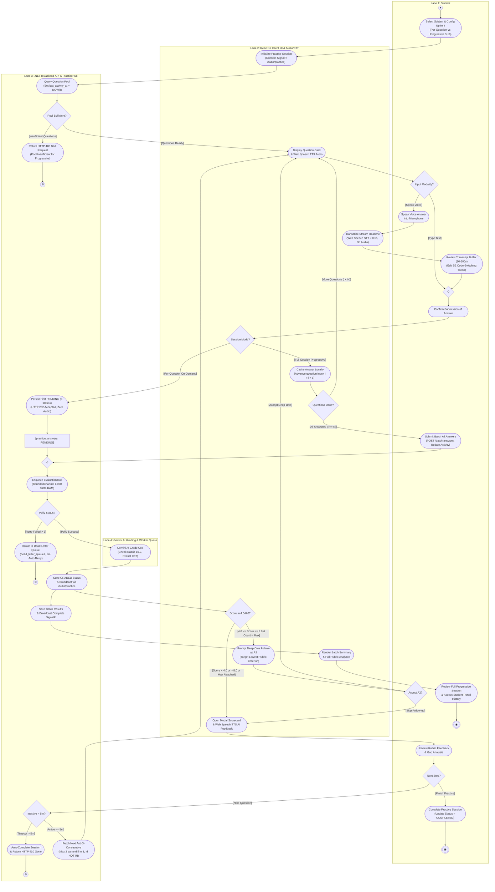

### 1.5. Phần B — Lưu Đồ Thuật Toán Chuyên Sâu (Algorithmic Flowchart)

Sơ đồ dưới đây bóc tách toàn diện 4 thuật toán lõi Backend của MF-01: (1) Anti-3-Consecutive, (2) Chia đều Full-Session Progressive 3–10 câu kèm HTTP 400, (3) Lazy Inactivity Timeout 5 phút trả HTTP 410 Gone, (4) Phòng thủ 4 tầng và kích hoạt Follow-up A2 theo tiêu chí yếu nhất:

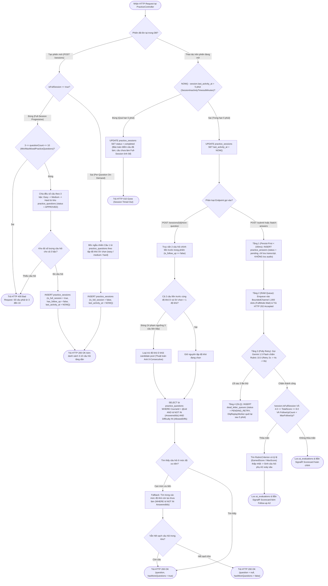

### 1.6. Phần C — Vòng Đời Trạng Thái (State Machine Diagram)

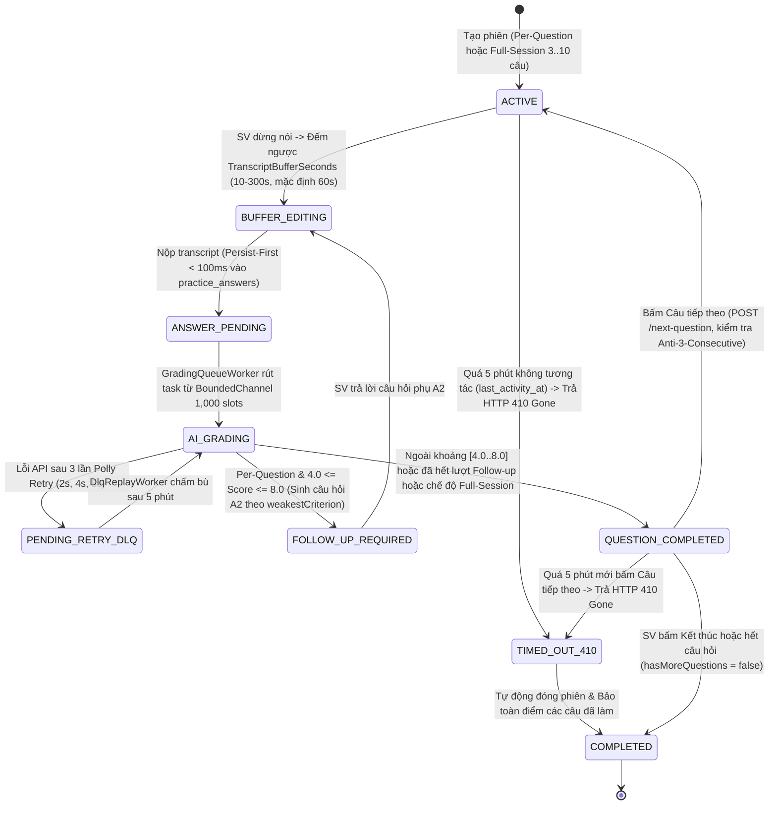

---

## PHẦN 2. LUỒNG MF-02: SINH VIÊN THI THỬ VẤN ĐÁP BẤM GIỜ
*(MF-02: TIMED MOCK EXAM WITH QUOTA & VOICE-FIRST GATE)*

* **Tài nguyên trực quan:** [Tệp sơ đồ Draw.io](../05_diagrams/MF02_Timed_Mock_Exam.drawio) (4 Phân làn, 45 đỉnh, 50 cạnh, 3 nút kết thúc)

### 2.1. Mục Tiêu Nghiệp Vụ
Mô phỏng áp lực phòng thi vấn đáp chính thức có giới hạn thời gian nghiêm ngặt. Áp dụng hai chốt chặn cốt lõi: **Daily Quota Guard** (hạn ngạch thi thử tối đa trong ngày do Admin cấu hình theo môn `max_mock_exams_per_day` để chống lạm dụng token AI, không khóa cứng K=3; Trưởng Bộ Môn cấu hình cấu trúc đề, Bloom và thời lượng) và **Voice-First Gate** (bắt buộc phải phát biểu qua micro, khóa cứng ô nhập liệu văn bản nhằm rèn luyện phản xạ phát âm thực tế dưới áp lực thời gian). Đặc biệt, hệ thống cung cấp **Instant Feedback Scorecard chi tiết** (Điểm từng tiêu chí Rubric, ưu điểm, thiếu sót kiến thức, gợi ý cải thiện) ngay tại màn hình kết quả và lưu trữ vĩnh viễn trong mục **Lịch sử thi** (`Exam History`) để phục vụ ôn tập cá nhân hóa.

### 2.2. Bốn Phân Làn Trách Nhiệm (4 Swimlanes)
1. **Lane 1: Student (Sinh viên)**:
   - Chọn môn thi thử $\to$ Chủ động tự chọn chế độ: Có Follow-up hoặc Không Follow-up $\to$ Xác nhận thông báo nếu đã hết lượt $\to$ Phát biểu qua micro $\to$ Chỉnh sửa từ vựng trên ô đệm $\to$ Bấm lưu từng câu $\to$ Bấm nộp bài thi $\to$ Xem Instant Feedback Scorecard chi tiết (tiêu chí Rubric, ưu điểm, lỗ hổng kiến thức, gợi ý cải thiện) hoặc xem lại bất cứ lúc nào trong Lịch sử thi.
2. **Lane 2: React 19 Client UI & Voice-First Gate (Giao diện Web & Đồng hồ Đếm ngược)**:
   - Kiểm tra hạn ngạch $\to$ Bật đồng hồ đếm ngược $\to$ Hiển thị câu hỏi và khóa ô gõ phím $\to$ Bóc băng giọng nói STT $\to$ Mở khóa ô đệm sau khi nói $\to$ Tự động thu bài khi hết giờ (`00:00`) $\to$ Gửi bài nộp $\to$ Mở modal hiển thị Instant Feedback Scorecard chi tiết kèm biểu đồ năng lực.
3. **Lane 3: .NET 8 Backend API & Quota Handler (Backend & Đồng hồ Chủ Server)**:
   - Truy vấn hạn ngạch trong PostgreSQL $\to$ Trừ 1 lượt thi và bốc ngẫu nhiên $N$ câu hỏi từ kho `practice_questions` $\to$ Kích hoạt Server Master Timer (chống gian lận sửa giờ máy trạm) $\to$ Lưu bài nộp `PENDING` $\to$ Điều phối chấm nhanh Fast-Path hoặc đưa vào hàng đợi nền Async Fallback $\to$ Lưu trữ kết quả và Scorecard vào bảng `mock_exam_sessions` phục vụ tra cứu Lịch sử thi.
4. **Lane 4: Gemini AI Grading Engine (Dịch vụ Chấm điểm AI)**:
   - Gemini 1.5 Flash chấm toàn bộ $N$ câu trả lời theo Barem Rubric 10.0 qua chuỗi CoT và trả về điểm số tổng hợp kèm vector điểm tiêu chí, phân tích ưu điểm (strengths), thiếu sót kiến thức (weaknesses) và gợi ý cải thiện hành động (actionable suggestions) cho từng câu.

### 2.3. Diễn Giải Quy Trình Theo Từng Bước (Tên : Mục Đích)
* **Start Mock Exam (`M_INIT`)**: Khởi đầu quy trình thi thử vấn đáp bấm giờ.
* **Select Subject & Follow-up Mode (`M01`)**: Sinh viên chọn môn học và chủ động chọn Có/Không Follow-up (AI hỏi chuyên sâu theo ngữ cảnh, không chọn topic/độ khó).
* **Request Daily Quota Check (`M02`)**: Gửi yêu cầu kiểm tra hạn ngạch thi thử trong ngày lên Backend API.
* **Check Daily Quota Limit (`M03`)**: Backend truy vấn hạn ngạch kiểm tra đối chiếu `Course.MaxMockExamsPerDay`.
* **Quota Available? (`MD01`)**: Phân nhánh: nếu hết hạn ngạch $\to$ hiển thị cảnh báo giới hạn lượt thi (`Display Quota Limit Alert` - `M04`), sinh viên xác nhận chuyển sang luyện tập (`Confirm Alert & Switch to Practice` - `M06`) và kết thúc luồng (`MF01`); nếu còn lượt $\to$ trừ 1 lượt và bốc đề (`Deduct Quota & Fetch Question Set` - `M07`).
* **Fork Timers (`FORK_TIMERS`)**: Kích hoạt thanh đồng bộ song song khởi chạy đồng thời `Start Countdown Timer` (`M09`) và `Start Server Master Timer` (`M08`).
* **Join Timers (`JOIN_TIMERS`)**: Hội tụ đồng bộ đồng hồ thi.
* **Display Question & Lock Text Input (`M10`)**: Hiển thị câu hỏi và khóa cứng 100% bàn phím (Voice-First Gate), bắt buộc phải trả lời qua micro.
* **Speak Voice Answer (`M11`)**: Sinh viên phát biểu câu trả lời qua micro tai nghe.
* **Transcribe Voice Stream (`M12`)**: Web Speech STT bóc băng thời gian thực dưới 0.5s không lưu file âm thanh.
* **Unlock Transcript Edit Buffer & Edit Technical Terms (`M13`, `M14`)**: Mở khóa ô đệm trong 10–300s (mặc định 60s) để sinh viên sửa lỗi Code-Switching.
* **Confirm & Save Answer Transcript (`M15`)**: Ghi nhận câu trả lời vào `mock_exam_answers`.
* **Has Follow-up? (`MD02`)**: Nếu sinh viên chọn Có Follow-up $\to$ phân tích ngữ cảnh (`Evaluate Answer Context` - `M16`); nếu Không $\to$ chuyển sang kiểm tra tiến độ (`MD05`).
* **AI Needs Follow-up? (`MD03`)**: Nếu AI phát hiện luận điểm cần đào sâu $\to$ phát câu hỏi phụ (`Play Follow-up Question Audio` - `M17`), sinh viên trả lời micro (`Speak Follow-up Answer` - `M18`), bóc băng (`Transcribe Follow-up Stream` - `M19`), sửa đệm (`Unlock Follow-up Edit Buffer` - `M20`, `Edit & Confirm Follow-up Transcript` - `M21`); nếu đã rõ ý $\to$ bỏ qua.
* **Follow-up < Max? (`MD04`)**: Đảm bảo số câu hỏi phụ không vượt quá giới hạn Trưởng BM cấu hình $\to$ hội tụ tại `M_MERGE_DONE`.
* **Exam Progress? (`MD05`)**: Nếu còn câu $\to$ chuyển câu tiếp theo; nếu hết câu $\to$ sinh viên chủ động nộp bài (`Submit Mock Exam` - `M22`); nếu hết giờ $\to$ tự động thu bài khi chạm 00:00 (`Auto-Submit Exam on Timeout` - `M23`). **Câu chưa làm tính là bỏ trống, không chấm**.
* **Send Exam Submission (`M24`)**: Client gửi gói bài nộp lên Backend.
* **Save Pending Exam Submission (`M25`)**: Lưu DB trạng thái `PENDING` trong $< 100$ms, trả `HTTP 202 Accepted`.
* **System Load? (`MD06`)**: Điều phối tải:
  - Nhánh Fast-Path ($< 10$s): Chấm tức thì theo Rubric (`Grade Answers by Rubric` - `M26`) $\to$ lưu điểm và phát SignalR (`Save Graded Results & Broadcast` - `M27`) $\to$ hiển thị bảng điểm CLO (`Display Instant CLO Scorecard` - `M28`) $\to$ sinh viên xem điểm (`Review CLO Scorecard & History` - `M29`) $\to$ kết thúc toàn bộ (`MF02_FINAL`).
  - Nhánh Async Fallback (Khi tải cao): Đẩy vào hàng đợi chấm ngầm (`Enqueue Background Grading Task` - `M30`) $\to$ hiện thông báo chấm nền (`Display Async Grading Notice` - `M31`) $\to$ sinh viên xác nhận thoát (`Acknowledge Notice & Exit` - `M32`) $\to$ kết thúc nhánh (`MF02_ASYNC`).

### 2.4. Phần A — Sơ Đồ Hoạt Động Liên Làn (OMG UML 2.5 Swimlane Activity Diagram)

Sơ đồ Mermaid dưới đây biểu diễn đầy đủ và chính xác 100% cấu trúc 4 Swimlanes, 45 đỉnh toán học, cặp Fork/Join Bar đồng bộ đồng hồ, Decision guards, Flow Final và Activity Final đồng bộ với tệp `MF02_Timed_Mock_Exam.drawio`:

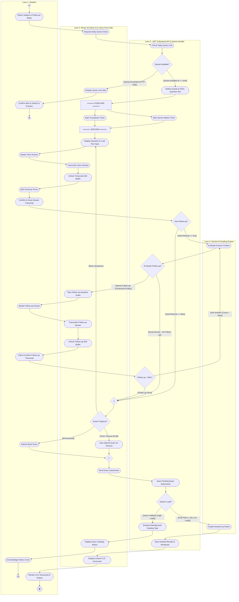

### 2.5. Phần B — Lưu Đồ Thuật Toán Chuyên Sâu (Algorithmic Flowchart)

```mermaid
flowchart TD
    M2_Start(["Sinh viên gửi POST /api/v1/mock-exams/sessions { courseId, hasFollowUp }"]) --> M2_ReadCfg["Truy vấn Course.MaxMockExamsPerDay (do Admin cấu hình theo môn) & bảng mock_exam_quotas (quota_date = TODAY)"]
    M2_ReadCfg --> M2_QuotaCheck{"used_attempts >= Course.MaxMockExamsPerDay?"}

    M2_QuotaCheck -- "Đúng (Vượt hạn ngạch ngày)" --> M2_Block429(["Trả HTTP 429 Too Many Requests -> Giao diện khóa nút thi thử & Điều hướng sang MF-01"])
    M2_QuotaCheck -- "Sai (Còn lượt hợp lệ)" --> M2_LoadStruct["Đọc cấu hình đề thi thử của môn (ExamStructure: Thời lượng phút, tổng số câu, tỷ lệ Bloom do Trưởng BM thiết lập)"]
    M2_LoadStruct --> M2_SamplePool["Rút ngẫu nhiên N câu từ kho practice_questions (status = APPROVED, cô lập 100% với kho exam_questions)"]
    M2_SamplePool --> M2_InitSession["Tăng used_attempts + 1; INSERT mock_exam_sessions (status = in_progress, has_follow_up, started_at = NOW, expected_end_time = NOW + Duration)"]

    M2_InitSession --> M2_QuestionLoop["Duyệt qua từng câu hỏi i (1 <= i <= N) trên giao diện phòng thi"]
    M2_QuestionLoop --> M2_LockInput["VOICE-FIRST GATE: Khóa cứng ô nhập liệu Textarea (disabled = true)"]
    M2_LockInput --> M2_HasAudio{"Trình duyệt phát hiện luồng thu âm Micro hợp lệ & STT trả transcript?"}
    M2_HasAudio -- "Chưa thu âm" --> M2_CheckTimer1{"Đồng hồ chạm mốc expected_end_time?"}
    M2_CheckTimer1 -- "Chưa hết giờ" --> M2_LockInput
    M2_CheckTimer1 -- "Hết giờ làm bài" --> M2_AutoSubmit["Kích hoạt Auto-Submit: Thu bài tự động ngay lập tức"]

    M2_HasAudio -- "Đã thu âm xong" --> M2_UnlockEdit["Mở khóa Textarea trong khoảng TranscriptBufferSeconds (10-300s, mặc định 60s do Admin cấu hình)"]
    M2_UnlockEdit --> M2_CheckFUFlag{"session.has_follow_up == true?"}
    M2_CheckFUFlag -- "Đúng (SV chọn Có Follow-up)" --> M2_ContextCheck{"AI đánh giá nhanh ngữ cảnh: Luận điểm cần đào sâu phản biện [Needs Follow-up]?"}
    M2_ContextCheck -- "Cần phản biện (Tối đa 1-5 câu, mặc định 2)" --> M2_AskContextFU["Phát câu hỏi phụ qua TTS -> SV trả lời qua Micro (Voice-First) -> Lưu transcript phụ"]
    M2_ContextCheck -- "Trả lời đã rõ ý" --> M2_SaveTemp["Ghi nhận câu trả lời i vào bộ nhớ phiên (KHÔNG lưu file audio R2)"]
    M2_CheckFUFlag -- "Sai (SV chọn Không Follow-up)" --> M2_SaveTemp
    M2_AskContextFU --> M2_SaveTemp

    M2_SaveTemp --> M2_MoreQ{"Còn câu hỏi tiếp theo VÀ chưa hết giờ?"}
    M2_MoreQ -- "Còn câu & Còn giờ" --> M2_QuestionLoop
    M2_MoreQ -- "Đã làm xong hoặc Hết giờ" --> M2_AutoSubmit

    M2_AutoSubmit --> M2_FilterAns["Persist-First (< 100ms): Lưu mock_exam_answers (Câu chưa trả lời đánh dấu bỏ trống, tuyệt đối KHÔNG đưa vào chấm AI)"]
    M2_FilterAns --> M2_Dispatch{"Dual-Path Grading Dispatcher: Kiểm tra độ trễ AI (< 10s)?"}
    M2_Dispatch -- "Fast-Path (Phản hồi trong 10s)" --> M2_SyncGrade["Gemini 1.5 Flash chấm toàn bộ câu đã làm theo Rubric 10.0 -> Tổng hợp Scorecard theo CLO"]
    M2_SyncGrade --> M2_PushLive(["UPDATE mock_exam_sessions (status = completed) & Đẩy Instant Scorecard qua SignalR"])
    M2_Dispatch -- "Async Fallback (Quá 10s / Hàng đợi bận)" --> M2_QueueGrade["Đẩy vào BoundedChannel 1,000 slots + Polly Retry (2-4-8s) + DLQ -> Chấm ngầm hoàn tất"]
    M2_QueueGrade --> M2_SaveHistory(["UPDATE mock_exam_sessions (status = completed) & Lưu vĩnh viễn vào Lịch sử thi (GET /api/v1/mock-exams/history)"])
```

### 2.6. Phần C — Vòng Đời Trạng Thái (State Machine Diagram)

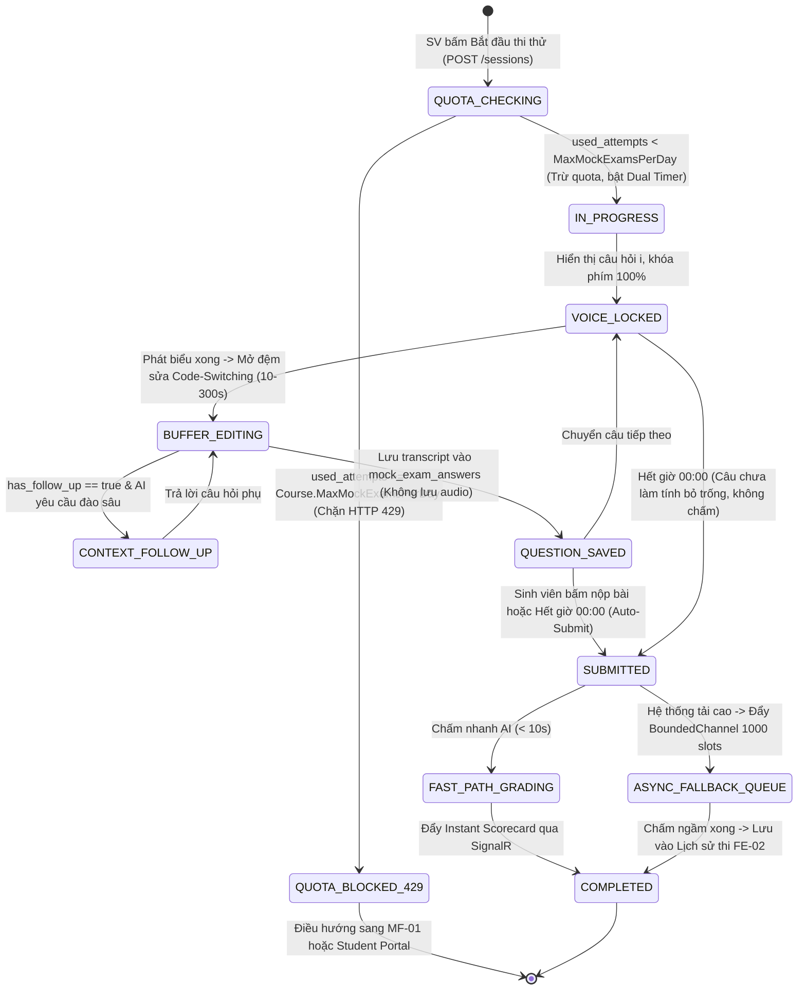

---

## PHẦN 3. LUỒNG MF-03: QUẢN LÝ NGÂN HÀNG CÂU HỎI & BAREM RUBRIC
*(MF-03: QUESTION BANK & RUBRIC STUDIO — NÂNG CẤP FLM AI QUESTION GENERATOR)*

* **Tài nguyên trực quan:** [Tệp sơ đồ Draw.io](../05_diagrams/MF03_Question_Bank_Rubric.drawio) (5 Phân làn tách riêng GV và Trưởng BM, 60 đỉnh, 68 cạnh, 2 nút kết thúc)

### 3.1. Mục Tiêu Nghiệp Vụ
Cung cấp công cụ chuyên biệt cho **Giảng viên (`lecturer`)** và **Trưởng Bộ Môn (`department_head`)** thiết kế, quản lý ngân hàng câu hỏi vấn đáp và barem chấm điểm Rubric theo **chuẩn thang điểm 10.0 bắt buộc ($\sum \equiv 10.0$đ)**.

Đặc biệt, hệ thống hỗ trợ hai phương thức khởi tạo:
1. **Sinh câu hỏi tự động từ Syllabus FLM theo CLO:** Giảng viên và Trưởng BM kết nối FLM Adapter lấy chuẩn đầu ra CLO, cấu hình mức Bloom (1-6) và số lượng câu $\to$ Gemini 1.5 Flash tự động sinh Đề bài, Barem Rubric $\sum \equiv 10.0$đ và Model Answer $\ge 50$ ký tự. Giảng viên xem trước (Preview), tùy biến theo barem riêng và kiểm thử độ nhạy qua AI Calibration Simulator.
2. **Soạn câu hỏi thủ công (`source == "manual"`):** Hỗ trợ đính kèm sơ đồ kỹ thuật (UML, ERD, Kiến trúc Clean Architecture, UI Mockup) định dạng `PNG/JPG/WEBP` $\le 5$MB. Hệ thống kiểm tra chữ ký Magic Bytes chặt chẽ (chặn `HTTP 413 Payload Too Large` nếu $> 5$MB, `HTTP 415 Unsupported Media Type` nếu sai định dạng), stream trực tiếp lên Cloudflare R2, lưu `image_url` và bắt buộc nhập `image_description` để Gemini 1.5 Flash chấm đa phương thức (Multimodal CoT) chuẩn xác.

**Tick chọn 2 kho câu hỏi:** Giảng viên tick chọn lưu vào `practice_questions` (phục vụ MF-01 và MF-02) và/hoặc `exam_questions` (cô lập tuyệt đối cho MF-04). Sau khi hoàn thiện, Giảng viên ấn **Gửi lên cho Bộ Môn (`POST /api/v1/questions/batch-submit-review`)**, chuyển trạng thái sang `SUBMITTED_FOR_REVIEW`. **Trưởng Bộ Môn (`department_head`)** là người duy nhất có thẩm quyền thẩm định và ra quyết định: Phê duyệt (`APPROVED` - kích hoạt trong ngân hàng đề), Yêu cầu sửa (`NEEDS_REVISION` kèm `review_notes` trả về Giảng viên sửa), hoặc Từ chối loại bỏ (`REJECTED` kèm `review_notes`).

### 3.2. Năm Phân Làn Trách Nhiệm (5 Swimlanes)
1. **Lane 1: Lecturer (Question Author - Giảng viên Tác giả đề)**:
   - Truy cập Question Studio, chọn phương thức khởi tạo (tra cứu catalog, sửa câu hỏi cũ/bị yêu cầu sửa, soạn thủ công đính kèm ảnh kỹ thuật $\le 5$MB, hoặc sinh tự động từ FLM) $\to$ Thiết kế tiêu chí Rubric chuẩn $\sum \equiv 10.0$đ, Model Answer $\ge 50$ ký tự $\to$ Tick chọn 2 kho (`practice_questions` / `exam_questions`) $\to$ Chạy AI Simulator thử nghiệm độ nhạy $\to$ Bấm "Gửi lên cho Bộ Môn" (`POST /batch-submit-review`). Nhận thông báo chỉnh sửa khi Trưởng BM yêu cầu `NEEDS_REVISION`.
2. **Lane 2: Question & Rubric Studio UI (Giao diện Studio Quản trị & Preview)**:
   - Render giao diện danh mục câu hỏi, form biên soạn, modal xem trước Preview Studio và cây đề cương CLOs từ FLM Adapter $\to$ Real-time Client Guard tính tổng điểm: tính $\sum \text{MaxScore}_j$, hiển thị cảnh báo đỏ và khóa cứng nút Lưu/Gửi duyệt nếu lệch 10.0đ hoặc Model Answer $< 50$ ký tự $\to$ Hiển thị kết quả AI Simulator $\to$ Hiển thị thông báo phê duyệt thành công.
3. **Lane 3: .NET 8 Backend API & R2 (Cổng Kiểm định Backend & Lưu Trữ)**:
   - Xác thực quyền RBAC qua JWT Claims $\to$ Cung cấp endpoint trích xuất đề cương FLM $\to$ Tiếp nhận upload ảnh kỹ thuật (kiểm tra Magic Bytes PNG/JPG/WEBP $\le 5$MB, trả HTTP 413/415) và stream lên Cloudflare R2 $\to$ Thẩm định độc lập tổng điểm $\sum = 10.0$đ và Model Answer $\ge 50$ ký tự qua FluentValidation (chặn HTTP 422 nếu vi phạm) $\to$ ACID Transaction ghi nhận Questions, Rubrics, RubricCriteria và AuditLog vào PostgreSQL $\to$ Cập nhật trạng thái duyệt đề và vô hiệu hóa cache khi được phê duyệt.
4. **Lane 4: Gemini AI Generator & Simulator (Dịch vụ AI Sinh Đề & Hiệu Chuẩn)**:
   - Gemini 1.5 Flash phân tích dữ liệu CLO từ Syllabus FLM, tự động sinh câu hỏi, barem rubric $\sum = 10.0$đ và Model Answer $\ge 50$ ký tự $\to$ Chấm thử nghiệm câu trả lời giả định trong AI Calibration Simulator để giúp Giảng viên hiệu chuẩn trọng số tiêu chí.
5. **Lane 5: Department Head (Approver - Trưởng Bộ Môn Phê duyệt)**:
   - Mở Cổng Thẩm Định (Approval Studio), xem danh sách câu hỏi `SUBMITTED_FOR_REVIEW` $\to$ Đối chiếu đề bài, ảnh sơ đồ kỹ thuật, Model Answer và Barem 10.0đ với chuẩn đầu ra CLO $\to$ Ra quyết định thẩm định (`POST /questions/{id}/review-decision`): Phê duyệt chính thức (`APPROVED`), Yêu cầu chỉnh sửa (`NEEDS_REVISION` kèm `review_notes`), hoặc Từ chối loại hẳn (`REJECTED` kèm `review_notes`).

### 3.3. Diễn Giải Quy Trình Theo Từng Bước (Tên : Mục Đích)
* **Access Studio (`Q01`, `Q02`, `Q03`, `Q04`)**: Giảng viên truy cập Question Studio, hệ thống xác thực RBAC claims và render không gian làm việc.
* **Select Authoring Mode? (`D_AuthorMode`)**: Lựa chọn 1 trong 4 nhánh tác vụ:
  - *Nhánh 1 [Browse / Filter]:* Lọc catalog theo môn, Bloom, độ khó, trạng thái duyệt (`Q_Browse_Filter` $\to$ `Q_Browse_Query` $\to$ `Q_Browse_Render`).
  - *Nhánh 2 [Edit Existing]:* Chọn câu hỏi cần sửa (`Q_Edit_Select` $\to$ `Q_Edit_Fetch` $\to$ `Q_Edit_Form`).
  - *Nhánh 3 [Manual Authoring]:* Soạn đề bài, tick chọn 2 kho (`Q_Man_Start`), kiểm tra đính kèm ảnh (`D_Man_Image`). Nếu có ảnh $\to$ kiểm tra Magic Bytes $\le 5$MB, upload R2 (`Q_Man_Upload`, `Obj_R2_Image`), gắn `image_url` và bắt buộc nhập `image_description` (`Q_Man_Attach`).
  - *Nhánh 4 [Generate from FLM]:* Chọn môn và lấy đề cương CLO từ FLM (`Q_FLM_Req`, `Q_FLM_Fetch`, `Q_FLM_RenderTree`) $\to$ cấu hình tham số (`Q_FLM_Config`) $\to$ gửi yêu cầu sinh đề (`Q_FLM_Dispatch`) $\to$ Gemini 1.5 Flash sinh câu hỏi, Rubric 10.0 và Model Answer (`Q_FLM_AIGen`) $\to$ mở Draft Preview Studio (`Q_FLM_Preview`) $\to$ Giảng viên tùy chỉnh Barem và tick chọn 2 kho (`Q_FLM_Customize`).
* **Calculate & Check Rubric Sum (`Q_Rubric_Calc`, `D_Rubric_Sum`)**: Client Guard tính $\sum \text{MaxScore}_j$: nếu lệch 10.0đ $\to$ cảnh báo đỏ, khóa nút gửi duyệt (`Q_Rubric_Warn`) và yêu cầu sửa lại (`Q_Rubric_Adjust`); nếu chuẩn 10.0đ $\to$ mở khóa.
* **Run AI Simulator? (`D_Simulator`)**: Tùy chọn chạy AI Calibration Simulator: nhập câu trả lời giả định (`Q_Sim_Input`) $\to$ Gemini chấm thử và trích xuất CoT (`Q_Sim_Dispatch`, `Q_Sim_AI`) $\to$ hiển thị Scorecard (`Q_Sim_Show`) $\to$ đánh giá Barem (`D_Sim_Check`).
* **Submit to Department Head (`Q_Submit_Review`)**: Giảng viên bấm nút gửi duyệt Bộ Môn qua `POST /batch-submit-review`.
* **Backend FluentValidation (`Q_Val_Backend`, `D_Val_Backend`)**: Backend kiểm tra độc lập $\sum \equiv 10.0$đ và Model Answer $\ge 50$ ký tự: nếu vi phạm $\to$ chặn trả `HTTP 422 Unprocessable Entity` (`Q_Val_422`); nếu hợp lệ $\to$ lưu CSDL trạng thái `SUBMITTED_FOR_REVIEW` (`Q_Persist_Review`, `Obj_State_Review`).
* **Department Head Decision (`Q_Dept_Open`, `Q_Dept_Inspect`, `D_Dept_Decision`)**: Trưởng Bộ Môn mở Approval Studio thẩm định:
  - *Nhánh NEEDS_REVISION:* Nhập `review_notes` $\ge 10$ ký tự (`Q_Dept_Revise`) $\to$ lưu CSDL (`Q_DB_Revise`) $\to$ thông báo phản hồi về cho Giảng viên (`Q_UI_Revise`) $\to$ Giảng viên mở lại form sửa (`Q_Lec_Revise`).
  - *Nhánh REJECTED:* Nhập lý do (`Q_Dept_Reject`) $\to$ cập nhật CSDL loại khỏi ngân hàng đề (`Q_DB_Reject`) $\to$ kết thúc luồng (`End_Reject`).
  - *Nhánh APPROVED:* Bấm phê duyệt (`Q_Dept_Approve`) $\to$ ACID Transaction commit câu hỏi vào kho đã tick (`practice_questions` / `exam_questions`), xóa cache (`Q_DB_Approve`, `Obj_State_Approved`) $\to$ hiển thị banner thành công (`Q_Sync_UI`) $\to$ xem catalog đã cập nhật (`Q_Catalog_View`) $\to$ kết thúc toàn bộ (`Q_End_Final`).

### 3.4. Phần A — Sơ Đồ Hoạt Động Liên Làn (OMG UML 2.5 Swimlane Activity Diagram)

Sơ đồ Mermaid dưới đây biểu diễn đầy đủ 5 Swimlanes tách biệt rõ ràng ranh giới trách nhiệm giữa Giảng viên và Trưởng Bộ Môn, 60 đỉnh toán học, các ký hiệu OMG UML 2.5 chuẩn hóa đồng bộ với tệp `MF03_Question_Bank_Rubric.drawio`:

```mermaid
flowchart TD
    subgraph Lane1 ["Lane 1: Lecturer (Question Author)"]
        Q01((●))
        Q02(["Access Question Bank & Rubric Studio"])
        Q_Browse_Filter(["Apply Filters (Course, Bloom 1-6, Difficulty, Approval Status)"])
        Q_Edit_Select(["Select Question to Edit (DRAFT or NEEDS_REVISION)"])
        Q_Man_Start(["Enter Question Content & Select Target Pools (practice/exam)"])
        D_Man_Image{"Attach Technical Diagram?"}
        M_Man_Img{"◇"}
        Q_FLM_Req(["Select Course & Request Syllabus/CLOs from FLM"])
        Q_FLM_Config(["Select Target CLOs, Bloom 1-6, Difficulty & Question Count"])
        Q_FLM_Customize(["Customize Rubric, Refine Model Ans & Tick Target Pools"])
        M_Author_Done{"◇"}
        Q_Rubric_Adjust(["Adjust Criteria Points to exactly 10.0"])
        D_Simulator{"Run AI Calibration Simulator?"}
        Q_Sim_Input(["Input Test Student Answer (High / Medium / Low)"])
        D_Sim_Check{"Criteria Weights Satisfactory?"}
        M_Sim_Done{"◇"}
        Q_Submit_Review(["Lecturer Submits Batch (POST /batch-submit-review)"])
        Q_Lec_Revise(["Lecturer Re-opens Question Form to Revise"])
        Q_Catalog_View(["View Updated Question Catalog (Ready for MF-01/02/04)"])
        Q_End_Final(((◉)))
    end

    subgraph Lane2 ["Lane 2: Question & Rubric Studio UI"]
        Q04(["Render Question Studio Workspace"])
        M_Studio{"◇"}
        D_AuthorMode{"Select Authoring Mode?"}
        Q_Browse_Render(["Display Paginated Question Grid & Details Modal"])
        Q_Edit_Form(["Populate Question Form & Revision Feedback"])
        Q_Man_Attach(["Attach Image URL & Description for Gemini Multimodal CoT"])
        Q_FLM_RenderTree(["Render Syllabus Tree & Target CLO Selector"])
        Q_FLM_Preview(["Render Draft Preview Studio & Side-by-Side Comparison"])
        Q_Rubric_Calc(["Calculate Real-time Total Points (∑ MaxScore_j)"])
        D_Rubric_Sum{"∑ == 10.0?"}
        Q_Rubric_Warn(["Show Red Invariant Warning & Disable Submit Actions"])
        Q_Sim_Show(["Display Calibration Scorecard & Feedback Analysis"])
        Q_Val_422(["Display 422 Validation Error Alert"])
        Q_UI_Revise(["Notify Lecturer with Revision Feedback (review_notes)"])
        Q_Sync_UI(["Display Approval Success Banner & Update Bank Catalog"])
    end

    subgraph Lane3 ["Lane 3: .NET 8 Backend API & R2"]
        Q03(["Verify RBAC Claims (Role in [lecturer, department_head])"])
        Q_Browse_Query(["Query Question Catalog & Rubrics (GET /api/v1/questions)"])
        Q_Edit_Fetch(["Fetch Question, Rubric & Revision Notes from DB"])
        Q_Man_Upload(["POST /upload-image: Check Magic Bytes (413/415) & Stream R2"])
        Obj_R2_Image["[Diagram Sealed on Cloudflare R2: image_url + image_desc]"]
        Q_FLM_Fetch(["GET /syllabus via FLM Adapter (Polly Retry 3x: 2s, 4s, 8s)"])
        Q_FLM_Dispatch(["POST /generate-from-flm (Dispatch Generation Request)"])
        Q_Sim_Dispatch(["POST /api/v1/questions/simulate-grading"])
        Q_Val_Backend(["Backend FluentValidation: Validate ∑==10.0 & Ans>=50"])
        D_Val_Backend{"Valid ∑==10.0 & Ans>=50?"}
        Q_Persist_Review(["ACID Persist: Save DRAFT & Set Status = SUBMITTED_FOR_REVIEW"])
        Obj_State_Review["[Question & Rubric: SUBMITTED_FOR_REVIEW]"]
        Q_DB_Revise(["Update Status = NEEDS_REVISION & Record review_notes in DB"])
        Q_DB_Reject(["Update Status = REJECTED, Save AuditLog & Discard Question"])
        End_Reject((⊗))
        Q_DB_Approve(["ACID: Status = APPROVED, Commit Target Pools & Invalidate Cache"])
        Obj_State_Approved["[Question & Rubric: APPROVED in Target Banks]"]
    end

    subgraph Lane4 ["Lane 4: Gemini AI Generator & Simulator"]
        Q_FLM_AIGen(["Gemini 1.5 Flash: Auto-Gen Questions, Model Ans & Rubric (∑=10.0)"])
        Q_Sim_AI(["Gemini 1.5 Flash: Grade Test Answer against Rubric & Trace CoT"])
    end

    subgraph Lane5 ["Lane 5: Department Head (Approver)"]
        Q_Dept_Open(["Open Approval Studio: View Pending (SUBMITTED_FOR_REVIEW)"])
        Q_Dept_Inspect(["Inspect Question Content, Diagram, Model Ans & Rubric 10.0"])
        D_Dept_Decision{"Dept Head Decision?"}
        Q_Dept_Revise(["Enter Revision Notes (review_notes >= 10 chars) & Request"])
        Q_Dept_Reject(["Enter Rejection Reason (>= 10 chars) & Reject Question"])
        Q_Dept_Approve(["Approve Question Batch (POST /review-decision)"])
    end

    Q01 --> Q02
    Q02 --> Q03
    Q03 --> Q04
    Q04 --> M_Studio
    M_Studio --> D_AuthorMode
    D_AuthorMode -->|"[Browse / Filter Catalog]"| Q_Browse_Filter
    D_AuthorMode -->|"[Edit Existing Question]"| Q_Edit_Select
    D_AuthorMode -->|"[Manual Authoring]"| Q_Man_Start
    D_AuthorMode -->|"[Generate from FLM Syllabus]"| Q_FLM_Req
    Q_Browse_Filter --> Q_Browse_Query
    Q_Browse_Query --> Q_Browse_Render
    Q_Browse_Render --> M_Studio
    Q_Edit_Select --> Q_Edit_Fetch
    Q_Edit_Fetch --> Q_Edit_Form
    Q_Edit_Form --> M_Author_Done
    Q_Man_Start --> D_Man_Image
    D_Man_Image -->|"[Attach Diagram]"| Q_Man_Upload
    D_Man_Image -->|"[No Diagram]"| M_Man_Img
    Q_Man_Upload --> Obj_R2_Image
    Obj_R2_Image --> Q_Man_Attach
    Q_Man_Attach --> M_Man_Img
    M_Man_Img --> M_Author_Done
    Q_FLM_Req --> Q_FLM_Fetch
    Q_FLM_Fetch --> Q_FLM_RenderTree
    Q_FLM_RenderTree --> Q_FLM_Config
    Q_FLM_Config --> Q_FLM_Dispatch
    Q_FLM_Dispatch --> Q_FLM_AIGen
    Q_FLM_AIGen --> Q_FLM_Preview
    Q_FLM_Preview --> Q_FLM_Customize
    Q_FLM_Customize --> M_Author_Done
    M_Author_Done --> Q_Rubric_Calc
    Q_Rubric_Calc --> D_Rubric_Sum
    D_Rubric_Sum -->|"[Sum != 10.0 (Invalid)]"| Q_Rubric_Warn
    D_Rubric_Sum -->|"[Sum == 10.0 (Valid)]"| D_Simulator
    Q_Rubric_Warn --> Q_Rubric_Adjust
    Q_Rubric_Adjust --> Q_Rubric_Calc
    D_Simulator -->|"[Run AI Simulator]"| Q_Sim_Input
    D_Simulator -->|"[Skip Simulator]"| M_Sim_Done
    Q_Sim_Input --> Q_Sim_Dispatch
    Q_Sim_Dispatch --> Q_Sim_AI
    Q_Sim_AI --> Q_Sim_Show
    Q_Sim_Show --> D_Sim_Check
    D_Sim_Check -->|"[Need Weight Adjustment]"| M_Author_Done
    D_Sim_Check -->|"[Weights Satisfactory]"| M_Sim_Done
    M_Sim_Done --> Q_Submit_Review
    Q_Submit_Review --> Q_Val_Backend
    Q_Val_Backend --> D_Val_Backend
    D_Val_Backend -->|"[Validation Failed (HTTP 422)]"| Q_Val_422
    D_Val_Backend -->|"[Validation Passed]"| Q_Persist_Review
    Q_Val_422 --> M_Author_Done
    Q_Persist_Review --> Obj_State_Review
    Obj_State_Review --> Q_Dept_Open
    Q_Dept_Open --> Q_Dept_Inspect
    Q_Dept_Inspect --> D_Dept_Decision
    D_Dept_Decision -->|"[NEEDS_REVISION]"| Q_Dept_Revise
    D_Dept_Decision -->|"[REJECTED]"| Q_Dept_Reject
    D_Dept_Decision -->|"[APPROVED]"| Q_Dept_Approve
    Q_Dept_Revise --> Q_DB_Revise
    Q_DB_Revise --> Q_UI_Revise
    Q_UI_Revise --> Q_Lec_Revise
    Q_Lec_Revise --> M_Studio
    Q_Dept_Reject --> Q_DB_Reject
    Q_DB_Reject --> End_Reject
    Q_Dept_Approve --> Q_DB_Approve
    Q_DB_Approve --> Obj_State_Approved
    Obj_State_Approved --> Q_Sync_UI
    Q_Sync_UI --> Q_Catalog_View
    Q_Catalog_View --> Q_End_Final
```

### 3.5. Phần B — Lưu Đồ Thuật Toán Chuyên Sâu (Algorithmic Flowchart)

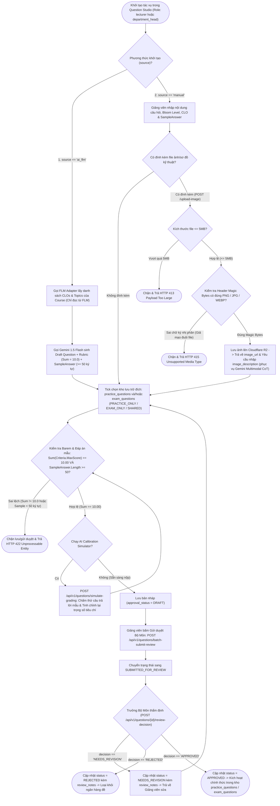

### 3.6. Phần C — Vòng Đời Trạng Thái Câu Hỏi Ngân Hàng Đề (Question State Machine)

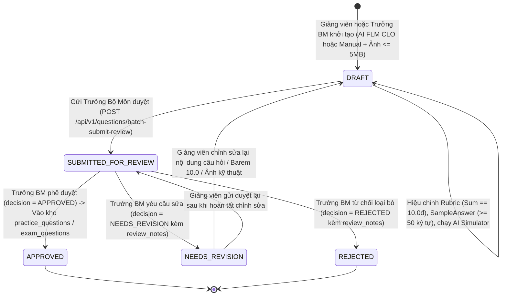

---

## PHẦN 4. LUỒNG MF-04: THI THẬT PHÒNG LAB KIOSK, CÔNG BỐ ĐIỂM & PHÚC KHẢO NỘI BỘ
*(MF-04: LAB EXAM KIOSK LOCKDOWN, LECTURER AUDIT & INTERNAL APPEALS)*

* **Tài nguyên trực quan:** [Tệp sơ đồ Draw.io](../05_diagrams/MF04_Lab_Exam_Audit.drawio) (5 Phân làn tách riêng Thí sinh, Kiosk, Worker, GV/Giám thị, Trưởng BM; 84 đỉnh, 94 cạnh, 2 nút kết thúc)

### 4.1. Mục Tiêu Nghiệp Vụ
Tổ chức kỳ thi vấn đáp kết thúc môn chính thức tại phòng máy lab có kiểm soát an ninh nghiêm ngặt kiểu IELTS. Quy trình xuất phát từ **Pha 0: Trưởng Bộ Môn (`department_head`) khởi tạo kỳ thi (`OfficialExamSession`), gán môn thi vào kỳ thi, cấu hình ca thi (`RealExamSessionShift`: phòng lab ghi ngay trên ca, gán người coi thi là GV hoặc giám thị, danh sách thí sinh lấy từ lớp đã có), cấu hình Follow-up môn thi trong kỳ thi (`has_follow_up`, `max_follow_up_questions` 1–5 câu, mặc định 2 câu) và `ExamInputMode` (`VoiceOnly`, `VoiceWithTranscriptEdit`)**. Trong phòng thi lab áp dụng các chốt chặn: **Fullscreen Kiosk Lockdown chống gian lận (blur > 3 lần đình chỉ)**, **kiểm tra micro phần cứng 30s $\ge 60$dB**, **cấu hình phương thức làm bài theo môn học `ExamInputMode` (`VoiceOnly` khóa cứng 100% bàn phím, `VoiceWithTranscriptEdit` mở đệm sửa transcript)**, **hỏi câu chuyên sâu theo ngữ cảnh khi môn thi bật cờ (1–5 câu do Trưởng BM cấu hình, mặc định 2 câu)**, **niêm phong âm thanh bằng mã băm mật mã SHA-256 stream trực tiếp lên Cloudflare R2 định danh bất biến `STT_MSSV.webm`**.

Đặc biệt, quy trình chấm điểm, hậu kiểm và công bố điểm được thiết kế chuẩn mực theo đúng quy chế Khảo thí Đại học FPT:
1. **Thi xong Kiosk KHÔNG CÓ ĐIỂM LIỀN (No Immediate Score):** Sau khi kết thúc thời gian thi hoặc bấm nộp bài, Kiosk TUYỆT ĐỐI KHÔNG hiện điểm và không cho khiếu nại tại phòng thi. Máy trạm Kiosk khóa màn hình và hiển thị thông báo: *"Bài thi đã được ghi nhận và niêm phong an toàn. Kết quả sẽ do Giảng viên thẩm định và công bố trên hệ thống."* Thí sinh ký biên bản nộp bài giấy và ra về (về nhà).
2. **AI chấm điểm ngầm & Sinh viên phải đợi Giảng viên chấm hết bài nghi ngờ hoặc fail:** Đầu vào chấm điểm của AI chỉ là bản *transcript* nhận từ hệ thống (sau bóc băng Whisper STT hoặc sau khi chỉnh sửa qua màn hình đệm nếu môn cho phép). AI (Gemini 1.5 Pro) thực hiện chấm điểm ngầm toàn bộ bài thi theo Barem Rubric 10.0, trích xuất chuỗi suy luận CoT (`ai_chain_of_thought`) và tính toán `confidence_score` kèm cờ `is_suspicious`. Hệ thống tự động phân loại kết quả thành 2 nhóm:
   - *Nhóm 1 (Cần xem lại / Fail / Đáng nghi ngờ):* Các bài có `is_suspicious == true`, `confidence_score < 0.70` (audio ồn, nói ngập ngừng, CoT mâu thuẫn, điểm ranh giới) hoặc bài thi bị fail/điểm liệt. **Sinh viên bắt buộc phải đợi Giảng viên rà soát và chấm lại toàn bộ các bài trong nhóm này**. Giảng viên mở Evidence Panel (AudioURL R2, Transcript Whisper gốc, AI CoT), nghe lại trên Waveform Player (tua theo timestamp citations, 1.0x–1.5x) để chấm và điều chỉnh lại điểm kèm lý do giải trình bắt buộc (`override_reason`).
   - *Nhóm 2 (Độ tin cậy cao):* Các bài AI chấm chuẩn xác (`confidence_score >= 0.70` và `is_suspicious == false`), giảng viên rà soát nhanh đối chiếu Evidence Panel.
3. **Sau khi Giảng viên xử lý có điểm đầy đủ mới gửi điểm về cho sinh viên (Publish Grades):** Chỉ sau khi Giảng viên đã xử lý dứt điểm tất cả bài thi nghi ngờ hoặc fail và đảm bảo **100% sinh viên trong ca thi đã có điểm hoàn chỉnh**, Giảng viên mới bấm nút **"Công Bố Điểm" (`Publish Grades`)** (`POST /api/v1/official-exams/shifts/{shiftId}/publish-grades`) một lần duy nhất. Lúc này hệ thống mới giải phóng điểm gửi về cho sinh viên, cập nhật trạng thái ca thi và vé thi thành `PUBLISHED` và kích hoạt One-Way Lock (`LOCKED`, `is_locked = true`, từ chối mọi lệnh sửa trái phép bằng `HTTP 403 Forbidden`). Đồng thời xuất file Bảng điểm Khảo thí FPT cả định dạng Excel (.xlsx) và PDF có chữ ký số cho Phòng Khảo thí.
4. **Sinh viên ở nhà nhận điểm & Phúc khảo nội bộ:** Sinh viên ở nhà đăng nhập Student Portal trên hệ thống của mình để xem bảng điểm chính thức do Giảng viên công bố (tổng điểm, điểm chi tiết rubric, nhận xét). Nếu đồng ý, sinh viên xác nhận nhận điểm (`ACKNOWLEDGED` qua `POST /api/v1/student/official-exams/{ticketId}/acknowledge-grade`). Nếu có nhu cầu phúc khảo, sinh viên làm đơn trực tiếp ở phần Phúc khảo trong hệ thống của mình (`POST /api/v1/appeals`). Hệ thống tạo entity `AppealRequest` chuyển đến Trưởng Bộ Môn (`department_head`). Trưởng Bộ Môn tiếp nhận và **giao cho một Giảng viên chấm lại** (`PUT /api/v1/appeals/{id}/assign-lecturer`). Cơ chế One-Way Lock mở đường hợp lệ cho Giảng viên được phân công chấm lại cập nhật điểm số mới sau phúc khảo.

### 4.2. Năm Phân Làn Trách Nhiệm (5 Swimlanes)
1. **Lane 1: Student (Examinee - Thí sinh)**:
   - Ngồi đúng máy thi theo STT (SeatNumber 1-40) $\to$ Chạy Mic-Check 30s $\ge 60$dB $\to$ Chờ lệnh mở đề $\to$ Trả lời viva qua micro (kèm câu hỏi phụ ngữ cảnh 1-5 câu do Trưởng BM cấu hình nếu có) $\to$ Xác nhận nộp bài $\to$ Màn hình Kiosk khóa an toàn, ký biên bản giấy ra về (0% điểm liền, 0% khiếu nại tại chỗ) $\to$ Xem điểm tại nhà trên Student Portal $\to$ Bấm Xác nhận nhận điểm (`ACKNOWLEDGED`) hoặc Nộp đơn phúc khảo nội bộ (`POST /api/v1/appeals`).
2. **Lane 2: Lab Workstation Kiosk (Máy trạm Phòng Lab Kiosk Lockdown & R2 Seal)**:
   - Xác thực SeatNumber 1-40 và kiểm tra chéo địa chỉ IP máy trạm qua trường thống nhất `ip_address` (theo quy chuẩn ip_address) $\to$ Kích hoạt Fullscreen Kiosk Lockdown (chặn F11, F12, DevTools, Alt+Tab, chuột phải, blur > 3 lần đình chỉ thi) $\to$ Đo cường độ micro 30s $\ge 60$dB $\to$ Bật Kiosk Countdown Timer $\to$ TTS đọc câu hỏi từ kho cô lập `exam_questions` $\to$ Thu âm WebM/Opus và bóc băng transcript $\to$ Đóng gói âm thanh chuẩn `STT_MSSV.webm` (vd: `01_SE170123.webm`) $\to$ Tính mã băm mật mã SHA-256 niêm phong tại máy trạm $\to$ Stream trực tiếp lên Cloudflare R2 qua Presigned URL $\to$ Gửi gói bài nộp lên Backend $\to$ Khóa an toàn máy trạm tức thì.
3. **Lane 3: .NET 8 Backend API & Worker (Hạ tầng Backend, BoundedChannel & AI Worker)**:
   - Khởi tạo ca thi trong CSDL (`SCHEDULED`, gắn trước IP & Roster) $\to$ Broadcast tín hiệu mở ca thi đồng loạt qua SignalR (`IN_PROGRESS`) $\to$ Bật Server Master Timer (đồng hồ chủ tuyệt đối) $\to$ Persist-First tiếp nhận bài nộp dưới 100ms trạng thái `SUBMITTED` lưu SHA-256 R2 $\to$ Đẩy task vào RAM BoundedChannel 1,000 slots (`FullMode.Wait`) $\to$ Background Worker rút task, điều phối Polly Retry 3 lần (2s, 4s, 8s) và cách ly DLQ 5m khi sự cố $\to$ Gọi Gemini 1.5 Pro chấm ngầm Rubric 10.0, tính CoT và `confidence_score` (`AI_GRADED`) $\to$ AI Doubt Guard phân loại 2 nhóm bài thi $\to$ Lưu kết quả hậu kiểm (`AUDITED`) $\to$ Kiểm tra Atomic Gate 100% sinh viên có điểm $\to$ Kích hoạt One-Way Lock (`PUBLISHED` $\to$ `LOCKED`, HTTP 403) $\to$ Xuất báo cáo Khảo thí Excel (.xlsx) + PDF ký số $\to$ Mở đường ngoại lệ cho Giảng viên chấm lại phúc khảo cập nhật CSDL.
4. **Lane 4: Proctor & Lecturer (Audit - Giám thị Ca thi & Giảng viên Hậu kiểm)**:
   - **Giám thị:** Mở Proctor Console, điểm danh Thẻ SV/CCCD, gán SeatNumber 1-40 và lưu `ip_address` máy trạm $\to$ Can thiệp đổi máy dự phòng nếu mic $< 60$dB $\to$ Bấm phát lệnh bắt đầu ca thi cả phòng $\to$ Đóng ca thi khi thí sinh ra về hết.
   - **Giảng viên:** Mở Cổng Hậu Kiểm (Lecturer Audit Portal) $\to$ Ưu tiên xử lý Nhóm 1 (Đáng nghi ngờ / Fail): đối chiếu Evidence Panel (AudioURL R2, Transcript Whisper gốc, AI CoT), nghe lại trên Waveform Player (tua theo citations, 1.0x-1.5x) $\to$ Sửa điểm bắt buộc nhập giải trình `override_reason` $\ge 10$ ký tự $\to$ Rà soát nhanh Nhóm 2 (Độ tin cậy cao) $\to$ Bấm nút "Công Bố Điểm" (`Publish Grades`) 1 lần duy nhất khi 100% sinh viên có điểm $\to$ Khi được phân công, chấm lại bài phúc khảo trên Evidence Panel và nhập `regrade_reason`.
5. **Lane 5: Department Head (Config & Appeal - Trưởng Bộ Môn Cấu hình & Phúc khảo)**:
   - Khởi tạo Kỳ thi (`OfficialExamSession`), gán môn học $\to$ Cấu hình ca thi (`RealExamSessionShift`: phòng lab ghi ngay trên ca, phân công người coi thi, danh sách thí sinh từ lớp đã có) $\to$ Cấu hình Follow-up môn thi trong kỳ thi (1-5 câu, mặc định 2) và `ExamInputMode` (`VoiceOnly`, `VoiceWithTranscriptEdit`) kèm `TranscriptBufferSeconds` $\to$ Giám sát Dead-Letter Queue và kích hoạt Replay thủ công khi cần $\to$ Tiếp nhận đơn phúc khảo nội bộ `AppealRequest` của sinh viên $\to$ Phân công một Giảng viên khác vào chấm lại (`PUT /assign-lecturer`) $\to$ Phê duyệt quyết định phúc khảo cuối cùng (`PUT /review-decision`).

### 4.3. Diễn Giải Quy Trình Theo Từng Bước (Tên : Mục Đích)
* **Create Exam Session & Shifts (`E01`, `E02`, `E03`)**: Trưởng BM tạo kỳ thi, gán môn, thiết lập ca thi phòng lab, kíp thi, follow-up (1-5 câu) và ExamInputMode.
* **Initialize Shift in DB (`E04`, `Obj_Shift_Scheduled`)**: Backend khởi tạo ca thi, tạo vé thi trạng thái `SCHEDULED`, binding trước địa chỉ `ip_address` máy trạm.
* **Check-in & Seat Assignment (`E05`, `E06`, `E07`, `E08`)**: Giám thị điểm danh đối chiếu thẻ SV/CCCD, gán số máy SeatNumber 1-40. Thí sinh đăng nhập MSSV, Kiosk xác thực chéo `ip_address`.
* **Fullscreen Kiosk Lockdown (`E09`)**: Kích hoạt chế độ phòng thi an ninh cao: chặn F11, F12, DevTools, Alt+Tab, Windows, chuột phải; mất focus `window.onblur` quá 3 lần lập tức đình chỉ thi.
* **Mic-Check 30s Hardware Gate (`E10`, `E11`, `D_Mic_Check`)**: Thí sinh đọc đoạn văn mẫu trong 30 giây: nếu micro $< 60$dB $\to$ Giám thị can thiệp đổi sang máy trạm dự phòng (`E_Backup_Station`, `E_Student_Move`) và kiểm tra lại; nếu $\ge 60$dB $\to$ chuyển sang trạng thái chờ lệnh (`E_Wait_Start`).
* **Broadcast Start Shift (`E12`, `E13`)**: Giám thị bấm phát lệnh mở đề đồng bộ cả phòng qua SignalR, cập nhật vé thi thành `IN_PROGRESS`.
* **Fork Timers & Join Timers (`Fork_Timers`, `E14_ServerTimer`, `E14_KioskTimer`, `Join_Timers`)**: Khởi chạy đồng hồ kép song song (Server Master Timer và Kiosk Countdown Timer), hội tụ an toàn qua thanh Join Bar trước khi vào khối quyết định chế độ thi.
* **ExamInputMode Decision (`D_InputMode`)**: Phân nhánh theo cấu hình: nếu `VoiceOnly` $\to$ khóa phím 100% (`E_Mode_Voice`); nếu `VoiceWithTranscriptEdit` $\to$ mở đệm sửa transcript (`E_Mode_Buffer`).
* **TTS Plays Question & Student Answers (`E15`, `E16`, `E17`)**: Web Speech TTS phát âm thanh câu hỏi từ kho `exam_questions`, thí sinh trả lời vào micro, Kiosk thu âm WebM/Opus và bóc băng transcript.
* **Contextual Follow-up Loop (`D_Shift_Followup`, `E_AI_QuickEval`, `D_Need_Followup`, `E_Gen_Followup`, `E_Play_Followup`, `E_Speak_Followup`, `E_Rec_Followup`, `D_Followup_Limit`)**: Nếu ca thi bật cờ, AI đánh giá nhanh ngữ cảnh bài nói để sinh câu hỏi phụ đào sâu luận điểm (1-5 câu do Trưởng BM cấu hình, mặc định 2 câu).
* **Package Audio, SHA-256 Hash Seal & Upload R2 (`E18`, `E19`, `E20`)**: Đóng gói file ghi âm tên bất biến `STT_MSSV.webm`, tính mã băm mật mã SHA-256 niêm phong pháp lý tại Kiosk và stream trực tiếp lên Cloudflare R2 qua Presigned URL.
* **Exam Progress & Submission (`D_Exam_Progress`, `E_Student_Confirm`, `E_Auto_Submit`, `E21`)**: Thí sinh xác nhận nộp bài hoặc AutoSubmitGuard tự động thu bài khi hết giờ `00:00`.
* **Persist-First Ingestion < 100ms (`E22`, `Obj_Ticket_Submitted`)**: Backend ghi nhận bài nộp vào CSDL, cập nhật vé thi thành `SUBMITTED` dưới 100ms lưu kèm SHA-256 audio R2.
* **Fork Post Submit (`Fork_Post_Submit`)**: Tách 2 luồng song song:
  - Luồng 1 (Phòng thi): Kiosk khóa màn hình an toàn, thông báo bài đã lưu an toàn, tuyệt đối 0% điểm liền và 0% khiếu nại tại chỗ (`E23_Kiosk_Lock`) $\to$ thí sinh ký biên bản nộp bài giấy và ra về (`E24_Student_Leave`) $\to$ kết thúc nhánh phòng thi (`FlowEnd_Lab`).
  - Luồng 2 (Chấm ngầm): Đẩy task vào RAM BoundedChannel 1,000 slots (`E25_Enqueue`) $\to$ Background Worker rút task, điều phối Polly Retry 3 lần (`E26_Polly_Worker`). Nếu lỗi $\to$ cách ly DLQ (`E_DLQ_Isolate`, `E_DLQ_Replay`); nếu thành công $\to$ Gemini 1.5 Pro chấm ngầm Rubric 10.0, tính CoT và `confidence_score` (`E_Gemini_Grading`) $\to$ cập nhật trạng thái `AI_GRADED` (`E27_Save_AI_Graded`, `Obj_Ticket_AiGraded`).
* **Lecturer Audit & AI Doubt Guard (`E28_Close_Shift`, `E29_Open_Audit`, `E30_AI_Doubt`, `D_Audit_Group`)**: Giám thị đóng ca thi, Giảng viên mở Cổng Hậu Kiểm. AI Doubt Guard phân loại 2 nhóm:
  - *Nhóm 1 (Đáng nghi ngờ / Fail):* Giảng viên bắt buộc nghe lại trên Waveform Player (1.0x-1.5x) với timestamp citations và AI CoT (`E_Audit_Group1`), sửa điểm bắt buộc nhập `override_reason` $\ge 10$ ký tự (`E_Audit_Override`).
  - *Nhóm 2 (Độ tin cậy cao):* Rà soát nhanh tổng quan (`E_Audit_FastTrack`).
  - Cập nhật trạng thái toàn bộ ca thi thành `AUDITED` (`E_Audit_Save`, `Obj_Shift_Audited`).
* **Publish Grades & One-Way Lock (`E31_Publish`, `E32_Validate_100`, `E33_OneWayLock`, `Obj_Shift_Locked`, `E34_Export_Reports`)**: Khi 100% sinh viên đã có điểm, Giảng viên bấm "Công Bố Điểm" 1 lần duy nhất $\to$ kích hoạt One-Way Lock (`PUBLISHED` $\to$ `LOCKED`, `is_locked = true`, chặn HTTP 403) $\to$ xuất báo cáo Khảo thí FPT cả file Excel (.xlsx) và PDF có chữ ký số.
* **Student View & Internal Appeal (`E35_Student_Portal`, `D_Student_Appeal`, `E_Ack_Grade`, `E_Submit_Appeal`, `E_Dept_Assign`, `E_Lec_Regrade`, `E_Appeal_DB`, `E_Student_ReAck`, `E_End_Final`)**: Sinh viên ở nhà xem điểm trên Student Portal. Nếu đồng ý $\to$ xác nhận `ACKNOWLEDGED`. Nếu phúc khảo $\to$ nộp đơn `AppealRequest` trực tiếp trên hệ thống $\to$ Trưởng BM tiếp nhận và phân công Giảng viên chấm lại $\to$ Giảng viên chấm lại trên Evidence Panel mở đường hợp lệ qua One-Way Lock $\to$ Trưởng BM duyệt cập nhật điểm chính thức và kết thúc quy trình tại `E_End_Final`.

### 4.4. Phần A — Sơ Đồ Hoạt Động Liên Làn (OMG UML 2.5 Swimlane Activity Diagram)

Sơ đồ Mermaid dưới đây biểu diễn đầy đủ và chính xác 100% cấu trúc 5 Swimlanes tách biệt theo đúng vai trò thực tế, 84 đỉnh toán học, cặp Fork/Join Bar đồng bộ đồng hồ, Fork Bar nộp bài tách nhánh Kiosk và Worker chấm ngầm, Flow Final và Activity Final đồng bộ với tệp `MF04_Lab_Exam_Audit.drawio`:

```mermaid
flowchart TD
    subgraph Lane1 ["Lane 1: Student (Examinee)"]
        E07(["Student Takes Assigned Seat (1-40) & Signs in with Student ID"])
        E10(["Run 30s Microphone Hardware Test (Read Calibration Passage)"])
        E_Student_Move(["Student Moves to Backup Station"])
        E16(["Student Speaks Viva Answer into Headset Mic"])
        E_Speak_Followup(["Student Speaks Follow-up Answer"])
        E_Student_Confirm(["Student Confirms Final Submission"])
        E24_Student_Leave(["Sign Paper Attendance Sheet & Leave Exam Room Safely"])
        FlowEnd_Lab((⊗))
        E35_Student_Portal(["Student at Home Views Official Grade & CLO Scorecard on Portal"])
        D_Student_Appeal{"Student Grade Decision?"}
        E_Ack_Grade(["Acknowledge Grade (POST /acknowledge-grade -> ACKNOWLEDGED)"])
        E_Submit_Appeal(["Submit AppealRequest on Student Portal (POST /api/v1/appeals)"])
        E_Student_ReAck(["Student Views Updated Grade on Portal & Acknowledges"])
        E_End_Final(((◉)))
    end

    subgraph Lane2 ["Lane 2: Lab Workstation Kiosk"]
        E08(["Kiosk Validates SeatNumber & Checks ip_address Binding"])
        E09(["Enforce Fullscreen Lockdown (Block Alt+Tab/Win/DevTools; Blur>3 Suspend)"])
        E11(["Measure Audio Input Level (Target Peak >= 60dB)"])
        D_Mic_Check{"Hardware Mic >= 60dB?"}
        E_Wait_Start(["Wait for Synchronized Shift Exam Start Signal"])
        Fork_Timers["═════ FORK BAR (Khởi chạy đồng hồ chủ và Kiosk) ═════"]
        E14_KioskTimer(["Start Kiosk Synchronized Countdown Timer"])
        Join_Timers["═════ JOIN BAR (Hội tụ đồng bộ đồng hồ thi) ═════"]
        D_InputMode{"ExamInputMode?"}
        E_Mode_Voice(["Lock Keyboard 100% (Microphone Only)"])
        E_Mode_Buffer(["Enable TranscriptBufferSeconds (10-300s, default 60s)"])
        M_Mode{"◇"}
        E15(["TTS Plays Question Audio (from isolated exam_questions pool)"])
        E17(["Record Audio Stream (WebM/Opus) & Transcribe Stream"])
        D_Shift_Followup{"Shift has_follow_up Enabled?"}
        E_Play_Followup(["TTS Plays Follow-up Question Audio"])
        E_Rec_Followup(["Record & Transcribe Follow-up"])
        D_Followup_Limit{"Follow-up Count < Limit?"}
        M_Followup_Done{"◇"}
        E18(["Package Complete Audio: STT_MSSV.webm (e.g., 01_SE170123.webm)"])
        E19(["Compute Cryptographic SHA-256 Hash Seal at Kiosk"])
        E20(["Direct Upload STT_MSSV.webm to Cloudflare R2 via Presigned URL"])
        D_Exam_Progress{"More Questions or Timeout?"}
        E_Auto_Submit(["Auto-Submit Guard: Force Lock Micro & Auto-Submit"])
        M_Submit{"◇"}
        E21(["Dispatch Submission (R2 Audio URL + SHA-256 Seal + Transcripts)"])
        Fork_Post_Submit["═════ FORK BAR (Tách nhánh: Khóa Kiosk vs Worker chấm ngầm) ═════"]
        E23_Kiosk_Lock(["Lock Kiosk Safely: Submission Sealed (0% Instant Score, 0% Appeal)"])
    end

    subgraph Lane3 ["Lane 3: .NET 8 Backend API & Worker"]
        E04(["Initialize Shift in DB (Tickets: SCHEDULED, Pre-bind IP & Roster)"])
        Obj_Shift_Scheduled["[Shift & Tickets: SCHEDULED | IP Pre-bound]"]
        E13(["SignalR Broadcasts Shift Start & Updates Tickets = IN_PROGRESS"])
        E14_ServerTimer(["Start Server Master Timer (Anti-Tampering Absolute Clock)"])
        E_AI_QuickEval(["AI Quick Context Evaluation on Answer Quality"])
        D_Need_Followup{"Needs Follow-up?"}
        E_Gen_Followup(["Generate Contextual Follow-up Question"])
        E22(["Persist-First (< 100ms): Save Submissions & Ticket = SUBMITTED"])
        Obj_Ticket_Submitted["[Ticket Status = SUBMITTED | SHA-256 Sealed]"]
        E25_Enqueue(["Enqueue EvaluationTask into BoundedChannel (1,000 slots RAM)"])
        E26_Polly_Worker(["Background Worker Rinses Task & Runs Polly Retry (3x: 2s, 4s, 8s)"])
        D_Polly_Status{"AI Service Status?"}
        E_DLQ_Isolate(["Isolate into Dead-Letter Queue with PENDING_RETRY"])
        E_Gemini_Grading(["Gemini 1.5 Pro Grades Transcript via Rubric 10.0 & Computes CoT"])
        E27_Save_AI_Graded(["Update DB: Save Criteria Scores, CoT & Ticket = AI_GRADED"])
        Obj_Ticket_AiGraded["[Ticket Status = AI_GRADED]"]
        E30_AI_Doubt(["AI Doubt Guard Classifies Shift Submissions into 2 Groups"])
        E_Audit_Save(["Update DB Ticket Status = AUDITED & Save lecturer_audits"])
        Obj_Shift_Audited["[All Tickets in Shift: AUDITED]"]
        E32_Validate_100(["Backend Atomic Gate: Verify 100% Shift Tickets have FinalScore"])
        E33_OneWayLock(["Enforce One-Way Lock: Status = PUBLISHED -> LOCKED (HTTP 403)"])
        Obj_Shift_Locked["[Shift & Tickets: PUBLISHED & LOCKED | OneWayLock Active]"]
        E34_Export_Reports(["Export Official Shift Reports (FPT Excel .xlsx & Signed PDF)"])
        E_Appeal_DB(["OneWayLock Authorized Exception: Update DB & Write AuditLog"])
    end

    subgraph Lane4 ["Lane 4: Proctor & Lecturer (Audit)"]
        E05(["Proctor Opens Proctor Console & Loads Shift Roster"])
        E06(["Check Attendance: Match ID/CCCD, Assign Seat (1-40) & Bind IP"])
        E_Backup_Station(["Proctor Reassigns Backup Station & Updates ip_address on Ticket"])
        E12(["Proctor Clicks Start Shift Exam on Console"])
        E28_Close_Shift(["Proctor Confirms Candidates Vacated & Closes Exam Shift"])
        E29_Open_Audit(["Lecturer Opens Lecturer Audit Portal (Filter Shift & Seat 1-40)"])
        D_Audit_Group{"AI Doubt Classification?"}
        E_Audit_Group1(["Listen STT_MSSV.webm on Waveform Player with Citations & AI CoT"])
        E_Audit_Override(["Override Score with Mandatory override_reason (>= 10 chars)"])
        E_Audit_FastTrack(["Fast-Track Overview & Confirm AI Suggested Scores"])
        M_Audit_Done{"◇"}
        E31_Publish(["Lecturer Clicks Công Bố Điểm Once (POST /publish-grades)"])
        E_Lec_Regrade(["Assigned Lecturer Regrades on Evidence Panel & Submits Reason"])
    end

    subgraph Lane5 ["Lane 5: Department Head (Config & Appeal)"]
        E01((●))
        E02(["Create OfficialExamSession & Assign Courses"])
        E03(["Config RealExamSessionShift (Lab, Roster, Follow-up 1-5, Mode, Buffer)"])
        E_DLQ_Replay(["DlqReplayWorker Auto-Retry 5m OR Dept Head Manual Replay"])
        E_Dept_Assign(["Department Head Assigns Lecturer (PUT /assign-lecturer)"])
    end

    E01 --> E02
    E02 --> E03
    E03 --> E04
    E04 --> Obj_Shift_Scheduled
    Obj_Shift_Scheduled --> E05
    E05 --> E06
    E06 --> E07
    E07 --> E08
    E08 --> E09
    E09 --> E10
    E10 --> E11
    E11 --> D_Mic_Check
    D_Mic_Check -->|"[Mic Level < 60dB (Failed)]"| E_Backup_Station
    D_Mic_Check -->|"[Mic Level >= 60dB (Passed)]"| E_Wait_Start
    E_Backup_Station --> E_Student_Move
    E_Student_Move --> E08
    E_Wait_Start --> E12
    E12 --> E13
    E13 --> Fork_Timers
    Fork_Timers --> E14_ServerTimer
    Fork_Timers --> E14_KioskTimer
    E14_KioskTimer --> Join_Timers
    E14_ServerTimer --> Join_Timers
    Join_Timers --> D_InputMode
    D_InputMode -->|"[VoiceOnly Mode]"| E_Mode_Voice
    D_InputMode -->|"[VoiceWithTranscriptEdit Mode]"| E_Mode_Buffer
    E_Mode_Voice --> M_Mode
    E_Mode_Buffer --> M_Mode
    M_Mode --> E15
    E15 --> E16
    E16 --> E17
    E17 --> D_Shift_Followup
    D_Shift_Followup -->|"[Follow-up Enabled]"| E_AI_QuickEval
    D_Shift_Followup -->|"[No Follow-up]"| M_Followup_Done
    E_AI_QuickEval --> D_Need_Followup
    D_Need_Followup -->|"[Needs Follow-up]"| E_Gen_Followup
    D_Need_Followup -->|"[Good Answer - No Follow-up]"| M_Followup_Done
    E_Gen_Followup --> E_Play_Followup
    E_Play_Followup --> E_Speak_Followup
    E_Speak_Followup --> E_Rec_Followup
    E_Rec_Followup --> D_Followup_Limit
    D_Followup_Limit -->|"[Count < Limit]"| M_Followup_Done
    D_Followup_Limit -->|"[Count >= Limit]"| M_Followup_Done
    M_Followup_Done --> E18
    E18 --> E19
    E19 --> E20
    E20 --> D_Exam_Progress
    D_Exam_Progress -->|"[More Questions]"| E15
    D_Exam_Progress -->|"[All Questions Done]"| E_Student_Confirm
    D_Exam_Progress -->|"[Timeout 00:00]"| E_Auto_Submit
    E_Student_Confirm --> M_Submit
    E_Auto_Submit --> M_Submit
    M_Submit --> E21
    E21 --> E22
    E22 --> Obj_Ticket_Submitted
    Obj_Ticket_Submitted --> Fork_Post_Submit
    Fork_Post_Submit --> E23_Kiosk_Lock
    Fork_Post_Submit --> E25_Enqueue
    E23_Kiosk_Lock --> E24_Student_Leave
    E24_Student_Leave --> FlowEnd_Lab
    E25_Enqueue --> E26_Polly_Worker
    E26_Polly_Worker --> D_Polly_Status
    D_Polly_Status -->|"[Polly Retry Failed > 3]"| E_DLQ_Isolate
    D_Polly_Status -->|"[Polly Success]"| E_Gemini_Grading
    E_DLQ_Isolate --> E_DLQ_Replay
    E_DLQ_Replay --> E25_Enqueue
    E_Gemini_Grading --> E27_Save_AI_Graded
    E27_Save_AI_Graded --> Obj_Ticket_AiGraded
    Obj_Ticket_AiGraded --> E30_AI_Doubt
    E28_Close_Shift --> E29_Open_Audit
    E29_Open_Audit --> D_Audit_Group
    E30_AI_Doubt --> D_Audit_Group
    D_Audit_Group -->|"[Group 1: Suspicious / Fail / Conf < 0.70]"| E_Audit_Group1
    D_Audit_Group -->|"[Group 2: High Confidence (Conf >= 0.70)]"| E_Audit_FastTrack
    E_Audit_Group1 --> E_Audit_Override
    E_Audit_Override --> E_Audit_Save
    E_Audit_FastTrack --> E_Audit_Save
    E_Audit_Save --> M_Audit_Done
    M_Audit_Done --> Obj_Shift_Audited
    Obj_Shift_Audited --> E31_Publish
    E31_Publish --> E32_Validate_100
    E32_Validate_100 --> E33_OneWayLock
    E33_OneWayLock --> Obj_Shift_Locked
    Obj_Shift_Locked --> E34_Export_Reports
    Obj_Shift_Locked --> E35_Student_Portal
    E35_Student_Portal --> D_Student_Appeal
    D_Student_Appeal -->|"[Agree with Grade]"| E_Ack_Grade
    D_Student_Appeal -->|"[Submit Appeal]"| E_Submit_Appeal
    E_Submit_Appeal --> E_Dept_Assign
    E_Dept_Assign --> E_Lec_Regrade
    E_Lec_Regrade --> E_Appeal_DB
    E_Appeal_DB --> E_Student_ReAck
    E_Ack_Grade --> E_End_Final
    E_Student_ReAck --> E_End_Final
```

### 4.5. Phần B — Lưu Đồ Thuật Toán Chuyên Sâu (Algorithmic Flowchart)

```mermaid
flowchart TD
    M4_Start(["Khởi chạy Ca thi thật phòng Lab (RealExamSessionShift)"]) --> M4_CheckIn["Proctor điểm danh Thẻ SV/CCCD, gán SeatNumber (1..40) & lưu cột ip_address (theo quy chuẩn ip_address) -> Vé thi SCHEDULED"]
    M4_CheckIn --> M4_KioskGuard["Máy trạm bật Fullscreen Kiosk Lockdown: Chặn Alt+Tab, Win, Esc, F11, F12, DevTools"]
    M4_KioskGuard --> M4_MicTest{"Kiểm tra phần cứng Mic-Check 30s: Cường độ âm thanh >= 60dB?"}
    M4_MicTest -- "Không đạt (< 60dB)" --> M4_SwapSeat["Báo Giám thị đổi tai nghe hoặc chuyển vị trí SeatNumber dự phòng"]
    M4_SwapSeat --> M4_MicTest
    M4_MicTest -- "Đạt chuẩn (>= 60dB)" --> M4_InProg["Chuyển trạng thái vé thi -> IN_PROGRESS & Rút đề từ kho exam_questions"]

    M4_InProg --> M4_BlurCheck{"Giám sát sự kiện window.onblur trong lúc làm bài: blur_count > 3 lần?"}
    M4_BlurCheck -- "Vi phạm (> 3 lần thoát màn hình)" --> M4_Suspend(["Đình chỉ thi tự động, lập biên bản vi phạm quy chế & báo Proctor Console"])
    M4_BlurCheck -- "An toàn (<= 3 lần)" --> M4_InputMode{"Kiểm tra cấu hình ExamInputMode của ca thi?"}

    M4_InputMode -- "VoiceOnly" --> M4_VoiceOnly["SV chỉ trả lời bằng giọng nói (kèm 1-5 câu hỏi phụ ngữ cảnh nếu bật), khóa hoàn toàn chỉnh sửa văn bản"]
    M4_InputMode -- "VoiceWithTranscriptEdit" --> M4_VoiceEdit["SV trả lời bằng giọng nói -> Mở đệm sửa thuật ngữ trong TranscriptBufferSeconds (10-300s)"]
    M4_VoiceOnly --> M4_SealR2
    M4_VoiceEdit --> M4_SealR2

    M4_SealR2["Đóng gói file ghi âm tên bất biến STT_MSSV.webm (vd: 01_SE170123.webm), tính mã băm SHA-256 tại Kiosk & Stream lên Cloudflare R2"] --> M4_Persist["Persist-First (< 100ms): INSERT exam_question_submissions & UPDATE student_exam_tickets SET status = SUBMITTED"]
    M4_Persist --> M4_LockKiosk["Khóa màn hình Kiosk tức thì: Báo đã lưu an toàn, TUYỆT ĐỐI KHÔNG hiện điểm liền, không khiếu nại tại chỗ; SV ký biên bản giấy ra về"]
    M4_Persist --> M4_Queue["Đẩy task vào BoundedChannel 1,000 slots RAM (FullMode.Wait) -> OfficialExamGradingWorker rút xử lý"]

    M4_Queue --> M4_Retry{"Gọi Whisper STT + Gemini 1.5 Pro chấm Rubric 10.0 (Polly Retry 2s -> 4s -> 8s)?"}
    M4_Retry -- "Thất bại cả 3 lần" --> M4_DLQ["Cách ly vào bảng dead_letter_queues (Tự động chấm bù sau 5 phút hoặc Trưởng BM bấm Replay thủ công)"]
    M4_DLQ --> M4_Retry
    M4_Retry -- "Chấm thành công" --> M4_SetGraded["Cập nhật vé thi status = AI_GRADED (Lưu ai_score, confidence_score, is_suspicious)"]

    M4_SetGraded --> M4_Doubt{"AI Doubt Guard: is_suspicious == true HOẶC confidence_score < 0.70 HOẶC điểm liệt?"}
    M4_Doubt -- "Đúng (Nhóm 1: Cần hậu kiểm bắt buộc)" --> M4_Group1["Đẩy lên đầu danh sách ưu tiên: Giảng viên nghe Waveform Audio R2 (1.0x-1.5x), đối soát Transcript & AI CoT"]
    M4_Doubt -- "Sai (Nhóm 2: Độ tin cậy cao >= 0.70)" --> M4_Group2["Giảng viên rà soát nhanh trên Evidence Panel"]
    M4_Group1 --> M4_Override{"Giảng viên có điều chỉnh điểm so với AI?"}
    M4_Override -- "Có sửa điểm" --> M4_ReqReason["BẮT BUỘC nhập lý do giải trình (override_reason) -> Lưu trạng thái AUDITED"]
    M4_Override -- "Giữ nguyên điểm AI" --> M4_SetAudited["Lưu trạng thái vé thi = AUDITED"]
    M4_Group2 --> M4_SetAudited
    M4_ReqReason --> M4_SetAudited

    M4_SetAudited --> M4_CheckAll{"Giảng viên bấm Công Bố Điểm: 100% SV trong ca thi đã có điểm hoàn chỉnh?"}
    M4_CheckAll -- "Chưa đủ 100% (Còn bài chưa chấm/hậu kiểm)" --> M4_Err422Pub(["Chặn công bố điểm & Trả HTTP 422 Unprocessable Entity"])
    M4_CheckAll -- "Đủ 100% SV" --> M4_Publish["POST /api/v1/official-exams/shifts/{shiftId}/publish-grades (1 lần duy nhất): Chuyển PUBLISHED -> LOCKED (is_locked = true)"]
    M4_Publish --> M4_Export["Xuất báo cáo khảo thí kép: File Excel (.xlsx) & File PDF có chữ ký số"]
    M4_Publish --> M4_OneWay{"Phát sinh lệnh UPDATE / DELETE trên vé thi đã khóa (is_locked == true)?"}
    M4_OneWay -- "Can thiệp trực tiếp / Trái phép" --> M4_Block403(["OneWayLockInterceptor chặn cứng -> Trả HTTP 403 Forbidden"])

    M4_Publish --> M4_PortalView{"Sinh viên xem điểm trên Student Portal: Đồng ý kết quả?"}
    M4_PortalView -- "Đồng ý" --> M4_Ack(["POST /api/v1/student/official-exams/{ticketId}/acknowledge-grade -> ACKNOWLEDGED"])
    M4_PortalView -- "Không đồng ý (Phúc khảo)" --> M4_Step1Appeal["Bước 1: SV gửi POST /api/v1/appeals tạo AppealRequest (status = PENDING)"]
    M4_Step1Appeal --> M4_Step2Assign["Bước 2: Trưởng BM gọi PUT /api/v1/appeals/{id}/assign-lecturer giao GV chấm lại (status = ASSIGNED)"]
    M4_Step2Assign --> M4_Step3Regrade["Bước 3: GV được giao gọi PUT /api/v1/appeals/{id}/regrade trên Evidence Panel (OneWayLockInterceptor mở chốt hợp lệ)"]
    M4_Step3Regrade --> M4_Step4Review["Bước 4: Trưởng BM gọi PUT /api/v1/appeals/{id}/review-decision (APPROVED / REJECTED) -> Cập nhật điểm chính thức & Khóa lại DB"]
```

### 4.6. Phần C — Vòng Đời 7 Trạng Thái Vé Thi Viết HOA Bất Biến & Vòng Đời Phúc Khảo (Ticket State Machine)

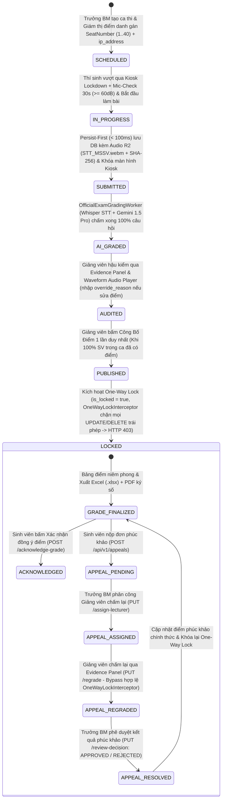

---

## BẢNG ĐỐI CHIẾU 4 LUỒNG VỚI CÁC TÀI LIỆU TOÀN HỆ THỐNG

| Luồng Nghiệp Vụ | Tệp Sơ Đồ Draw.io Chuẩn Hóa | Vị Trí Trong Tài Liệu Master Architecture |
|:---:|:---|:---|
| **MF-01** | [`MF01_Interactive_Practice.drawio`](../05_diagrams/MF01_Interactive_Practice.drawio) | [MASTER_ARCHITECTURE.md Mục 6.4.1 / 6.5.1](./MASTER_ARCHITECTURE.md#phan-651) |
| **MF-02** | [`MF02_Timed_Mock_Exam.drawio`](../05_diagrams/MF02_Timed_Mock_Exam.drawio) | [MASTER_ARCHITECTURE.md Mục 6.4.2 / 6.5.2](./MASTER_ARCHITECTURE.md#phan-652) |
| **MF-03** | [`MF03_Question_Bank_Rubric.drawio`](../05_diagrams/MF03_Question_Bank_Rubric.drawio) | [MASTER_ARCHITECTURE.md Mục 6.4.3 / 6.5.3](./MASTER_ARCHITECTURE.md#phan-653) |
| **MF-04** | [`MF04_Lab_Exam_Audit.drawio`](../05_diagrams/MF04_Lab_Exam_Audit.drawio) | [MASTER_ARCHITECTURE.md Mục 6.4.4 / 6.5.4](./MASTER_ARCHITECTURE.md#phan-654) |

---

## PHẦN 5: XỬ LÝ 4 CẠNH BIÊN NGHIỆP VỤ ĐẶC THÙ (EDGE-CASES)

> **Chi tiết kiến trúc và giải pháp kỹ thuật xem tại:** MASTER_ARCHITECTURE.md (Mục 6.6)

1. **[Session Resumption] Phục hồi phiên thi Kiosk (MF-04):** Lưu trạng thái question_index và bộ đệm (heartbeat) vào Backend để khi máy sập/mất điện, mở lên thi tiếp tục không mất bài.
2. **[R2 Direct Upload] Chống nghẽn mạng (MF-04):** Áp dụng Presigned URL. Kiosk upload `STT_MSSV.webm` trực tiếp lên Cloudflare R2, sau đó chỉ gửi SHA-256 về Backend thay vì đẩy qua đường ống Backend.
3. **[Booth Reassignment] Đổi máy thi (MF-04):** Giám thị có quyền gỡ niêm phong `ip_address` máy cũ trên vé thi để gán cho máy mới nếu phần cứng mic (< 60dB) bị hỏng.
4. **[Token Expiration] Quản lý Token (MF-04/MF-02):** Chạy cơ chế **Silent Refresh Token** dưới nền bằng Axios Interceptor để giữ phiên thi không văng ra ngoài đăng nhập sau 1 tiếng.
