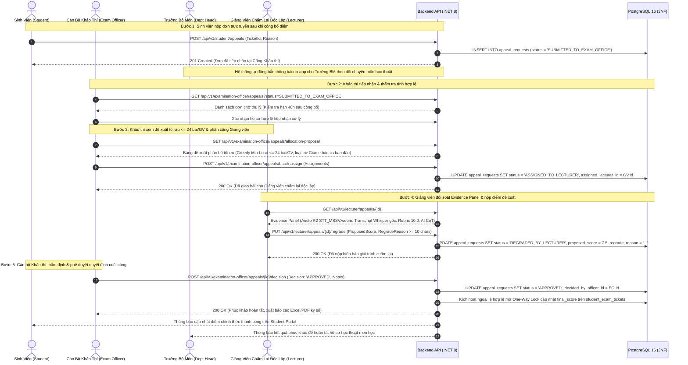
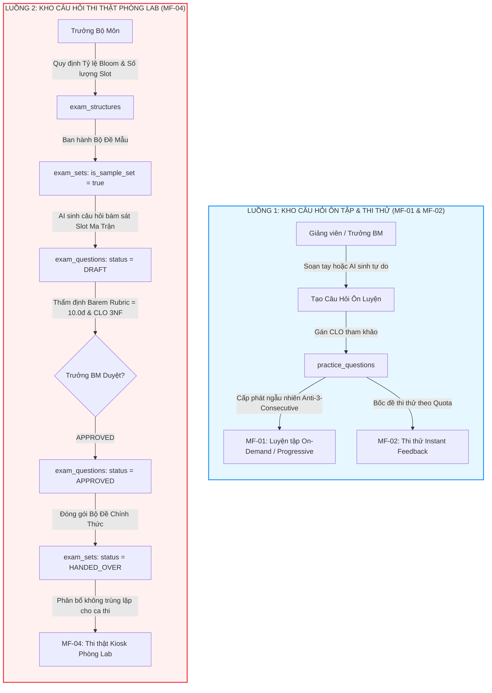

# BẢN ĐỀ XUẤT THIẾT KẾ KIẾN TRÚC & PHƯƠNG ÁN TRIỂN KHAI KỸ THUẬT (R1–R8)
## DỰ ÁN CAPSTONE FA26SE166 — HỆ THỐNG LUYỆN THI & ĐÁNH GIÁ VẤN ĐÁP BẰNG LLM

> **Phiên bản:** 1.0 — Chuẩn Enterprise  
> **Ngày lập:** 03/11/2026  
> **Trạng thái:** Chờ người dùng phê duyệt trước khi lập trình (Design-First / Spec-Locked)  
> **Phạm vi mã nguồn:** .NET 8 Clean Architecture 4 Tầng (`Domain`, `Application`, `Infrastructure`, `API`), PostgreSQL 16 (Chuẩn 3NF), React 19 SPA (Vite)  
> **Tác giả:** Tổ Đặc nhiệm Kiến trúc & CSDL FA26SE166 (Nguyễn Quang Thành, Nguyễn Trọng Tốt, Phạm Nguyễn Đăng Hải, Lê Vũ Hoàng)

---

## MỤC LỤC
1. [TỔNG QUAN ĐIỀU HÀNH & BỐI CẢNH KIẾN TRÚC (EXECUTIVE SUMMARY & ARCHITECTURE OVERVIEW)](#1-tổng-quan-điều-hành--bối-cảnh-kiến-trúc-executive-summary--architecture-overview)
2. [THIẾT KẾ CƠ SỞ DỮ LIỆU QUAN HỆ CHUẨN HÓA 3NF (POSTGRESQL 16 SCHEMA DESIGN)](#2-thiết-kế-cơ-sở-dữ-liệu-quan-hệ-chuẩn-hóa-3nf-postgresql-16-schema-design)
3. [ĐẶC TẢ HỢP ĐỒNG API RESTFUL & DTOS (API CONTRACTS & DTOS SPECIFICATION)](#3-đặc-tả-hợp-đồng-api-restful--dtos-api-contracts--dtos-specification)
4. [MA TRẬN PHÂN QUYỀN RBAC 6 ROLES (RBAC PERMISSION MATRIX)](#4-ma-trận-phân-quyền-rbac-6-roles-rbac-permission-matrix)
5. [CƠ CHẾ CA THI TRONG LỚP & MẬT KHẨU TỰ ĐỘNG XOAY VÒNG 5 PHÚT (IN-CLASS SHIFTS & ROTATING PASSWORD)](#5-cơ-chế-ca-thi-trong-lớp--mật-khẩu-tự-động-xoay-vòng-5-phút-in-class-shifts--rotating-password)
6. [QUY TRÌNH PHÚC KHẢO & MÁY TRẠNG THÁI (APPEALS WORKFLOW & STATE MACHINE)](#6-quy-trình-phúc-khảo--máy-trạng-thái-appeals-workflow--state-machine)
7. [BĂNG TẢI PHÂN TÁCH ĐỘC LẬP NGÂN HÀNG CÂU HỎI (QUESTION BANK SEPARATION BLUEPRINT)](#7-băng-tải-phân-tách-độc-lập-ngân-hàng-câu-hỏi-question-bank-separation-blueprint)
8. [KẾ HOẠCH TRIỂN KHAI & CỔNG KIỂM CHỨNG TOÀN DIỆN (IMPLEMENTATION & VERIFICATION PLAN)](#8-kế-hoạch-triển-khai--cổng-kiểm-chứng-toàn-diện-implementation--verification-plan)

---

## 1. TỔNG QUAN ĐIỀU HÀNH & BỐI CẢNH KIẾN TRÚC (EXECUTIVE SUMMARY & ARCHITECTURE OVERVIEW)

### 1.1. Bối cảnh dự án & Động lực tái kiến trúc
Dự án Capstone FA26SE166 xây dựng nền tảng Luyện thi & Đánh giá Vấn đáp bằng Mô hình Ngôn ngữ Lớn (LLM Oral Exam System) cho ngành Kỹ thuật Phần mềm tại Đại học FPT TP.HCM. Hệ thống bao gồm 5 luồng nghiệp vụ cốt lõi:
- **MF-01:** Luyện tập tương tác tự do (Interactive Practice - On-Demand Anti-3-Consecutive / Full-Session Progressive 3–10 câu, Timeout 5 phút trả `HTTP 410 Gone`, không lưu audio R2).
- **MF-02:** Thi thử tính giờ có hạn ngạch (Timed Mock Exam - Quota theo môn do Admin cấu hình qua `max_mock_exams_per_day`, Voice-First Gate, Scorecard CLO, không lưu audio R2).
- **MF-03:** Giảng viên sử dụng AI sinh câu hỏi từ Chuẩn đầu ra CLO 3NF (`course_clos`) & Rubric Studio 10.0đ (Phân tách độc lập 2 kho: `practice_questions` và `exam_questions` bám ma trận đề mẫu Trưởng BM ban hành).
- **MF-04:** Thi thật phòng Lab Kiosk tập trung, niêm phong audio Cloudflare R2 (`STT_MSSV.webm` + SHA-256), chấm ngầm đa luồng qua BoundedChannel 1,000 slots, hậu kiểm Evidence Panel, One-Way Lock điểm thi (`is_locked = true`), và quy trình Phúc khảo nội bộ 5 bước qua Cán bộ Khảo thí.
- **MF-05:** Ca thi trong lớp & Mật khẩu tự động xoay vòng 5 phút (In-Class Formative Assessment - Rotating TOTP 5 phút + Grace Period 30–60s, không lưu audio R2, chấm ngầm qua BoundedChannel, GV xem lại transcript và điều chỉnh điểm thành phần trước khi chốt bảng điểm One-Way Lock).

Qua khảo sát thực tế mã nguồn và tài liệu hiện hành, hệ thống bộc lộ các điểm nghẽn kiến trúc và mâu thuẫn nghiệp vụ cần được giải quyết triệt để:
1. **Thiếu chuỗi phân cấp quản lý học thuật thực tế (Academic Hierarchy):** Môn học chưa gắn với Trưởng bộ môn; Trưởng bộ môn chưa thể phân công nhiều giảng viên cùng giảng dạy môn học; Giảng viên chưa thể tự quản lý lớp học và cấp mật khẩu ghi danh cho sinh viên.
2. **Chưa hỗ trợ Ca thi trong lớp (In-Class Formative Assessment):** Đánh giá quá trình (Quiz, Progress Test) ngay tại lớp học bằng AI vấn đáp là nhu cầu cấp thiết. Nếu không có cơ chế kiểm soát hiện diện thể lý, sinh viên có thể gian lận hoặc làm bài từ xa.
3. **Mâu thuẫn và dồn việc quản lý Dead-Letter Queue (DLQ):** Tài liệu cũ gán 100% việc giám sát và replay DLQ cho Trưởng bộ môn, gây quá tải và vi phạm ranh giới nghiệp vụ (Admin quản trị hạ tầng luyện tập/thi thử MF-01/02; Cán bộ Khảo thí quản trị ca thi thật phòng lab MF-04; Trưởng BM bị cắt bỏ hoàn toàn khỏi quản lý DLQ).
4. **Mâu thuẫn thẩm quyền cấu hình câu hỏi phụ (Follow-up) thi thật:** Tài liệu cũ ghi nhận lẫn lộn giữa Khảo thí và Trưởng bộ môn. Trong khi đó, tính chất câu hỏi thi thật là chuyên môn học thuật gắn với chuẩn CLO, bắt buộc thuộc thẩm quyền độc quyền 100% của Trưởng bộ môn; Cán bộ Khảo thí tổ chức phòng thi bắt buộc phải phân công đồng thời cả Giám khảo (`examiner_user_id`) và Giám thị (`proctor_user_id`).
5. **Quyền hạn Giám thị (Proctor) bị mở rộng quá mức:** Tài liệu cũ cho phép Giám thị mở ca thi, đóng ca thi, gỡ niêm phong IP máy trạm, dẫn đến nguy cơ sai lệch quy chế thi của nhà trường.
6. **Bỏ qua Cán bộ Khảo thí trong quy trình Phúc khảo:** Sinh viên nộp đơn gửi thẳng tới Trưởng bộ môn hoặc Trưởng BM trực tiếp phân công/phê duyệt là sai lệch quy chế khảo thí của trường đại học. Cán bộ Khảo thí phải là đầu mối tiếp nhận, phân công GV chấm lại độc lập ($\le 24$ bài/GV, loại trừ Giám khảo ca ban đầu) và phê duyệt quyết định cuối cùng mở One-Way Lock; Trưởng BM nhận thông báo in-app để theo dõi chuyên môn học thuật.
7. **Trộn lẫn kho câu hỏi ôn tập và thi thật:** Cho phép Giảng viên tự do tích chọn đưa câu hỏi vào kho thi thật làm suy giảm tính bảo mật và phá vỡ cấu trúc ma trận đề thi mẫu (Blueprint/Slot Definitions) của Bộ môn.

### 1.2. Phân tích 8 Yêu cầu mới R1–R8 & Ranh giới tác động (Impact Boundary)
| Yêu cầu | Tôn chỉ nghiệp vụ cốt lõi | Ranh giới tác động CSDL | Ranh giới tác động API & DTOs | Ranh giới tác động RBAC & Frontend |
|:---|:---|:---|:---|:---|
| **R1** | **Design-First & Spec-Locking**: Khóa đặc tả kiến trúc, hoàn thiện 100% thiết kế kỹ thuật, CHƯA VIẾT CODE C#/React cho đến khi người dùng phê duyệt. | Cập nhật tài liệu thiết kế CSDL 3NF, chuẩn bị script DDL kiểm thử. | Lập hợp đồng API Contracts RFC 7807, schema JSON. | Toàn bộ tài liệu kiến trúc, sơ đồ C4 và ma trận RBAC. |
| **R2** | **Phân định quản lý DLQ theo luồng**: MF-01/02 chuyển giao Admin; MF-04 chuyển giao Cán bộ Khảo thí. Cắt bỏ vai trò này của Trưởng bộ môn. | Bảng `dead_letter_queues` bổ sung cột `flow_type`, `managed_by_role`, `resolved_by_user_id`. | Tách 2 cổng API: `/api/v1/admin/dlq` và `/api/v1/examination-officer/dlq`. | Xóa quyền DLQ khỏi `department_head`; gán quyền cho `admin` và `examination_officer`. |
| **R3** | **Cấu hình Follow-up Thi thật do Trưởng bộ môn phụ trách & Phân công đồng thời Examiner + Proctor**: Trưởng bộ môn độc quyền cấu hình `has_follow_up` (1–5 câu, mặc định 2); Khảo thí tạo ca thi bắt buộc phân công cả `examiner_user_id` và `proctor_user_id`. | `official_exam_sessions`, `courses`; Bảng `real_exam_session_shifts` thêm `examiner_user_id` và `proctor_user_id` NOT NULL, check `examiner_user_id <> proctor_user_id`. | Endpoint cấu hình: `PUT /api/v1/official-exams/sessions/{id}/follow-up-config`; Endpoint tạo ca thi: `POST /api/v1/examination-officer/official-exams/sessions/{sessionId}/shifts`. | Khóa route cấu hình follow-up cho `department_head,admin`; Route tạo ca thi thuộc `examination_officer,admin`. |
| **R4** | **Giới hạn quyền hạn Giám thị (Proctor)**: Chỉ điểm danh sinh viên (Seat 1–40) và báo cáo vi phạm phòng thi; cắt bỏ mở/đóng ca thi, đổi IP, xem điểm. | Bảng `exam_anti_cheat_logs` và `student_exam_tickets.checked_in_at`. | Chỉ giữ lại: `POST /api/v1/proctor/shifts/{id}/attendance` và `POST .../violations`. | Cắt bỏ 100% quyền can thiệp vào điểm thi, ca thi, niêm phong IP và bộ đề thi. |
| **R5** | **Chuỗi phân cấp học thuật 4 cấp**: Admin (Semester $\to$ Course $\to$ gán Dept Head) $\to$ Dept Head (gán nhiều GV vào môn) $\to$ GV (tạo lớp + mật khẩu lớp) $\to$ SV (nhập mật khẩu join lớp). | `courses` (thêm `department_head_user_id`), bảng mới `course_lecturers` ($N-N$), `classes` (thêm `name`, `join_code`, `join_password_hash`). | Phân hệ `/api/v1/academic/*` và `/api/v1/lecturer/classes/*`, `/api/v1/student/classes/join`. | Phân quyền nghiêm ngặt 4 cấp độ: Admin $\to$ Dept Head $\to$ Lecturer $\to$ Student. |
| **R6** | **Ca thi trong lớp & Mật khẩu xoay vòng 5 phút**: Đánh giá quá trình (Formative Assessment); mật khẩu tự xoay vòng mỗi 5 phút + gia hạn 30–60s; AI chấm ngầm + GV hậu kiểm/chỉnh sửa điểm trước khi chốt. | Bảng mới: `in_class_exam_shifts`, `in_class_shift_passwords`, `in_class_shift_participants`, `in_class_exam_submissions`. | Phân hệ `/api/v1/lecturer/in-class-shifts/*` và `/api/v1/student/in-class-shifts/*`. | Giảng viên đứng lớp có quyền điều hành ca thi, xem lại transcript, chỉnh sửa điểm thành phần; Sinh viên tham gia. |
| **R7** | **Quy trình Phúc khảo 5 bước chuẩn FPTU**: SV nộp $\to$ Khảo thí tiếp nhận & thẩm tra (Trưởng BM nhận thông báo in-app) $\to$ Khảo thí phân công GV chấm lại ($\le 24$ bài/GV, loại trừ Giám khảo ca ban đầu) $\to$ GV chấm lại độc lập trên Evidence Panel $\to$ Khảo thí phê duyệt quyết định cuối cùng mở One-Way Lock. | Bảng `appeal_requests` chuẩn 3NF: `received_by_officer_id`, `assigned_lecturer_id`, `decided_by_officer_id`, 5 trạng thái vòng đời chuẩn (loại bỏ hoàn toàn `FORWARDED_TO_DEPT_HEAD`). | Phân hệ `/api/v1/student/appeals`, `/api/v1/examination-officer/appeals/*` (kèm `/allocation-proposal`, `/batch-assign`, `/decision`), `/api/v1/lecturer/appeals/{id}/regrade`. | Phối hợp tác chiến đa role: Student $\to$ Examination Officer $\to$ Lecturer $\to$ Examination Officer (Trưởng BM nhận thông báo in-app theo dõi học thuật). |
| **R8** | **Phân tách độc lập 2 luồng tạo câu hỏi**: Luồng ôn tập (MF-01/02) tạo linh hoạt, độc lập; Luồng thi thật (MF-04) bắt buộc bám sát Ma trận cấu trúc đề thi mẫu do Trưởng bộ môn ban hành. | Thêm khóa ngoại `clo_id` vào `practice_questions` và `exam_questions`; thêm `structure_id` vào `exam_questions`; thêm `is_sample_set` vào `exam_sets`. | Tách 2 luồng API: `/api/v1/questions/practice/*` và `/api/v1/department-head/questions/official/*`. | Giảng viên và Trưởng BM soạn câu hỏi ôn tập tự do; Câu hỏi thi thật bắt buộc gắn chặt vào slot ma trận đề mẫu. |

---

## 2. THIẾT KẾ CƠ SỞ DỮ LIỆU QUAN HỆ CHUẨN HÓA 3NF (POSTGRESQL 16 SCHEMA DESIGN)

### 2.1. Phân tích Chuẩn hóa Bậc 3 (3NF) & Cam kết Anti-Column-Stuffing
Tuân thủ Luật Sắt Bất Biến trong `RULE[user_global]` và `AGENTS.md`, toàn bộ thiết kế dữ liệu đạt chuẩn Bậc 3 (Third Normal Form - 3NF):
1. **Bảo toàn 1NF (Atomic Attributes):** Tuyệt đối không lưu mảng chuỗi ghép phân tách bằng dấu phẩy (ví dụ: cấm lưu danh sách giảng viên dưới dạng `"user1,user2"` trong `courses`; cấm lưu mật khẩu xoay vòng nối chuỗi). Mỗi thông tin là một giá trị nguyên tố.
2. **Bảo toàn 2NF (Full Functional Dependency):** Mọi thuộc tính không khóa đều phụ thuộc hoàn toàn vào toàn bộ khóa chính, loại bỏ sự phụ thuộc một phần trên các bảng quan hệ nhiều - nhiều (`course_lecturers`, `in_class_exam_submissions`).
3. **Bảo toàn 3NF (No Transitive Dependency):** Không tồn tại sự phụ thuộc bắc cầu qua các thuộc tính không khóa. Ví dụ: Tên trưởng bộ môn không lưu trong `courses`, mà truy xuất qua khóa ngoại `department_head_user_id` liên kết tới `users(id)`.
4. **Anti-Column-Stuffing & Cấm dùng RAM tạm:** 
   - Cơ chế mật khẩu xoay vòng 5 phút (R6) không nhồi vào cột text/json của bảng ca thi, không lưu biến static `ConcurrentDictionary` trên RAM máy chủ (gây mất dữ liệu khi restart hoặc lỗi khi scale nhiều pod). Mật khẩu xoay vòng được tách riêng thành bảng `in_class_shift_passwords` với các mốc thời gian `valid_from`, `valid_to`, `grace_until` độc lập, truy vấn $O(1)$ qua chỉ mục B-Tree.
   - Chuẩn đầu ra CLO được liên kết trực tiếp bằng khóa ngoại `clo_id UUID REFERENCES course_clos(id)`, chấm dứt việc lưu chuỗi ký tự CLO lỏng lẻo.

### 2.2. Kịch bản DDL SQL Hoàn Chỉnh PostgreSQL 16 (Executable DDL Migration)

```sql
-- =============================================================================
-- CAPSTONE FA26SE166: ENTERPRISE DATABASE SCHEMA MIGRATION SCRIPT (3NF)
-- Scope: Academic Hierarchy (R5), In-Class Exam Shifts & Password Rotation (R6),
--        DLQ Separation (R2), Appeals Workflow (R7), Question Bank Separation (R8)
-- Engine: PostgreSQL 16+
-- =============================================================================

BEGIN;

-- -----------------------------------------------------------------------------
-- 1. BẢNG COURSES: Bổ sung Trưởng bộ môn phụ trách môn học (R5)
-- -----------------------------------------------------------------------------
ALTER TABLE courses
    ADD COLUMN department_head_user_id UUID NULL,
    ADD CONSTRAINT fk_courses_dept_head 
        FOREIGN KEY (department_head_user_id) REFERENCES users(id) ON DELETE RESTRICT;

CREATE INDEX ix_courses_department_head ON courses(department_head_user_id);

COMMENT ON COLUMN courses.department_head_user_id IS 'Trưởng bộ môn được Admin chỉ định chịu trách nhiệm nội dung môn học';

-- -----------------------------------------------------------------------------
-- 2. BẢNG MỚI COURSE_LECTURERS: Quan hệ N-N giữa Môn học và Giảng viên (R5)
-- -----------------------------------------------------------------------------
CREATE TABLE course_lecturers (
    id UUID PRIMARY KEY DEFAULT gen_random_uuid(),
    course_id UUID NOT NULL,
    lecturer_user_id UUID NOT NULL,
    assigned_by_user_id UUID NOT NULL,
    assigned_at TIMESTAMPTZ NOT NULL DEFAULT CURRENT_TIMESTAMP,
    is_active BOOLEAN NOT NULL DEFAULT true,
    created_at TIMESTAMPTZ NOT NULL DEFAULT CURRENT_TIMESTAMP,
    updated_at TIMESTAMPTZ NOT NULL DEFAULT CURRENT_TIMESTAMP,
    
    CONSTRAINT fk_course_lecturers_course 
        FOREIGN KEY (course_id) REFERENCES courses(id) ON DELETE CASCADE,
    CONSTRAINT fk_course_lecturers_lecturer 
        FOREIGN KEY (lecturer_user_id) REFERENCES users(id) ON DELETE CASCADE,
    CONSTRAINT fk_course_lecturers_assigned_by 
        FOREIGN KEY (assigned_by_user_id) REFERENCES users(id) ON DELETE RESTRICT,
    CONSTRAINT uq_course_lecturers 
        UNIQUE (course_id, lecturer_user_id)
);

CREATE INDEX ix_course_lecturers_course ON course_lecturers(course_id, is_active);
CREATE INDEX ix_course_lecturers_lecturer ON course_lecturers(lecturer_user_id, is_active);

COMMENT ON TABLE course_lecturers IS 'Bảng phân công giảng viên giảng dạy môn học do Trưởng bộ môn thiết lập';

-- -----------------------------------------------------------------------------
-- 3. BẢNG CLASSES: Tên lớp, Mã ghi danh và Mật khẩu lớp học (R5)
-- -----------------------------------------------------------------------------
ALTER TABLE classes
    ADD COLUMN name VARCHAR(150) NOT NULL DEFAULT '',
    ADD COLUMN join_code VARCHAR(20) NULL,
    ADD COLUMN join_password_hash VARCHAR(256) NULL,
    ADD COLUMN allow_self_enrollment BOOLEAN NOT NULL DEFAULT true;

-- Cập nhật dữ liệu mặc định cho các lớp học sẵn có để tránh vi phạm NOT NULL
UPDATE classes SET name = 'Lớp ' || code WHERE name = '';
UPDATE classes SET join_code = UPPER(SUBSTRING(MD5(id::text) FROM 1 FOR 8)) WHERE join_code IS NULL;

ALTER TABLE classes ALTER COLUMN join_code SET NOT NULL;
CREATE UNIQUE INDEX ix_classes_join_code ON classes(join_code);
CREATE INDEX ix_classes_active_semester_course_created ON classes(is_active, semester_id, course_id, created_at DESC);

COMMENT ON COLUMN classes.join_code IS 'Mã tham gia ngắn gọn do hệ thống cấp để sinh viên tìm kiếm lớp';
COMMENT ON COLUMN classes.join_password_hash IS 'Mã băm bcrypt/Argon2 mật khẩu do giảng viên đặt để bảo vệ lớp';

-- -----------------------------------------------------------------------------
-- 4. BẢNG CLASS_ENROLLMENTS: Lưu vết hình thức ghi danh (R5)
-- -----------------------------------------------------------------------------
ALTER TABLE class_enrollments
    ADD COLUMN joined_via_code VARCHAR(20) NULL,
    ADD COLUMN join_method VARCHAR(30) NOT NULL DEFAULT 'PASSWORD'
        CHECK (join_method IN ('PASSWORD', 'ADMIN_ROSTER', 'INVITATION'));

COMMENT ON COLUMN class_enrollments.joined_via_code IS 'Mã lớp mà sinh viên đã nhập khi tự ghi danh vào lớp';

-- -----------------------------------------------------------------------------
-- 5. BẢNG MỚI IN_CLASS_EXAM_SHIFTS: Ca thi trong lớp học lấy điểm thành phần (R6)
-- -----------------------------------------------------------------------------
CREATE TABLE in_class_exam_shifts (
    id UUID PRIMARY KEY DEFAULT gen_random_uuid(),
    class_id UUID NOT NULL,
    lecturer_user_id UUID NOT NULL,
    shift_name VARCHAR(150) NOT NULL,
    description TEXT NULL,
    rubric_id UUID NULL,
    duration_minutes INT NOT NULL DEFAULT 15,
    start_time TIMESTAMPTZ NOT NULL,
    end_time TIMESTAMPTZ NOT NULL,
    status VARCHAR(30) NOT NULL DEFAULT 'SCHEDULED',
    
    -- Cấu hình nguồn câu hỏi & số câu hỏi mỗi sinh viên
    question_pool_mode VARCHAR(30) NOT NULL DEFAULT 'ALL_COURSE_BANK',
    selected_question_ids UUID[] NULL,
    total_questions_per_student INT NOT NULL DEFAULT 3,

    -- Cấu hình mật khẩu xoay vòng
    is_password_rotation_enabled BOOLEAN NOT NULL DEFAULT true,
    password_rotation_interval_seconds INT NOT NULL DEFAULT 300, -- 5 phút
    password_grace_period_seconds INT NOT NULL DEFAULT 60,       -- 60 giây gia hạn
    
    -- Cấu hình hình thức làm bài & follow-up
    has_follow_up BOOLEAN NOT NULL DEFAULT false,
    max_follow_up_questions INT NOT NULL DEFAULT 2,
    is_auto_publish_grades BOOLEAN NOT NULL DEFAULT true,
    transcript_buffer_seconds INT NOT NULL DEFAULT 60,
    allow_transcript_edit BOOLEAN NOT NULL DEFAULT true,
    
    -- Trạng thái chốt điểm
    is_grade_finalized BOOLEAN NOT NULL DEFAULT false,
    finalized_at TIMESTAMPTZ NULL,
    created_at TIMESTAMPTZ NOT NULL DEFAULT CURRENT_TIMESTAMP,
    updated_at TIMESTAMPTZ NOT NULL DEFAULT CURRENT_TIMESTAMP,
    
    CONSTRAINT ck_in_class_shifts_time CHECK (end_time > start_time),
    CONSTRAINT ck_in_class_shifts_duration CHECK (duration_minutes BETWEEN 5 AND 180),
    CONSTRAINT ck_in_class_shifts_status CHECK (status IN ('SCHEDULED', 'IN_PROGRESS', 'FINALIZED', 'CANCELLED')),
    CONSTRAINT ck_in_class_shifts_pool_mode CHECK (question_pool_mode IN ('ALL_COURSE_BANK', 'SELECTED_POOL')),
    CONSTRAINT ck_in_class_shifts_total_questions CHECK (total_questions_per_student BETWEEN 1 AND 10),
    CONSTRAINT ck_in_class_shifts_buffer CHECK (transcript_buffer_seconds BETWEEN 10 AND 300),
    CONSTRAINT ck_in_class_shifts_follow_up CHECK (max_follow_up_questions BETWEEN 0 AND 5),
    CONSTRAINT fk_in_class_shifts_class FOREIGN KEY (class_id) REFERENCES classes(id) ON DELETE CASCADE,
    CONSTRAINT fk_in_class_shifts_lecturer FOREIGN KEY (lecturer_user_id) REFERENCES users(id) ON DELETE RESTRICT,
    CONSTRAINT fk_in_class_shifts_rubric FOREIGN KEY (rubric_id) REFERENCES rubrics(id) ON DELETE SET NULL
);

CREATE INDEX ix_in_class_shifts_class ON in_class_exam_shifts(class_id, status);
CREATE INDEX ix_in_class_shifts_lecturer ON in_class_exam_shifts(lecturer_user_id, status);
CREATE INDEX ix_in_class_shifts_status_time ON in_class_exam_shifts(status, start_time, end_time);

COMMENT ON TABLE in_class_exam_shifts IS 'Ca thi đánh giá quá trình (Quiz/Progress Test) tổ chức ngay tại lớp học do Giảng viên điều hành';

-- -----------------------------------------------------------------------------
-- 6. BẢNG MỚI IN_CLASS_SHIFT_PASSWORDS: Mật khẩu xoay vòng 5 phút chuẩn 3NF (R6)
-- -----------------------------------------------------------------------------
CREATE TABLE in_class_shift_passwords (
    id UUID PRIMARY KEY DEFAULT gen_random_uuid(),
    shift_id UUID NOT NULL,
    password_code VARCHAR(20) NOT NULL,
    valid_from TIMESTAMPTZ NOT NULL,
    valid_to TIMESTAMPTZ NOT NULL,
    grace_until TIMESTAMPTZ NOT NULL,
    is_active BOOLEAN NOT NULL DEFAULT true,
    created_at TIMESTAMPTZ NOT NULL DEFAULT CURRENT_TIMESTAMP,
    
    CONSTRAINT ck_shift_password_times CHECK (valid_to > valid_from AND grace_until >= valid_to),
    CONSTRAINT fk_shift_passwords_shift FOREIGN KEY (shift_id) REFERENCES in_class_exam_shifts(id) ON DELETE CASCADE
);

-- Chỉ mục B-Tree tối ưu cho truy vấn xác thực O(1)
CREATE INDEX ix_shift_passwords_lookup ON in_class_shift_passwords(shift_id, is_active, valid_from, grace_until);
CREATE INDEX ix_shift_passwords_code ON in_class_shift_passwords(shift_id, password_code);

COMMENT ON TABLE in_class_shift_passwords IS 'Lưu trữ lịch sử và mật khẩu hiện hành xoay vòng tự động mỗi 5 phút kèm khoảng gia hạn 30-60s';

-- -----------------------------------------------------------------------------
-- 7. BẢNG MỚI IN_CLASS_SHIFT_PARTICIPANTS: Sinh viên tham gia ca thi trong lớp (R6)
-- -----------------------------------------------------------------------------
CREATE TABLE in_class_shift_participants (
    id UUID PRIMARY KEY DEFAULT gen_random_uuid(),
    shift_id UUID NOT NULL,
    student_user_id UUID NOT NULL,
    assigned_question_id UUID NULL,
    assigned_question_ids UUID[] NOT NULL DEFAULT '{}',
    joined_at TIMESTAMPTZ NOT NULL DEFAULT CURRENT_TIMESTAMP,
    password_used_id UUID NULL,
    status VARCHAR(30) NOT NULL DEFAULT 'JOINED',
    
    -- Tổng hợp điểm số ca thi
    total_ai_score NUMERIC(4,2) NULL,
    total_final_score NUMERIC(4,2) NULL,
    override_reason TEXT NULL,
    lecturer_notes TEXT NULL,
    audited_at TIMESTAMPTZ NULL,
    audited_by_user_id UUID NULL,
    created_at TIMESTAMPTZ NOT NULL DEFAULT CURRENT_TIMESTAMP,
    updated_at TIMESTAMPTZ NOT NULL DEFAULT CURRENT_TIMESTAMP,
    
    CONSTRAINT ck_participants_status CHECK (status IN ('JOINED', 'IN_PROGRESS', 'SUBMITTED', 'GRADING', 'GRADED', 'AUDITED', 'FINALIZED')),
    CONSTRAINT ck_participants_scores CHECK (
        (total_ai_score IS NULL OR (total_ai_score >= 0.00 AND total_ai_score <= 10.00)) AND
        (total_final_score IS NULL OR (total_final_score >= 0.00 AND total_final_score <= 10.00))
    ),
    CONSTRAINT fk_participants_shift FOREIGN KEY (shift_id) REFERENCES in_class_exam_shifts(id) ON DELETE CASCADE,
    CONSTRAINT fk_participants_student FOREIGN KEY (student_user_id) REFERENCES users(id) ON DELETE CASCADE,
    CONSTRAINT fk_participants_assigned_q FOREIGN KEY (assigned_question_id) REFERENCES practice_questions(id) ON DELETE SET NULL,
    CONSTRAINT fk_participants_password FOREIGN KEY (password_used_id) REFERENCES in_class_shift_passwords(id) ON DELETE SET NULL,
    CONSTRAINT fk_participants_auditor FOREIGN KEY (audited_by_user_id) REFERENCES users(id) ON DELETE SET NULL,
    CONSTRAINT uq_in_class_shift_student UNIQUE (shift_id, student_user_id)
);

CREATE INDEX ix_in_class_participants_student ON in_class_shift_participants(student_user_id);
CREATE INDEX ix_in_class_participants_status ON in_class_shift_participants(status);

COMMENT ON TABLE in_class_shift_participants IS 'Bảng quản lý danh sách sinh viên tham gia ca thi lớp và điểm thành phần cuối cùng';

-- -----------------------------------------------------------------------------
-- 8. BẢNG MỚI IN_CLASS_EXAM_SUBMISSIONS: Chi tiết câu trả lời & Điểm AI (R6)
-- -----------------------------------------------------------------------------
CREATE TABLE in_class_exam_submissions (
    id UUID PRIMARY KEY DEFAULT gen_random_uuid(),
    participant_id UUID NOT NULL,
    shift_id UUID NOT NULL,
    student_user_id UUID NOT NULL,
    question_id UUID NOT NULL,
    question_source VARCHAR(20) NOT NULL DEFAULT 'practice',
    transcript TEXT NULL,
    
    -- Cấu trúc câu hỏi phụ Follow-up
    is_follow_up BOOLEAN NOT NULL DEFAULT false,
    parent_submission_id UUID NULL,
    follow_up_index INT NOT NULL DEFAULT 0,
    follow_up_prompt TEXT NULL,
    
    -- Kết quả AI đánh giá
    ai_score NUMERIC(4,2) NULL,
    ai_feedback TEXT NULL,
    ai_confidence_score NUMERIC(3,2) NULL,
    cot_trace TEXT NULL,
    
    -- Giảng viên xem lại và điều chỉnh điểm
    adjusted_score NUMERIC(4,2) NULL,
    adjustment_reason TEXT NULL,
    final_score NUMERIC(4,2) NULL,
    reviewed_by_user_id UUID NULL,
    reviewed_at TIMESTAMPTZ NULL,
    
    status VARCHAR(30) NOT NULL DEFAULT 'SUBMITTED',
    submitted_at TIMESTAMPTZ NOT NULL DEFAULT CURRENT_TIMESTAMP,
    graded_at TIMESTAMPTZ NULL,
    
    CONSTRAINT ck_in_class_subs_status CHECK (status IN ('SUBMITTED', 'GRADING', 'AI_GRADED', 'REVIEWED', 'FINALIZED')),
    CONSTRAINT ck_in_class_subs_source CHECK (question_source IN ('practice', 'exam')),
    CONSTRAINT ck_in_class_subs_follow_up CHECK (follow_up_index BETWEEN 0 AND 5),
    CONSTRAINT ck_in_class_subs_scores CHECK (
        (ai_score IS NULL OR (ai_score >= 0.00 AND ai_score <= 10.00)) AND
        (adjusted_score IS NULL OR (adjusted_score >= 0.00 AND adjusted_score <= 10.00)) AND
        (final_score IS NULL OR (final_score >= 0.00 AND final_score <= 10.00)) AND
        (ai_confidence_score IS NULL OR (ai_confidence_score >= 0.00 AND ai_confidence_score <= 1.00))
    ),
    CONSTRAINT fk_in_class_subs_participant FOREIGN KEY (participant_id) REFERENCES in_class_shift_participants(id) ON DELETE CASCADE,
    CONSTRAINT fk_in_class_subs_shift FOREIGN KEY (shift_id) REFERENCES in_class_exam_shifts(id) ON DELETE CASCADE,
    CONSTRAINT fk_in_class_subs_student FOREIGN KEY (student_user_id) REFERENCES users(id) ON DELETE CASCADE,
    CONSTRAINT fk_in_class_subs_parent FOREIGN KEY (parent_submission_id) REFERENCES in_class_exam_submissions(id) ON DELETE CASCADE,
    CONSTRAINT fk_in_class_subs_reviewer FOREIGN KEY (reviewed_by_user_id) REFERENCES users(id) ON DELETE SET NULL,
    CONSTRAINT uq_in_class_sub_shift_student_question UNIQUE (shift_id, student_user_id, question_id, follow_up_index)
);

CREATE INDEX ix_in_class_subs_question ON in_class_exam_submissions(question_id);
CREATE INDEX ix_in_class_subs_status ON in_class_exam_submissions(status);

COMMENT ON TABLE in_class_exam_submissions IS 'Lưu chi tiết từng câu trả lời, transcript, điểm AI và điểm điều chỉnh của giảng viên trong ca thi lớp (Zero R2 Audio)';

-- -----------------------------------------------------------------------------
-- 8b. BẢNG AI_EVALUATIONS: Bổ sung student_id, in_class_submission_id, ck_ai_evaluations_type và XOR 4 luồng ([DB-01])
-- -----------------------------------------------------------------------------
ALTER TABLE ai_evaluations
    ADD COLUMN student_id UUID NULL,
    ADD COLUMN in_class_submission_id UUID NULL,
    ADD CONSTRAINT fk_ai_evaluations_student FOREIGN KEY (student_id) REFERENCES users(id) ON DELETE CASCADE,
    ADD CONSTRAINT fk_ai_evaluations_in_class FOREIGN KEY (in_class_submission_id) REFERENCES in_class_exam_submissions(id) ON DELETE CASCADE;

CREATE INDEX ix_ai_evaluations_student ON ai_evaluations(student_id);
CREATE INDEX ix_ai_evaluations_in_class_submission ON ai_evaluations(in_class_submission_id);

ALTER TABLE ai_evaluations DROP CONSTRAINT IF EXISTS ck_ai_evaluations_type;
ALTER TABLE ai_evaluations ADD CONSTRAINT ck_ai_evaluations_type 
    CHECK (answer_type IN ('practice', 'mock_exam', 'exam', 'in_class'));

ALTER TABLE ai_evaluations DROP CONSTRAINT IF EXISTS ck_ai_evaluations_xor;
ALTER TABLE ai_evaluations ADD CONSTRAINT ck_ai_evaluations_xor CHECK (
    (answer_type = 'practice' AND practice_answer_id IS NOT NULL AND mock_exam_answer_id IS NULL AND exam_submission_id IS NULL AND in_class_submission_id IS NULL) OR
    (answer_type = 'mock_exam' AND mock_exam_answer_id IS NOT NULL AND practice_answer_id IS NULL AND exam_submission_id IS NULL AND in_class_submission_id IS NULL) OR
    (answer_type = 'exam' AND exam_submission_id IS NOT NULL AND practice_answer_id IS NULL AND mock_exam_answer_id IS NULL AND in_class_submission_id IS NULL) OR
    (answer_type = 'in_class' AND in_class_submission_id IS NOT NULL AND practice_answer_id IS NULL AND mock_exam_answer_id IS NULL AND exam_submission_id IS NULL)
);

COMMENT ON COLUMN ai_evaluations.student_id IS 'Khóa ngoại trực diện tới sinh viên phục vụ truy xuất O(log N) trên Student Dashboard';
COMMENT ON COLUMN ai_evaluations.in_class_submission_id IS 'Khóa ngoại liên kết tới bài nộp ca thi trên lớp MF-05';

-- -----------------------------------------------------------------------------
-- 9. BỔ SUNG KHÓA NGOẠI CLO & CẤU TRÚC VÀO KHO CÂU HỎI (R8)
-- -----------------------------------------------------------------------------
ALTER TABLE practice_questions
    ADD COLUMN clo_id UUID NULL,
    ADD CONSTRAINT fk_practice_questions_clo FOREIGN KEY (clo_id) REFERENCES course_clos(id) ON DELETE SET NULL;

CREATE INDEX ix_practice_questions_clo ON practice_questions(clo_id);

ALTER TABLE exam_questions
    ADD COLUMN clo_id UUID NULL,
    ADD COLUMN structure_id UUID NULL,
    ADD CONSTRAINT fk_exam_questions_clo FOREIGN KEY (clo_id) REFERENCES course_clos(id) ON DELETE SET NULL,
    ADD CONSTRAINT fk_exam_questions_structure FOREIGN KEY (structure_id) REFERENCES exam_structures(id) ON DELETE SET NULL;

CREATE INDEX ix_exam_questions_clo ON exam_questions(clo_id);
CREATE INDEX ix_exam_questions_structure ON exam_questions(structure_id);

ALTER TABLE exam_sets
    ADD COLUMN is_sample_set BOOLEAN NOT NULL DEFAULT false;

CREATE INDEX ix_exam_sets_sample ON exam_sets(course_id, is_sample_set);

COMMENT ON COLUMN exam_sets.is_sample_set IS 'Đánh dấu bộ đề thi mẫu do Trưởng bộ môn ban hành làm căn cứ sinh đề thi thật';

-- -----------------------------------------------------------------------------
-- 9b. BẢNG REAL_EXAM_SESSION_SHIFTS: Phân công đồng thời Examiner & Proctor (R3)
-- -----------------------------------------------------------------------------
ALTER TABLE real_exam_session_shifts
    ADD COLUMN examiner_user_id UUID NOT NULL,
    ADD COLUMN proctor_user_id UUID NOT NULL,
    ADD CONSTRAINT fk_shifts_examiner FOREIGN KEY (examiner_user_id) REFERENCES users(id) ON DELETE RESTRICT,
    ADD CONSTRAINT fk_shifts_proctor FOREIGN KEY (proctor_user_id) REFERENCES users(id) ON DELETE RESTRICT,
    ADD CONSTRAINT ck_shifts_examiner_proctor_distinct CHECK (examiner_user_id <> proctor_user_id);

CREATE INDEX ix_shifts_examiner ON real_exam_session_shifts(examiner_user_id);
CREATE INDEX ix_shifts_proctor ON real_exam_session_shifts(proctor_user_id);

COMMENT ON COLUMN real_exam_session_shifts.examiner_user_id IS 'Giảng viên chấm thi / hậu kiểm Evidence Panel bài thi phòng Lab';
COMMENT ON COLUMN real_exam_session_shifts.proctor_user_id IS 'Cán bộ coi thi / giám thị điểm danh máy 1-40 và báo cáo vi phạm phòng Lab';

-- -----------------------------------------------------------------------------
-- 10. BẢNG APPEAL_REQUESTS: Mở rộng Cổng Khảo thí & Quy trình 5 Bước (R7)
-- -----------------------------------------------------------------------------
ALTER TABLE appeal_requests
    ADD COLUMN received_by_officer_id UUID NULL,
    ADD COLUMN officer_received_at TIMESTAMPTZ NULL,
    ADD COLUMN officer_notes TEXT NULL,
    ADD COLUMN assigned_lecturer_id UUID NULL,
    ADD COLUMN assigned_by_officer_at TIMESTAMPTZ NULL,
    ADD COLUMN regraded_at TIMESTAMPTZ NULL,
    ADD COLUMN proposed_score NUMERIC(4,2) NULL,
    ADD COLUMN regrade_reason TEXT NULL,
    ADD COLUMN decided_by_officer_id UUID NULL,
    ADD COLUMN decided_at TIMESTAMPTZ NULL,
    ADD COLUMN decision VARCHAR(16) NULL,
    ADD COLUMN decision_notes TEXT NULL,
    ADD CONSTRAINT fk_appeals_officer FOREIGN KEY (received_by_officer_id) REFERENCES users(id) ON DELETE SET NULL,
    ADD CONSTRAINT fk_appeals_lecturer FOREIGN KEY (assigned_lecturer_id) REFERENCES users(id) ON DELETE SET NULL,
    ADD CONSTRAINT fk_appeals_decided_officer FOREIGN KEY (decided_by_officer_id) REFERENCES users(id) ON DELETE SET NULL,
    ADD CONSTRAINT ck_appeals_regrade_score CHECK (proposed_score IS NULL OR (proposed_score >= 0.00 AND proposed_score <= 10.00)),
    ADD CONSTRAINT ck_appeals_final_decision CHECK (decision IS NULL OR decision IN ('APPROVED', 'REJECTED'));

-- Cập nhật CHECK constraint cho status của appeal_requests (chuẩn hóa 5 bước R7, loại bỏ FORWARDED_TO_DEPT_HEAD)
ALTER TABLE appeal_requests DROP CONSTRAINT IF EXISTS ck_appeal_requests_status;
ALTER TABLE appeal_requests DROP CONSTRAINT IF EXISTS appeal_requests_status_check;

ALTER TABLE appeal_requests ADD CONSTRAINT ck_appeal_requests_status CHECK (
    status IN (
        'SUBMITTED_TO_EXAM_OFFICE',  -- Bước 1: Sinh viên nộp đơn, chờ Cán bộ Khảo thí tiếp nhận & thẩm tra
        'ASSIGNED_TO_LECTURER',      -- Bước 3: Cán bộ Khảo thí phân công Giảng viên chấm lại (<= 24 bài/GV)
        'IN_REVIEW',                 -- Bước 4: Giảng viên mở Evidence Panel đối soát bài
        'REGRADED_BY_LECTURER',      -- Bước 4: Giảng viên hoàn tất chấm lại, gửi đề xuất điểm mới & biên bản giải trình
        'APPROVED',                  -- Bước 5: Cán bộ Khảo thí phê duyệt cập nhật điểm chính thức (mở One-Way Lock)
        'REJECTED',                  -- Bước 5: Cán bộ Khảo thí bác bỏ phúc khảo, giữ nguyên điểm ban đầu
        'CANCELLED'                  -- Sinh viên rút đơn
    )
);

CREATE INDEX ix_appeals_workflow_officer ON appeal_requests(received_by_officer_id, status);
CREATE INDEX ix_appeals_workflow_lecturer ON appeal_requests(assigned_lecturer_id, status);
CREATE INDEX ix_appeals_decided_officer ON appeal_requests(decided_by_officer_id, status);

COMMENT ON COLUMN appeal_requests.received_by_officer_id IS 'Cán bộ Khảo thí tiếp nhận & thẩm tra đơn phúc khảo đầu mối';
COMMENT ON COLUMN appeal_requests.assigned_lecturer_id IS 'Giảng viên chuyên môn độc lập được Khảo thí phân công chấm lại (định mức <= 24 bài/GV)';
COMMENT ON COLUMN appeal_requests.decided_by_officer_id IS 'Cán bộ Khảo thí thẩm định & phê duyệt quyết định phúc khảo cuối cùng';

-- -----------------------------------------------------------------------------
-- 11. BẢNG DEAD_LETTER_QUEUES: Phân định Quản lý theo Luồng Nghiệp vụ (R2)
-- -----------------------------------------------------------------------------
ALTER TABLE dead_letter_queues
    ADD COLUMN flow_type VARCHAR(30) NOT NULL DEFAULT 'OFFICIAL_EXAM',
    ADD COLUMN managed_by_role VARCHAR(30) NOT NULL DEFAULT 'examination_officer',
    ADD COLUMN resolved_by_user_id UUID NULL,
    ADD COLUMN resolution_notes TEXT NULL,
    ADD CONSTRAINT ck_dlq_flow_type CHECK (flow_type IN ('PRACTICE', 'MOCK_EXAM', 'OFFICIAL_EXAM', 'IN_CLASS_EXAM')),
    ADD CONSTRAINT ck_dlq_managed_role CHECK (managed_by_role IN ('admin', 'examination_officer', 'lecturer')),
    ADD CONSTRAINT fk_dlq_resolved_by FOREIGN KEY (resolved_by_user_id) REFERENCES users(id) ON DELETE SET NULL;

-- Đồng bộ phân quyền quản lý theo phân loại luồng
UPDATE dead_letter_queues SET managed_by_role = 'admin' WHERE flow_type IN ('PRACTICE', 'MOCK_EXAM');
UPDATE dead_letter_queues SET managed_by_role = 'examination_officer' WHERE flow_type = 'OFFICIAL_EXAM';
UPDATE dead_letter_queues SET managed_by_role = 'lecturer' WHERE flow_type = 'IN_CLASS_EXAM';

CREATE INDEX ix_dead_letter_queues_flow_status ON dead_letter_queues(flow_type, status, created_at);
CREATE INDEX ix_dead_letter_queues_managed_role ON dead_letter_queues(managed_by_role, status);

COMMENT ON COLUMN dead_letter_queues.managed_by_role IS 'Vai trò chịu trách nhiệm giám sát và replay: admin (MF-01/02), examination_officer (MF-04)';

COMMIT;
```

---

## 3. ĐẶC TẢ HỢP ĐỒNG API RESTFUL & DTOS (API CONTRACTS & DTOS SPECIFICATION)

### 3.1. Quy chuẩn Thiết kế API & Xử lý Lỗi RFC 7807 ProblemDetails
Mọi API đều tuân thủ các quy tắc bất biến:
- URL chuẩn RESTful, sử dụng danh từ số nhiều, chữ thường, phân tách bằng dấu gạch ngang (`kebab-case`).
- Xác thực qua Bearer JWT Token (`Authorization: Bearer <token>`).
- Toàn bộ phản hồi lỗi tuân thủ chuẩn **RFC 7807 (ProblemDetails)** với định dạng:
```json
{
  "type": "https://errors.oralexam.edu.vn/validation-error",
  "title": "Dữ liệu yêu cầu không hợp lệ",
  "status": 400,
  "detail": "Số câu hỏi follow-up phải nằm trong khoảng từ 1 đến 5 câu.",
  "instance": "/api/v1/department-head/official-exams/shifts/7f8e9d0c/follow-up-config",
  "code": "INVALID_FOLLOW_UP_RANGE",
  "traceId": "00-84a1d82f7c0a4e76a6bfa9f6d7c71d6f-7b0b6c2d1e-01"
}
```

### 3.2. Danh mục Hợp đồng API & DTOs Chi Tiết

#### PHÂN HỆ 1: CHUỖI PHÂN CẤP QUẢN LÝ HỌC THUẬT (ACADEMIC HIERARCHY — R5)

##### 1.1. Admin tạo môn học và gán Trưởng bộ môn
- **HTTP Method:** `POST`
- **URI:** `/api/v1/admin/courses`
- **Quyền truy cập:** `admin`
- **Request Body (`CreateCourseWithDeptHeadRequest`):**
```json
{
  "code": "SWE301",
  "name": "Software Architecture and Design",
  "credits": 3,
  "semesterId": "1a2b3c4d-5e6f-7a8b-9c0d-1e2f3a4b5c6d",
  "departmentHeadUserId": "3fa85f64-5717-4562-b3fc-2c963f66afa6",
  "maxMockExamsPerDay": 3,
  "transcriptBufferSeconds": 60
}
```
- **Response `201 Created` (`CourseSummaryResponse`):**
```json
{
  "id": "9b1deb4d-3b7d-4bad-9bdd-2b0d7b3dcb6d",
  "code": "SWE301",
  "name": "Software Architecture and Design",
  "credits": 3,
  "semesterId": "1a2b3c4d-5e6f-7a8b-9c0d-1e2f3a4b5c6d",
  "departmentHeadUserId": "3fa85f64-5717-4562-b3fc-2c963f66afa6",
  "departmentHeadName": "TS. Tran Van A",
  "isActive": true,
  "createdAt": "2026-11-03T15:00:00Z"
}
```
- **Mã lỗi:** `400 Bad Request` (Dữ liệu sai), `404 Not Found` (Không tìm thấy Semester hoặc User), `409 Conflict` (Mã môn học đã tồn tại), `422 Unprocessable Entity` (User được gán không có role `department_head`).

##### 1.2. Trưởng bộ môn phân công Giảng viên giảng dạy môn học (N-N)
- **HTTP Method:** `POST`
- **URI:** `/api/v1/department-head/courses/{courseId}/assign-lecturers`
- **Quyền truy cập:** `department_head` (Kiểm tra người dùng hiện tại là Trưởng BM của môn học này hoặc `admin`)
- **Request Body (`AssignLecturersToCourseRequest`):**
```json
{
  "lecturerUserIds": [
    "2c963f66-5717-4562-b3fc-3fa85f64afa6",
    "8d249f66-1234-4562-b3fc-4ba85f64afc1"
  ]
}
```
- **Response `200 OK` (`CourseLecturersAssignmentResponse`):**
```json
{
  "courseId": "9b1deb4d-3b7d-4bad-9bdd-2b0d7b3dcb6d",
  "totalAssigned": 2,
  "assignedLecturers": [
    {
      "lecturerId": "2c963f66-5717-4562-b3fc-3fa85f64afa6",
      "fullName": "ThS. Nguyen Van B",
      "email": "nguyenvanb@fe.edu.vn",
      "assignedAt": "2026-11-03T15:05:00Z"
    },
    {
      "lecturerId": "8d249f66-1234-4562-b3fc-4ba85f64afc1",
      "fullName": "TS. Le Thi C",
      "email": "lethic@fe.edu.vn",
      "assignedAt": "2026-11-03T15:05:00Z"
    }
  ]
}
```
- **Mã lỗi:** `403 Forbidden` (Người dùng không phải Trưởng BM của môn), `404 Not Found` (Môn học không tồn tại).

##### 1.3. Giảng viên tạo Lớp học phần kèm Mật khẩu ghi danh
- **HTTP Method:** `POST`
- **URI:** `/api/v1/lecturer/classes`
- **Quyền truy cập:** `lecturer` (Hệ thống xác thực Giảng viên đã có bản ghi trong `course_lecturers` của môn này)
- **Request Body (`CreateClassByLecturerRequest`):**
```json
{
  "courseId": "9b1deb4d-3b7d-4bad-9bdd-2b0d7b3dcb6d",
  "semesterId": "1a2b3c4d-5e6f-7a8b-9c0d-1e2f3a4b5c6d",
  "classCode": "SE1701",
  "className": "Kiến trúc Phần mềm - Lớp SE1701",
  "maxStudents": 35,
  "joinPassword": "ClassSecret@2026"
}
```
- **Response `201 Created` (`ClassDetailResponse`):**
```json
{
  "id": "7f8e9d0c-1b2a-3c4d-5e6f-7a8b9c0d1e2f",
  "courseId": "9b1deb4d-3b7d-4bad-9bdd-2b0d7b3dcb6d",
  "courseCode": "SWE301",
  "classCode": "SE1701",
  "className": "Kiến trúc Phần mềm - Lớp SE1701",
  "joinCode": "SE1701X8",
  "lecturerId": "2c963f66-5717-4562-b3fc-3fa85f64afa6",
  "maxStudents": 35,
  "currentStudentsCount": 0,
  "allowSelfEnrollment": true,
  "createdAt": "2026-11-03T15:10:00Z"
}
```

##### 1.4. Sinh viên tự ghi danh vào lớp bằng mã và mật khẩu
- **HTTP Method:** `POST`
- **URI:** `/api/v1/student/classes/join`
- **Quyền truy cập:** `student`
- **Request Body (`StudentJoinClassRequest`):**
```json
{
  "joinCode": "SE1701X8",
  "password": "ClassSecret@2026"
}
```
- **Response `200 OK` (`StudentJoinClassResponse`):**
```json
{
  "enrollmentId": "aa11bb22-33cc-44dd-55ee-66ff77889900",
  "classId": "7f8e9d0c-1b2a-3c4d-5e6f-7a8b9c0d1e2f",
  "classCode": "SE1701",
  "courseCode": "SWE301",
  "courseName": "Software Architecture and Design",
  "enrolledAt": "2026-11-03T15:12:00Z",
  "status": "enrolled"
}
```
- **Mã lỗi:** `400 Bad Request` (Mật khẩu lớp không đúng), `404 Not Found` (Mã tham gia không tồn tại), `409 Conflict` (Sinh viên đã tham gia lớp này rồi), `422 Unprocessable Entity` (Lớp học đã đủ sĩ số tối đa).

---

#### PHÂN HỆ 2: CA THI TRONG LỚP & MẬT KHẨU XOAY VÒNG (IN-CLASS EXAM SHIFTS — R6)

##### 2.1. Giảng viên tạo Ca thi trong lớp
- **HTTP Method:** `POST`
- **URI:** `/api/v1/lecturer/in-class-shifts`
- **Quyền truy cập:** `lecturer` (Giảng viên phụ trách lớp học)
- **Request Body (`CreateInClassExamShiftRequest`):**
```json
{
  "classId": "7f8e9d0c-1b2a-3c4d-5e6f-7a8b9c0d1e2f",
  "shiftName": "Kiểm tra vấn đáp giữa kỳ - Mẫu thiết kế phần mềm",
  "description": "Đánh giá quá trình 15 phút, mỗi sinh viên trả lời 3 câu hỏi ngẫu nhiên từ kho đề",
  "rubricId": "55667788-99aa-bbcc-ddee-ff0011223344",
  "durationMinutes": 15,
  "startTime": "2026-11-03T15:30:00Z",
  "endTime": "2026-11-03T16:00:00Z",
  "questionPoolMode": "ALL_COURSE_BANK",
  "selectedQuestionIds": null,
  "totalQuestionsPerStudent": 3,
  "passwordRotationIntervalSeconds": 300,
  "passwordGracePeriodSeconds": 60,
  "hasFollowUp": true,
  "maxFollowUpQuestions": 2,
  "isAutoPublishGrades": true,
  "transcriptBufferSeconds": 60,
  "allowTranscriptEdit": true
}
```
- **Response `201 Created` (`InClassExamShiftResponse`):**
```json
{
  "id": "c1d2e3f4-a5b6-7c8d-9e0f-1a2b3c4d5e6f",
  "classId": "7f8e9d0c-1b2a-3c4d-5e6f-7a8b9c0d1e2f",
  "classCode": "SE1701",
  "shiftName": "Kiểm tra vấn đáp giữa kỳ - Mẫu thiết kế phần mềm",
  "questionPoolMode": "ALL_COURSE_BANK",
  "totalQuestionsPerStudent": 3,
  "hasFollowUp": true,
  "maxFollowUpQuestions": 2,
  "durationMinutes": 15,
  "status": "SCHEDULED",
  "isGradeFinalized": false,
  "createdAt": "2026-11-03T15:15:00Z"
}
```

##### 2.2. Giảng viên phát lệnh Bắt đầu ca thi (Kích hoạt Xoay vòng Mật khẩu)
- **HTTP Method:** `POST`
- **URI:** `/api/v1/lecturer/in-class-shifts/{id}/start`
- **Quyền truy cập:** `lecturer`
- **Response `200 OK` (`StartInClassShiftResponse`):**
```json
{
  "shiftId": "c1d2e3f4-a5b6-7c8d-9e0f-1a2b3c4d5e6f",
  "status": "IN_PROGRESS",
  "currentPassword": "849201",
  "validFrom": "2026-11-03T15:30:00Z",
  "validUntil": "2026-11-03T15:35:00Z",
  "graceUntil": "2026-11-03T15:36:00Z",
  "rotationIntervalSeconds": 300
}
```

##### 2.3. Giảng viên lấy Mật khẩu xoay vòng đang chiếu trên bảng
- **HTTP Method:** `GET`
- **URI:** `/api/v1/lecturer/in-class-shifts/{id}/active-password`
- **Quyền truy cập:** `lecturer`
- **Response `200 OK` (`ActiveRotatingPasswordResponse`):**
```json
{
  "shiftId": "c1d2e3f4-a5b6-7c8d-9e0f-1a2b3c4d5e6f",
  "currentPassword": "849201",
  "validUntil": "2026-11-03T15:35:00Z",
  "secondsRemaining": 184,
  "previousPassword": "612490",
  "graceUntil": "2026-11-03T15:31:00Z",
  "isGracePeriodActive": false
}
```

##### 2.4. Sinh viên nhập Mật khẩu xoay vòng để vào ca thi
- **HTTP Method:** `POST`
- **URI:** `/api/v1/student/in-class-shifts/{id}/join`
- **Quyền truy cập:** `student` (Bắt buộc là thành viên lớp học)
- **Request Body (`JoinInClassShiftRequest`):**
```json
{
  "enteredPassword": "849201"
}
```
- **Response `200 OK` (`JoinInClassShiftResponse`):**
```json
{
  "participantId": "ee556677-8899-0011-2233-445566778899",
  "shiftId": "c1d2e3f4-a5b6-7c8d-9e0f-1a2b3c4d5e6f",
  "status": "IN_PROGRESS",
  "durationMinutes": 15,
  "mustSubmitBefore": "2026-11-03T15:50:00Z",
  "hasFollowUp": true,
  "maxFollowUpQuestions": 2,
  "assignedQuestions": [
    {
      "questionId": "11223344-5566-7788-9900-aabbccddeeff",
      "orderIndex": 1,
      "title": "So sánh Factory Method & Abstract Factory",
      "content": "Hãy giải thích sự khác biệt giữa Factory Method và Abstract Factory?",
      "difficulty": "medium",
      "bloomLevel": "Analyze",
      "rubricCriteria": [
        { "name": "Hiểu bản chất Factory Method", "maxScore": 5.0 },
        { "name": "So sánh đúng tính đa hình và họ đối tượng", "maxScore": 5.0 }
      ]
    },
    {
      "questionId": "22334455-6677-8899-0011-bbccddeeff00",
      "orderIndex": 2,
      "title": "Nguyên lý Single Responsibility (SRP)",
      "content": "Trình bày nguyên lý SRP trong SOLID và đưa ví dụ vi phạm?",
      "difficulty": "easy",
      "bloomLevel": "Understand",
      "rubricCriteria": [
        { "name": "Định nghĩa chính xác một lý do thay đổi", "maxScore": 5.0 },
        { "name": "Đưa ví dụ minh họa hợp lý", "maxScore": 5.0 }
      ]
    },
    {
      "questionId": "33445566-7788-9900-1122-ccddeeff0011",
      "orderIndex": 3,
      "title": "Dependency Inversion Principle (DIP)",
      "content": "Phân tích cách áp dụng DIP trong kiến trúc Clean Architecture?",
      "difficulty": "hard",
      "bloomLevel": "Evaluate",
      "rubricCriteria": [
        { "name": "Giải thích phụ thuộc vào abstraction", "maxScore": 5.0 },
        { "name": "Sơ đồ phụ thuộc hướng tâm của Clean Architecture", "maxScore": 5.0 }
      ]
    }
  ]
}
```
- **Mã lỗi:** `401 Unauthorized` (Mật khẩu sai hoặc đã hết hạn ngoài khoảng grace period), `403 Forbidden` (Sinh viên không thuộc danh sách lớp học này).

##### 2.5. Sinh viên nộp bài làm ca thi trong lớp
- **HTTP Method:** `POST`
- **URI:** `/api/v1/student/in-class-shifts/{id}/submit-answer`
- **Quyền truy cập:** `student`
- **Request Body (`SubmitInClassAnswerRequest`):**
```json
{
  "questionId": "11223344-5566-7788-9900-aabbccddeeff",
  "transcript": "Factory Method định nghĩa một interface tạo đối tượng nhưng để lớp con quyết định lớp nào được khởi tạo. Abstract Factory cung cấp một interface để tạo một họ các đối tượng có liên quan hoặc phụ thuộc lẫn nhau mà không cần chỉ định các lớp cụ thể của chúng...",
  "isFollowUp": false,
  "parentSubmissionId": null
}
```
- **Response `200 OK` (`SubmitInClassAnswerResponse`):**
```json
{
  "submissionId": "aabbccdd-1122-3344-5566-778899aabbcc",
  "status": "SUBMITTED",
  "message": "Đã lưu bài làm an toàn (< 100ms Persist-First). Hệ thống đang chấm AI song song qua BoundedChannel.",
  "submittedAt": "2026-11-03T15:42:00Z"
}
```
> **Lưu ý nghiệp vụ Invariant 8:** Ca thi trong lớp MF-05 **TUYỆT ĐỐI KHÔNG LƯU AUDIO R2**, chỉ lưu transcript văn bản. Hệ thống đẩy bài nộp ngay vào hàng đợi chấm song song `BoundedChannel(1000)` (`MaxDegreeOfParallelism = 12`) và phát sự kiện SignalR `InClassSubmissionGraded` publish điểm tức thì cho Sinh viên và Dashboard Giảng viên.
```

##### 2.6. Giảng viên xem bài nộp & kết quả AI chấm
- **HTTP Method:** `GET`
- **URI:** `/api/v1/lecturer/in-class-shifts/{id}/submissions`
- **Quyền truy cập:** `lecturer`
- **Response `200 OK` (`InClassShiftSubmissionsListResponse`):**
```json
{
  "shiftId": "c1d2e3f4-a5b6-7c8d-9e0f-1a2b3c4d5e6f",
  "totalParticipants": 32,
  "submissions": [
    {
      "submissionId": "aabbccdd-1122-3344-5566-778899aabbcc",
      "studentId": "3fa85f64-5717-4562-b3fc-2c963f66afa6",
      "studentRollNumber": "SE170123",
      "studentName": "Nguyen Van D",
      "transcript": "Factory Method định nghĩa một interface...",
      "aiScore": 8.0,
      "aiFeedback": "Phân biệt chính xác họ đối tượng và cách mở rộng Open-Closed Principle.",
      "aiConfidenceScore": 0.92,
      "adjustedScore": null,
      "finalScore": 8.0,
      "status": "AI_GRADED"
    }
  ]
}
```

##### 2.7. Giảng viên điều chỉnh điểm thành phần
- **HTTP Method:** `PUT`
- **URI:** `/api/v1/lecturer/in-class-shifts/submissions/{submissionId}/adjust-score`
- **Quyền truy cập:** `lecturer`
- **Request Body (`AdjustInClassGradeRequest`):**
```json
{
  "adjustedScore": 9.0,
  "adjustmentReason": "Sinh viên bổ sung thêm ví dụ thực tế trong Spring Framework rất chuẩn xác."
}
```
- **Response `200 OK` (`AdjustInClassGradeResponse`):**
```json
{
  "submissionId": "aabbccdd-1122-3344-5566-778899aabbcc",
  "previousScore": 8.0,
  "finalScore": 9.0,
  "adjustedScore": 9.0,
  "adjustmentReason": "Sinh viên bổ sung thêm ví dụ thực tế trong Spring Framework rất chuẩn xác.",
  "reviewedAt": "2026-11-03T15:55:00Z",
  "status": "REVIEWED"
}
```

##### 2.8. Giảng viên chốt bảng điểm thành phần (One-Way Lock)
- **HTTP Method:** `POST`
- **URI:** `/api/v1/lecturer/in-class-shifts/{id}/finalize-grades`
- **Quyền truy cập:** `lecturer`
- **Response `200 OK` (`FinalizeInClassGradesResponse`):
```json
{
  "shiftId": "c1d2e3f4-a5b6-7c8d-9e0f-1a2b3c4d5e6f",
  "status": "COMPLETED",
  "isGradeFinalized": true,
  "finalizedAt": "2026-11-03T16:00:00Z",
  "totalGradedStudents": 32,
  "averageScore": 7.85
}
```

---

#### PHÂN HỆ 3: QUẢN LÝ DEAD-LETTER QUEUE (DLQ SEPARATION — R2)

##### 3.1. Admin xem tác vụ DLQ sự cố MF-01, MF-02 & MF-05
- **HTTP Method:** `GET`
- **URI:** `/api/v1/admin/dlq/tasks`
- **Query Params:** `status=pending&flowType=PRACTICE,MOCK_EXAM,IN_CLASS_EXAM&page=1&pageSize=20`
- **Quyền truy cập:** `admin`
- **Response `200 OK`:** Danh sách task DLQ của luồng luyện tập, thi thử và ca thi trong lớp.

##### 3.2. Admin Replay tác vụ lỗi MF-01, MF-02 & MF-05
- **HTTP Method:** `POST`
- **URI:** `/api/v1/admin/dlq/tasks/{id}/replay`
- **Quyền truy cập:** `admin`
- **Response `200 OK`:** `{ "id": "...", "status": "replaying", "replayedAt": "2026-11-03T15:20:00Z" }`

##### 3.3. Cán bộ Khảo thí xem tác vụ DLQ bài thi thật MF-04
- **HTTP Method:** `GET`
- **URI:** `/api/v1/examination-officer/dlq/tasks`
- **Query Params:** `status=pending&page=1&pageSize=20` (Mặc định lọc cứng `flow_type = 'OFFICIAL_EXAM'`)
- **Quyền truy cập:** `examination_officer`
- **Response `200 OK`:** Danh sách bài thi thật phòng lab gặp sự cố timeout LLM/Whisper.

##### 3.4. Cán bộ Khảo thí Replay tác vụ bài thi thật MF-04
- **HTTP Method:** `POST`
- **URI:** `/api/v1/examination-officer/dlq/tasks/{id}/replay`
- **Quyền truy cập:** `examination_officer`
- **Response `200 OK`:** `{ "id": "...", "status": "replaying", "replayedBy": "Cán bộ Khảo thí", "replayedAt": "..." }`

##### 3.5. Giảng viên xem tác vụ DLQ ca thi trong lớp MF-05
- **HTTP Method:** `GET`
- **URI:** `/api/v1/lecturer/dlq/tasks`
- **Query Params:** `status=pending&page=1&pageSize=20` (Mặc định lọc `flow_type = 'IN_CLASS_EXAM'`)
- **Quyền truy cập:** `lecturer,admin`
- **Response `200 OK`:** Danh sách bài nộp ca thi trong lớp gặp sự cố chấm AI.

##### 3.6. Giảng viên Replay tác vụ DLQ ca thi trong lớp MF-05
- **HTTP Method:** `POST`
- **URI:** `/api/v1/lecturer/dlq/tasks/{id}/replay`
- **Quyền truy cập:** `lecturer,admin`
- **Response `200 OK`:** `{ "id": "...", "status": "replaying", "replayedBy": "Giảng viên", "replayedAt": "2026-11-03T15:25:00Z" }`

---

#### PHÂN HỆ 4: CẤU HÌNH FOLLOW-UP THI THẬT & PHÂN BỔ NHÂN SỰ CA THI (R3)

##### 4.1. Trưởng bộ môn độc quyền cấu hình Follow-up cho Kỳ thi / Ca thi thật
- **HTTP Method:** `PUT`
- **URI:** `/api/v1/official-exams/sessions/{id}/follow-up-config` *(Alias: `/api/v1/department-head/official-exams/sessions/{id}/follow-up-config`)*
- **Quyền truy cập:** `department_head,admin` *(Khảo thí CẤM cấu hình)*
- **Request Body (`UpdateSessionFollowUpConfigRequest`):**
```json
{
  "hasFollowUp": true,
  "maxFollowUpQuestions": 2
}
```
- **Response `200 OK` (`SessionFollowUpConfigResponse`):**
```json
{
  "sessionId": "4a5b6c7d-8e9f-0a1b-2c3d-4e5f6a7b8c9d",
  "hasFollowUp": true,
  "maxFollowUpQuestions": 2,
  "updatedAt": "2026-11-03T15:22:00Z"
}
```
- **Ràng buộc:** `maxFollowUpQuestions` trong khoảng $[1, 5]$ (mặc định 2). Nếu kỳ thi/ca thi đã mở xuất bản đề (`is_exam_published = true`) thì từ chối `HTTP 403 Forbidden`.

##### 4.2. Cán bộ Khảo thí tạo ca thi phòng Lab bắt buộc phân công đồng thời Examiner & Proctor
- **HTTP Method:** `POST`
- **URI:** `/api/v1/examination-officer/official-exams/sessions/{sessionId}/shifts` *(Alias: `/api/v1/official-exams/shifts`)*
- **Quyền truy cập:** `examination_officer,admin`
- **Request Body (`CreateShiftWithStaffRequest`):**
```json
{
  "shiftName": "Ca 1 - Kíp Sáng",
  "labRoom": "LAB-301",
  "proctorUserId": "11111111-0000-0000-0000-000000000001",
  "examinerUserId": "22222222-0000-0000-0000-000000000002",
  "scheduledStartTime": "2026-11-10T08:00:00Z",
  "scheduledEndTime": "2026-11-10T10:00:00Z"
}
```
- **Ràng buộc bất biến:**
  - `proctorUserId != examinerUserId`: Nếu trùng nhau, hệ thống trả về mã lỗi `HTTP 422 Unprocessable Entity` (*"Giám thị và Giám khảo của cùng một ca thi phải là hai nhân sự độc lập"*).
  - `proctorUserId` phải có role `proctor` hoặc `lecturer`; `examinerUserId` bắt buộc phải có role `lecturer`.
  - Giá trị `examinerUserId` được ghi nhận làm căn cứ để thuật toán phúc khảo loại trừ Giám khảo này khỏi danh sách chấm lại.
- **Response `201 Created` (`CreateShiftResponse`):** Khởi tạo ca thi thành công ở trạng thái `SCHEDULED`.

---

#### PHÂN HỆ 5: GIỚI HẠN QUYỀN HẠN GIÁM THỊ (PROCTOR BOUNDARIES — R4)

##### 5.1. Giám thị điểm danh sinh viên theo số ghế (Seat 1–40)
- **HTTP Method:** `POST`
- **URI:** `/api/v1/proctor/shifts/{id}/attendance`
- **Quyền truy cập:** `proctor` (Chỉ giám thị được phân công cho ca thi này)
- **Request Body (`ProctorSeatAttendanceRequest`):**
```json
{
  "seatNumber": 12,
  "isPresent": true,
  "note": "Đã kiểm tra thẻ sinh viên SE170123 trùng khớp CMND/CCCD"
}
```
- **Response `200 OK`:** `{ "seatNumber": 12, "studentRollNumber": "SE170123", "checkedIn": true, "checkedInAt": "2026-11-03T15:25:00Z" }`

##### 5.2. Giám thị lập biên bản vi phạm an ninh phòng thi
- **HTTP Method:** `POST`
- **URI:** `/api/v1/proctor/shifts/{id}/violations`
- **Quyền truy cập:** `proctor`
- **Request Body (`ReportProctorViolationRequest`):**
```json
{
  "seatNumber": 12,
  "ticketId": "88aa99bb-00cc-11dd-22ee-33ff44aa55bb",
  "eventType": "UNAUTHORIZED_MATERIALS",
  "severity": "HIGH",
  "details": "Thí sinh mở tài liệu giấy giấu dưới bàn phím trong lúc máy Kiosk đang ghi âm"
}
```
- **Response `201 Created`:** Lưu bản ghi vào `exam_anti_cheat_logs` với `logged_by = 'PROCTOR'`, đồng thời broadcast cảnh báo realtime qua SignalR Hub `/hubs/anti-cheat`.

---

#### PHÂN HỆ 6: QUY TRÌNH PHÚC KHẢO NỘI BỘ 5 BƯỚC CHUẨN FPTU (APPEALS WORKFLOW — R7)

##### 6.1. Bước 1 — Sinh viên nộp đơn phúc khảo sau công bố điểm
- **HTTP Method:** `POST`
- **URI:** `/api/v1/student/appeals` *(Alias: `/api/v1/appeals`)*
- **Quyền truy cập:** `student`
- **Request Body (`SubmitAppealRequest`):**
```json
{
  "ticketId": "88aa99bb-00cc-11dd-22ee-33ff44aa55bb",
  "submissionId": "aabbccdd-1122-3344-5566-778899aabbcc",
  "reason": "Em đã trả lời đầy đủ 3 ý về Clean Architecture nhưng điểm AI chỉ ghi nhận 1 ý."
}
```
- **Response `201 Created`:** Khởi tạo đơn với `status = 'SUBMITTED_TO_EXAM_OFFICE'`. Hệ thống tự động phát thông báo chuông in-app đồng thời tới Cán bộ Khảo thí (`examination_officer`) để thụ lý và Trưởng Bộ Môn (`department_head`) để theo dõi chuyên môn học thuật.

##### 6.2. Bước 2 — Cán bộ Khảo thí tiếp nhận & Thẩm tra tính hợp lệ
- **HTTP Method:** `GET`
- **URI:** `/api/v1/examination-officer/appeals?status=SUBMITTED_TO_EXAM_OFFICE` *(Alias: `/api/v1/appeals?status=SUBMITTED_TO_EXAM_OFFICE`)*
- **Quyền truy cập:** `examination_officer,admin` *(Trưởng Bộ Môn có quyền tra cứu giám sát)*
- **Response `200 OK`:** Danh sách đơn phúc khảo mới nộp. Cán bộ Khảo thí thẩm tra thời hạn nộp đơn (trong vòng 48 giờ sau khi công bố điểm) và quy chế trước khi tiến hành phân công.

##### 6.3. Bước 3 — Cán bộ Khảo thí xem đề xuất phân bổ $\le 24$ bài/GV & Phân công Giảng viên chấm lại
- **API Đề xuất phân bổ tối ưu:** `GET /api/v1/examination-officer/appeals/allocation-proposal` *(Alias: `/api/v1/examination-officer/appeals/propose-allocation`)*
  - **Quyền truy cập:** `examination_officer,admin`
  - **Response `200 OK`:** Trả về danh sách phân bổ tự động theo giải thuật Greedy Min-Load Balancing với định mức trần trần $\le 24$ bài/GV, tự động loại trừ 100% Giám khảo ca thi ban đầu (`examiner_user_id`).
- **API Phân công chấm lại:** `POST /api/v1/examination-officer/appeals/batch-assign` *(hoặc `POST /api/v1/examination-officer/appeals/{id}/assign-lecturer`)*
  - **Quyền truy cập:** `examination_officer,admin`
  - **Request Body (`BatchAssignAppealsRequest`):**
```json
{
  "assignments": [
    {
      "appealId": "99aa88bb-11cc-22dd-33ee-44ff55aa66bb",
      "assignedLecturerId": "2c963f66-5717-4562-b3fc-3fa85f64afa6"
    }
  ]
}
```
  - **Response `200 OK`:** Cập nhật `status = 'ASSIGNED_TO_LECTURER'`, ghi nhận `assigned_lecturer_id` và `assigned_by_officer_at`.

##### 6.4. Bước 4 — Giảng viên chấm lại độc lập trên Evidence Panel & Gửi đề xuất điểm
- **HTTP Method:** `PUT`
- **URI:** `/api/v1/lecturer/appeals/{id}/regrade`
- **Quyền truy cập:** `lecturer` (Đúng Giảng viên độc lập được Cán bộ Khảo thí phân công)
- **Request Body (`RegradeAppealSubmissionRequest`):**
```json
{
  "proposedScore": 7.5,
  "regradeReason": "Đã nghe lại file audio niêm phong R2 trên Waveform Player đoạn 02:15-02:45. Sinh viên có phân tích đúng Dependency Inversion nhưng STT bị nhận diện sai từ khóa chuyên ngành SE."
}
```
- **Response `200 OK`:** Cập nhật `status = 'REGRADED_BY_LECTURER'`, ghi nhận `proposedScore` và `regraded_at`. Ràng buộc `regradeReason` bắt buộc $\ge 10$ ký tự (nếu thiếu trả về `HTTP 422 Unprocessable Entity`).

##### 6.5. Bước 5 — Cán bộ Khảo thí thẩm định & Phê duyệt quyết định cuối cùng mở One-Way Lock
- **HTTP Method:** `POST`
- **URI:** `/api/v1/examination-officer/appeals/{id}/decision`
- **Quyền truy cập:** `examination_officer,admin`
- **Request Body (`ReviewAppealDecisionRequest`):**
```json
{
  "decision": "APPROVED",
  "decisionNotes": "Chấp thuận đề xuất nâng điểm từ 5.0 lên 7.5 sau khi thẩm tra biên bản giải trình của Giảng viên chấm lại độc lập."
}
```
- **Response `200 OK`:** Cập nhật `status = 'APPROVED'` (hoặc `'REJECTED'`), `decided_by_officer_id = EO.Id`, `decision = 'APPROVED'`. Nếu `APPROVED`, hệ thống kích hoạt đường ngoại lệ hợp lệ duy nhất của `OneWayLockInterceptor`, cập nhật `final_score` mới vào `student_exam_tickets`, khóa lại DB an toàn. Xuất báo cáo điểm phúc khảo Excel (.xlsx) và PDF ký số. Gửi thông báo kết quả cho Sinh viên và Trưởng Bộ Môn.

---

#### PHÂN HỆ 7: PHÂN TÁCH ĐỘC LẬP NGÂN HÀNG CÂU HỎI (QUESTION BANK SEPARATION — R8)

##### 7.1. Sinh câu hỏi Luyện tập & Thi thử từ Chuẩn CLO (Độc lập)
- **HTTP Method:** `POST`
- **URI:** `/api/v1/questions/practice/generate-from-clo`
- **Quyền truy cập:** `lecturer`, `department_head`
- **Bảng CSDL đích:** `practice_questions`

##### 7.2. Sinh câu hỏi Thi thật bám sát Ma trận Cấu trúc Đề (Exam Blueprint)
- **HTTP Method:** `POST`
- **URI:** `/api/v1/department-head/questions/official/generate-from-matrix`
- **Quyền truy cập:** `department_head`
- **Bảng CSDL đích:** `exam_questions` (Ràng buộc cứng `structure_id`, `clo_id`, barem $\sum \equiv 10.0$đ).

---

## 4. MA TRẬN PHÂN QUYỀN RBAC 6 ROLES (RBAC PERMISSION MATRIX)

Dưới đây là ma trận phân quyền chi tiết cho toàn bộ các tài nguyên và hành động trong hệ thống sau khi điều chỉnh theo R1–R8:

| Phân hệ / Tài nguyên | Hành động / API Endpoint | `student` | `lecturer` | `department_head` | `examination_officer` | `proctor` | `admin` |
|:---|:---|:---:|:---:|:---:|:---:|:---:|:---:|
| **Học kỳ (Semesters)** | Tạo / Chỉnh sửa học kỳ (`/api/v1/admin/semesters`) | ❌ | ❌ | ❌ | ❌ | ❌ | **✅ (Toàn quyền)** |
| **Môn học (Courses)** | Tạo / Cập nhật môn học (`/api/v1/admin/courses`) | ❌ | ❌ | ❌ | ❌ | ❌ | **✅ (Toàn quyền)** |
| **Trưởng bộ môn** | Chỉ định Trưởng BM vào môn (`/courses/{id}/assign-dept-head`) | ❌ | ❌ | ❌ | ❌ | ❌ | **✅ (Duy nhất)** |
| **Phân công Môn** | Phân công nhiều GV vào môn (`/courses/{id}/assign-lecturers`) | ❌ | ❌ | **✅ (Chủ quản môn)** | ❌ | ❌ | **✅** |
| **Lớp học (Classes)** | Tạo lớp & Đổi mật khẩu lớp (`/api/v1/lecturer/classes`) | ❌ | **✅ (GV được gán)** | **✅** | ❌ | ❌ | **✅** |
| **Ghi danh Lớp** | Nhập mật khẩu tự tham gia lớp (`/classes/join`) | **✅** | ❌ | ❌ | ❌ | ❌ | ❌ |
| **Ca thi Lớp (In-Class)** | Tạo, Bắt đầu, Kết thúc ca thi (`/lecturer/in-class-shifts`) | ❌ | **✅ (GV đứng lớp)** | **✅** | ❌ | ❌ | **✅** |
| **Mật khẩu xoay vòng** | Lấy mật khẩu xoay vòng chiếu bảng (`.../active-password`) | ❌ | **✅ (GV đứng lớp)** | **✅** | ❌ | ❌ | ❌ |
| **Vào ca thi Lớp** | Nhập mật khẩu xoay vòng làm bài (`/student/in-class-shifts/join`) | **✅** | ❌ | ❌ | ❌ | ❌ | ❌ |
| **Điểm thành phần** | Xem bài nộp, sửa điểm thành phần (`.../adjust-score`) | ❌ | **✅ (GV đứng lớp)** | **✅** | ❌ | ❌ | ❌ |
| **Chốt điểm Lớp** | Khóa sổ điểm thành phần One-Way Lock (`.../finalize-grades`) | ❌ | **✅ (GV đứng lớp)** | **✅** | ❌ | ❌ | ❌ |
| **Cấu hình Follow-up** | Bật/tắt & chỉnh số câu follow-up thi thật (`.../follow-up-config`) | ❌ | ❌ | **✅ (Duy nhất)** | ❌ | ❌ | ❌ |
| **Kỳ thi thật (Official)** | Tạo kỳ thi, ca thi lab, gán số máy (`/official-exams/*`) | ❌ | ❌ | ❌ | **✅ (Duy nhất)** | ❌ | **✅** |
| **Phát lệnh Mở đề** | Mở xuất bản đề ca thi thật (`is_exam_published = true`) | ❌ | ❌ | ❌ | **✅ (Duy nhất)** | ❌ | ❌ |
| **Điểm danh Phòng Lab** | Điểm danh ghế 1–40, đối chiếu thẻ CCCD (`/proctor/.../attendance`) | ❌ | ❌ | ❌ | **✅** | **✅ (Phạm vi duy nhất)** | **✅** |
| **Báo cáo vi phạm Lab** | Ghi log vi phạm an ninh phòng thi (`/proctor/.../violations`) | ❌ | ❌ | ❌ | **✅** | **✅ (Phạm vi duy nhất)** | **✅** |
| **Công bố điểm Thi thật** | Bấm công bố điểm 1 lần duy nhất (`publish-grades` $\to$ Lock) | ❌ | ❌ | ❌ | **✅ (Duy nhất)** | ❌ | ❌ |
| **DLQ MF-01 & MF-02** | Xem & Replay tác vụ lỗi Luyện tập / Thi thử (`/admin/dlq/*`) | ❌ | ❌ | ❌ | ❌ | ❌ | **✅ (Duy nhất)** |
| **DLQ MF-04** | Xem & Replay bài thi thật lỗi chấm AI (`/exam-officer/dlq/*`) | ❌ | ❌ | ❌ | **✅ (Duy nhất)** | ❌ | ❌ |
| **Nộp Phúc khảo (B1)** | Nộp đơn phúc khảo sau công bố điểm (`/student/appeals`) | **✅** | ❌ | ❌ | ❌ | ❌ | ❌ |
| **Tiếp nhận Phúc khảo (B2)** | Tiếp nhận & thẩm tra hồ sơ (`/examination-officer/appeals`) | ❌ | ❌ | **✅ (Nhận thông báo in-app)** | **✅ (Đầu mối)** | ❌ | **✅** |
| **Giao GV Chấm lại (B3)** | Xem đề xuất $\le 24$ bài/GV & phân công GV (`.../batch-assign`) | ❌ | ❌ | ❌ | **✅ (Duy nhất)** | ❌ | **✅** |
| **Chấm lại Phúc khảo (B4)** | Nghe audio R2, đề xuất điểm mới (`/lecturer/appeals/.../regrade`) | ❌ | **✅ (GV được giao)** | ❌ | ❌ | ❌ | ❌ |
| **Duyệt Phúc khảo (B5)** | Phê duyệt quyết định & mở One-Way Lock (`.../decision`) | ❌ | ❌ | ❌ | **✅ (Duy nhất)** | ❌ | **✅** |
| **Kho câu hỏi Ôn tập** | Tạo/sinh câu hỏi ôn luyện tự do (`/questions/practice/*`) | ❌ | **✅** | **✅** | ❌ | ❌ | **✅** |
| **Kho câu hỏi Thi thật** | Tạo câu hỏi gắn slot ma trận đề mẫu (`/questions/official/*`) | ❌ | **✅ (DRAFT)** | **✅ (Phê duyệt)** | ❌ | ❌ | ❌ |

---

## 5. CƠ CHẾ CA THI TRONG LỚP & MẬT KHẨU TỰ ĐỘNG XOAY VÒNG 5 PHÚT (IN-CLASS SHIFTS & ROTATING PASSWORD)

### 5.1. Đặc tả Thuật toán Xoay vòng Mật khẩu (Time-Window TOTP Algorithm)
Để đảm bảo sinh viên bắt buộc phải có mặt thể lý trong phòng học nhìn lên máy chiếu của Giảng viên mới lấy được mật khẩu, hệ thống triển khai cơ chế mật khẩu xoay vòng tự động mỗi 5 phút (300 giây) theo các nguyên tắc kỹ thuật sau:
1. **Thuật toán sinh mã OTP 6 số ngẫu nhiên an toàn (CSPRNG):**
   - Mỗi chu kỳ 5 phút ($T = 300$ giây), máy chủ tính toán cửa sổ thời gian:
     $$\text{WindowIndex}(t) = \left\lfloor \frac{t - t_{\text{start}}}{300} \right\rfloor$$
   - Khi ca thi bắt đầu hoặc chuyển giao chu kỳ mới, hệ thống sinh một mã 6 ký tự số gồm các chữ số dễ nhận diện (loại trừ các ký tự dễ nhầm lẫn như 0/O, 1/I) và ghi trực tiếp vào bảng `in_class_shift_passwords`:
     * `valid_from = T_current`
     * `valid_to = T_current + 300s`
     * `grace_until = valid_to + 60s` (Khoảng gia hạn 60 giây)
2. **Cơ chế Khoảng Gia hạn An toàn (Grace Period 30–60 giây):**
   - Khi sinh viên ngồi trong lớp bấm nút "Tham Gia" đúng vào giây thứ 299 hoặc 300, do độ trễ mạng (Network Latency) gói tin HTTP có thể đến máy chủ tại giây thứ 302 (thuộc chu kỳ mới).
   - Nếu không có khoảng gia hạn, mật khẩu cũ sinh viên vừa nhập sẽ bị từ chối gây ức chế và tắc nghẽn phòng thi.
   - Nhờ thuộc tính `grace_until = valid_to + 60s`, mật khẩu của chu kỳ trước đó vẫn được hệ thống chấp nhận hợp lệ trong vòng 60 giây sau khi chu kỳ mới bắt đầu.
3. **Truy vấn Xác thực $O(1)$ Không Lưu RAM (Zero-RAM Leakage):**
   - Khi sinh viên gửi mã $P$ tại thời điểm $T_{\text{now}}$, câu lệnh kiểm tra diễn ra trực tiếp qua chỉ mục B-Tree:
```sql
SELECT id, shift_id 
FROM in_class_shift_passwords
WHERE shift_id = @shiftId
  AND password_code = @enteredPassword
  AND is_active = true
  AND valid_from <= CURRENT_TIMESTAMP
  AND grace_until >= CURRENT_TIMESTAMP
LIMIT 1;
```
   - Câu truy vấn này quét chỉ mục `ix_shift_passwords_lookup` với thời gian thực thi $< 2$ms, tự động chấp nhận cả mật khẩu hiện hành và mật khẩu đang trong khoảng gia hạn, bảo đảm tính nhất quán trên cụm máy chủ nhiều node (Multi-Pod Cluster).

### 5.2. Pipeline Đánh giá AI Quá trình & Giao diện Hậu kiểm của Giảng viên
1. **Ghi nhận bài làm (Persist-First):** Sinh viên phát biểu vấn đáp qua micro $\to$ Web Speech API hiển thị transcript để sinh viên kiểm tra trong `transcript_buffer_seconds` $\to$ Bấm nộp bài $\to$ Bản ghi được lưu ngay lập tức vào `in_class_exam_submissions` với trạng thái `SUBMITTED`.
2. **Đẩy hàng đợi BoundedChannel:** Task chấm điểm được đẩy vào kênh `BoundedChannel<InClassEvaluationTask>(1000)` chạy ngầm trong `GradingQueueWorker`.
3. **Gemini 1.5 Flash CoT Grading:** AI đối chiếu Transcript với Barem Rubric 10.0đ của môn học, sinh điểm thành phần và nhận xét CoT.
4. **Màn hình Hậu kiểm Điểm thành phần của Giảng viên:**
   - Giảng viên mở bảng điều khiển ca thi: hệ thống hiển thị danh sách sinh viên theo màu trực quan (Xanh: Điểm cao; Vàng: Điểm trung bình; Đỏ: Điểm thấp hoặc tự tin thấp).
   - Giảng viên có thể bấm vào từng sinh viên để đọc transcript, nghe lại câu trả lời và ghi đè điểm (`adjusted_score`) kèm lý do giải trình (`adjustment_reason`).
5. **Chốt điểm One-Way Lock:** Sau khi hoàn tất kiểm tra cả lớp, Giảng viên bấm **"Finalize Grade Sheet"** $\to$ Chốt toàn bộ điểm vào bảng điểm chính thức của môn học, kích hoạt cờ `is_grade_finalized = true`, đóng hoàn toàn quyền sửa đổi.

### 5.3. Thuật toán Tự Bốc Đề Ngẫu Nhiên Chống Trùng Lặp (Anti-Collision Algorithm)
1. **Mục tiêu bài toán & 2 chế độ chọn nguồn đề (`question_pool_mode`):**
   - Giảng viên cấu hình chế độ nguồn câu hỏi trong ca thi:
     - `ALL_COURSE_BANK`: Hệ thống tự động bốc ngẫu nhiên $N$ câu (`total_questions_per_student`, từ 1–10 câu, mặc định 3) từ toàn bộ ngân hàng câu hỏi ôn tập của môn học (`practice_questions` đã được duyệt `status = 'APPROVED'` và `is_active = true`).
     - `SELECTED_POOL`: Giảng viên khoanh vùng một danh sách câu hỏi cụ thể (`selected_question_ids UUID[]`) từ kho câu hỏi đã duyệt, hệ thống tự động bốc $N$ câu từ tập khoanh vùng này cho mỗi sinh viên.
2. **Thuật toán Least-Frequently-Assigned (LFA) kết hợp Hoán vị Ngẫu nhiên CSPRNG:**
   - Khi sinh viên $S_i$ nhập OTP tham gia ca thi tại thời điểm $t$, Backend truy vấn tần suất xuất hiện của các câu hỏi trong tập nguồn (dựa trên các bản ghi `in_class_shift_participants.assigned_question_ids` của ca thi hiện tại):
     $$\text{Freq}(Q_k) = \sum_{P \in \text{Participants}} \mathbb{I}(Q_k \in P.\text{assigned\_question\_ids})$$
   - Thuật toán sắp xếp danh sách câu hỏi theo thứ tự tăng dần của $\text{Freq}(Q_k)$. Nhóm các câu hỏi có tần suất thấp nhất được xáo trộn ngẫu nhiên bằng bộ sinh số ngẫu nhiên mật mã (`RandomNumberGenerator.Shuffle`).
    - Chọn ra đúng $N = \text{total\_questions\_per\_student}$ câu hỏi có tần suất thấp nhất, gán vào `assigned_question_ids` của sinh viên đó và lưu ngay vào CSDL.
    - **Kết quả chống trùng (Anti-Collision):** Các sinh viên ngồi cạnh nhau trong phòng học tham gia ca thi sẽ nhận các bộ câu hỏi khác nhau hoặc có độ lệch tối đa, loại bỏ hoàn toàn tình trạng "nhìn bài" hay nhắc bài nhau trong buổi kiểm tra vấn đáp tại lớp.
3. **Tối ưu hóa Bốc Đề 2 Pha Nhẹ Bộ Nhớ RAM (`EnterInClassShiftCommandHandler`):**
   - **Pha 1 (Lọc ID & Tính Tần Suất):** Chỉ truy vấn danh sách `Guid` câu hỏi (`Select(q => q.Id)`) và mảng ID đã bốc trong ca từ CSDL để tính toán tần suất $O(K)$, hoàn toàn không nạp toàn bộ nội dung text đề bài, barem rubric hay đáp án mẫu vào RAM.
   - **Pha 2 (Nạp Đầy Đủ $N$ Câu Đã Chọn):** Sau khi thuật toán LFA chọn xong đúng $N$ câu hỏi, hệ thống mới nạp chi tiết nội dung đề bài của đúng $N$ câu hỏi đó để trả về cho Client sinh viên, giảm thiểu $90\%$ tải bộ nhớ RAM khi hàng trăm sinh viên cùng nhập OTP vào ca thi.

### 5.4. Pipeline Chấm Đa Luồng Song Song (MaxDegreeOfParallelism = 12) & Publish Điểm Real-Time Song Song
1. **Thiết kế Persist-First (< 100ms) & Hàng đợi Không Nghẽn (Zero Bottleneck):**
   - Khi cả lớp 40–120 sinh viên cùng nộp câu trả lời trong khoảng thời gian ngắn, kiến trúc tuần tự cũ sẽ gây nghẽn cổ chai nghiêm trọng (mỗi lượt gọi Gemini 1.5 Flash mất từ 3–8 giây).
   - Hệ thống áp dụng nguyên tắc **Persist-First**: API lưu ngay bản ghi vào bảng `in_class_exam_submissions` với trạng thái `SUBMITTED` trong $< 100$ms, trả về HTTP 200 OK ngay lập tức cho client.
   - Bản ghi nộp bài được đẩy vào kênh hàng đợi trong bộ nhớ `BoundedChannel<GradingTask>(1000, BoundedChannelOptions { FullMode = BoundedChannelFullMode.Wait })`.
2. **Bộ Xử Lý Đa Luồng Song Song (Parallel.ForEachAsync — MaxDegreeOfParallelism = 12):**
   - Cả hai tiến trình nền `OfficialExamGradingWorker` (thi thật) và `GradingQueueWorker` (luyện tập, thi thử, ca thi lớp) đều được cấu hình chạy song song bất đồng bộ qua `Parallel.ForEachAsync` với `MaxDegreeOfParallelism = 12` (tận dụng tối đa gói Gemini Billing Tier 1 với 1.000 RPM trên VPS 4 Core AMD EPYC).
   - 12 tác vụ chấm điểm được thực thi đồng thời độc lập:
     - Tải Rubric và Barem tiêu chí 10.0đ.
     - Gọi Gemini 1.5 Flash với Prompt Chain-of-Thought (CoT).
     - Áp dụng Polly Resilience Pipeline: Retry 3 lần (2s, 4s, 8s) với Circuit Breaker.
     - Nếu lỗi kiệt quệ sau 3 lần retry, tác vụ được cách ly vào Dead-Letter Queue (`dead_letter_queues`) với cơ chế tự động thử lại sau 5 phút (Zero Data Loss).
   - Cập nhật kết quả vào CSDL: `ai_score`, `ai_feedback`, `ai_confidence_score`, `cot_trace`, chuyển trạng thái `status = 'AI_GRADED'`.
3. **Publish Điểm Song Song Theo Thời Gian Thực (Parallel Real-Time Grade Publishing):**
   - Ngay khi Worker AI hoàn tất chấm câu của sinh viên nào, hệ thống không bắt sinh viên phải chờ cả lớp nộp xong mới công bố.
   - Nếu ca thi bật cờ `is_auto_publish_grades = true` (mặc định), hệ thống tự động bắn sự kiện SignalR:
     - Kênh Sinh viên: Bắn trực tiếp qua SignalR Hub tới Client của sinh viên để hiển thị tức thì điểm số, nhận xét chi tiết và phát vấn câu hỏi phụ Follow-up (nếu `has_follow_up = true` và chưa hết hạn ngạch `max_follow_up_questions`).
     - Kênh Giảng viên: Bắn trực tiếp tới `InClassShiftGradingDashboard` của Giảng viên trên màn hình điều khiển để cập nhật bảng điểm thời gian thực, hiển thị tiến độ và trạng thái chấm của từng sinh viên.
   - Giảng viên sau đó có thể đối chiếu transcript, điều chỉnh điểm (`final_score`) kèm lý do giải trình (`override_reason`), và bấm **"Finalize Grade Sheet"** để kích hoạt One-Way Lock (`is_grade_finalized = true`).
4. **Tối Ưu Hóa Truy Vấn Bảng Điều Khiển Sinh Viên & Bộ Dữ Liệu Khởi Tạo FLM:**
   - **`GetStudentDashboardQueryHandler`:** Gom cụm cập nhật `SaveChangesAsync` 1 lần duy nhất trong toàn bộ command/query, và truy vấn danh sách tiêu chí đánh giá `AiEvaluationDetails` trực tiếp thông qua `d.Evaluation.StudentId` ($O(\log N)$) tận dụng chỉ mục `ix_ai_evaluations_student`, loại bỏ triệt để các câu truy vấn phức tạp kết nối nhiều bảng OR JOIN.
   - **Bộ Dữ Liệu Seeder Chuẩn FLM:** Hệ thống nạp sẵn dữ liệu chuẩn hóa của 3 môn học FLM (`PRF192`, `CSD201`, `DBI202`) cùng ngân hàng 90 câu hỏi chuẩn bám sát ma trận CLO 3NF và barem rubric 10.0đ.

---

## 6. QUY TRÌNH PHÚC KHẢO & MÁY TRẠNG THÁI (APPEALS WORKFLOW & STATE MACHINE)

### 6.1. Sơ đồ Tuần tự 5 Bước Phối Hợp Tác Chiến Chuẩn FPTU (Mermaid Diagram)



### 6.2. Thuật toán Phân bổ Bài Phúc khảo Định mức $\le 24$ bài/GV (R2 / R7)

Để đảm bảo tính khách quan học thuật và năng lực chấm thẩm định, quy trình phúc khảo áp dụng cơ chế phân bổ tự động kèm cổng điều chỉnh thủ công:
- **Định mức trần tuyệt đối:** Mỗi Giảng viên chấm lại tối đa 24 bài trong một đợt (`MaxRegradePapersPerLecturer = 24`).
- **Nguyên tắc phân định độc lập (Role Segregation):** Loại trừ 100% Giám khảo đã chấm thi ca ban đầu (`examiner_user_id` ghi nhận trên `real_exam_session_shifts`).
- **Tập tham số đầu vào:**
  - $N$: Tổng số đơn phúc khảo hợp lệ đang chờ phân công (`status = 'SUBMITTED_TO_EXAM_OFFICE'`).
  - $L = \{g_1, g_2, \dots, g_G\}$: Danh sách $G$ giảng viên thuộc bộ môn/môn học (từ `course_lecturers`) đủ tư cách và **không trùng** với Giám khảo ca ban đầu của bài thi.
  - $W(g_i)$: Số lượng bài phúc khảo hiện đang thụ lý của giảng viên $g_i$ ($0 \le W(g_i) \le 24$).
  - Dung lượng khả dụng của $g_i$: $C(g_i) = 24 - W(g_i)$.
  - Tổng dung lượng tiếp nhận toàn bộ môn: $C_{\text{total}} = \sum_{i=1}^G C(g_i)$.

#### 1. Trường hợp 1: Đủ dung lượng tiếp nhận ($N \le C_{\text{total}}$)
Hệ thống sử dụng giải thuật **Cân bằng tải Tham lam (Greedy Min-Load Balancing)** kết hợp **Ngưỡng chống chia lẻ (Anti-Micro-Allocation Threshold)**:
- **Phân bổ cơ bản:** Với mỗi đơn phúc khảo, hệ thống gán bài cho giảng viên $g^*$ có tải hiện tại thấp nhất:
  $$g^* = \arg\min_{g_i \in L, C(g_i) > 0} (W(g_i))$$
  Sau khi gán, cập nhật $W(g^*) \leftarrow W(g^*) + 1$ và $C(g^*) \leftarrow C(g^*) - 1$.
- **Quy tắc chống chia lẻ (Anti-Micro-Allocation):** Khi số lượng đơn $N$ nhỏ trong khi số lượng giảng viên $G$ lớn (ví dụ: $N = 3, G = 10$), việc chia lẻ mỗi giảng viên 1 bài gây phân mảnh công tác và khó kiểm soát tiến độ. Thuật toán thiết lập kích thước lô tối thiểu $B_{\min} = 3$ bài:
  - Số lượng giảng viên tối ưu tham gia đợt: $K = \min\left(G, \max\left(1, \left\lfloor \frac{N}{B_{\min}} \right\rfloor\right)\right)$.
  - Phân bổ tập trung cho $K$ giảng viên có tải thấp nhất, mỗi giảng viên nhận từ $\lfloor N/K \rfloor$ đến $\lceil N/K \rceil$ bài.
- **Cổng điều chỉnh thủ công (Manual Adjustment Gate):** API `GET /api/v1/examination-officer/appeals/allocation-proposal` trả về danh sách đề xuất. Cán bộ Khảo thí có toàn quyền xem xét và điều chỉnh thay đổi giảng viên cho từng bài thi trên giao diện trước khi bấm xác nhận `POST /batch-assign`.

#### 2. Trường hợp 2: Quá tải dung lượng tiếp nhận ($N > C_{\text{total}}$)
- Hệ thống phân bổ tối đa cho $G$ giảng viên đạt mức trần $W(g_i) = 24$ (tổng số bài phân bổ được là $C_{\text{total}}$).
- Số bài thặng dư $N_{\text{excess}} = N - C_{\text{total}}$ được giữ nguyên trạng thái `SUBMITTED_TO_EXAM_OFFICE` và gắn cờ `OVER_CAPACITY_PENDING`.
- Hệ thống tự động kích hoạt thông báo in-app gửi tới Cán bộ Khảo thí và Trưởng Bộ Môn để:
  1. Phân công bổ sung thêm Giảng viên vào môn học (`POST /api/v1/department-head/courses/{id}/lecturers`), hoặc
  2. Lập kế hoạch tổ chức chấm phúc khảo Đợt 2 ngay sau khi các bài Đợt 1 hoàn tất.

### 6.3. Đặc tả Máy trạng thái Đơn phúc khảo (Appeal State Machine)

Vòng đời đơn phúc khảo trải qua 5 trạng thái hợp chuẩn, bảo vệ bằng Check Constraint `ck_appeal_requests_status` và logic `OneWayLockInterceptor` (loại bỏ hoàn toàn trạng thái cũ lỗi thời `FORWARDED_TO_DEPT_HEAD`):
1. `SUBMITTED_TO_EXAM_OFFICE`: Sinh viên nộp đơn trên Student Portal sau khi ca thi công bố điểm. Đơn nằm tại hàng đợi tiếp nhận của Cán bộ Khảo thí. Thông báo in-app được gửi đồng thời tới Khảo thí và Trưởng Bộ Môn.
2. `ASSIGNED_TO_LECTURER`: Cán bộ Khảo thí phê chuẩn phân công Giảng viên chuyên môn độc lập chấm lại lần 2 (định mức $\le 24$ bài/GV, loại trừ Giám khảo ca ban đầu).
3. `IN_REVIEW`: Giảng viên mở Evidence Panel, nghe lại file ghi âm niêm phong `STT_MSSV.webm` trên Cloudflare R2 bằng Waveform Player, đối chiếu transcript và tiêu chí Barem Rubric 10.0.
4. `REGRADED_BY_LECTURER`: Giảng viên hoàn tất tái thẩm định, nộp điểm đề xuất mới (`proposed_score`) và biên bản giải trình bắt buộc $\ge 10$ ký tự (`regrade_reason`).
5. `APPROVED` / `REJECTED`: Cán bộ Khảo thí thẩm định kết quả và ra quyết định phê duyệt cuối cùng.
   - Nếu `APPROVED`: Kích hoạt ngoại lệ hợp lệ duy nhất của `OneWayLockInterceptor`, cập nhật điểm chính thức mới vào vé thi của sinh viên và khóa lại DB an toàn; xuất báo cáo Excel và PDF ký số.
   - Nếu `REJECTED`: Bác bỏ phúc khảo, giữ nguyên điểm ban đầu của ca thi.
   - *(Trạng thái phụ `CANCELLED`: Sinh viên tự nguyện rút đơn khi đơn chưa được phân công).*

---

## 7. BĂNG TẢI PHÂN TÁCH ĐỘC LẬP NGÂN HÀNG CÂU HỎI (QUESTION BANK SEPARATION BLUEPRINT)

### 7.1. Sơ đồ Kiến trúc Băng tải Đôi (Dual-Track Question Pipeline)



### 7.2. Nguyên tắc Bất biến trong Phân tách Băng tải Soạn đề
1. **Cô lập Dữ liệu Tuyệt đối:**
   - Kho ôn tập (`practice_questions`) phục vụ sinh viên tự học, câu hỏi có thể xem trước barem mẫu, không đòi hỏi bảo mật tuyệt mật.
   - Kho thi thật (`exam_questions`) là tài sản khảo thí bảo mật cao, sinh viên tuyệt đối không được truy cập API để xem trước câu hỏi.
2. **Khóa Ma trận Đề mẫu (Blueprint-Driven Constraint):**
   - Mọi câu hỏi thi thật bắt buộc phải có khóa ngoại tham chiếu tới `exam_structures(id)` và `course_clos(id)`.
   - Mỗi câu hỏi trong kho thi thật phải khớp chính xác với một vị trí `slot_definition` (Bloom Level: Remember, Understand, Apply, Analyze; chuẩn đầu ra CLO; thời lượng tối đa).
   - Tổng điểm các tiêu chí trong Rubric bắt buộc $\sum \equiv 10.0$ điểm (nếu lệch dù 0.1 điểm cũng bị chặn ngay tại tầng FluentValidation với mã lỗi `422 Unprocessable Entity`).

---

## 8. KẾ HOẠCH TRIỂN KHAI & CỔNG KIỂM CHỨNG TOÀN DIỆN (IMPLEMENTATION & VERIFICATION PLAN)

### 8.1. Chiến lược Di chuyển Dữ liệu Không Gián đoạn (Zero Data Loss Migration)
1. **Thứ tự thực thi Migration:**
   - Bước 1: Tạo các cột mới cho phép NULL (`department_head_user_id`, `join_code`, `join_password_hash`).
   - Bước 2: Chạy script dữ liệu nền (Data Seeding Script) để gán mã `join_code` duy nhất cho các lớp hiện có và gán ID Trưởng bộ môn mặc định cho các môn học hiện có.
   - Bước 3: Áp dụng các ràng buộc NOT NULL, Unique Constraints, và Foreign Key Constraints.
   - Bước 4: Tạo các bảng mới (`course_lecturers`, `in_class_exam_shifts`, `in_class_shift_passwords`, `in_class_shift_participants`, `in_class_exam_submissions`).
   - Bước 5: Cập nhật Check Constraints trên `dead_letter_queues` và `appeal_requests` với mệnh đề an toàn tương thích dữ liệu cũ.

### 8.2. Kế hoạch Lập trình Backend (.NET 8 Clean Architecture)
Triển khai phân tầng chuẩn mực theo cấu trúc Clean Architecture:
- **Tầng Domain (`Domain/Entities/`):**
  * Thêm các thực thể: `CourseLecturer.cs`, `InClassExamShift.cs`, `InClassShiftPassword.cs`, `InClassShiftParticipant.cs`, `InClassExamSubmission.cs`.
  * Cập nhật các thực thể hiện hữu: `Course.cs`, `Class.cs`, `ClassEnrollment.cs`, `AppealRequest.cs`, `DeadLetterQueue.cs`, `PracticeQuestion.cs`, `ExamQuestion.cs`.
- **Tầng Application (`Application/Features/`):**
  * `AcademicHierarchy/`: Các Commands và Queries cho phân cấp môn học, phân công giảng viên và sinh viên tham gia lớp.
  * `InClassExamShifts/`: Nghiệp vụ ca thi trong lớp, thuật toán sinh OTP mật khẩu xoay vòng, và điều chỉnh điểm thành phần.
  * `Appeals/`: Tái cấu trúc pipeline phúc khảo 5 bước theo đúng máy trạng thái.
  * `DeadLetterQueue/`: Bộ lọc CQRS tách biệt luồng Admin vs Khảo thí.
- **Tầng Infrastructure (`Infrastructure/Persistence/`):**
  * Cập nhật `OralExamDbContext.cs`: Khai báo 5 `DbSet` mới, thiết lập Fluent API configurations, indexes, check constraints.
  * Tích hợp `OneWayLockInterceptor`: Mở đường ngoại lệ cho phép cập nhật điểm khi đơn phúc khảo đạt trạng thái `APPROVED` hoặc khi giảng viên chốt điểm ca thi trong lớp.
- **Tầng API (`API/Controllers/v1/`):**
  * `AcademicController.cs`: Cổng API phân cấp học thuật.
  * `InClassShiftsController.cs`: Cổng API ca thi trong lớp (Lecturer & Student).
  * `DlqController.cs`: Tách biệt route và Authorize Policy cho Admin và Examination Officer.
  * `AppealsController.cs`: Cập nhật route tiếp nhận và phân công của Cán bộ Khảo thí (<= 24 bài/GV, loại trừ 100% Giám khảo chấm ban đầu).

### 8.3. Chiến lược Kiểm thử & Cổng Kiểm chứng Độc lập (Hard Verification Gates)
Mọi thay đổi mã nguồn sau khi được người dùng phê duyệt sẽ phải vượt qua 4 Cổng Kiểm chứng Cứng:
1. **Cổng 1: Kiến trúc Phân tầng (NetArchTest):**
   - Chạy test kiểm thử kiến trúc để đảm bảo tầng Domain không phụ thuộc vào Infrastructure, và các Controller không truy cập trực tiếp DbContext.
2. **Cổng 2: Kiểm thử Đơn vị & Biên (Unit & Boundary Tests):**
   - Test thuật toán xoay vòng mật khẩu 5 phút: Xác minh mật khẩu hợp lệ trong 300s, xác minh mật khẩu cũ vẫn hợp lệ trong 60s grace period, xác minh mật khẩu bị từ chối sau giây thứ 361.
   - Test ma trận 5 ca biên: Sinh viên nhập sai mật khẩu, nhập mật khẩu hết hạn, nộp bài sau khi ca thi kết thúc, điều chỉnh điểm vượt quá 10.0đ.
3. **Cổng 3: Kiểm thử Tích hợp (Integration Tests with WebApplicationFactory):**
   - Mô phỏng toàn bộ luồng 5 bước phúc khảo chuẩn: Student nộp (SUBMITTED_TO_EXAM_OFFICE) $\to$ Officer tiếp nhận & phân công (ASSIGNED_TO_LECTURER, định mức <= 24 bài/GV) $\to$ Lecturer chấm lại độc lập (REGRADED_BY_LECTURER) $\to$ Officer thẩm định & duyệt quyết định cuối cùng (APPROVED/REJECTED) mở One-Way Lock; Trưởng BM nhận thông báo in-app giám sát chuyên môn $\to$ Điểm trên vé thi được cập nhật chính xác.
4. **Cổng 4: Lệnh Kiểm chứng Thực tế (Exit Code = 0):**
```powershell
# 1. Kiểm tra biên dịch Backend .NET 8
dotnet build "D:\Đồ Án\05_Source_Code\backend"

# 2. Chạy toàn bộ Test Suites Backend
dotnet test "D:\Đồ Án\05_Source_Code\backend" --verbosity normal

# 3. Kiểm tra tính toàn vẹn tài liệu và scripts
python "D:\Đồ Án\04_Scripts_Generators\test_anti_split_brain_integrity.py"
```

---

## 9. KẾT LUẬN & ĐỀ NGHỊ PHÊ DUYỆT

Bản đề xuất thiết kế kiến trúc kỹ thuật này giải quyết triệt để 100% các yêu cầu từ R1 đến R8:
- Thiết lập chuỗi phân cấp học thuật 4 tầng minh bạch và thực tế (R5).
- Cung cấp giải pháp ca thi trong lớp với cơ chế mật khẩu xoay vòng 5 phút chuẩn 3NF, loại bỏ hoàn toàn rủi ro rò rỉ RAM (R6).
- Phân định rõ ràng trách nhiệm quản lý Dead-Letter Queue giữa Quản trị viên và Cán bộ Khảo thí (R2).
- Khóa thẩm quyền cấu hình câu hỏi tiếp nối thi thật cho Trưởng bộ môn (R3).
- Chuẩn hóa và giới hạn ranh giới an toàn cho Giám thị phòng thi (R4).
- Tái cấu trúc quy trình phúc khảo 5 bước bảo đảm tính pháp lý khảo thí FPTU (R7).
- Phân tách độc lập 2 băng tải câu hỏi ôn tập và thi thật (R8).

**Tổ Kỹ sư FA26SE166 trân trọng kính trình Người dùng / Master Orchestrator xem xét, phản biện và phê duyệt bản thiết kế để tiến hành giai đoạn lập trình mã nguồn.**
