# BẢN THIẾT KẾ CƠ SỞ DỮ LIỆU & SƠ ĐỒ ERD (ENTITY RELATIONSHIP DIAGRAM v4.0)
## ĐỀ TÀI CAPSTONE FA26SE166 — KHOA KỸ THUẬT PHẦN MỀM — ĐẠI HỌC FPT TP.HCM (FPT SG)
### Hệ Thống Luyện Thi & Đánh Giá Vấn Đáp Bằng LLM Cho Ngành Kỹ Thuật Phần Mềm
*(An LLM-based Oral Examination Practice and Assessment System for Software Engineering Major)*

---

> **Mã đề tài:** FA26SE166 | **Học kỳ:** Fall 2026 (FA26)  
> **Nhóm tác giả & Kỹ sư thực hiện:**  
> - 🧑 **Nguyễn Quang Thành** — Lead Backend Engineer & System Architect  
> - 🧑 **Nguyễn Trọng Tốt** — Backend Developer, AI Engineer & QA Lead  
> - 🧑 **Phạm Nguyễn Đăng Hải** — DB Specialist & Frontend Developer (phụ trách Database 38 bảng PostgreSQL 3NF và dồn toàn lực phát triển Frontend; tuyệt đối không code C# Backend)  
> - 🧑 **Lê Vũ Hoàng** — Lead Frontend Architect & Fullstack Coordinator  
> **Chuẩn thiết kế:** Chuẩn hóa Bậc 3 (3NF) — ACID Transactions — PostgreSQL 16+ (38 bảng 3NF trong 7 Bounded Contexts: 30 bảng lõi bao gồm `course_clos` và `exam_anti_cheat_logs` + 1 bảng phúc khảo + 2 bảng cấu hình hệ thống & thông báo + 1 bảng phân công `course_lecturers` + 4 bảng ca thi tại lớp `in_class_exam_shifts`)  
> **Sơ đồ ERD:** Nhúng trực tiếp trong Mục 2 của tài liệu này (Mermaid ERD) và tệp Kiến trúc [`KIEN_TRUC_HE_THONG.drawio`](../05_diagrams/KIEN_TRUC_HE_THONG.drawio)  
> **Nguồn sự thật CSDL duy nhất (Single Source of Truth):** EF Core Code-First ([`backend/src/Infrastructure/Persistence/OralExamDbContext.cs`](../../backend/src/Infrastructure/Persistence/OralExamDbContext.cs)) và các bản Migrations ([`backend/src/Infrastructure/Migrations/`](../../backend/src/Infrastructure/Migrations/))

---

## 1. TỔNG QUAN KIẾN TRÚC DỮ LIỆU (7 BOUNDED CONTEXTS — 38 BẢNG 3NF: 30 BẢNG LÕI + 1 BẢNG PHÚC KHẢO + 2 BẢNG HỆ THỐNG & THÔNG BÁO + 1 BẢNG COURSE_LECTURERS + 4 BẢNG CA THI TẠI LỚP)

Cơ sở dữ liệu được thiết kế bóc tách hoàn toàn giữa hai thế giới: **Kho tự luyện tập mở (Practice)** và **Kho thi cử bảo mật (Exam)**, giải quyết triệt để nguy cơ lộ đề thi và không phụ thuộc vòng lẫn nhau. Hệ thống bao gồm 38 bảng chuẩn hóa 3NF chia thành 7 Bounded Contexts cốt lõi và các phân hệ hỗ trợ:

```
┌─────────────────────────────────────────────────────────────────────────────────────────────────┐
│                          HỆ THỐNG CSDL CHUẨN HÓA 3NF POSTGRESQL 16 (FA26SE166)                  │
├────────────────────────────────┬────────────────────────────────┬───────────────────────────────┤
│  [1] Identity & RBAC           │  [2] Academic Cohorts (R5)     │  [3] Rubrics & Assessment     │
│  • users                       │  • semesters                   │  • rubrics (CHECK = 10.00)    │
│    (admin, department_head,    │  • courses (department_head_id,│  • rubric_criteria            │
│     examination_officer,       │    has_follow_up, buffer)      │    (Weight, Bloom, MaxScore)  │
│     lecturer, proctor,         │  • course_clos (3NF)           │                               │
│     student, UUID PK)          │  • course_lecturers (N-N, R5)  │                               │
│  • refresh_tokens              │  • classes (join_code, pass)   │                               │
│    (SHA-256 hash, rotation)    │  • class_enrollments           │                               │
├────────────────────────────────┼────────────────────────────────┼───────────────────────────────┤
│  [4] Practice Module (MF-01)   │  [5] Mock Exam Module (MF-02)  │  [6] Official Exam & Audit    │
│  • practice_questions (Public) │  • exam_structures             │    (MF-04)                    │
│    (source: manual/ai_gen)     │    (slot_definitions JSONB,    │  • exam_questions (Secure)    │
│  • practice_sessions           │     required_set_count)        │  • official_exam_sessions     │
│  • practice_answers            │  • exam_sets                   │  • real_exam_session_shifts   │
│  • ai_evaluations              │    (status: DRAFT->OFFICIAL->  │    (is_exam_published,        │
│  • ai_evaluation_details       │     HANDED_OVER, created_by)   │     examiner_user_id)         │
│                                │  • exam_set_questions         │  • student_exam_tickets       │
│                                │  • mock_exam_quotas            │    (UQ shift + exam_set, 1-40)│
│                                │    (Dynamic Quota)             │  • exam_question_submissions  │
│                                │  • mock_exam_sessions (Timer)  │  • exam_anti_cheat_logs       │
│                                │    (rút practice_questions)    │    (Realtime violation events)│
│                                │                                │  • lecturer_audits (Reason)   │
│                                │                                │  • lecturer_audit_details     │
│                                │                                │  • appeal_requests (5 bước R7)│
├────────────────────────────────┴────────────────────────────────┴───────────────────────────────┤
│  [7] In-Class Oral Exams & TOTP (MF-05/R6)                                                     │
│  • in_class_exam_shifts (Ca thi tại lớp do GV quản lý, status = DRAFT/OPEN/CLOSED/FINALIZED)   │
│  • in_class_shift_passwords (Mật khẩu xoay vòng 5 phút + Grace period 30-60s TOTP 3NF)          │
│  • in_class_shift_participants (Danh sách SV tham gia ca thi tại lớp)                          │
│  • in_class_exam_submissions (Bài nộp SV tại lớp, AI grading + GV chấm lại)                   │
├─────────────────────────────────────────────────────────────────────────────────────────────────┤
│  [Chịu Lỗi, Cấu Hình & Thông Báo Enterprise]                                                   │
│  • dead_letter_queues (Zero Data Loss - Phân tách flow_type & managed_by_role: Admin / Khảo thí)│
│  • audit_logs (Lưu vết thay đổi dữ liệu nhạy cảm & điểm số)                                    │
│  • system_configs (Cấu hình động: Min/Max Practice, Buffer, Follow-up, Inactivity Timeout 5m)  │
│  • notifications (Hộp thư thông báo trong ứng dụng FE-11: 5 sự kiện)                           │
└─────────────────────────────────────────────────────────────────────────────────────────────────┘
```

---

## 2. SƠ ĐỒ THỰC THỂ LIÊN KẾT (MERMAID ERD DIAGRAM)

```mermaid
erDiagram
    %% Identity, RBAC va Academic (R5)
    USERS ||--o{ REFRESH_TOKENS : "has sessions"
    USERS ||--o{ COURSES : "dept head in charge"
    SEMESTERS ||--o{ COURSES : "contains"
    SEMESTERS ||--o{ CLASSES : "schedules"
    COURSES ||--o{ CLASSES : "has classes"
    COURSES ||--o{ COURSE_CLOS : "defines CLOs"
    COURSES ||--o{ COURSE_LECTURERS : "assigns lecturers"
    USERS ||--o{ COURSE_LECTURERS : "assigned lecturer"
    SEMESTERS ||--o{ COURSE_LECTURERS : "applies semester"
    USERS ||--o{ CLASSES : "lectures"
    CLASSES ||--o{ CLASS_ENROLLMENTS : "enrolls"
    USERS ||--o{ CLASS_ENROLLMENTS : "attends"

    %% Rubric
    COURSES ||--o{ RUBRICS : "defines rubrics"
    RUBRICS ||--|{ RUBRIC_CRITERIA : "contains criteria"

    %% Practice MF-01 va Question Bank MF-03
    COURSES ||--o{ PRACTICE_QUESTIONS : "has practice questions"
    RUBRICS ||--o{ PRACTICE_QUESTIONS : "assesses question"
    USERS ||--o{ PRACTICE_QUESTIONS : "submits or approves"
    USERS ||--o{ PRACTICE_SESSIONS : "starts practice"
    COURSES ||--o{ PRACTICE_SESSIONS : "practices course"
    PRACTICE_SESSIONS ||--|{ PRACTICE_ANSWERS : "submits answers"
    PRACTICE_QUESTIONS ||--o{ PRACTICE_ANSWERS : "answered for"
    PRACTICE_ANSWERS ||--o| PRACTICE_ANSWERS : "follow-up parent"
    PRACTICE_ANSWERS ||--o| AI_EVALUATIONS : "evaluated by AI"
    AI_EVALUATIONS ||--|{ AI_EVALUATION_DETAILS : "breaks down criteria"
    RUBRIC_CRITERIA ||--o{ AI_EVALUATION_DETAILS : "benchmarks criterion"

    %% Mock exam MF-02
    COURSES ||--o{ EXAM_STRUCTURES : "defines matrix"
    USERS ||--o{ EXAM_STRUCTURES : "creates structure"
    EXAM_STRUCTURES ||--o{ EXAM_SETS : "generates sets"
    COURSES ||--o{ EXAM_SETS : "belongs to course"
    USERS ||--o{ EXAM_SETS : "created by lecturer / approved by dept head"
    OFFICIAL_EXAM_SESSIONS ||--o{ EXAM_SETS : "allocated session"
    EXAM_SETS ||--|{ EXAM_SET_QUESTIONS : "comprises questions"
    EXAM_QUESTIONS ||--o{ EXAM_SET_QUESTIONS : "included in set"
    USERS ||--o{ MOCK_EXAM_QUOTAS : "enforces daily quota"
    COURSES ||--o{ MOCK_EXAM_QUOTAS : "quota per course"
    USERS ||--o{ MOCK_EXAM_SESSIONS : "takes mock exam"
    COURSES ||--o{ MOCK_EXAM_SESSIONS : "mocks course"
    EXAM_SETS ||--o{ MOCK_EXAM_SESSIONS : "uses set"
    MOCK_EXAM_SESSIONS ||--|{ MOCK_EXAM_ANSWERS : "records answers"
    PRACTICE_QUESTIONS ||--o{ MOCK_EXAM_ANSWERS : "questions answered from practice pool"

    %% Official exam MF-04
    COURSES ||--o{ EXAM_QUESTIONS : "has exam questions"
    RUBRICS ||--o{ EXAM_QUESTIONS : "assesses exam question"
    USERS ||--o{ EXAM_QUESTIONS : "approves question"
    COURSES ||--o{ OFFICIAL_EXAM_SESSIONS : "schedules final exam"
    USERS ||--o{ OFFICIAL_EXAM_SESSIONS : "created by examination officer"
    EXAM_STRUCTURES ||--o{ OFFICIAL_EXAM_SESSIONS : "governs exam rules"
    OFFICIAL_EXAM_SESSIONS ||--|{ REAL_EXAM_SESSION_SHIFTS : "divides into shifts"
    USERS ||--o{ REAL_EXAM_SESSION_SHIFTS : "proctors shift"
    USERS ||--o{ REAL_EXAM_SESSION_SHIFTS : "examiner audits shift"
    REAL_EXAM_SESSION_SHIFTS ||--|{ STUDENT_EXAM_TICKETS : "allocates booth"
    USERS ||--o{ STUDENT_EXAM_TICKETS : "ticket for candidate"
    USERS ||--o{ STUDENT_EXAM_TICKETS : "publishes grades by examination officer"
    EXAM_SETS ||--o{ STUDENT_EXAM_TICKETS : "assigned exam set"
    STUDENT_EXAM_TICKETS ||--|{ EXAM_QUESTION_SUBMISSIONS : "submits spoken answer"
    EXAM_QUESTIONS ||--o{ EXAM_QUESTION_SUBMISSIONS : "question submitted"
    STUDENT_EXAM_TICKETS ||--o| LECTURER_AUDITS : "audited by examiner"
    USERS ||--o{ LECTURER_AUDITS : "audited by lecturer"
    LECTURER_AUDITS ||--|{ LECTURER_AUDIT_DETAILS : "overrides criteria"
    RUBRIC_CRITERIA ||--o{ LECTURER_AUDIT_DETAILS : "rubric benchmark"
    STUDENT_EXAM_TICKETS ||--o| APPEAL_REQUESTS : "appealed by candidate"
    USERS ||--o{ APPEAL_REQUESTS : "assigned regrading lecturer"
    STUDENT_EXAM_TICKETS ||--o{ EXAM_ANTI_CHEAT_LOGS : "logs violations"
    REAL_EXAM_SESSION_SHIFTS ||--o{ EXAM_ANTI_CHEAT_LOGS : "tracks shift events"
    USERS ||--o{ EXAM_ANTI_CHEAT_LOGS : "violating student"

    %% In-Class Oral Exams MF-05 / R6
    CLASSES ||--o{ IN_CLASS_EXAM_SHIFTS : "schedules in-class exam"
    IN_CLASS_EXAM_SHIFTS ||--o{ IN_CLASS_SHIFT_PASSWORDS : "rotates passwords"
    IN_CLASS_EXAM_SHIFTS ||--o{ IN_CLASS_SHIFT_PARTICIPANTS : "enrolls students"
    IN_CLASS_EXAM_SHIFTS ||--o{ IN_CLASS_EXAM_SUBMISSIONS : "records submissions"
    USERS ||--o{ IN_CLASS_SHIFT_PARTICIPANTS : "participates"
    USERS ||--o{ IN_CLASS_EXAM_SUBMISSIONS : "submits spoken answer"

    %% Audit, DLQ va notification
    USERS ||--o{ DEAD_LETTER_QUEUES : "managed by admin / exam officer"
    USERS ||--o{ AUDIT_LOGS : "performed by user"
    USERS ||--o{ NOTIFICATIONS : "receives in-app notifications"
```



---

## 3. TỪ ĐIỂN DỮ LIỆU CHI TIẾT (DATA DICTIONARY 38 BẢNG 3NF TRONG 7 BOUNDED CONTEXTS: 34 DBSETS HIỆN HÀNH TRONG `OralExamDbContext` + 4 BẢNG CA THI TẠI LỚP `in_class_*` MỞ RỘNG R6)

### 3.1. Phân hệ 1: Định danh & Phân quyền (Identity & RBAC)

#### Bảng `users`
| Tên cột | Kiểu dữ liệu | Ràng buộc | Mô tả nghiệp vụ |
|:---|:---|:---:|:---|
| `id` | `uuid` | PK, Default `gen_random_uuid()` | Định danh người dùng duy nhất toàn hệ thống |
| `email` | `varchar(255)` | NOT NULL, UNIQUE | Email định danh toàn hệ thống (hỗ trợ đăng nhập qua Google OAuth 2.0 PKCE) |
| `full_name` | `varchar(150)` | NOT NULL | Họ và tên đầy đủ |
| `student_code` | `varchar(20)` | UNIQUE, NULLABLE | Mã sinh viên (chỉ có với vai trò `student`, ví dụ: `SE170001`) |
| `username` | `varchar(32)` | UNIQUE, NULLABLE | Tên đăng nhập do Nhà trường cấp phát (phục vụ xác thực kép Dual Auth) |
| `role` | `varchar(30)` | NOT NULL, CHECK in (`'admin'`, `'department_head'`, `'examination_officer'`, `'lecturer'`, `'proctor'`, `'student'`) | Vai trò người dùng trong hệ thống (6 roles: `admin`: Quản trị hệ thống/học kỳ/quota; `department_head`: Trưởng Bộ Môn quản lý CLOs 3NF, duyệt đề thi OFFICIAL, cắm cờ trùng, chuyển giao HANDED_OVER, giao phúc khảo; `examination_officer`: Cán bộ Khảo thí tạo session/shifts, phát đề không trùng `uq_tickets_shift_exam_set`, publish ca thi, nhận anti-cheat realtime, công bố điểm và xuất Excel/PDF; `lecturer`: Giảng viên soạn đề slot_definitions, cắm cờ trùng, hậu kiểm bài thi, chấm phúc khảo; `proctor`: Giám thị điểm danh thí sinh thẻ SV/CCCD; `student`: Sinh viên) |
| `password_hash` | `varchar(256)` | NULLABLE | Mã băm mật khẩu (PBKDF2) cho tài khoản do Nhà trường cấp phát |
| `must_change_password` | `boolean` | NOT NULL, Default `false` | Cờ yêu cầu đổi mật khẩu trong lần đăng nhập đầu tiên với tài khoản trường cấp |
| `is_active` | `boolean` | NOT NULL, Default `true` | Trạng thái kích hoạt tài khoản |
| `created_at` | `timestamptz` | NOT NULL, Default `CURRENT_TIMESTAMP` | Thời điểm tạo |
| `updated_at` | `timestamptz` | NOT NULL, Default `CURRENT_TIMESTAMP` | Thời điểm cập nhật cuối |

#### Bảng `refresh_tokens`
| Tên cột | Kiểu dữ liệu | Ràng buộc | Mô tả nghiệp vụ |
|:---|:---|:---:|:---|
| `id` | `uuid` | PK, Default `gen_random_uuid()` | Định danh refresh token |
| `user_id` | `uuid` | FK → `users(id)`, ON DELETE CASCADE | Người sở hữu token |
| `token_hash` | `varchar(128)` | NOT NULL, UNIQUE | SHA-256 hash của token gốc (không lưu bản rõ) |
| `expires_at` | `timestamptz` | NOT NULL | Thời điểm hết hạn (7 ngày sau khi tạo) |
| `revoked_at` | `timestamptz` | NULLABLE | Thời điểm bị thu hồi (null = đang active) |
| `replaced_by_token_hash` | `varchar(128)` | NULLABLE | Hash của token mới thay thế (Token Rotation) |
| `created_at` | `timestamptz` | NOT NULL, Default `CURRENT_TIMESTAMP` | Thời điểm tạo |

---

### 3.2. Phân hệ 2: Quản lý Đào tạo & Niên khóa (Academic Cohorts)

#### Bảng `semesters`
| Tên cột | Kiểu dữ liệu | Ràng buộc | Mô tả nghiệp vụ |
|:---|:---|:---:|:---|
| `id` | `uuid` | PK, Default `gen_random_uuid()` | Khóa chính học kỳ |
| `code` | `varchar(20)` | NOT NULL, UNIQUE | Mã học kỳ (FA26, SP26, SU26...) |
| `name` | `varchar(100)` | NOT NULL | Tên hiển thị học kỳ (Fall 2026) |
| `start_date` | `date` | NOT NULL | Ngày bắt đầu học kỳ |
| `end_date` | `date` | NOT NULL, CHECK `end_date >= start_date` | Ngày kết thúc học kỳ |
| `is_active` | `boolean` | NOT NULL, Default `true` | Trạng thái học kỳ hiện hành |

#### Bảng `courses`
| Tên cột | Kiểu dữ liệu | Ràng buộc | Mô tả nghiệp vụ |
|:---|:---|:---:|:---|
| `id` | `uuid` | PK, Default `gen_random_uuid()` | Khóa chính môn học |
| `code` | `varchar(20)` | NOT NULL, UNIQUE | Mã môn học chuẩn (PRN231, SWD392...) |
| `name` | `varchar(200)` | NOT NULL | Tên môn học đầy đủ |
| `credits` | `int` | NOT NULL, CHECK `credits > 0` | Số tín chỉ của môn học |
| `description` | `text` | NULLABLE | Mô tả chi tiết nội dung và mục tiêu học phần |
| `semester_id` | `uuid` | NULLABLE, FK `semesters(id)` ON DELETE SET NULL | Học kỳ áp dụng |
| `department_head_user_id` | `uuid` | NULLABLE, FK `users(id)` ON DELETE SET NULL | Trưởng Bộ Môn chịu trách nhiệm chuyên môn môn học do Admin chỉ định (R5) |
| `has_follow_up` | `boolean` | NOT NULL, Default `false` | Cờ bật/tắt hỏi xoáy Follow-up cho môn thi do Trưởng Bộ Môn cấu hình (R3) |
| `transcript_buffer_seconds` | `int` | NOT NULL, Default `60`, CHECK `transcript_buffer_seconds BETWEEN 10 AND 300` | Thời gian đệm hiệu đính phiên âm theo môn (10–300s, mặc định 60s) |
| `max_follow_up_questions` | `int` | NOT NULL, Default `2`, CHECK `max_follow_up_questions BETWEEN 1 AND 5` | Số câu hỏi phụ Follow-up tối đa (1–5 câu, mặc định 2 câu) |
| `max_mock_exams_per_day` | `int` | NOT NULL, Default `3`, CHECK `max_mock_exams_per_day >= 1` | Hạn ngạch thi thử tối đa trong ngày do Admin cấu hình theo môn |
| `mock_exam_duration_minutes` | `int` | NOT NULL, Default `30`, CHECK `mock_exam_duration_minutes BETWEEN 5 AND 180` | Thời lượng làm bài thi thử mặc định của môn học (phút) do Trưởng Bộ Môn cấu hình (MF-02) |
| `mock_exam_total_questions` | `int` | NOT NULL, Default `5`, CHECK `mock_exam_total_questions BETWEEN 1 AND 20` | Tổng số câu hỏi mặc định của ca thi thử theo môn học do Trưởng Bộ Môn cấu hình (MF-02) |
| `mock_exam_bloom_distribution` | `jsonb` | NOT NULL, Default `'{}'::jsonb` | Phân bổ tỷ lệ mức độ nhận thức Bloom cho đề thi thử theo môn học (MF-02) |
| `allow_transcript_edit` | `boolean` | NOT NULL, Default `true` | Cho phép mở màn hình đệm sửa transcript sau khi phát biểu qua micro |
| `exam_input_mode` | `varchar(30)` | NOT NULL, Default `'VoiceWithTranscriptEdit'`, CHECK in (`'VoiceOnly'`, `'VoiceWithTranscriptEdit'`) | Phương thức trả lời bài thi theo môn (`VoiceOnly`: chỉ mic, khóa phím; `VoiceWithTranscriptEdit`: nói mic + mở đệm sửa transcript) |
| `is_active` | `boolean` | NOT NULL, Default `true` | Trạng thái hoạt động |

#### Bảng `course_clos` (Chuẩn đầu ra Học phần - Course Learning Outcomes 3NF)
| Tên cột | Kiểu dữ liệu | Ràng buộc | Mô tả nghiệp vụ |
|:---|:---|:---:|:---|
| `id` | `uuid` | PK, Default `gen_random_uuid()` | Khóa chính chuẩn đầu ra CLO |
| `course_id` | `uuid` | FK `courses(id)` ON DELETE CASCADE | Môn học trực thuộc |
| `clo_code` | `varchar(20)` | NOT NULL | Mã định danh chuẩn đầu ra (ví dụ: `CLO1`, `CLO2`, `CLO3`...) |
| `description` | `text` | NOT NULL | Mô tả chi tiết năng lực người học đạt được theo chuẩn đầu ra |
| `bloom_level` | `varchar(20)` | NOT NULL, CHECK in (`'Remember'`, `'Understand'`, `'Apply'`, `'Analyze'`, `'Evaluate'`, `'Create'`) | Bậc nhận thức tư duy Bloom tương ứng |
| `order_index` | `int` | NOT NULL, Default `1` | Thứ tự sắp xếp hiển thị của CLO |
| `is_active` | `boolean` | NOT NULL, Default `true` | Trạng thái hiệu lực áp dụng |
| `created_at` | `timestamptz` | NOT NULL, Default `CURRENT_TIMESTAMP` | Thời điểm tạo chuẩn đầu ra |
| (UNIQUE) | `uq_course_clos_course_code` | UNIQUE `(course_id, clo_code)` | **Ràng buộc bất biến:** Trong cùng một môn học, mã chuẩn đầu ra CLO là duy nhất 100% |

#### Bảng `course_lecturers` (Phân công Giảng dạy Môn học N-N - R5)
| Tên cột | Kiểu dữ liệu | Ràng buộc | Mô tả nghiệp vụ |
|:---|:---|:---:|:---|
| `id` | `uuid` | PK, Default `gen_random_uuid()` | Khóa chính bản ghi phân công |
| `course_id` | `uuid` | FK `courses(id)` ON DELETE CASCADE | Môn học được phân công |
| `lecturer_id` | `uuid` | FK `users(id)` ON DELETE RESTRICT | Giảng viên được phân công giảng dạy |
| `semester_id` | `uuid` | FK `semesters(id)` ON DELETE RESTRICT | Học kỳ áp dụng phân công |
| `assigned_at` | `timestamptz` | NOT NULL, Default `CURRENT_TIMESTAMP` | Thời điểm Trưởng Bộ Môn phân công |
| `is_active` | `boolean` | NOT NULL, Default `true` | Trạng thái hiệu lực phân công |
| (UNIQUE) | `uq_course_lecturer_semester` | UNIQUE `(course_id, lecturer_id, semester_id)` | **Ràng buộc bất biến:** Mỗi Giảng viên chỉ được phân công tối đa một lần vào cùng một môn học trong một học kỳ |

#### Bảng `classes`
| Tên cột | Kiểu dữ liệu | Ràng buộc | Mô tả nghiệp vụ |
|:---|:---|:---:|:---|
| `id` | `uuid` | PK, Default `gen_random_uuid()` | Khóa chính lớp học |
| `code` | `varchar(50)` | NOT NULL, UNIQUE | Mã lớp học (SE1801-NET, SE1802-SWD) |
| `name` | `varchar(100)` | NOT NULL | Tên hiển thị lớp học phần |
| `join_code` | `varchar(16)` | NOT NULL, UNIQUE | Mã tham gia lớp học duy nhất (R5) |
| `join_password_hash` | `varchar(255)` | NOT NULL | Mật khẩu tham gia lớp học băm an toàn do Giảng viên quản lý & cấp/reset (R5) |
| `course_id` | `uuid` | FK `courses(id)` ON DELETE RESTRICT | Môn học trực thuộc (Giảng viên bắt buộc thuộc danh sách course_lecturers) |
| `semester_id` | `uuid` | FK `semesters(id)` ON DELETE RESTRICT | Học kỳ diễn ra lớp |
| `lecturer_id` | `uuid` | FK `users(id)` ON DELETE SET NULL | Giảng viên đứng lớp |
| `max_students` | `int` | NOT NULL, Default `35`, CHECK `max_students > 0` | Sĩ số tối đa |
| `is_active` | `boolean` | NOT NULL, Default `true` | Trạng thái lớp học |

#### Bảng `class_enrollments`
| Tên cột | Kiểu dữ liệu | Ràng buộc | Mô tả nghiệp vụ |
|:---|:---|:---:|:---|
| `id` | `uuid` | PK, Default `gen_random_uuid()` | Khóa chính ghi danh |
| `class_id` | `uuid` | FK `classes(id)` ON DELETE CASCADE | Lớp học tham gia |
| `student_id` | `uuid` | FK `users(id)` ON DELETE CASCADE | Sinh viên ghi danh |
| `enrolled_at` | `timestamptz` | NOT NULL, Default `CURRENT_TIMESTAMP` | Thời điểm ghi danh |
| `status` | `varchar(20)` | NOT NULL, CHECK in (`enrolled`, `dropped`) | Trạng thái học tập |

---

### 3.3. Phân hệ 3: Barem Đánh giá & Tiêu chuẩn Rubric (MF-03)

#### Bảng `rubrics`
| Tên cột | Kiểu dữ liệu | Ràng buộc | Mô tả nghiệp vụ |
|:---|:---|:---:|:---|
| `id` | `uuid` | PK, Default `gen_random_uuid()` | Khóa chính barem |
| `course_id` | `uuid` | FK `courses(id)` ON DELETE CASCADE | Môn học áp dụng |
| `name` | `varchar(200)` | NOT NULL | Tên barem chấm điểm |
| `description` | `text` | NULLABLE | Mô tả mục tiêu đánh giá |
| `total_max_score` | `numeric(4,2)` | NOT NULL, Default `10.00`, CHECK `total_max_score = 10.00` | **Quy tắc sắt: Bắt buộc = 10.00đ** |
| `is_active` | `boolean` | NOT NULL, Default `true` | Trạng thái sử dụng |

#### Bảng `rubric_criteria`
| Tên cột | Kiểu dữ liệu | Ràng buộc | Mô tả nghiệp vụ |
|:---|:---|:---:|:---|
| `id` | `uuid` | PK, Default `gen_random_uuid()` | Khóa chính tiêu chí |
| `rubric_id` | `uuid` | FK `rubrics(id)` ON DELETE CASCADE | Thuộc barem nào |
| `criterion_name` | `varchar(200)` | NOT NULL | Tên tiêu chí đánh giá |
| `description` | `text` | NULLABLE | Hướng dẫn chấm chi tiết |
| `max_score` | `numeric(4,2)` | NOT NULL, CHECK `max_score > 0` | Điểm tối đa của tiêu chí |
| `weight` | `numeric(3,2)` | NOT NULL, CHECK `weight > 0 AND weight <= 1` | Trọng số tiêu chí trong barem |
| `bloom_level` | `varchar(20)` | CHECK in (`Remember`, `Understand`, `Apply`, `Analyze`, `Evaluate`, `Create`) | Bậc nhận thức Bloom |
| `order_index` | `int` | NOT NULL, Default `1` | Thứ tự hiển thị |

---

### 3.4. Phân hệ 4: Kho Câu hỏi & Luyện tập Tự do (MF-01)

#### Bảng `practice_questions`
| Tên cột | Kiểu dữ liệu | Ràng buộc | Mô tả nghiệp vụ |
|:---|:---|:---:|:---|
| `id` | `uuid` | PK, Default `gen_random_uuid()` | Khóa chính câu hỏi luyện tập |
| `course_id` | `uuid` | FK `courses(id)` ON DELETE CASCADE | Môn học trực thuộc |
| `rubric_id` | `uuid` | FK `rubrics(id)` ON DELETE RESTRICT | Barem đánh giá tương ứng |
| `clo_id` | `uuid` | NULLABLE, FK `course_clos(id)` ON DELETE SET NULL | Chuẩn đầu ra học phần (CLO 3NF) liên kết trực tiếp với câu hỏi luyện tập |
| `title` | `varchar(300)` | NOT NULL | Tiêu đề câu hỏi |
| `content` | `text` | NOT NULL | Nội dung đề bài |
| `sample_answer` | `text` | NULLABLE | Câu trả lời mẫu chuẩn mực (Model Answer >= 50 ký tự) hiển thị cho sinh viên học tập |
| `key_points` | `jsonb` | NOT NULL, Default `'[]'::jsonb` | Danh sách các ý chính bắt buộc phải có |
| `difficulty` | `varchar(20)` | NOT NULL, CHECK in (`easy`, `medium`, `hard`) | Độ khó câu hỏi |
| `bloom_level` | `varchar(20)` | NOT NULL, CHECK in 6 mức Bloom | Bậc nhận thức Bloom (1 đến 6) |
| `source` | `varchar(20)` | NOT NULL, Default `'manual'`, CHECK in (`'manual'`, `'ai_generated'`) | Nguồn gốc tạo câu hỏi: `'manual'` (soạn thủ công) hoặc `'ai_generated'` (sinh tự động bằng AI từ CLO môn học) |
| `approval_status` | `varchar(20)` | NOT NULL, Default `'DRAFT'`, CHECK in (`'DRAFT'`, `'SUBMITTED_FOR_REVIEW'`, `'APPROVED'`, `'NEEDS_REVISION'`, `'REJECTED'`) | Trạng thái thẩm định phê duyệt: Dự thảo, Đã gửi Bộ môn, Đã phê duyệt, Yêu cầu chỉnh sửa, Từ chối |
| `submitted_by` | `uuid` | NULLABLE, FK `users(id)` ON DELETE SET NULL | Giảng viên đệ trình câu hỏi lên Bộ Môn thẩm định |
| `approved_by` | `uuid` | NULLABLE, FK `users(id)` ON DELETE SET NULL | Trưởng Bộ Môn thẩm định và phê duyệt |
| `review_notes` | `text` | NULLABLE | Nhận xét, hướng dẫn chỉnh sửa hoặc căn cứ phê duyệt của Trưởng Bộ Môn |
| `has_follow_up` | `boolean` | NOT NULL, Default `false` | Cho phép hỏi xoáy thêm câu phụ |
| `follow_up_prompt` | `text` | NULLABLE | Nội dung gợi ý câu hỏi xoáy A2 |
| `image_url` | `varchar(1000)` | NULLABLE | URL hình ảnh / sơ đồ kỹ thuật (UML, ERD, Kiến trúc, UI) lưu trữ Cloudflare R2 / Server |
| `image_description` | `text` | NULLABLE | Mô tả chi tiết hình ảnh của Giảng viên phục vụ hỗ trợ AI Multimodal đối chiếu CoT và accessibility |
| `is_active` | `boolean` | NOT NULL, Default `true` | Trạng thái hiển thị |
| `created_at` | `timestamptz` | NOT NULL, Default `CURRENT_TIMESTAMP` | Thời điểm tạo câu hỏi |

#### Bảng `practice_sessions`
| Tên cột | Kiểu dữ liệu | Ràng buộc | Mô tả nghiệp vụ |
|:---|:---|:---:|:---|
| `id` | `uuid` | PK, Default `gen_random_uuid()` | Khóa chính phiên luyện tập |
| `student_id` | `uuid` | FK `users(id)` ON DELETE CASCADE | Sinh viên thực hiện |
| `course_id` | `uuid` | FK `courses(id)` ON DELETE CASCADE | Môn học luyện tập |
| `practice_mode` | `varchar(20)` | NOT NULL, CHECK in (`per_question`, `full_session`) | Chế độ luyện từng câu (`per_question` On-Demand) hay cả đề tiến trình (`full_session`) |
| `started_at` | `timestamptz` | NOT NULL, Default `CURRENT_TIMESTAMP` | Thời điểm bắt đầu phiên luyện tập |
| `completed_at` | `timestamptz` | NULLABLE | Thời điểm hoàn thành phiên |
| `status` | `varchar(20)` | NOT NULL, Default `'in_progress'`, CHECK in (`'in_progress'`, `'completed'`, `'abandoned'`, `'timed_out'`) | Trạng thái phiên: đang làm, đã hoàn thành, bỏ dở, hoặc quá hạn timeout không tương tác |
| `last_activity_at` | `timestamptz` | NOT NULL, Default `CURRENT_TIMESTAMP` | Thời điểm tương tác gần nhất của sinh viên (tạo phiên, bốc câu tiếp theo `POST /next-question`, nộp câu trả lời), phục vụ kiểm soát Lazy Timeout 5 phút không tương tác |
| `selected_difficulties` | `jsonb` | NOT NULL, Default `'[]'::jsonb` | Mảng JSON lưu trữ tổ hợp mức độ khó sinh viên đã chọn (ví dụ: `["easy"]`, `["easy", "medium"]`, `["easy", "medium", "hard"]`) phục vụ thuật toán bốc đề On-Demand chặn 3 câu liên tiếp cùng mức |
| `total_score` | `numeric(4,2)` | NULLABLE, CHECK `total_score IS NULL OR (total_score >= 0.00 AND total_score <= 10.00)` | Điểm trung bình tổng kết của phiên luyện tập (lưu trữ trực tiếp chuẩn 3NF giúp truy vấn lịch sử $O(1)$) |
| `total_score` | `numeric(4,2)` | NULLABLE, CHECK `total_score IS NULL OR (total_score >= 0.00 AND total_score <= 10.00)` | Điểm trung bình tổng kết của phiên luyện tập (lưu trữ trực tiếp chuẩn 3NF giúp truy vấn lịch sử $O(1)$) |

#### Bảng `practice_answers`
| Tên cột | Kiểu dữ liệu | Ràng buộc | Mô tả nghiệp vụ |
|:---|:---|:---:|:---|
| `id` | `uuid` | PK, Default `gen_random_uuid()` | Khóa chính câu trả lời |
| `session_id` | `uuid` | FK `practice_sessions(id)` ON DELETE CASCADE | Phiên luyện tập |
| `question_id` | `uuid` | FK `practice_questions(id)` ON DELETE RESTRICT | Câu hỏi được trả lời |
| `student_id` | `uuid` | FK `users(id)` ON DELETE CASCADE | Sinh viên nộp bài |
| `answer_text` | `text` | NOT NULL | Văn bản câu trả lời sau Buffer (mặc định 60s cho MF-01 hoặc theo cấu hình môn) |
| `order_index` | `int` | NOT NULL, Default `1`, CHECK `order_index >= 1` | Thứ tự câu hỏi trong phiên luyện tập (phục vụ thuật toán Anti-3-Consecutive và hiển thị lịch sử) |
| `is_follow_up` | `boolean` | NOT NULL, Default `false` | Có phải câu trả lời cho câu hỏi xoáy A2 |
| `parent_answer_id` | `uuid` | NULLABLE, FK `practice_answers(id)` ON DELETE SET NULL | Liên kết câu trả lời gốc nếu là câu phụ |
| `follow_up_index` | `int` | NOT NULL, Default `0`, CHECK `follow_up_index >= 0 AND follow_up_index <= 5` | Thứ tự lượt hỏi phụ (0 = câu chính, 1..5 = câu hỏi phụ đào sâu) |
| `follow_up_prompt` | `text` | NULLABLE | Nội dung câu hỏi phụ được hỏi tại lượt này |
| `status` | `varchar(20)` | NOT NULL, CHECK in (`pending`, `grading`, `graded`, `failed`) | Trạng thái chấm điểm |
| `submitted_at` | `timestamptz` | NOT NULL, Default `CURRENT_TIMESTAMP` | Thời điểm nộp bài |

#### Bảng `ai_evaluations`
| Tên cột | Kiểu dữ liệu | Ràng buộc | Mô tả nghiệp vụ |
|:---|:---|:---:|:---|
| `id` | `uuid` | PK, Default `gen_random_uuid()` | Khóa chính đánh giá AI |
| `practice_answer_id` | `uuid` | NULLABLE, FK `practice_answers(id)` ON DELETE CASCADE | Câu trả lời luyện tập (MF-01) |
| `mock_exam_answer_id` | `uuid` | NULLABLE, FK `mock_exam_answers(id)` ON DELETE CASCADE | Câu trả lời thi thử (MF-02) |
| `submission_id` | `uuid` | NULLABLE, FK `exam_question_submissions(id)` ON DELETE CASCADE | Bài nộp câu hỏi thi thật (MF-04) |
| `total_score` | `numeric(4,2)` | NOT NULL | Tổng điểm AI chấm theo barem 10.0đ |
| `feedback` | `text` | NOT NULL | Nhận xét sư phạm tổng thể |
| `confidence_score` | `numeric(3,2)` | NOT NULL, CHECK `confidence_score >= 0.00 AND confidence_score <= 1.00` | Hệ số tin cậy của AI |
| `cot_trace` | `text` | NOT NULL | Chuỗi tư duy suy luận Chain-of-Thought 3 bước của Gemini phục vụ Evidence Panel |
| `follow_up_prompt` | `text` | NULLABLE | Câu hỏi phụ tiếp theo do AI sinh động từ câu trả lời của sinh viên (nếu có) |
| `created_at` | `timestamptz` | NOT NULL, Default `CURRENT_TIMESTAMP` | Thời điểm đánh giá |
| (CHECK XOR) | `ck_ai_evaluations_xor` | CHECK `(practice_answer_id IS NOT NULL)::int + (mock_exam_answer_id IS NOT NULL)::int + (submission_id IS NOT NULL)::int = 1` | **Ràng buộc 3NF XOR:** Mỗi bản ghi đánh giá AI chỉ thuộc về duy nhất 1 trong 3 luồng (MF-01, MF-02 hoặc MF-04) |

#### Bảng `ai_evaluation_details`
| Tên cột | Kiểu dữ liệu | Ràng buộc | Mô tả nghiệp vụ |
|:---|:---|:---:|:---|
| `id` | `uuid` | PK, Default `gen_random_uuid()` | Khóa chính chi tiết tiêu chí |
| `evaluation_id` | `uuid` | FK `ai_evaluations(id)` ON DELETE CASCADE | Đánh giá tổng thể trực thuộc |
| `criterion_id` | `uuid` | FK `rubric_criteria(id)` ON DELETE RESTRICT | Tiêu chí rubric đối chiếu |
| `score` | `numeric(4,2)` | NOT NULL, CHECK `score >= 0` | Điểm số đạt được |
| `comment` | `text` | NULLABLE | Nhận xét chi tiết cho tiêu chí |

---

### 3.5. Phân hệ 5: Ma trận Đề, Bộ đề, Hạn ngạch & Thi thử (MF-02)

#### Bảng `exam_structures` (Ma trận Cấu trúc Đề thi)
| Tên cột | Kiểu dữ liệu | Ràng buộc | Mô tả nghiệp vụ |
|:---|:---|:---:|:---|
| `id` | `uuid` | PK, Default `gen_random_uuid()` | Khóa chính cấu trúc ma trận đề thi |
| `course_id` | `uuid` | FK `courses(id)` ON DELETE CASCADE | Môn học áp dụng cấu trúc đề |
| `created_by` | `uuid` | FK `users(id)` ON DELETE RESTRICT | Giảng viên thiết lập cấu trúc đề thi |
| `name` | `varchar(200)` | NOT NULL | Tên gọi cấu trúc ma trận đề (ví dụ: Cấu trúc Đề thi Vấn đáp Cuối kỳ PRN231) |
| `total_questions` | `int` | NOT NULL, Default `5`, CHECK `total_questions > 0` | Tổng số câu hỏi của một bộ đề thi |
| `duration_minutes` | `int` | NOT NULL, Default `30`, CHECK `duration_minutes > 0` | Thời lượng làm bài thi thử / thi thật (phút) |
| `bloom_distribution` | `jsonb` | NOT NULL, Default `'{}'::jsonb` | Tỷ lệ phân bổ câu hỏi theo bậc nhận thức Bloom (ví dụ: `{"Understand": 2, "Apply": 2, "Analyze": 1}`) |
| `slot_definitions` | `jsonb` | NOT NULL, Default `'[]'::jsonb` | Blueprint chi tiết các slot câu hỏi trong bộ đề: `[{"slotIndex": 1, "cloCode": "CLO1", "bloomLevel": "Understand", "targetDifficulty": "easy", "maxScore": 2.0}]` |
| `required_set_count` | `int` | NOT NULL, Default `5`, CHECK `required_set_count >= 1` | Số lượng bộ đề tối thiểu cần sinh/chuyển giao cho kỳ thi chính thức |
| `is_active` | `boolean` | NOT NULL, Default `true` | Trạng thái kích hoạt cấu trúc đề |
| `created_at` | `timestamptz` | NOT NULL, Default `CURRENT_TIMESTAMP` | Thời điểm tạo cấu trúc ma trận |

#### Bảng `exam_sets` (Bộ Đề Thi)
| Tên cột | Kiểu dữ liệu | Ràng buộc | Mô tả nghiệp vụ |
|:---|:---|:---:|:---|
| `id` | `uuid` | PK, Default `gen_random_uuid()` | Khóa chính bộ đề thi |
| `structure_id` | `uuid` | FK `exam_structures(id)` ON DELETE CASCADE | Thuộc cấu trúc ma trận đề thi nào |
| `course_id` | `uuid` | FK `courses(id)` ON DELETE CASCADE | Môn học trực thuộc |
| `session_id` | `uuid` | NULLABLE, FK `official_exam_sessions(id)` ON DELETE SET NULL | Gán bộ đề với kỳ thi chính thức cụ thể |
| `set_code` | `varchar(50)` | NOT NULL | Mã định danh bộ đề thi (ví dụ: `PRN231-SET01`) |
| `status` | `varchar(30)` | NOT NULL, Default `'DRAFT'`, CHECK in (`'DRAFT'`, `'SUBMITTED_FOR_REVIEW'`, `'OFFICIAL'`, `'HANDED_OVER'`, `'REJECTED'`) | Vòng đời phê duyệt bộ đề 5 bước: Dự thảo -> Đệ trình Bộ môn -> Đề chính thức -> Chuyển giao Khảo thí -> Từ chối |
| `created_by` | `uuid` | FK `users(id)` ON DELETE RESTRICT | Giảng viên biên soạn bộ đề |
| `approved_by` | `uuid` | NULLABLE, FK `users(id)` ON DELETE SET NULL | Trưởng Bộ Môn thẩm định đối chiếu trùng câu hỏi và phê duyệt |
| `review_notes` | `text` | NULLABLE | Nhận xét đối chiếu trùng câu hỏi, căn cứ phê duyệt của Trưởng Bộ Môn |
| `submitted_at` | `timestamptz` | NULLABLE | Thời điểm Giảng viên gửi duyệt bộ đề |
| `approved_at` | `timestamptz` | NULLABLE | Thời điểm Trưởng Bộ Môn phê duyệt OFFICIAL |
| `handed_over_at` | `timestamptz` | NULLABLE | Thời điểm Trưởng Bộ Môn chuyển giao HANDED_OVER cho Khảo thí |
| `generated_at` | `timestamptz` | NOT NULL, Default `CURRENT_TIMESTAMP` | Thời điểm sinh ngẫu nhiên bộ đề |
| `is_active` | `boolean` | NOT NULL, Default `true` | Trạng thái sẵn sàng sử dụng của bộ đề |

#### Bảng `exam_set_questions` (Chi tiết Câu hỏi trong Bộ Đề)
| Tên cột | Kiểu dữ liệu | Ràng buộc | Mô tả nghiệp vụ |
|:---|:---|:---:|:---|
| `id` | `uuid` | PK, Default `gen_random_uuid()` | Khóa chính liên kết câu hỏi trong bộ đề |
| `exam_set_id` | `uuid` | FK `exam_sets(id)` ON DELETE CASCADE | Bộ đề thi trực thuộc |
| `exam_question_id` | `uuid` | FK `exam_questions(id)` ON DELETE RESTRICT | Câu hỏi thi được gán vào bộ đề |
| `order_index` | `int` | NOT NULL, Default `1` | Thứ tự xuất hiện của câu hỏi trong bộ đề |
| (UNIQUE) | `uq_exam_set_questions` | UNIQUE `(exam_set_id, exam_question_id)` | Ràng buộc: Một câu hỏi không được trùng lặp trong cùng một bộ đề |

#### Bảng `mock_exam_quotas` (Hạn ngạch Thi Thử Ngày Theo Môn)
| Tên cột | Kiểu dữ liệu | Ràng buộc | Mô tả nghiệp vụ |
|:---|:---|:---:|:---|
| `id` | `uuid` | PK, Default `gen_random_uuid()` | Khóa chính bản ghi hạn ngạch thi thử |
| `student_id` | `uuid` | FK `users(id)` ON DELETE CASCADE | Sinh viên thực hiện thi thử |
| `course_id` | `uuid` | FK `courses(id)` ON DELETE CASCADE | Môn học thi thử áp dụng hạn ngạch |
| `quota_date` | `date` | NOT NULL | Ngày áp dụng hạn ngạch thi thử |
| `used_count` | `int` | NOT NULL, Default `0`, CHECK `used_count >= 0` | Số lượt thi thử đã sử dụng trong ngày (Kiểm tra đối chiếu `courses.max_mock_exams_per_day` do Admin cấu hình theo môn, vượt hạn ngạch bị chặn `HTTP 429 Too Many Requests`) |
| `updated_at` | `timestamptz` | NOT NULL, Default `CURRENT_TIMESTAMP` | Thời điểm cập nhật số lượt thi gần nhất |
| (UNIQUE) | `uq_mock_exam_quotas` | UNIQUE `(student_id, course_id, quota_date)` | Ràng buộc: Mỗi sinh viên chỉ có 1 bản ghi hạn ngạch cho mỗi môn trong một ngày |

#### Bảng `mock_exam_sessions`
| Tên cột | Kiểu dữ liệu | Ràng buộc | Mô tả nghiệp vụ |
|:---|:---|:---:|:---|
| `id` | `uuid` | PK, Default `gen_random_uuid()` | Khóa chính phiên thi thử |
| `student_id` | `uuid` | FK `users(id)` ON DELETE CASCADE | Sinh viên tham gia thi thử |
| `course_id` | `uuid` | FK `courses(id)` ON DELETE CASCADE | Môn học thi thử |
| `exam_set_id` | `uuid` | NULLABLE, FK `exam_sets(id)` ON DELETE SET NULL | Bộ đề thi rút ngẫu nhiên |
| `has_follow_up` | `boolean` | NOT NULL, Default `false` | Chế độ thi thử do sinh viên chủ động chọn: true (Có Follow-up đào sâu), false (Không Follow-up) |
| `started_at` | `timestamptz` | NOT NULL, Default `CURRENT_TIMESTAMP` | Thời điểm bắt đầu (Server Master Timer) |
| `expected_end_time` | `timestamptz` | NOT NULL | Thời điểm dự kiến kết thúc (Grace Period 10s) |
| `submitted_at` | `timestamptz` | NULLABLE | Thời điểm thực tế nộp bài |
| `total_score` | `numeric(4,2)` | NULLABLE | Tổng điểm thi thử đạt được |
| `scorecard_json` | `jsonb` | NULLABLE | Instant Feedback Scorecard chi tiết theo Rubric lưu Lịch sử thi |
| `status` | `varchar(20)` | NOT NULL, Default `'in_progress'`, CHECK in (`'in_progress'`, `'submitted'`, `'graded'`, `'abandoned'`) | Trạng thái phiên thi thử |

#### Bảng `mock_exam_answers`
| Tên cột | Kiểu dữ liệu | Ràng buộc | Mô tả nghiệp vụ |
|:---|:---|:---:|:---|
| `id` | `uuid` | PK, Default `gen_random_uuid()` | Khóa chính câu trả lời thi thử |
| `session_id` | `uuid` | FK `mock_exam_sessions(id)` ON DELETE CASCADE | Phiên thi thử trực thuộc |
| `question_id` | `uuid` | FK `practice_questions(id)` ON DELETE RESTRICT | Khóa ngoại trỏ sang kho câu hỏi luyện tập chung (`practice_questions`) |
| `student_id` | `uuid` | FK `users(id)` ON DELETE CASCADE | Sinh viên nộp câu trả lời |
| `answer_text` | `text` | NOT NULL | Văn bản câu trả lời sau màn hình đệm |
| `is_follow_up` | `boolean` | NOT NULL, Default `false` | Có phải câu hỏi phụ Follow-up theo ngữ cảnh |
| `status` | `varchar(20)` | NOT NULL, Default `'answered'`, CHECK in (`'answered'`, `'graded'`) | Trạng thái chấm điểm câu trả lời |
| `score` | `numeric(4,2)` | NULLABLE | Điểm câu hỏi thi thử |
| `submitted_at` | `timestamptz` | NOT NULL, Default `CURRENT_TIMESTAMP` | Thời điểm nộp câu trả lời |

---

### 3.6. Phân hệ 6: Thi thật Phòng Lab, Kiosk Lockdown & Thẩm định Giảng viên (MF-04)

#### Bảng `exam_questions` (Kho câu hỏi thi bảo mật)
| Tên cột | Kiểu dữ liệu | Ràng buộc | Mô tả nghiệp vụ |
|:---|:---|:---:|:---|
| `id` | `uuid` | PK, Default `gen_random_uuid()` | Khóa chính câu hỏi thi |
| `course_id` | `uuid` | FK `courses(id)` ON DELETE CASCADE | Môn học trực thuộc |
| `rubric_id` | `uuid` | FK `rubrics(id)` ON DELETE RESTRICT | Barem đánh giá |
| `title` | `varchar(300)` | NOT NULL | Tiêu đề câu hỏi thi |
| `content` | `text` | NOT NULL | Nội dung câu hỏi bí mật |
| `sample_answer` | `text` | NULLABLE | Đáp án chuẩn mẫu (Model Answer >= 50 ký tự) cho AI đối chiếu (giấu kín) |
| `key_points` | `jsonb` | NOT NULL, Default `'[]'::jsonb` | Các luận điểm mấu chốt |
| `difficulty` | `varchar(20)` | NOT NULL | Độ khó (`easy`, `medium`, `hard`) |
| `bloom_level` | `varchar(20)` | NOT NULL | Bậc nhận thức Bloom (1 đến 6) |
| `source` | `varchar(50)` | NOT NULL, Default `'manual'`, CHECK in (`'manual'`, `'ai_generated'`) | Nguồn gốc tạo câu hỏi: `'manual'` (soạn thủ công) hoặc `'ai_generated'` (sinh tự động bằng AI từ CLO môn học) |
| `approval_status` | `varchar(30)` | NOT NULL, Default `'DRAFT'`, CHECK in (`'DRAFT'`, `'SUBMITTED_FOR_REVIEW'`, `'APPROVED'`, `'NEEDS_REVISION'`, `'REJECTED'`) | Trạng thái thẩm định phê duyệt: Chỉ các câu hỏi `'APPROVED'` mới được bốc vào đề thi thật MF-04 |
| `submitted_by` | `uuid` | NULLABLE, FK `users(id)` ON DELETE SET NULL | Giảng viên thiết kế và đệ trình câu hỏi |
| `approved_by` | `uuid` | NULLABLE, FK `users(id)` ON DELETE SET NULL | Cán bộ Trưởng Bộ Môn thẩm định & phê duyệt chính thức đưa vào kho thi |
| `review_notes` | `text` | NULLABLE | Ghi chú thẩm định, căn cứ phê duyệt của Trưởng Bộ Môn |
| `clo_id` | `uuid` | NULLABLE, FK `course_clos(id)` ON DELETE SET NULL | Chuẩn đầu ra học phần (CLO 3NF) liên kết với câu hỏi thi |
| `structure_id` | `uuid` | NULLABLE, FK `exam_structures(id)` ON DELETE SET NULL | Ma trận cấu trúc đề thi mẫu của Trưởng Bộ Môn mà câu hỏi bám sát (R8) |
| `image_url` | `varchar(1000)` | NULLABLE | URL hình ảnh / sơ đồ bảo mật đính kèm câu hỏi thi (UML, ERD, Kiến trúc, UI) trên Cloudflare R2 |
| `image_description` | `text` | NULLABLE | Mô tả chi tiết hình ảnh phục vụ AI Gemini Multimodal đối chiếu CoT và hậu kiểm phúc khảo |
| `is_active` | `boolean` | NOT NULL, Default `true` | Trạng thái hoạt động |
| `created_at` | `timestamptz` | NOT NULL, Default `CURRENT_TIMESTAMP` | Thời điểm tạo câu hỏi thi |

#### Bảng `official_exam_sessions` (Đợt thi vấn đáp chính thức phòng Lab)
| Tên cột | Kiểu dữ liệu | Ràng buộc | Mô tả nghiệp vụ |
|:---|:---|:---:|:---|
| `id` | `uuid` | PK, Default `gen_random_uuid()` | Khóa chính đợt thi chính thức |
| `course_id` | `uuid` | FK `courses(id)` ON DELETE CASCADE | Môn học tổ chức thi |
| `exam_structure_id` | `uuid` | NULLABLE, FK `exam_structures(id)` ON DELETE SET NULL | Ma trận cấu trúc đề thi áp dụng (cho phép NULL ban đầu khi Khảo thí tạo kỳ thi trước) |
| `title` | `varchar(255)` | NOT NULL | Tiêu đề đợt thi vấn đáp |
| `exam_date` | `date` | NOT NULL | Ngày thi chính thức |
| `has_follow_up` | `boolean` | NOT NULL, Default `true` | Cờ bật/tắt hỏi chuyên sâu do Trưởng Bộ Môn cấu hình cho môn thi trong kỳ thi |
| `max_follow_up_questions` | `int` | NOT NULL, Default `2`, CHECK `max_follow_up_questions BETWEEN 1 AND 5` | Số câu hỏi phụ tối đa do Trưởng Bộ Môn cấu hình cho môn thi trong kỳ thi (1–5 câu, mặc định 2 câu, áp dụng đồng bộ cho các ca thi) |
| `exam_input_mode` | `varchar(30)` | NOT NULL, Default `'VoiceWithTranscriptEdit'`, CHECK in (`'VoiceOnly'`, `'VoiceWithTranscriptEdit'`) | Phương thức làm bài do Trưởng Bộ Môn cấu hình cho môn thi (`VoiceOnly` hoặc `VoiceWithTranscriptEdit`) |
| `transcript_buffer_seconds` | `int` | NOT NULL, Default `60`, CHECK `transcript_buffer_seconds BETWEEN 10 AND 300` | Thời gian đếm ngược màn hình đệm sửa transcript nếu cho phép (10–300s, mặc định 60s) |
| `created_by` | `uuid` | NULLABLE, FK `users(id)` ON DELETE SET NULL | Cán bộ Khảo thí (`examination_officer`) khởi tạo kỳ thi |
| `status` | `varchar(20)` | NOT NULL, Default `'scheduled'`, CHECK in (`scheduled`, `in_progress`, `grading`, `auditing`, `concluded`) | Trạng thái đợt thi |
| `created_at` | `timestamptz` | NOT NULL, Default `CURRENT_TIMESTAMP` | Thời điểm tạo đợt thi |

#### Bảng `real_exam_session_shifts` (Kíp thi chi tiết phòng Lab)
| Tên cột | Kiểu dữ liệu | Ràng buộc | Mô tả nghiệp vụ |
|:---|:---|:---:|:---|
| `id` | `uuid` | PK, Default `gen_random_uuid()` | Khóa chính kíp thi phòng Lab |
| `session_id` | `uuid` | FK `official_exam_sessions(id)` ON DELETE CASCADE | Đợt thi chính thức trực thuộc |
| `shift_name` | `varchar(100)` | NOT NULL | Tên kíp thi (ví dụ: Kíp 1 - 07:30 đến 09:30) |
| `room_lab` | `varchar(50)` | NOT NULL | Phòng máy Lab (ví dụ: Lab 301, Lab 302) |
| `start_time` | `timestamptz` | NOT NULL | Thời điểm bắt đầu kíp thi |
| `end_time` | `timestamptz` | NOT NULL, CHECK `end_time > start_time` | Thời điểm kết thúc kíp thi |
| `proctor_user_id` | `uuid` | NULLABLE, FK `users(id)` ON DELETE SET NULL | Cán bộ giám thị coi thi phòng Lab |
| `examiner_user_id` | `uuid` | NULLABLE, FK `users(id)` ON DELETE SET NULL | Cán bộ Giảng viên làm Giám khảo chấm thi / hậu kiểm |
| `is_exam_published` | `boolean` | NOT NULL, Default `false` | Cờ mở khóa đề thi đồng loạt cho Kiosk phòng Lab do Cán bộ Khảo thí kích hoạt |
| `published_at` | `timestamptz` | NULLABLE | Thời điểm Khảo thí bấm mở khóa đề thi ca thi |
| `status` | `varchar(20)` | NOT NULL, Default `'scheduled'`, CHECK in (`scheduled`, `in_progress`, `completed`, `cancelled`) | Trạng thái kíp thi |
| `created_at` | `timestamptz` | NOT NULL, Default `CURRENT_TIMESTAMP` | Thời điểm tạo kíp thi |

#### Bảng `student_exam_tickets` (Vé thi phân bổ máy trạm Kiosk)
| Tên cột | Kiểu dữ liệu | Ràng buộc | Mô tả nghiệp vụ |
|:---|:---|:---:|:---|
| `id` | `uuid` | PK, Default `gen_random_uuid()` | Khóa chính vé thi |
| `shift_id` | `uuid` | FK `real_exam_session_shifts(id)` ON DELETE CASCADE | Ca thi phòng Lab |
| `student_id` | `uuid` | FK `users(id)` ON DELETE CASCADE | Thí sinh tham gia thi |
| `exam_set_id` | `uuid` | NULLABLE, FK `exam_sets(id)` ON DELETE SET NULL | Bộ đề thi chính thức được phát cho thí sinh |
| `seat_number` | `int` | NOT NULL, CHECK `seat_number BETWEEN 1 AND 40` | Số thứ tự máy trạm (Booth 1-40) |
| `ip_address` | `varchar(45)` | NULLABLE | Địa chỉ IP máy trạm phòng Lab |
| `status` | `varchar(30)` | NOT NULL, CHECK in (`'SCHEDULED'`, `'IN_PROGRESS'`, `'SUBMITTED'`, `'AI_GRADED'`, `'AUDITED'`, `'PUBLISHED'`, `'LOCKED'`) | Vòng đời vé thi 7 bước: Lập lịch $\to$ Đang thi $\to$ Đã nộp (Kiosk khóa an toàn) $\to$ AI chấm ngầm $\to$ Giám khảo hậu kiểm $\to$ Khảo thí công bố điểm $\to$ Khóa một chiều |
| `ai_confidence_score` | `numeric(3,2)` | NULLABLE, CHECK `ai_confidence_score >= 0.00 AND ai_confidence_score <= 1.00` | Hệ số tin cậy tổng thể của AI khi chấm bài |
| `is_suspicious` | `boolean` | NOT NULL, Default `false` | Cờ lọc phân nhóm Hậu kiểm: `true` nếu `ai_confidence_score < 0.70` hoặc phát hiện âm thanh/nội dung dị thường |
| `student_acknowledgement_status` | `varchar(20)` | NOT NULL, Default `'PENDING'`, CHECK in (`'PENDING'`, `'ACKNOWLEDGED'`, `'APPEALED'`) | Trạng thái sinh viên xác nhận nhận điểm trên Student Portal sau khi Khảo thí công bố. Nếu không chấp nhận, sinh viên nộp đơn phúc khảo nội bộ trực tiếp trên hệ thống gán cho Trưởng Bộ Môn thẩm định |
| `is_locked` | `boolean` | NOT NULL, Default `false` | Cờ niêm phong khóa điểm 1 chiều (One-Way Lock) sau khi Khảo thí Publish điểm |
| `published_at` | `timestamptz` | NULLABLE | Thời điểm Khảo thí bấm Công bố điểm |
| `published_by` | `uuid` | NULLABLE, FK `users(id)` ON DELETE SET NULL | Cán bộ Khảo thí công bố điểm |
| `checked_in_at` | `timestamptz` | NULLABLE | Thời điểm giám thị điểm danh máy trạm |
| `created_at` | `timestamptz` | NOT NULL, Default `CURRENT_TIMESTAMP` | Thời điểm tạo vé thi |
| (UNIQUE) | `uq_tickets_shift_exam_set` | UNIQUE `(shift_id, exam_set_id) WHERE exam_set_id IS NOT NULL` | **Ràng buộc chống gian lận phòng thi:** Không có 2 thí sinh nhận cùng 1 bộ đề trong cùng ca thi |

#### Bảng `exam_anti_cheat_logs` (Nhật ký vi phạm chống gian lận Realtime)
| Tên cột | Kiểu dữ liệu | Ràng buộc | Mô tả nghiệp vụ |
|:---|:---|:---:|:---|
| `id` | `uuid` | PK, Default `gen_random_uuid()` | Khóa chính nhật ký vi phạm |
| `ticket_id` | `uuid` | FK `student_exam_tickets(id)` ON DELETE CASCADE | Vé thi của thí sinh vi phạm |
| `shift_id` | `uuid` | FK `real_exam_session_shifts(id)` ON DELETE CASCADE | Ca thi phòng Lab |
| `student_id` | `uuid` | FK `users(id)` ON DELETE CASCADE | Thí sinh có hành vi gian lận |
| `event_type` | `varchar(50)` | NOT NULL, CHECK in (`'WINDOW_BLUR'`, `'SHORTCUT_BLOCKED'`, `'DEVTOOLS_ATTEMPT'`, `'MULTIPLE_DISPLAYS'`, `'SUSPICIOUS_AUDIO'`) | Loại hành vi vi phạm Kiosk |
| `severity` | `varchar(20)` | NOT NULL, Default `'LOW'`, CHECK in (`'LOW'`, `'MEDIUM'`, `'HIGH'`, `'CRITICAL'`) | Mức độ nghiêm trọng của vi phạm |
| `details` | `jsonb` | NOT NULL, Default `'{}'::jsonb` | Dữ liệu chi tiết sự kiện (phím bị chặn, thông số màn hình, tạp âm) |
| `violation_count` | `int` | NOT NULL, Default `1` | Số lần vi phạm lũy tiến (> 3 lần kích hoạt đình chỉ thi) |
| `occurred_at` | `timestamptz` | NOT NULL, Default `CURRENT_TIMESTAMP` | Thời điểm ghi nhận vi phạm |

#### Bảng `exam_question_submissions` (Bài nộp âm thanh & Điểm AI tức thì)
| Tên cột | Kiểu dữ liệu | Ràng buộc | Mô tả nghiệp vụ |
|:---|:---|:---:|:---|
| `id` | `uuid` | PK, Default `gen_random_uuid()` | Khóa chính bài nộp câu hỏi |
| `ticket_id` | `uuid` | FK `student_exam_tickets(id)` ON DELETE CASCADE | Vé thi trực thuộc |
| `exam_question_id` | `uuid` | FK `exam_questions(id)` ON DELETE RESTRICT | Câu hỏi thi |
| `audio_r2_url` | `text` | NOT NULL | Đường dẫn file âm thanh `STT_MSSV.webm` trên Cloudflare R2 |
| `audio_hash_sha256` | `varchar(64)` | NOT NULL | Mã băm SHA-256 niêm phong pháp lý |
| `transcript_whisper` | `text` | NULLABLE | Văn bản bóc băng giọng nói |
| `timestamps_whisper` | `jsonb` | NULLABLE | Mốc thời gian từng từ/câu phục vụ đối chiếu bằng chứng |
| `ai_score` | `numeric(4,2)` | NULLABLE | Điểm AI chấm tức thì cho câu hỏi |
| `ai_confidence_score` | `numeric(3,2)` | NULLABLE, CHECK `ai_confidence_score >= 0.00 AND ai_confidence_score <= 1.00` | Độ tin cậy của AI khi chấm câu hỏi này |
| `is_suspicious` | `boolean` | NOT NULL, Default `false` | Cờ nghi ngờ chất lượng câu trả lời |
| `ai_feedback` | `text` | NULLABLE | Nhận xét sư phạm, điểm mạnh và lỗ hổng kiến thức |
| `time_spent_seconds` | `int` | NOT NULL, Default `0` | Thời gian làm câu hỏi |
| `submitted_at` | `timestamptz` | NOT NULL, Default `CURRENT_TIMESTAMP` | Thời điểm nộp bài |

#### Bảng `lecturer_audits` (Cổng Hậu kiểm & Thẩm định Điểm của Giảng viên)
| Tên cột | Kiểu dữ liệu | Ràng buộc | Mô tả nghiệp vụ |
|:---|:---|:---:|:---|
| `id` | `uuid` | PK, Default `gen_random_uuid()` | Khóa chính phiên hậu kiểm bài thi |
| `ticket_id` | `uuid` | UNIQUE, FK `student_exam_tickets(id)` ON DELETE CASCADE | Vé thi được thẩm định điểm (quan hệ 1-1) |
| `lecturer_id` | `uuid` | FK `users(id)` ON DELETE RESTRICT | Giảng viên thực hiện hậu kiểm và điều chỉnh điểm |
| `original_ai_score` | `numeric(4,2)` | NOT NULL, CHECK `original_ai_score >= 0` | Điểm số ban đầu do AI (Gemini) chấm tự động |
| `audited_score` | `numeric(4,2)` | NOT NULL, CHECK `audited_score >= 0` | Điểm số sau khi Giảng viên thẩm định/điều chỉnh |
| `override_reason` | `text` | NOT NULL | Lý do bắt buộc giải trình khi điều chỉnh điểm (bảo đảm minh bạch khảo thí) |
| `is_locked` | `boolean` | NOT NULL, Default `false` | Cờ khóa niêm phong một chiều (One-Way Lock) sau khi công bố điểm |
| `audited_at` | `timestamptz` | NOT NULL, Default `CURRENT_TIMESTAMP` | Thời điểm Giảng viên hoàn tất hậu kiểm |

#### Bảng `lecturer_audit_details` (Chi tiết Điều chỉnh theo Từng Tiêu chí Rubric)
| Tên cột | Kiểu dữ liệu | Ràng buộc | Mô tả nghiệp vụ |
|:---|:---|:---:|:---|
| `id` | `uuid` | PK, Default `gen_random_uuid()` | Khóa chính chi tiết tiêu chí hậu kiểm |
| `audit_id` | `uuid` | FK `lecturer_audits(id)` ON DELETE CASCADE | Phiên hậu kiểm trực thuộc |
| `criterion_id` | `uuid` | FK `rubric_criteria(id)` ON DELETE RESTRICT | Tiêu chí Barem Rubric được can thiệp điều chỉnh |
| `ai_score` | `numeric(4,2)` | NOT NULL, CHECK `ai_score >= 0` | Điểm ban đầu AI chấm cho tiêu chí này |
| `audited_score` | `numeric(4,2)` | NOT NULL, CHECK `audited_score >= 0` | Điểm Giảng viên chấm lại cho tiêu chí này |
| `lecturer_comment` | `text` | NULLABLE | Nhận xét sư phạm chi tiết của Giảng viên cho tiêu chí |

#### Bảng `appeal_requests` (Phân hệ Phúc khảo bài thi nội bộ 5 bước - R7)
| Tên cột | Kiểu dữ liệu | Ràng buộc | Mô tả nghiệp vụ |
|:---|:---|:---:|:---|
| `id` | `uuid` | PK, Default `gen_random_uuid()` | Khóa chính đơn phúc khảo |
| `ticket_id` | `uuid` | FK `student_exam_tickets(id)` ON DELETE CASCADE | Vé thi bài thi cần phúc khảo (quan hệ 1-1 tại một thời điểm) |
| `student_id` | `uuid` | FK `users(id)` ON DELETE CASCADE | Sinh viên nộp đơn phúc khảo (Bước 1) |
| `reason` | `text` | NOT NULL | Lý do chi tiết yêu cầu phúc khảo của sinh viên |
| `status` | `varchar(32)` | NOT NULL, Default `'SUBMITTED'`, CHECK in (`'SUBMITTED'`, `'FORWARDED_TO_DEPT_HEAD'`, `'ASSIGNED_TO_LECTURER'`, `'REGRADED_BY_LECTURER'`, `'APPROVED'`, `'REJECTED'`) | Trạng thái vòng đời 5 bước của đơn phúc khảo (R7) |
| `validated_by_officer_id` | `uuid` | NULLABLE, FK `users(id)` ON DELETE SET NULL | Cán bộ Khảo thí tiếp nhận & thẩm tra hồ sơ hợp lệ (Bước 2) |
| `validated_at` | `timestamptz` | NULLABLE | Thời điểm Cán bộ Khảo thí thẩm tra và chuyển giao hồ sơ |
| `validation_notes` | `text` | NULLABLE | Ghi chú thẩm tra quy chế của Cán bộ Khảo thí |
| `assigned_by_head_id` | `uuid` | NULLABLE, FK `users(id)` ON DELETE SET NULL | Trưởng Bộ Môn tiếp nhận và phân công giảng viên chấm lại (Bước 3) |
| `assigned_lecturer_id` | `uuid` | NULLABLE, FK `users(id)` ON DELETE SET NULL | Giảng viên chuyên môn được phân công chấm lại bài thi |
| `assigned_at` | `timestamptz` | NULLABLE | Thời điểm Trưởng Bộ Môn phân công giảng viên |
| `regrade_score` | `numeric(4,2)` | NULLABLE, CHECK `regrade_score >= 0.00 AND regrade_score <= 10.00` | Điểm số do Giảng viên được phân công chấm lại (Bước 4) |
| `regraded_at` | `timestamptz` | NULLABLE | Thời điểm Giảng viên hoàn tất tái thẩm định điểm trên Evidence Panel |
| `regrade_notes` | `text` | NULLABLE | Báo cáo giải trình chi tiết của Giảng viên chấm lại |
| `decision_by_head_id` | `uuid` | NULLABLE, FK `users(id)` ON DELETE SET NULL | Trưởng Bộ Môn phê duyệt quyết định cuối cùng (Bước 5) |
| `decided_at` | `timestamptz` | NULLABLE | Thời điểm Trưởng Bộ Môn ra quyết định phê chuẩn |
| `final_decision` | `varchar(16)` | NULLABLE, CHECK in (`'APPROVED'`, `'REJECTED'`) | Phán quyết cuối cùng của Trưởng Bộ Môn |
| `decision_notes` | `text` | NULLABLE | Nhận xét và căn cứ pháp lý phê chuẩn của Trưởng Bộ Môn |
| `created_at` | `timestamptz` | NOT NULL, Default `CURRENT_TIMESTAMP` | Thời điểm sinh viên nộp đơn |

---

### 3.7. Phân hệ Bảo mật & Chịu lỗi: DLQ & Audit Logs

#### Bảng `dead_letter_queues` (Khu Cách ly Cứu hộ Tác vụ Lỗi — Zero Data Loss - R2)
| Tên cột | Kiểu dữ liệu | Ràng buộc | Mô tả nghiệp vụ |
|:---|:---|:---:|:---|
| `id` | `uuid` | PK, Default `gen_random_uuid()` | Khóa chính bản ghi cách ly hàng đợi lỗi |
| `task_type` | `varchar(50)` | NOT NULL | Loại tác vụ nền gặp sự cố (ví dụ: `eval_grading`, `stt_transcription`) |
| `flow_type` | `varchar(20)` | NOT NULL, Default `'PRACTICE'`, CHECK in (`'PRACTICE'`, `'MOCK_EXAM'`, `'OFFICIAL_EXAM'`) | Phân định luồng nghiệp vụ: `PRACTICE` (MF-01), `MOCK_EXAM` (MF-02) do Admin quản lý; `OFFICIAL_EXAM` (MF-04) do Cán bộ Khảo thí quản lý (R2) |
| `managed_by_role` | `varchar(32)` | NOT NULL, Default `'examination_officer'`, CHECK in (`'admin'`, `'examination_officer'`) | Vai trò quản trị & kích hoạt replay: `admin` quản lý luồng Practice/Mock; `examination_officer` quản lý luồng Official Exam; Trưởng Bộ Môn tuyệt đối KHÔNG can thiệp (R2) |
| `payload_json` | `jsonb` | NOT NULL | Toàn bộ dữ liệu payload đầu vào của tác vụ dạng JSON để phục vụ replay |
| `error_message` | `text` | NOT NULL | Thông điệp lỗi chi tiết từ AI/STT (HTTP 429, Timeout, Circuit Breaker) |
| `retry_count` | `int` | NOT NULL, Default `0` | Số lần đã retry trong Background Worker (Polly tối đa 3 lần trước khi vào DLQ) |
| `status` | `varchar(20)` | NOT NULL, Default `'pending'`, CHECK in (`'pending'`, `'resolved'`, `'abandoned'`) | Trạng thái xử lý DLQ: `pending` (chờ xử lý), `resolved` (đã chấm bù thành công), `abandoned` (đã hủy) |
| `created_at` | `timestamptz` | NOT NULL, Default `CURRENT_TIMESTAMP` | Thời điểm cách ly tác vụ vào DLQ |
| `resolved_at` | `timestamptz` | NULLABLE | Thời điểm xử lý bù / phục hồi thành công |

#### Bảng `audit_logs` (Nhật ký Kiểm toán Hệ thống Không thể Chối bỏ)
| Tên cột | Kiểu dữ liệu | Ràng buộc | Mô tả nghiệp vụ |
|:---|:---|:---:|:---|
| `id` | `uuid` | PK, Default `gen_random_uuid()` | Khóa chính bản ghi kiểm toán |
| `user_id` | `uuid` | NULLABLE, FK `users(id)` ON DELETE SET NULL | Người dùng thực hiện thao tác (NULL nếu do background worker) |
| `action` | `varchar(50)` | NOT NULL | Tên hành động nghiệp vụ (ví dụ: `PUBLISH_GRADES`, `OVERRIDE_SCORE`, `UPDATE_CONFIG`) |
| `entity_name` | `varchar(100)` | NOT NULL | Tên thực thể/bảng bị tác động (ví dụ: `student_exam_tickets`, `courses`) |
| `entity_id` | `uuid` | NULLABLE | Định danh bản ghi thực thể bị tác động |
| `old_values` | `jsonb` | NULLABLE | Trạng thái dữ liệu trước khi thay đổi (JSON) |
| `new_values` | `jsonb` | NULLABLE | Trạng thái dữ liệu sau khi thay đổi (JSON) |
| `ip_address` | `varchar(45)` | NULLABLE | Địa chỉ IP của máy trạm/máy khách thực hiện hành động |
| `created_at` | `timestamptz` | NOT NULL, Default `CURRENT_TIMESTAMP` | Thời điểm ghi nhận hành vi kiểm toán |

---

### 3.8. Phân hệ 8: Cấu hình Hệ thống Enterprise (System Configs)

#### Bảng `system_configs`
| Tên cột | Kiểu dữ liệu | Ràng buộc | Mô tả nghiệp vụ |
|:---|:---|:---:|:---|
| `id` | `uuid` | PK, Default `gen_random_uuid()` | Khóa chính bản ghi cấu hình |
| `key` | `varchar(100)` | NOT NULL, UNIQUE | Mã định danh tham số cấu hình hệ thống (`SessionInactivityTimeoutMinutes`, `MinMixedPracticeQuestions`, `MaxMixedPracticeQuestions`, `TranscriptBufferSeconds`, `MaxPracticeQuestionsPerSession`, `MaxPracticeFollowUpQuestions`) |
| `value` | `varchar(500)` | NOT NULL | Giá trị thiết lập hiện hành (lưu dạng chuỗi, ứng dụng parse sang kiểu số nguyên/boolean tương ứng) |
| `description` | `text` | NULLABLE | Mô tả chi tiết mục đích và phạm vi áp dụng của cấu hình |
| `updated_at` | `timestamptz` | NOT NULL, Default `CURRENT_TIMESTAMP` | Thời điểm cập nhật cuối |

##### Danh mục tham số cấu hình mặc định (Default System Configuration Seeds)
| Khóa cấu hình (`key`) | Giá trị mặc định (`value`) | Kiểu dữ liệu logic | Mô tả nghiệp vụ & Phạm vi áp dụng |
|:---|:---:|:---:|:---|
| `SessionInactivityTimeoutMinutes` | `5` | Số nguyên (Integer, phút) | **Thời gian timeout không tương tác của phiên luyện tập MF-01.** Nếu quá 5 phút sinh viên không có tương tác (bốc câu mới hoặc nộp bài), hệ thống tự động kết thúc phiên (`status = 'timed_out'`), trả `HTTP 410 Gone` và bảo toàn kết quả các câu đã làm. |
| `MaxPracticeQuestionsPerSession` | `10` | Số nguyên (Integer, câu) | Giới hạn số lượng câu hỏi luyện tập tối đa sinh viên có thể thực hiện trong một phiên luyện tập. |
| `MinMixedPracticeQuestions` | `3` | Số nguyên (Integer, câu) | Số lượng câu hỏi luyện tập tối thiểu cho chế độ Full-Session tự động phân bổ tiến trình từ Dễ đến Khó. |
| `MaxMixedPracticeQuestions` | `10` | Số nguyên (Integer, câu) | Số lượng câu hỏi luyện tập tối đa cho chế độ Full-Session tự động phân bổ tiến trình từ Dễ đến Khó. |
| `TranscriptBufferSeconds` | `60` | Số nguyên (Integer, giây) | Thời gian đệm hiệu đính transcript mặc định (từ 10–300s, mặc định 60s) cho màn hình đệm sửa lỗi phát âm kỹ thuật trước khi nộp bài. |
| `MaxPracticeFollowUpQuestions` | `2` | Số nguyên (Integer, câu) | Số lượng câu hỏi phụ Follow-up tối đa (từ 1–5 câu, mặc định 2 câu) khi điểm số câu trả lời rơi vào khoảng ranh giới 4.0–8.0đ ở chế độ Per-Question. |

---

### 3.9. Phân hệ 9: Hộp thư Thông báo trong Ứng dụng (In-App Notifications - FE-11)

#### Bảng `notifications`
| Tên cột | Kiểu dữ liệu | Ràng buộc | Mô tả nghiệp vụ |
|:---|:---|:---:|:---|
| `id` | `uuid` | PK, Default `gen_random_uuid()` | Khóa chính thông báo |
| `user_id` | `uuid` | FK `users(id)` ON DELETE CASCADE | Người dùng nhận thông báo |
| `title` | `varchar(200)` | NOT NULL | Tiêu đề thông báo |
| `message` | `text` | NOT NULL | Nội dung chi tiết thông báo |
| `type` | `varchar(50)` | NOT NULL | Phân loại thông báo (5 sự kiện: `EXAM_SCHEDULE_PUBLISHED`, `EXAM_GRADE_PUBLISHED`, `APPEAL_LECTURER_ASSIGNED`, `QUESTION_REVIEW_SUBMITTED`, `QUESTION_NEEDS_REVISION`) |
| `is_read` | `boolean` | NOT NULL, Default `false` | Trạng thái đã đọc/chưa đọc |
| `metadata` | `jsonb` | NULLABLE | Dữ liệu phụ trợ đi kèm (ID thực thể liên quan, deep-link, thông tin ca thi/vé thi) |
| `created_at` | `timestamptz` | NOT NULL, Default `CURRENT_TIMESTAMP` | Thời điểm gửi thông báo |
| `read_at` | `timestamptz` | NULLABLE | Thời điểm người dùng ấn đọc thông báo |

---

### 3.10. Phân hệ 10: Ca Thi Vấn Đáp Tại Lớp & Mật Khẩu Xoay Vòng Động (In-Class Oral Exams & TOTP - R6)

#### Bảng `in_class_exam_shifts` (Ca thi Vấn đáp tại lớp do Giảng viên quản lý)
| Tên cột | Kiểu dữ liệu | Ràng buộc | Mô tả nghiệp vụ |
|:---|:---|:---:|:---|
| `id` | `uuid` | PK, Default `gen_random_uuid()` | Khóa chính ca thi tại lớp |
| `class_id` | `uuid` | FK `classes(id)` ON DELETE CASCADE | Lớp học phần trực thuộc |
| `name` | `varchar(255)` | NOT NULL | Tên hiển thị ca thi tại lớp (ví dụ: "Viva Progress Assessment - Week 5") |
| `description` | `text` | NULLABLE | Mô tả nội dung ôn tập và hướng dẫn làm bài |
| `question_ids` | `jsonb` | NOT NULL, Default `'[]'::jsonb` | Danh sách ID các câu hỏi được chọn cho ca thi |
| `duration_minutes` | `int` | NOT NULL, Default `15`, CHECK `duration_minutes > 0` | Thời lượng làm bài (phút) |
| `status` | `varchar(32)` | NOT NULL, Default `'DRAFT'`, CHECK in (`'DRAFT'`, `'OPEN'`, `'CLOSED'`, `'FINALIZED'`) | Trạng thái vòng đời ca thi tại lớp: Bản nháp, Đang mở, Đã đóng, Đã hoàn tất bảng điểm |
| `created_at` | `timestamptz` | NOT NULL, Default `CURRENT_TIMESTAMP` | Thời điểm tạo ca thi |
| `closed_at` | `timestamptz` | NULLABLE | Thời điểm Giảng viên đóng nhận bài |
| `finalized_at` | `timestamptz` | NULLABLE | Thời điểm Giảng viên hoàn tất chấm và khóa bảng điểm lớp |

#### Bảng `in_class_shift_passwords` (Mật khẩu Xoay vòng Động 5 phút & Grace Period 30-60s - R6)
| Tên cột | Kiểu dữ liệu | Ràng buộc | Mô tả nghiệp vụ |
|:---|:---|:---:|:---|
| `id` | `uuid` | PK, Default `gen_random_uuid()` | Khóa chính bản ghi mật khẩu |
| `in_class_shift_id` | `uuid` | FK `in_class_exam_shifts(id)` ON DELETE CASCADE | Ca thi tại lớp tương ứng |
| `password_hash` | `varchar(255)` | NOT NULL | Mật khẩu xoay vòng ngẫu nhiên 6 ký tự băm an toàn |
| `valid_from` | `timestamptz` | NOT NULL | Thời điểm bắt đầu hiệu lực cửa sổ mật khẩu (chu kỳ 5 phút) |
| `valid_to` | `timestamptz` | NOT NULL | Thời điểm kết thúc cửa sổ mật khẩu chính thức |
| `grace_until` | `timestamptz` | NOT NULL | Mốc thời gian ân hạn tối đa (+30..60s) để chống rớt mạng / độ trễ mạng khi sinh viên bấm tham gia ở giây cuối |
| `created_at` | `timestamptz` | NOT NULL, Default `CURRENT_TIMESTAMP` | Thời điểm sinh mật khẩu |

#### Bảng `in_class_shift_participants` (Danh sách Sinh viên Tham gia Ca thi tại lớp)
| Tên cột | Kiểu dữ liệu | Ràng buộc | Mô tả nghiệp vụ |
|:---|:---|:---:|:---|
| `id` | `uuid` | PK, Default `gen_random_uuid()` | Khóa chính bản ghi tham gia |
| `in_class_shift_id` | `uuid` | FK `in_class_exam_shifts(id)` ON DELETE CASCADE | Ca thi tại lớp tương ứng |
| `student_id` | `uuid` | FK `users(id)` ON DELETE RESTRICT | Sinh viên tham gia ca thi |
| `joined_at` | `timestamptz` | NOT NULL, Default `CURRENT_TIMESTAMP` | Thời điểm nhập đúng mật khẩu xoay vòng vào ca |
| `status` | `varchar(32)` | NOT NULL, Default `'JOINED'`, CHECK in (`'JOINED'`, `'IN_PROGRESS'`, `'SUBMITTED'`) | Trạng thái làm bài của sinh viên |
| (UNIQUE) | `uq_in_class_shift_student` | UNIQUE `(in_class_shift_id, student_id)` | **Ràng buộc bất biến:** Mỗi sinh viên chỉ có một bản ghi tham gia trong một ca thi tại lớp |

#### Bảng `in_class_exam_submissions` (Bài nộp & Điểm số Ca thi tại lớp)
| Tên cột | Kiểu dữ liệu | Ràng buộc | Mô tả nghiệp vụ |
|:---|:---|:---:|:---|
| `id` | `uuid` | PK, Default `gen_random_uuid()` | Khóa chính bài nộp tại lớp |
| `in_class_shift_id` | `uuid` | FK `in_class_exam_shifts(id)` ON DELETE CASCADE | Ca thi tại lớp tương ứng |
| `student_id` | `uuid` | FK `users(id)` ON DELETE RESTRICT | Sinh viên nộp bài |
| `transcript` | `text` | NOT NULL | Toàn bộ văn bản phiên âm bài nói của sinh viên |
| `ai_score` | `numeric(4,2)` | NULLABLE, CHECK `ai_score >= 0.00 AND ai_score <= 10.00` | Điểm số do AI (Gemini 1.5 Flash CoT) chấm tự động qua BoundedChannel |
| `ai_feedback` | `jsonb` | NULLABLE | Nhận xét chi tiết và phân tích Rubric từ AI |
| `final_score` | `numeric(4,2)` | NULLABLE, CHECK `final_score >= 0.00 AND final_score <= 10.00` | Điểm số chính thức sau khi Giảng viên phụ trách lớp rà soát / điều chỉnh |
| `lecturer_comment` | `text` | NULLABLE | Ghi chú nhận xét sư phạm của Giảng viên phụ trách |
| `status` | `varchar(32)` | NOT NULL, Default `'SUBMITTED'`, CHECK in (`'SUBMITTED'`, `'AI_GRADED'`, `'AUDITED'`) | Trạng thái bài nộp |
| `submitted_at` | `timestamptz` | NOT NULL, Default `CURRENT_TIMESTAMP` | Thời điểm nộp bài (Persist-First < 100ms) |
| `audited_at` | `timestamptz` | NULLABLE | Thời điểm Giảng viên hoàn tất thẩm định điểm |

---

## 4. CHIẾN LƯỢC CHỈ MỤC HIỆU NĂNG & RÀNG BUỘC TOÀN VẸN (INDEXES & CONSTRAINTS MATRIX)

Nhằm đảm bảo hiệu năng truy vấn cao (< 50ms) và bảo vệ tính toàn vẹn dữ liệu học thuật, hệ thống thiết lập hệ thống chỉ mục và ràng buộc toàn diện:

### 4.1. Bảng Chỉ Mục Hiệu Năng Trọng Yếu (Database Indexes)
| Tên chỉ mục | Bảng mục tiêu | Cột đánh chỉ mục | Loại chỉ mục | Mục đích tối ưu hiệu năng |
|:---|:---|:---|:---:|:---|
| `ix_users_role` | `users` | `(role) WHERE is_active = true` | Partial B-Tree | Tối ưu hóa truy vấn xác thực RBAC, lọc danh sách cán bộ theo vai trò (`department_head`, `examination_officer`, `lecturer`, `student`). |
| `ix_users_email` | `users` | `(email)` UNIQUE | Unique B-Tree | Đăng nhập và xác thực FPT Google OAuth PKCE (< 10ms). |
| `uq_course_clos_course_code` | `course_clos` | `(course_id, clo_code)` UNIQUE | Unique B-Tree | Bảo đảm tính duy nhất của mã chuẩn đầu ra CLO trong cùng một môn học. |
| `uq_course_lecturer_semester` | `course_lecturers` | `(course_id, lecturer_id, semester_id)` UNIQUE | Unique B-Tree | Bảo đảm tính duy nhất của phân công Giảng viên vào môn học theo kỳ (R5). |
| `ix_classes_join_code` | `classes` | `(join_code)` UNIQUE | Unique B-Tree | Tìm kiếm lớp học tức thì theo mã mời khi sinh viên ghi danh (R5). |
| `ix_practice_questions_course` | `practice_questions` | `(course_id, difficulty, is_active)` | Composite B-Tree | Lọc danh sách câu hỏi luyện tập theo môn học và độ khó. |
| `ix_practice_questions_source` | `practice_questions` | `(course_id, source)` | Composite B-Tree | Tối ưu tra cứu và phân loại câu hỏi sinh từ AI (`ai_generated`) so với soạn thủ công (`manual`). |
| `ix_practice_questions_rubric` | `practice_questions` | `(rubric_id)` | B-Tree | Join tức thời bảng Barem khi sinh scorecard luyện tập. |
| `ix_practice_sessions_last_activity` | `practice_sessions` | `(status, last_activity_at)` | Composite B-Tree | Tối ưu hóa truy vấn lọc các phiên đang mở (`status = 'in_progress'`) có `last_activity_at` vượt quá thời gian timeout (5 phút) để Lazy Validation và Background Worker quét dọn chuyển sang `'timed_out'`. |
| `ix_exam_questions_course` | `exam_questions` | `(course_id, difficulty, is_active)` | Composite B-Tree | Bốc ngẫu nhiên câu hỏi theo cấu trúc ma trận đề thi MF-02/MF-04. |
| `ix_exam_questions_source` | `exam_questions` | `(course_id, source)` | Composite B-Tree | Phân loại câu hỏi thi chính thức theo nguồn gốc (`ai_generated` / `manual`). |
| `ix_exam_questions_approved` | `exam_questions` | `(approved_by)` | B-Tree | Thống kê số lượng câu hỏi do Trưởng Bộ Môn phê duyệt. |
| `ix_exam_questions_rubric` | `exam_questions` | `(rubric_id)` | B-Tree | Nạp Barem Rubric đối chiếu chấm thi chính thức. |
| `ix_mock_exam_quotas_lookup` | `mock_exam_quotas` | `(student_id, course_id, quota_date)` | Unique B-Tree | Quota Guard kiểm tra hạn ngạch thi thử theo môn `max_mock_exams_per_day` (< 5ms). |
| `ix_student_exam_tickets_shift` | `student_exam_tickets` | `(shift_id, seat_number)` | Unique B-Tree | Gán duy nhất 1 sinh viên/máy trạm (1-40) trong mỗi ca thi phòng Lab. |
| `uq_tickets_shift_exam_set` | `student_exam_tickets` | `(shift_id, exam_set_id)` UNIQUE | Unique B-Tree (Partial) | **Bảo mật phòng thi:** Đảm bảo không có 2 thí sinh trùng bộ đề trong cùng một ca thi phòng Lab. |
| `ix_anti_cheat_logs_ticket` | `exam_anti_cheat_logs` | `(ticket_id)` | B-Tree | Tra cứu lịch sử vi phạm gian lận theo vé thi. |
| `ix_anti_cheat_logs_shift` | `exam_anti_cheat_logs` | `(shift_id)` | B-Tree | Tra cứu toàn bộ sự kiện gian lận trong ca thi phục vụ Proctor/Khảo thí Console. |
| `ix_dead_letter_queues_lookup` | `dead_letter_queues` | `(managed_by_role, status, created_at)` | Composite B-Tree | Phân quyền quét DLQ: Admin quét luồng Practice/Mock; Khảo thí quét luồng Official Exam (R2). |
| `ix_audit_logs_lookup` | `audit_logs` | `(entity_name, entity_id, created_at DESC)` | Composite B-Tree | Truy vết lịch sử sửa đổi điểm và cấu hình ngân hàng câu hỏi. |
| `ix_appeal_requests_ticket` | `appeal_requests` | `(ticket_id)` | Unique B-Tree | Chặn sinh viên nộp trùng lặp đơn phúc khảo khi vé thi đã có đơn đang xử lý. |
| `ix_appeal_requests_status` | `appeal_requests` | `(status, assigned_lecturer_id)` | Composite B-Tree | Hỗ trợ Cán bộ Khảo thí, Trưởng BM và Giảng viên lọc danh sách đơn theo từng bước quy trình 5 bước (R7). |
| `ix_in_class_passwords_window` | `in_class_shift_passwords` | `(in_class_shift_id, valid_from, valid_to, grace_until)` | Composite B-Tree | Xác thực mật khẩu xoay vòng TOTP tức thời (< 5ms) kèm kiểm tra thời gian ân hạn (R6). |
| `ix_in_class_submissions_shift` | `in_class_exam_submissions` | `(in_class_shift_id, student_id)` | Composite B-Tree | Lọc bài nộp ca thi tại lớp cho Giảng viên hậu kiểm và lên điểm (R6). |
| `ix_system_configs_key` | `system_configs` | `(key)` UNIQUE | Unique B-Tree | Tra cứu tham số cấu hình hệ thống tức thì (< 2ms). |
| `idx_notifications_user_read` | `notifications` | `(user_id, is_read, created_at DESC)` | Composite B-Tree | Lọc nhanh danh sách thông báo chưa đọc của người dùng trên thanh thông báo chuông (FE-11). |
| `ix_practice_sessions_student_started` | `practice_sessions` | `(student_id, started_at DESC)` | ESR Composite B-Tree | Tối ưu hóa truy vấn lịch sử luyện tập của sinh viên trên Student Portal và Dashboard ($O(\log N)$ không cần Filesort). |
| `ix_mock_exam_sessions_student_started` | `mock_exam_sessions` | `(student_id, started_at DESC)` | ESR Composite B-Tree | Tối ưu hóa truy vấn lịch sử thi thử có phân trang theo sinh viên và môn học. |
| `ix_practice_questions_review_queue` | `practice_questions` | `(course_id, approval_status, submitted_by)` | ESR Composite B-Tree | Tăng tốc hàng đợi duyệt đề của Trưởng Bộ Môn và danh sách câu hỏi `NEEDS_REVISION` trên Lecturer Dashboard. |
| `ix_exam_questions_review_queue` | `exam_questions` | `(course_id, approval_status, submitted_by)` | ESR Composite B-Tree | Tăng tốc hàng đợi duyệt câu hỏi thi thật MF-03/MF-04 theo môn học, trạng thái và giảng viên đệ trình. |
| `ix_practice_answers_session_order` | `practice_answers` | `(session_id, is_follow_up, order_index)` | ESR Composite B-Tree | Truy xuất tức thì các câu trả lời chính/phụ theo đúng thứ tự câu hỏi trong phiên luyện tập. |
| `ix_courses_dept_head` | `courses` | `(department_head_user_id)` | B-Tree | Tra cứu nhanh các môn học do một Trưởng Bộ Môn phụ trách trong chuỗi phân cấp học thuật R5. |
| `ix_practice_sessions_student_started` | `practice_sessions` | `(student_id, started_at DESC)` | ESR Composite B-Tree | Tối ưu hóa truy vấn lịch sử luyện tập của sinh viên trên Student Portal và Dashboard ($O(\log N)$ không cần Filesort). |
| `ix_mock_exam_sessions_student_started` | `mock_exam_sessions` | `(student_id, started_at DESC)` | ESR Composite B-Tree | Tối ưu hóa truy vấn lịch sử thi thử có phân trang theo sinh viên và môn học. |
| `ix_practice_questions_review_queue` | `practice_questions` | `(course_id, approval_status, submitted_by)` | ESR Composite B-Tree | Tăng tốc hàng đợi duyệt đề của Trưởng Bộ Môn và danh sách câu hỏi `NEEDS_REVISION` trên Lecturer Dashboard. |
| `ix_exam_questions_review_queue` | `exam_questions` | `(course_id, approval_status, submitted_by)` | ESR Composite B-Tree | Tăng tốc hàng đợi duyệt câu hỏi thi thật MF-03/MF-04 theo môn học, trạng thái và giảng viên đệ trình. |
| `ix_practice_answers_session_order` | `practice_answers` | `(session_id, is_follow_up, order_index)` | ESR Composite B-Tree | Truy xuất tức thì các câu trả lời chính/phụ theo đúng thứ tự câu hỏi trong phiên luyện tập. |
| `ix_courses_dept_head` | `courses` | `(department_head_user_id)` | B-Tree | Tra cứu nhanh các môn học do một Trưởng Bộ Môn phụ trách trong chuỗi phân cấp học thuật R5. |

### 4.2. Cơ Chế Điều Phối Lưu Trữ Phạm Vi Câu Hỏi (Storage Dispatching Policy — Cô Lập 2 Kho Đề R8)
Do kiến trúc bóc tách hoàn toàn giữa hai thế giới `practice_questions` (Kho mở) và `exam_questions` (Kho bảo mật), tham số `usageScope` trong các API tạo/duyệt câu hỏi (`POST /api/v1/questions/draft`, `POST /api/v1/questions/batch-approve`) được điều phối lưu trữ độc lập như sau:
1. **`usageScope == 'practice'`**:
   - Câu hỏi được INSERT trực tiếp và duy nhất vào bảng `practice_questions` (liên kết với `course_id`, `clo_id`, `rubric_id`, không gắn `structure_id`).
   - Sinh viên có thể tự do xem trước đề bài, câu trả lời mẫu (`sample_answer`), ý chính (`key_points`) và barem rubric để tự ôn luyện (MF-01) hoặc làm nguồn bốc đề thi thử bấm giờ (MF-02).
2. **`usageScope == 'exam'`**:
   - Câu hỏi được INSERT trực tiếp và duy nhất vào bảng `exam_questions` (liên kết với `course_id`, `clo_id`, `structure_id`, `rubric_id`).
   - Hệ thống tự động gán `approved_by = current_user_id` (Trưởng Bộ Môn phê duyệt).
   - Nội dung câu hỏi và đáp án mẫu được bảo mật tuyệt đối, chỉ phục vụ đóng gói vào `exam_sets` và bốc đề thi thật phòng Lab (MF-04).
3. **Từ chối các phạm vi gộp (`'both'`, `'shared'`, `'all'`)**:
   - Hệ thống từ chối mọi yêu cầu truyền `usageScope` gộp chung hai kho nhằm ngăn chặn rò rỉ đề thi thật sang luồng luyện tập/thi thử (R8).

### 4.3. Ràng Buộc Nghiệp Vụ Bất Biến (System Invariant Constraints)
- **Ràng buộc vai trò người dùng (6 roles):** `users.role` có CHECK constraint `role IN ('admin', 'department_head', 'examination_officer', 'lecturer', 'proctor', 'student')`.
- **Ràng buộc nguồn gốc câu hỏi:** `practice_questions.source` và `exam_questions.source` có CHECK constraint `source IN ('manual', 'ai_generated')`.
- **Ràng buộc Barem Rubric 10.0:** Tổng điểm các tiêu chí con trong bảng `rubrics` bắt buộc bằng đúng 10.00: $\sum \text{criteria.max_score} \equiv 10.00$.
- **Ràng buộc Đáp án mẫu:** `sample_answer` (Model Answer) bắt buộc $\ge 50$ ký tự khi phê duyệt vào kho đề.
- **Ràng buộc Chuẩn đầu ra duy nhất:** Bảng `course_clos` có Unique constraint `(course_id, clo_code)`.
- **Ràng buộc Không trùng đề phòng thi:** `student_exam_tickets` có Unique index `(shift_id, exam_set_id) WHERE exam_set_id IS NOT NULL` bảo đảm không có 2 thí sinh cùng phòng thi nhận trùng bộ đề.
- **Ràng buộc Hạn ngạch thi thử:** `mock_exam_quotas.used_count` có CHECK constraint `used_count >= 0` (so sánh động với `courses.max_mock_exams_per_day` do Admin cấu hình theo môn, vượt hạn ngạch trả `HTTP 429 Too Many Requests`).
- **Ràng buộc Khóa điểm một chiều & Phúc khảo:** Khi `student_exam_tickets.is_locked = true`, EF Core Interceptor chặn 100% câu lệnh `UPDATE`/`DELETE` ở cấp độ CSDL, ngoại trừ trường hợp Giảng viên được Trưởng Bộ Môn phân công chấm lại đơn phúc khảo nội bộ (`AppealRequest`) sau khi hoàn tất quy trình 5 bước thẩm định hợp lệ (R7).
- **Ràng buộc Phương thức thi môn học:** `courses.exam_input_mode` có CHECK constraint `exam_input_mode IN ('VoiceOnly', 'VoiceWithTranscriptEdit')`.
- **Ràng buộc Cấu hình động môn học & kỳ thi:** `courses.transcript_buffer_seconds` có CHECK `BETWEEN 10 AND 300` và `courses.max_follow_up_questions` có CHECK `BETWEEN 1 AND 5` (do Admin cấu hình cho hệ thống luyện tập MF-01). Môn thi trong kỳ thi thật MF-04 (`official_exam_sessions`) có `max_follow_up_questions` CHECK `BETWEEN 1 AND 5` (mặc định 2 câu), `transcript_buffer_seconds` CHECK `BETWEEN 10 AND 300` và `exam_input_mode` CHECK in (`'VoiceOnly'`, `'VoiceWithTranscriptEdit'`) do 100% Trưởng Bộ Môn thiết lập (R3). Cán bộ Khảo thí tuyệt đối không có quyền cấu hình follow-up.
- **Ràng buộc Giới hạn quyền Giám thị (R4):** Cán bộ coi thi (`proctor`) chỉ thực hiện điểm danh thí sinh (SeatNumber 1-40, thẻ SV/CCCD) và ghi nhận nhật ký vi phạm vào `exam_anti_cheat_logs`. Cắt bỏ toàn bộ quyền mở ca thi, đóng ca thi, gỡ niêm phong IP hay reset máy trạm.
- **Ràng buộc Vòng đời vé thi 7 bước:** `student_exam_tickets.status` có CHECK constraint `status IN ('SCHEDULED', 'IN_PROGRESS', 'SUBMITTED', 'AI_GRADED', 'AUDITED', 'PUBLISHED', 'LOCKED')`.
- **Ràng buộc Phân loại bài thi Hậu kiểm:** `student_exam_tickets.ai_confidence_score` và `exam_question_submissions.ai_confidence_score` có CHECK `ai_confidence_score >= 0.00 AND ai_confidence_score <= 1.00`. Khi `is_suspicious == true` hoặc `ai_confidence_score < 0.70`, hệ thống tự động gắn cờ xếp vào Nhóm 1 Đáng nghi ngờ trên Cổng Hậu kiểm Giám khảo để ưu tiên nghe lại Waveform Player và thẩm định trước.
- **Ràng buộc Phê duyệt Bộ đề & Câu hỏi:** `exam_sets.status` có CHECK constraint `status IN ('DRAFT', 'SUBMITTED_FOR_REVIEW', 'OFFICIAL', 'HANDED_OVER', 'REJECTED')`. Phê duyệt `OFFICIAL` bởi Trưởng Bộ Môn tự động cascade kích hoạt các câu hỏi liên kết trong `exam_questions` sang `approval_status = 'APPROVED'`. Chỉ các bộ đề `HANDED_OVER` mới được Cán bộ Khảo thí phát cho thí sinh trong phòng thi.
- **Ràng buộc Xác nhận nhận điểm Student Portal & Phúc khảo Nội Bộ:** `student_exam_tickets.student_acknowledgement_status` có CHECK constraint `student_acknowledgement_status IN ('PENDING', 'ACKNOWLEDGED', 'APPEALED')`. Máy trạm Kiosk khóa bảo mật không hiển thị điểm; sau khi Cán bộ Khảo thí công bố điểm (100% sinh viên có điểm), sinh viên xem điểm trên Student Portal. Nếu khiếu nại, sinh viên nộp đơn Phúc khảo nội bộ `AppealRequest` tuân thủ quy trình 5 bước nghiêm ngặt: SV nộp đơn -> Khảo thí thẩm tra hợp lệ -> Trưởng BM phân công GV chấm lại -> GV tái thẩm định trên Evidence Panel -> Trưởng BM phê duyệt quyết định cuối cùng (R7).
- **Ràng buộc Phân định Dead-Letter Queue (R2):** Bảng `dead_letter_queues` bắt buộc chứa 2 trường phân định `flow_type` (`PRACTICE_MOCK`, `OFFICIAL_EXAM`) và `managed_by_role` (`admin`, `examination_officer`). Admin toàn quyền quản trị và kích hoạt replay DLQ cho MF-01/02; Cán bộ Khảo thí quản trị và kích hoạt replay DLQ cho MF-04; Trưởng Bộ Môn tuyệt đối không can thiệp vào DLQ.
- **Ràng buộc Phân cấp Học thuật (R5):** Cột `courses.department_head_id` bắt buộc được gán bởi Admin. Bảng `course_lecturers` liên kết N-N giữa Môn học và Giảng viên theo từng học kỳ. Chỉ Giảng viên được phân công trong `course_lecturers` mới có quyền tạo Lớp học (`classes`) và quản lý mật khẩu tham gia (`classes.join_password_hash`).
- **Ràng buộc Mật khẩu Xoay vòng TOTP Ca thi tại lớp (R6):** Mật khẩu ca thi tại lớp thay đổi định kỳ 5 phút một lần lưu tại `in_class_shift_passwords`. Cột `grace_until` bắt buộc được cộng thêm 30–60 giây để xử lý độ trễ mạng. Toàn bộ trạng thái TOTP lưu trữ tại CSDL chuẩn 3NF, nghiêm cấm sử dụng RAM biến tĩnh tạm thời.
- **Ràng buộc Thời gian không tương tác (Session Inactivity Timeout MF-01):** Tham số `SessionInactivityTimeoutMinutes` trong bảng `system_configs` (mặc định 5 phút) quy định thời gian tối đa một phiên luyện tập được duy trì trạng thái `in_progress` mà không có hoạt động. Mọi request gọi lên (tạo phiên, bốc câu hỏi tiếp theo qua `POST /api/v1/practice/sessions/{id}/next-question`, nộp câu trả lời) đều cập nhật lại mốc thời gian `last_activity_at`. Khi phát hiện quá 5 phút không tương tác, hệ thống tự động đánh dấu phiên là `timed_out`, chấm điểm các câu đã hoàn thành (đối với Full-Session, các câu chưa làm tính 0 điểm; đối với Per-Question, lưu lại các câu đã làm), trả về lỗi `HTTP 410 Gone` (RFC 7807) và tuyệt đối không tạo phiên rác.
