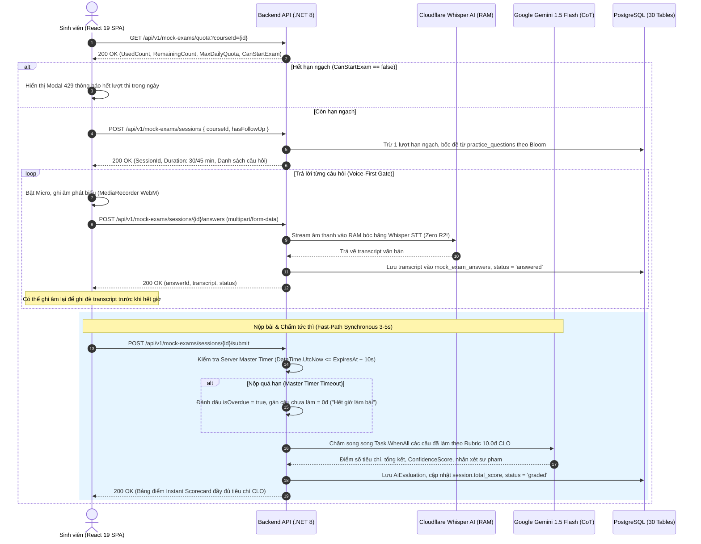

# 📘 TÀI LIỆU TÍCH HỢP FRONTEND — PHÂN HỆ MF-02 (TIMED MOCK EXAM)
## DỰ ÁN: LLM ORAL EXAM SYSTEM (FA26SE166 — ĐẠI HỌC FPT TP.HCM)

> **Dành cho:** Frontend Developers (Lê Vũ Hoàng & Nguyễn Đăng Hải)  
> **Tác giả:** Nguyễn Quang Thành (Team Leader & Lead Backend Architect) & worker_1  
> **Phiên bản:** 1.0 (Production-Ready) — Cập nhật: 2026-10-13  
> **Mục tiêu:** Hướng dẫn tích hợp toàn diện giao diện React 19 với Backend .NET 8 cho luồng Thi thử vấn đáp bấm giờ có hạn ngạch (MF-02), bao gồm RESTful APIs, Voice-First Audio Streaming Whisper STT, Server Master Timer chống gian lận, Fast-Path Instant AI Grading Scorecard (Gemini 1.5 Flash CoT Rubric 10.0đ CLO), và Student History Portal.

---

## 📑 MỤC LỤC
1. [Kiến Trúc Tổng Quan Luồng MF-02](#1-kiến-trúc-tổng-quan-luồng-mf-02)
2. [Quy Chuẩn Kết Nối & Môi Trường](#2-quy-chuẩn-kết-nối--môi-trường)
3. [Danh Sách RESTful API Endpoints](#3-danh-sách-restful-api-endpoints)
   - [3.1. Tra cứu hạn ngạch thi thử (`GET /api/v1/mock-exams/quota`)](#31-tra-cứu-hạn-ngạch-thi-thử-get-apiv1mock-examsquota)
   - [3.2. Khởi tạo ca thi thử (`POST /api/v1/mock-exams/sessions`)](#32-khởi-tạo-ca-thi-thử-post-apiv1mock-examssessions)
   - [3.3. Nộp câu trả lời Voice-First qua Micro (`POST /api/v1/mock-exams/sessions/{id}/answers`)](#33-nộp-câu-trả-lời-voice-first-qua-micro-post-apiv1mock-examssessionsidanswers)
   - [3.4. Nộp bài chính thức & Nhận Scorecard tức thì (`POST /api/v1/mock-exams/sessions/{id}/submit`)](#34-nộp-bài-chính-thức--nhận-scorecard-tức-thì-post-apiv1mock-examssessionsidsubmit)
   - [3.5. Tra cứu lịch sử thi thử (`GET /api/v1/mock-exams/history`)](#35-tra-cứu-lịch-sử-thi-thử-get-apiv1mock-examshistory)
   - [3.6. Tra cứu chi tiết bài thi & Scorecard (`GET /api/v1/mock-exams/history/{sessionId}`)](#36-tra-cứu-chi-tiết-bài-thi--scorecard-get-apiv1mock-examshistorysessionid)
4. [Cơ Chế Server Master Timer & Network Grace Period](#4-cơ-chế-server-master-timer--network-grace-period)
5. [Cơ Chế Voice-First & Zero R2 Invariant](#5-cơ-chế-voice-first--zero-r2-invariant)
6. [Instant AI Grading & Barem Rubric 10.0đ CLO](#6-instant-ai-grading--barem-rubric-100đ-clo)
7. [Chuẩn Xử Lý Lỗi RFC 7807 Problem Details](#7-chuẩn-xử-lý-lỗi-rfc-7807-problem-details)
8. [Checklist Tác Chiến Cho Frontend Dev (Hoàng & Hải)](#8-checklist-tác-chiến-cho-frontend-dev-hoàng--hải)

---

## 1. KIẾN TRÚC TỔNG QUAN LUỒNG MF-02

Luồng **MF-02 (Timed Mock Exam — Thi Thử Vấn Đáp Bấm Giờ Có Hạn Ngạch)** là môi trường thi giả lập phòng thi vấn đáp thật cho sinh viên ngành SE tại Đại học FPT TP.HCM:



### Các Đặc Tính Kỹ Thuật Trọng Yếu:
1. **Hạn ngạch động (Dynamic Daily Quota):** Admin cấu hình số lượt thi thử tối đa trong ngày qua `Course.MaxMockExamsPerDay` (mặc định $K = 3$). Reset tự động vào 00:00 GMT+7 (Giờ Việt Nam).
2. **Cô lập đề thi 100% (Zero Leakage):** Đề thi thử được rút ngẫu nhiên từ kho `practice_questions`, tuyệt đối cách ly khỏi kho `exam_questions` (kho thi thật phòng Lab Kiosk).
3. **Voice-First Gate & Zero R2 Storage:** Sinh viên bắt buộc phát biểu qua Micro. File âm thanh được stream trực tiếp vào Cloudflare Whisper STT trong bộ nhớ RAM và bị hủy ngay lập tức sau khi bóc băng. **Tuyệt đối KHÔNG lưu file audio lên Cloudflare R2** (tiết kiệm chi phí lưu trữ; Cloudflare R2 chỉ dành riêng cho MF-04).
4. **Server Master Timer:** Máy chủ quản lý thời gian thi chính thức: 30 phút (không follow-up) hoặc 45 phút (có follow-up). Cộng thêm **10 giây Network Grace Period** đệm trễ mạng. Quá hạn tự động thu bài, câu chưa làm nhận 0 điểm.
5. **Instant AI Feedback (3–5 giây):** Chấm song song đồng thời tất cả các câu hỏi qua Gemini 1.5 Flash theo Barem Rubric tổng 10.0đ chia theo chuẩn đầu ra môn học (CLOs), trả kết quả Scorecard tức thì trong cùng HTTP request.
6. **Lịch sử thi thử Student Portal (FE-02):** Sinh viên tra cứu toàn bộ các bài thi đã làm trong quá khứ, xem lại bản transcript câu trả lời và Scorecard chi tiết của AI.

---

## 2. QUY CHUẨN KẾT NỐI & MÔI TRƯỜNG

* **Base URL Backend:** `http://localhost:5000` (hoặc `https://api.oralexam.fpt.edu.vn`)
* **Prefix API:** `/api/v1/mock-exams` (Hỗ trợ alias: `/api/v1/mockexams`)
* **Xác thực:** JWT Bearer Token tại Header:
  ```http
  Authorization: Bearer <access_token>
  ```
* **Phân quyền Role:** Sinh viên (`student`) hoặc Giảng viên/Admin xem thử (`lecturer`, `department_head`, `admin`).
* **Header định danh phụ (Dev/Testing):**
  ```http
  X-User-Id: <student-guid>
  ```

---

## 3. DANH SÁCH RESTFUL API ENDPOINTS

### 3.1. Tra cứu hạn ngạch thi thử (`GET /api/v1/mock-exams/quota`)
Dùng để kiểm tra sinh viên còn lượt thi thử cho môn học này trong ngày hôm nay hay không trước khi mở modal cấu hình ca thi.

* **Method:** `GET`
* **URL:** `/api/v1/mock-exams/quota?courseId={courseId}`
* **Query Parameters:**
  * `courseId` (Guid, Bắt buộc): Mã định danh môn học muốn thi thử.
* **Response `200 OK`:**
  ```json
  {
    "courseId": "550e8400-e29b-41d4-a716-446655440000",
    "studentId": "c305c484-9ff5-4e89-8d7d-e6b7582eb727",
    "quotaDate": "2026-10-13",
    "usedCount": 1,
    "remainingCount": 2,
    "maxDailyQuota": 3,
    "canStartExam": true
  }
  ```
* **Frontend Handling:**
  * Nếu `canStartExam == true`: Mở màn hình/modal chọn "Có / Không Follow-up" để bắt đầu thi.
  * Nếu `canStartExam == false`: Vô hiệu hóa nút Bắt đầu, hiển thị Badge cảnh báo: *"Bạn đã dùng hết hạn ngạch thi thử hôm nay (3/3 lượt). Vui lòng quay lại vào ngày mai!"*.

---

### 3.2. Khởi tạo ca thi thử (`POST /api/v1/mock-exams/sessions`)
Khởi tạo ca thi, trừ 1 lượt hạn ngạch, bốc đề ngẫu nhiên theo ma trận Bloom (Remember, Understand, Apply...) từ kho `practice_questions`.

* **Method:** `POST`
* **URL:** `/api/v1/mock-exams/sessions`
* **Request Body (`application/json`):**
  ```json
  {
    "courseId": "550e8400-e29b-41d4-a716-446655440000",
    "hasFollowUp": false
  }
  ```
* **Response `200 OK`:**
  ```json
  {
    "sessionId": "b8a531b7-d812-4f76-883a-442c55b68231",
    "courseId": "550e8400-e29b-41d4-a716-446655440000",
    "courseCode": "SWD392",
    "courseName": "Software Architecture and Design",
    "hasFollowUp": false,
    "durationMinutes": 30,
    "startedAt": "2026-10-13T07:00:00Z",
    "expiresAt": "2026-10-13T07:30:00Z",
    "usedQuota": 2,
    "remainingQuota": 1,
    "maxDailyQuota": 3,
    "questions": [
      {
        "id": "771bfa3c-535c-4c6e-9844-48b0a99ff521",
        "orderIndex": 1,
        "title": "Clean Architecture Layering",
        "imageUrl": "/uploads/questions/202610/a1b2c3d4e5f6478980123456789abcde.png",
        "imageDescription": "Sơ đồ 4 vòng tròn đồng tâm Clean Architecture.",
        "content": "Hãy phân tích trách nhiệm và quy tắc phụ thuộc (Dependency Rule) của 4 phân tầng trong Clean Architecture.",
        "bloomLevel": "Apply",
        "difficulty": "medium",
        "rubricCriteria": [
          {
            "name": "Hiểu rõ 4 phân tầng",
            "maxScore": 5.0
          },
          {
            "name": "Quy tắc phụ thuộc một chiều",
            "maxScore": 5.0
          }
        ]
      }
    ]
  }
  ```
* **Response Lỗi `429 Too Many Requests` (Vượt quá hạn ngạch):**
  ```json
  {
    "type": "https://oralexam.fpt.edu.vn/errors/quota-exceeded",
    "title": "Too Many Requests",
    "status": 429,
    "detail": "Bạn đã sử dụng hết hạn ngạch thi thử trong ngày (3/3 lượt) cho môn học này."
  }
  ```

---

### 3.3. Nộp câu trả lời Voice-First qua Micro (`POST /api/v1/mock-exams/sessions/{id}/answers`)
Sinh viên thu âm bằng micro, gửi file âm thanh lên để Whisper AI bóc băng văn bản trực tiếp trong RAM.

* **Method:** `POST`
* **URL:** `/api/v1/mock-exams/sessions/{id}/answers`
* **Content-Type:** `multipart/form-data`
* **Form Data Fields:**
  * `QuestionId` (Guid, Bắt buộc): Mã câu hỏi trong đề thi.
  * `File` (IFormFile, Bắt buộc nếu không có Transcript): File âm thanh `.webm`, `.mp3`, hoặc `.wav` (tối đa 25MB).
  * `TimeTakenSeconds` (int, Bắt buộc): Số giây sinh viên đã dùng để trả lời câu này.
  * `Transcript` (string, Tùy chọn): Bản transcript hiệu đính nếu sinh viên gõ chỉnh sửa.
* **Response `200 OK`:**
  ```json
  {
    "answerId": "123e4567-e89b-12d3-a456-426614174000",
    "questionId": "771bfa3c-535c-4c6e-9844-48b0a99ff521",
    "transcript": "Clean Architecture có 4 tầng chính: Domain chứa entities, Application điều phối use case, Infrastructure giao tiếp CSDL bên ngoài, và Presentation là API. Mọi phụ thuộc bắt buộc hướng vào trong.",
    "status": "answered",
    "answeredAt": "2026-10-13T07:15:30Z"
  }
  ```
* **Lưu ý đặc biệt cho Frontend:**
  * Có thể gửi lại câu trả lời nhiều lần cho cùng 1 câu hỏi trước khi hết giờ; backend sẽ tự động ghi đè bản transcript mới nhất.
  * Nếu ca thi đã hết thời gian (quá `ExpiresAt + 10s`), backend trả về `410 Gone`:
    ```json
    {
      "type": "https://oralexam.fpt.edu.vn/errors/session-expired",
      "title": "Gone",
      "status": 410,
      "detail": "Ca thi đã hết thời gian làm bài."
    }
    ```

---

### 3.4. Nộp bài chính thức & Nhận Scorecard tức thì (`POST /api/v1/mock-exams/sessions/{id}/submit`)
Sinh viên ấn nút "Nộp bài" hoặc khi đồng hồ đếm ngược chạm 00:00 (hết giờ). Backend thực hiện chấm điểm song song tức thì bằng Google Gemini 1.5 Flash và trả về Bảng điểm chi tiết trong 3–5 giây.

* **Method:** `POST`
* **URL:** `/api/v1/mock-exams/sessions/{id}/submit`
* **Body:** Không yêu cầu (hoặc `{}`)
* **Response `200 OK` (Instant Scorecard):**
  ```json
  {
    "sessionId": "b8a531b7-d812-4f76-883a-442c55b68231",
    "courseId": "550e8400-e29b-41d4-a716-446655440000",
    "courseCode": "SWD392",
    "courseName": "Software Architecture and Design",
    "totalScore": 8.75,
    "classification": "Giỏi",
    "totalQuestions": 5,
    "answeredQuestions": 5,
    "durationMinutes": 30,
    "isOverdue": false,
    "startedAt": "2026-10-13T07:00:00Z",
    "submittedAt": "2026-10-13T07:28:45Z",
    "questions": [
      {
        "questionId": "771bfa3c-535c-4c6e-9844-48b0a99ff521",
        "orderIndex": 1,
        "title": "Clean Architecture Layering",
        "imageUrl": "/uploads/questions/202610/a1b2c3d4e5f6478980123456789abcde.png",
        "imageDescription": "Sơ đồ 4 vòng tròn đồng tâm Clean Architecture.",
        "content": "Hãy phân tích trách nhiệm và quy tắc phụ thuộc (Dependency Rule) của 4 phân tầng trong Clean Architecture.",
        "bloomLevel": "Apply",
        "difficulty": "medium",
        "transcript": "Clean Architecture có 4 tầng chính: Domain chứa entities, Application điều phối use case, Infrastructure giao tiếp CSDL bên ngoài, và Presentation là API. Mọi phụ thuộc bắt buộc hướng vào trong.",
        "score": 9.0,
        "feedback": "Thí sinh nắm rất chắc bản chất Clean Architecture, trình bày rành mạch quy tắc phụ thuộc.",
        "confidenceScore": 0.98,
        "criteriaScores": [
          {
            "criterionId": "912ec803-b7b4-4b55-8855-467f5fe00111",
            "criterionName": "Hiểu rõ 4 phân tầng",
            "bloomLevel": "Understand",
            "maxScore": 5.0,
            "score": 4.5,
            "comment": "Liệt kê chính xác trách nhiệm của cả 4 tầng."
          },
          {
            "criterionId": "912ec803-b7b4-4b55-8855-467f5fe00222",
            "criterionName": "Quy tắc phụ thuộc một chiều",
            "bloomLevel": "Apply",
            "maxScore": 5.0,
            "score": 4.5,
            "comment": "Nêu đúng Dependency Rule hướng tâm."
          }
        ]
      }
    ]
  }
  ```
* **Bảng Xếp Loại (Classification Scale):**
  * $\ge 9.0$: `"Xuất sắc"`
  * $\ge 8.0$: `"Giỏi"`
  * $\ge 6.5$: `"Khá"`
  * $\ge 5.0$: `"Trung bình"`
  * $< 5.0$: `"Yếu"`

---

### 3.5. Tra cứu lịch sử thi thử (`GET /api/v1/mock-exams/history`)
Dùng cho màn hình Student Portal (FE-02) để sinh viên theo dõi tiến độ luyện tập thi thử.

* **Method:** `GET`
* **URL:** `/api/v1/mock-exams/history?courseId={guid}&pageIndex=1&pageSize=10`
* **Query Parameters:**
  * `courseId` (Guid, Tùy chọn): Lọc theo môn học cụ thể.
  * `pageIndex` (int, Mặc định 1): Trang hiện tại.
  * `pageSize` (int, Mặc định 10): Số bản ghi trên mỗi trang.
* **Response `200 OK`:**
  ```json
  {
    "items": [
      {
        "sessionId": "b8a531b7-d812-4f76-883a-442c55b68231",
        "courseId": "550e8400-e29b-41d4-a716-446655440000",
        "courseCode": "SWD392",
        "courseName": "Software Architecture and Design",
        "startedAt": "2026-10-13T07:00:00Z",
        "durationMinutes": 30,
        "totalScore": 8.75,
        "status": "graded",
        "answeredQuestions": 5,
        "totalQuestions": 5
      }
    ],
    "pageIndex": 1,
    "pageSize": 10,
    "totalCount": 1,
    "totalPages": 1
  }
  ```

---

### 3.6. Tra cứu chi tiết bài thi & Scorecard (`GET /api/v1/mock-exams/history/{sessionId}`)
Xem lại chi tiết bài thi đã làm trong quá khứ, bao gồm toàn bộ đề thi, transcript đã nói và bảng điểm Scorecard nhận xét của AI.

* **Method:** `GET`
* **URL:** `/api/v1/mock-exams/history/{sessionId}`
* **Response `200 OK`:** Cấu trúc JSON tương đương với `MockExamScorecardDto` tại mục 3.4.

---

## 4. CƠ CHẾ SERVER MASTER TIMER & NETWORK GRACE PERIOD

Để ngăn chặn gian lận chỉnh sửa giờ hệ thống ở phía Client:
1. **Server Master Timer:** Thời điểm bắt đầu `StartedAt` và thời điểm hết hạn `ExpiresAt` do Backend xác lập:
   $$\text{ExpiresAt} = \text{StartedAt} + \text{DurationMinutes}$$
2. **Network Grace Period (10 giây):** Cho phép Client trễ tối đa 10 giây do độ trễ truyền gói tin mạng:
   $$\text{Deadline} = \text{ExpiresAt} + 10\text{s}$$
3. **Overdue Handling:**
   * Nếu nộp câu trả lời khi đã quá Deadline: Trả `HTTP 410 Gone`.
   * Nếu nộp bài chính thức khi đã quá Deadline: Backend tự động đánh dấu `isOverdue = true`, khóa ca thi, chỉ chấm các câu đã nộp trước đó; các câu chưa làm nhận 0 điểm kèm nhận xét: *"Hết giờ làm bài - Không có câu trả lời"*.
4. **Hướng dẫn Client:**
   * Tính số giây còn lại: `Math.max(0, Math.floor((new Date(expiresAt) - new Date()) / 1000))`.
   * Khi đồng hồ chạm 00:00, tự động gọi `POST /api/v1/mock-exams/sessions/{id}/submit` ngay lập tức để không bị quá 10 giây grace period.

---

## 5. CƠ CHẾ VOICE-FIRST & ZERO R2 INVARIANT

* **Voice-First Gate:** Màn hình làm bài khóa hoàn toàn việc gõ phím trực tiếp câu trả lời ban đầu, bắt buộc sinh viên bấm nút Micro để nói.
* **Định dạng ghi âm:** Trình duyệt sử dụng `MediaRecorder` API đóng gói âm thanh WebM (`audio/webm;codecs=opus`).
* **Không lưu Cloudflare R2:** Backend stream thẳng byte âm thanh vào bộ nhớ RAM gọi Cloudflare Whisper STT. Trường `audio_url` trên bảng `mock_exam_answers` luôn luôn bằng `null`. Giúp tiết kiệm 100% chi phí lưu trữ đám mây cho các phiên luyện tập và thi thử.

---

## 6. INSTANT AI GRADING & BAREM RUBRIC 10.0Đ CLO

* **Mô hình AI:** Google Gemini 1.5 Flash (`temperature: 0.2`).
* **Cơ chế Chấm song song:** Backend kích hoạt `Task.WhenAll` chấm đồng thời toàn bộ các câu hỏi đã nộp. Thời gian phản hồi API nộp bài cam kết từ **3 đến 5 giây**.
* **Đảm bảo tính toàn vẹn Barem:**
  * Tổng điểm mỗi câu hỏi chuẩn hóa $\equiv 10.0$ điểm.
  * Điểm tổng kết toàn bài: $\text{TotalScore} = \text{Round}\left(\frac{\sum \text{Score}_i}{N}, 2\right)$.
  * Điểm từng tiêu chí rubric con được map tương ứng theo chuẩn đầu ra CLO của đề cương môn học.

---

## 7. CHUẨN XỬ LÝ LỖI RFC 7807 PROBLEM DETAILS

Mọi phản hồi lỗi từ Backend đều tuân thủ chuẩn RFC 7807 với `Content-Type: application/problem+json`:

| HTTP Status | Error Type URL | Ý Nghĩa Nghiệp Vụ | Cách Xử Lý Ở Frontend |
|---|---|---|---|
| `400 Bad Request` | `.../errors/command-failed` | Lỗi tham số hoặc dữ liệu | Hiển thị Toast thông báo lỗi chi tiết từ `detail`. |
| `401 Unauthorized` | `.../errors/unauthorized` | Chưa đăng nhập hoặc token hết hạn | Redirect về màn hình đăng nhập Google Auth. |
| `404 Not Found` | `.../errors/not-found` | Môn học hoặc ca thi không tồn tại | Hiển thị màn hình 404 hoặc thông báo không tìm thấy. |
| `410 Gone` | `.../errors/session-expired` | Ca thi đã hết thời gian làm bài | Khóa thao tác thu âm, chuyển sang gọi submit tự động. |
| `429 Too Many Requests`| `.../errors/quota-exceeded` | Hết hạn ngạch thi thử trong ngày | Hiển thị Modal thông báo hết lượt thi thử hôm nay. |

---

## 8. CHECKLIST TÁC CHIẾN CHO FRONTEND DEV (HOÀNG & HẢI)

- [ ] **Màn hình chọn thi thử (Mock Exam Setup):** Gọi `GET /quota`, hiển thị số lượt còn lại (`remainingCount/maxDailyQuota`). Nếu hết lượt thì disable nút Bắt đầu.
- [ ] **Modal Bắt đầu thi:** Cho phép chọn môn học và tùy chọn `Có / Không Follow-up` (không cho chọn độ khó hay số câu hỏi, backend tự bốc theo Bloom).
- [ ] **Màn hình phòng thi thử (Exam Room):**
  - [ ] Hiển thị đồng hồ đếm ngược Server Master Timer dựa trên `expiresAt`.
  - [ ] Bộ thu âm Web Audio API: Bắt đầu nói $\to$ Dừng nói $\to$ Gửi file WebM lên endpoint `/answers`.
  - [ ] Cho phép xem lại transcript STT và nghe/nói lại trước khi hết giờ.
  - [ ] Đồng hồ đếm ngược chạm 00:00: Tự động khóa và gọi endpoint `/submit`.
- [ ] **Màn hình kết quả Scorecard (Instant Feedback):**
  - [ ] Hiển thị Điểm tổng kết thang 10.0đ và Badge xếp loại (`Xuất sắc`, `Giỏi`, `Khá`, `Trung bình`, `Yếu`).
  - [ ] Accordion danh sách câu hỏi: Hiển thị Đề bài, Transcript sinh viên đã nói, Nhận xét sư phạm của AI, và Barem điểm chi tiết từng tiêu chí theo CLO.
- [ ] **Màn hình Lịch sử thi thử (Student Portal - FE-02):**
  - [ ] Bảng danh sách bài thi đã làm với bộ lọc theo môn học và phân trang.
  - [ ] Bấm vào dòng bài thi mở Modal/Trang chi tiết hiển thị toàn bộ Scorecard của bài thi đó.
