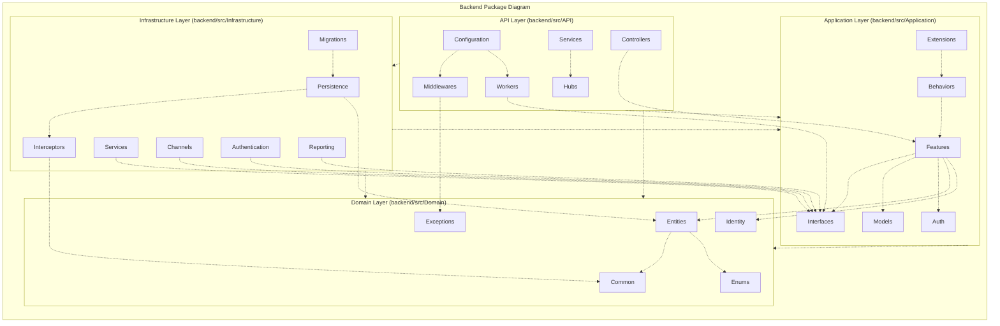
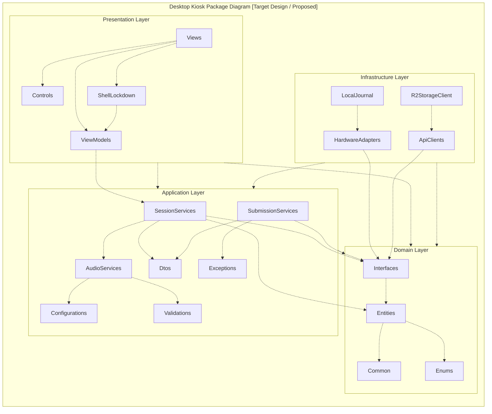

# REPORT 4 — SOFTWARE DESIGN DOCUMENT (BẢN TIẾNG VIỆT)
## PHẦN PHỤ TRÁCH: NGUYỄN QUANG THÀNH — MỤC 1.2.1 (`D-03`) & MỤC 1.2.3 (`D-05`)

> **Thông tin tài liệu:**
> - **Dự án:** Hệ Thống Luyện Thi & Đánh Giá Vấn Đáp Bằng LLM Cho Ngành Kỹ Thuật Phần Mềm (`FA26SE166`)
> - **Người thực hiện:** Nguyễn Quang Thành | **Người review chéo:** Phạm Nguyễn Đăng Hải
> - **Tệp sơ đồ Draw.io & PNG trong cùng thư mục:**
>   - `D-03` (`1.2.1`): [`D03_Backend_Package_Diagram.drawio`](./D03_Backend_Package_Diagram.drawio) | [`D03_Backend_Package_Diagram.png`](./D03_Backend_Package_Diagram.png)
>   - `D-05` (`1.2.3`): [`D05_Desktop_Kiosk_Package_Diagram.drawio`](./D05_Desktop_Kiosk_Package_Diagram.drawio) | [`D05_Desktop_Kiosk_Package_Diagram.png`](./D05_Desktop_Kiosk_Package_Diagram.png)

---

## 1.2. Sơ Đồ Gói Hệ Thống (Package Diagrams)

### 1.2.1. Sơ Đồ Gói Phân Hệ Backend (Backend Package Diagram — `D-03`)

#### a) Lý Do Lựa Chọn Kiến Trúc Backend (Clean Architecture 4 Tầng + CQRS + Persist-First Pipeline)

Hệ thống **Luyện Thi & Đánh Giá Vấn Đáp Bằng LLM (`FA26SE166`)** không sử dụng kiến trúc 3 lớp truyền thống (`Controller -> Service -> Repository`) mà lựa chọn **Clean Architecture 4 tầng** kết hợp **CQRS (MediatR)** và đường ống bất đồng bộ **Persist-First + BoundedChannel + Background Workers** vì **5 lý do kỹ thuật đặc thù của bài toán thi vấn đáp AI**:

1. **Cô lập luật nghiệp vụ cốt lõi khỏi sự phụ thuộc vào nhà cung cấp AI/Cloud bên ngoài (Chống Vendor Lock-in):**
   - Hệ thống tích hợp nhiều dịch vụ bên thứ ba có độ biến động cao: **Google Gemini 1.5 Flash/Pro** (sinh câu hỏi & chấm điểm theo chuỗi suy luận CoT), **Cloudflare Whisper** (nhận diện giọng nói STT), **TTS** và **Cloudflare R2** (lưu trữ tệp ghi âm `STT_MSSV.webm`).
   - Bằng cách đặt các giao diện trừu tượng (`IAiGradingService`, `IAiQuestionGenerationService`, `ISpeechToTextService`, `ITextToSpeechService`, `IStorageService`) tại gói `Interfaces` của `Application Layer` và đẩy toàn bộ code gọi API hãng thứ ba xuống `Infrastructure Layer`, tầng lõi nghiệp vụ hoàn toàn không biết đến SDK của Google hay Cloudflare. Khi cần nâng cấp mô hình LLM hoặc đổi nhà cung cấp lưu trữ, **100% mã nguồn ở `Domain Layer` và `Application Layer` được giữ nguyên**.
2. **Giải bài toán chịu tải đồng thời tại phòng thi Lab (40 máy trạm nộp bài cùng lúc) và chống mất bài làm:**
   - Quá trình LLM chấm một bài thi vấn đáp nhiều câu hỏi mất từ **3–8 giây** và có nguy cơ gặp giới hạn băng thông (`HTTP 429 Rate Limit`) hoặc đứt kết nối mạng. Nếu xử lý đồng bộ trên luồng HTTP Request như kiến trúc truyền thống, máy trạm Kiosk của thí sinh sẽ bị treo và dễ mất dữ liệu bài thi.
   - Kiến trúc hiện tại tách bạch hoàn toàn bước **Thu nhận bài nộp (`Application.Features`)** và bước **Chấm điểm ngầm (`API.Workers` + `Infrastructure.Channels`)**: API nộp bài chỉ lưu bản ghi xuống PostgreSQL ở trạng thái `SUBMITTED` trong **$< 100\text{ ms}$** và đẩy mã tác vụ vào hàng đợi RAM `BoundedChannel` (1,000 vị trí), sau đó các `Workers` chạy nền mới lấy ra gọi Gemini AI kèm cơ chế **Polly Retry 3 lần (2s, 4s, 8s)** và hàng đợi lỗi **`dead_letter_queues` (DLQ)**.
3. **Phục vụ đồng thời 2 ứng dụng khách (Web SPA & Desktop Kiosk) trên một lõi nghiệp vụ duy nhất:**
   - Backend vừa phục vụ **Web Application** (cho 6 vai trò RBAC thực hiện luyện tập MF-01, thi thử MF-02, ngân hàng đề MF-03, quản trị/hậu kiểm/phúc khảo MF-04, ca thi trong lớp MF-05), vừa phục vụ **Desktop Kiosk Application** (cho thí sinh ngồi tại ghế `1..40` phòng Lab làm bài thi thật MF-04).
   - Cả hai ứng dụng khách đều tái sử dụng chung các `Commands/Queries` trong `Application.Features` thông qua `API.Controllers` mà không bị nhân bản logic kiểm tra quyền hay trạng thái vé thi.
4. **Tách biệt luồng Đọc/Ghi (CQRS Vertical Slices) và hỗ trợ làm việc nhóm 4 thành viên không xung đột mã nguồn:**
   - Trong hệ thống khảo thí, luồng **Ghi (Command)** đòi hỏi kiểm tra ràng buộc rất chặt (tổng điểm Rubric $\equiv 10.0$, đối soát mã băm SHA-256 của file âm thanh, khóa điểm một chiều `is_locked = true`), trong khi luồng **Đọc (Query)** cần truy vấn tổng hợp nhanh cho Scorecard, Evidence Panel và bảng giám sát ca thi.
   - Việc chia gói `Features` theo từng lát cắt nghiệp vụ độc lập (`Practice`, `MockExams`, `QuestionBank`, `OfficialExams`, `Appeals`...) giúp 4 thành viên trong nhóm phát triển song song mà không xảy ra xung đột (merge conflict) trên các lớp `Service` dùng chung.
5. **Đảm bảo tính pháp lý phòng thi và khả năng kiểm thử độc lập (`1,462 Unit Tests`):**
   - Nhờ `Domain Layer` và `Application Layer` không phụ thuộc vào cơ sở dữ liệu vật lý hay dịch vụ mạng, toàn bộ quy tắc nghiệp vụ cốt lõi (chống 3 câu cùng độ khó liên tiếp, tính hạn ngạch thi thử theo môn, quy trình phúc khảo 5 bước, tách biệt 2 kho câu hỏi) đều được kiểm thử tự động với **1,462 bài Unit Test (`1,462 / 1,462 Passed`, Exit Code 0)** và kiểm tra ranh giới kiến trúc tự động tại [`CleanArchitectureRulesTests.cs`](file:///d:/Đồ%20Án/05_Source_Code/backend/tests/OralExamination.UnitTests/Architecture/CleanArchitectureRulesTests.cs).

---

#### b) Mô Tả 4 Tầng Kiến Trúc, Nhiệm Vụ Từng Tầng, Các Gói Con & Ví Dụ Thực Tế

| STT | Tên Tầng (Layer) | Dự án (`.csproj`) | Gói con Bên trong | Nhiệm vụ Cốt lõi & Quy tắc Phụ thuộc |
|:---:|:---|:---|:---|:---|
| **01** | **`Domain Layer`** *(Tầng Lõi Miền Nghiệp vụ)* | [`Domain.csproj`](file:///d:/Đồ%20Án/05_Source_Code/backend/src/Domain/Domain.csproj) | `Common`, `Entities`, `Enums`, `Exceptions`, `Identity` | • **Nhiệm vụ:** Lưu giữ **38 thực thể CSDL chuẩn 3NF**, các kiểu liệt kê (`6 Roles`, `7 trạng thái vé thi viết HOA`), giao diện khóa điểm một chiều (`ILockableEntity`) và các quy tắc bất biến cốt lõi. • **Quy tắc phụ thuộc:** **Tầng lõi thuần khiết — không phụ thuộc vào bất kỳ tầng nào khác.** |
| **02** | **`Application Layer`** *(Tầng Nghiệp vụ Ứng dụng — CQRS)* | [`Application.csproj`](file:///d:/Đồ%20Án/05_Source_Code/backend/src/Application/Application.csproj) | `Features`, `Interfaces`, `Behaviors`, `Models`, `Auth`, `Extensions` | • **Nhiệm vụ:** Điều phối các ca sử dụng (`MF-01..MF-05`) theo mô hình **Vertical Slices CQRS** (`Commands`, `Queries`, `Handlers`, `Validators`, `DTOs`); kiểm tra đầu vào bằng `FluentValidation`; định nghĩa **14 giao diện cổng trừu tượng (`Interfaces`)**. • **Quy tắc phụ thuộc:** **Chỉ phụ thuộc vào `Domain Layer`**. |
| **03** | **`Infrastructure Layer`** *(Tầng Hạ tầng Kỹ thuật & Tích hợp Ngoại vi)* | [`Infrastructure.csproj`](file:///d:/Đồ%20Án/05_Source_Code/backend/src/Infrastructure/Infrastructure.csproj) | `Persistence`, `Interceptors`, `Services`, `Migrations`, `Channels`, `Authentication`, `Reporting` | • **Nhiệm vụ:** Triển khai thực tế cho 14 `Interfaces` của `Application Layer`: quản lý PostgreSQL 16 (`OralExamDbContext`, `Migrations`), chặn sửa điểm đã khóa (`OneWayLockInterceptor`), vận hành hàng đợi RAM 1,000 vị trí (`Channels`), tích hợp Gemini AI, Whisper STT, Cloudflare R2 và xuất báo cáo Excel/PDF. • **Quy tắc phụ thuộc:** Phụ thuộc vào `Application Layer` và `Domain Layer`. |
| **04** | **`API Layer`** *(Tầng Giao tiếp & Điều phối Tiến trình nền)* | [`API.csproj`](file:///d:/Đồ%20Án/05_Source_Code/backend/src/API/API.csproj) | `Controllers`, `Middlewares`, `Configuration`, `Hubs`, `Services`, `Workers` | • **Nhiệm vụ:** Cổng giao tiếp HTTP REST (`/api/v1/*`) & SignalR (`/hubs/*`) tại cổng `5000`; chuẩn hóa lỗi trả về theo **RFC 7807 `ProblemDetails`**; vận hành 4 tiến trình nền `BackgroundService` (`Workers`) tiêu thụ hàng đợi chấm điểm và chấm bù DLQ. • **Quy tắc phụ thuộc:** Phụ thuộc vào `Application Layer`, `Infrastructure Layer` và `Domain Layer`. |

#### c) Sơ Đồ Backend Package Diagram (`Figure 1.2.1` / `D-03`)

> **Tệp Draw.io & PNG:** [`D03_Backend_Package_Diagram.drawio`](./D03_Backend_Package_Diagram.drawio) | [`D03_Backend_Package_Diagram.png`](./D03_Backend_Package_Diagram.png)

*Hình 1.2.1 — Sơ đồ gói phân hệ Backend (`Backend Package Diagram` — `D-03`).*

---

#### d) Bảng Mô Tả Các Gói Trong Phân Hệ Backend (`Table 1.2.1`)

| STT | Tầng (Layer) | Tên Gói (Package) | Đường dẫn Nguồn | Mô tả Trách nhiệm Nghiệp vụ & Kỹ thuật |
|:---:|:---|:---|:---|:---|
| **01** | **API Layer** | **`Controllers`** | [`API/Controllers/v1/`](file:///d:/Đồ%20Án/05_Source_Code/backend/src/API/Controllers/v1/) | Chứa 25 REST Controllers phục vụ cả **Web Application** và **Desktop Kiosk** theo 6 vai trò RBAC (`Auth`, `Speech`, `Practice`, `MockExams`, `Questions`, `Rubrics`, `ExamStructures`, `OfficialExams`, `OfficialExamCheckIn`, `OfficialExamSubmissions`, `Proctor`, `Appeals`, `DeadLetterQueue`, `Semesters`, `Courses`, `Classes`, `InClassShifts*`, `Admin`). |
| **02** | **API Layer** | **`Middlewares`** | [`API/Middlewares/`](file:///d:/Đồ%20Án/05_Source_Code/backend/src/API/Middlewares/) | Chứa `GlobalExceptionMiddleware` (chuẩn hóa mọi ngoại lệ về định dạng lỗi **RFC 7807 `ProblemDetails`**: `401`, `403`, `410 Gone`, `422`, `429`) và `MustChangePasswordMiddleware` (chặn tài khoản trường cấp chưa đổi mật khẩu lần đầu). |
| **03** | **API Layer** | **`Configuration`** | [`API/Configuration/`](file:///d:/Đồ%20Án/05_Source_Code/backend/src/API/Configuration/) | Chứa `DotEnvLoader` và cấu hình khởi tạo DI, CORS (`AllowFrontend`), JWT Bearer, Rate Limiting và Swagger tại [`Program.cs`](file:///d:/Đồ%20Án/05_Source_Code/backend/src/API/Program.cs). |
| **04** | **API Layer** | **`Hubs`** | [`API/Hubs/`](file:///d:/Đồ%20Án/05_Source_Code/backend/src/API/Hubs/) | Chứa 2 SignalR Hubs thời gian thực: `PracticeHub` (`/hubs/practice` — đẩy kết quả chấm điểm AI về màn hình luyện tập) và `AntiCheatHub` (`/hubs/anti-cheat` — phát cảnh báo vi phạm phòng thi từ Kiosk tới Giám thị/Khảo thí). |
| **05** | **API Layer** | **`Workers`** | [`API/Workers/`](file:///d:/Đồ%20Án/05_Source_Code/backend/src/API/Workers/) | Chứa 4 tiến trình nền `BackgroundService` (`GradingQueueWorker`, `OfficialExamGradingDispatcher`, `OfficialExamGradingWorker`, `OfficialExamDlqReplayWorker`): tiêu thụ hàng đợi `BoundedChannel` (1,000 vị trí RAM) song song đa luồng qua **`Parallel.ForEachAsync` (`MaxDegreeOfParallelism = 12`)**, thử lại **Polly Retry 3 lần (2s, 4s, 8s)**, gắn cờ nghi ngờ (`confidence < 0.70`), cách ly lỗi vào `dead_letter_queues` và tự động chấm bù sau mỗi 5 phút. |
| **06** | **API Layer** | **`Services`** | [`API/Services/`](file:///d:/Đồ%20Án/05_Source_Code/backend/src/API/Services/) | Chứa `AntiCheatSignalRNotifier` kết nối tầng nghiệp vụ với `AntiCheatHub` để phát thông báo vi phạm tức thì. |
| **07** | **Application Layer** | **`Features`** | [`Application/Features/`](file:///d:/Đồ%20Án/05_Source_Code/backend/src/Application/Features/) | Tổ chức theo mô hình **CQRS Vertical Slices** (`Commands`, `Queries`, `Handlers`, `Validators`, `DTOs`) cho toàn bộ các miền nghiệp vụ: `Auth`, `AcademicHierarchy` (R5), `Semesters`, `Courses` (`course_clos` 3NF), `Practice` (MF-01), `MockExams` (MF-02), `QuestionBank` (MF-03/R8 tách biệt 2 kho `practice_questions` & `exam_questions`), `OfficialExams` (MF-04), `Proctor` (R4), `Appeals` (R7), `DeadLetterQueue` (R2), `InClassShifts*` (R6), `Speech`, `Admin`. |
| **08** | **Application Layer** | **`Interfaces`** | [`Application/Common/Interfaces/`](file:///d:/Đồ%20Án/05_Source_Code/backend/src/Application/Common/Interfaces/) | Định nghĩa 14 giao diện trừu tượng (DIP Ports): `IApplicationDbContext`, `IAccessTokenIssuer`, `IGoogleIdTokenValidator`, `IPasswordHasher`, `IAiGradingService`, `IAiQuestionGenerationService`, `ISpeechToTextService`, `ITextToSpeechService`, `IStorageService`, `IGradingQueueChannel`, `IOfficialExamGradingQueue`, `IPracticeClient`, `IAntiCheatNotifier`, `IExamGradeReportExporter`. |
| **09** | **Application Layer** | **`Behaviors`** | [`Application/Common/Behaviors/`](file:///d:/Đồ%20Án/05_Source_Code/backend/src/Application/Common/Behaviors/) | Chứa `ValidationBehavior<TRequest, TResponse>` tự động kiểm tra ràng buộc dữ liệu bằng `FluentValidation` trước khi chuyển vào `Handler`. |
| **10** | **Application Layer** | **`Models`** | [`Application/Common/Models/`](file:///d:/Đồ%20Án/05_Source_Code/backend/src/Application/Common/Models/) | Chứa các đối tượng kết quả dùng chung (`Result`, `Result<T>`) và thông điệp tác vụ chấm điểm (`GradingTask`, `OfficialExamGradingWorkItem`). |
| **11** | **Application Layer** | **`Auth` & `Extensions`** | [`Application/Common/Auth/`](file:///d:/Đồ%20Án/05_Source_Code/backend/src/Application/Common/Auth/) | Chứa mô hình thông tin người dùng đăng nhập hiện hành và các hàm mở rộng đăng ký dịch vụ tầng `Application`. |
| **12** | **Domain Layer** | **`Entities`** | [`Domain/Entities/`](file:///d:/Đồ%20Án/05_Source_Code/backend/src/Domain/Entities/) | Chứa 38 thực thể CSDL chuẩn 3NF thuộc 7 miền nghiệp vụ (Identity, Academic & Course CLOs, Assessment & Dual Question Pools, Practice MF-01, Mock Exam MF-02, Official Exam MF-04, System Governance & In-Class Shifts R6). |
| **13** | **Domain Layer** | **`Enums`** | [`Domain/Enums/`](file:///d:/Đồ%20Án/05_Source_Code/backend/src/Domain/Enums/DomainEnums.cs) | Định nghĩa 6 vai trò `UserRole`, 7 trạng thái vé thi viết HOA (`ExamTicketStatus`: `SCHEDULED` $\to$ `LOCKED`), `UsageScope` (`Practice` / `OfficialExam` tách biệt 100%), `QuestionStatus`, `AppealStatus`, `DlqFlowType`. |
| **14** | **Domain Layer** | **`Common` & `Identity`** | [`Domain/Common/`](file:///d:/Đồ%20Án/05_Source_Code/backend/src/Domain/Common/) | Chứa lớp cơ sở `BaseEntity`, `IAggregateRoot`, giao diện khóa điểm một chiều `ILockableEntity` (`IsLocked`) và quy tắc định danh `StudentUsername`. |
| **15** | **Domain Layer** | **`Exceptions`** | [`Domain/Exceptions/`](file:///d:/Đồ%20Án/05_Source_Code/backend/src/Domain/Exceptions/) | Chứa các ngoại lệ nghiệp vụ cốt lõi: `DomainValidationException`, `OneWayLockException` (`HTTP 403`), `QuotaExceededException` (`HTTP 429`). |
| **16** | **Infrastructure Layer** | **`Persistence`** | [`Infrastructure/Persistence/`](file:///d:/Đồ%20Án/05_Source_Code/backend/src/Infrastructure/Persistence/OralExamDbContext.cs) | Chứa `OralExamDbContext` và `DatabaseSeeder`: cấu hình Fluent API, khóa ngoại, chỉ mục (Indexes), **64 Check Constraints** cấp CSDL (`ck_ai_evaluations_xor` 4 luồng, `ck_exam_questions_approval_status`, `ck_in_class_exam_shifts_*`...) và Warm Connection Pool Npgsql (`MinPoolSize = 10`, `MaxPoolSize = 200`, `ConnectionIdleLifetime = 60`) cho 38 bảng PostgreSQL 16. |
| **17** | **Infrastructure Layer** | **`Interceptors`** | [`Persistence/Interceptors/`](file:///d:/Đồ%20Án/05_Source_Code/backend/src/Infrastructure/Persistence/Interceptors/OneWayLockInterceptor.cs) | Chứa `OneWayLockInterceptor` (`SaveChangesInterceptor`): tự động chặn 100% thao tác `UPDATE/DELETE` trên vé thi và bản ghi hậu kiểm đã công bố điểm (`is_locked = true` $\to$ `HTTP 403`), chỉ mở ngoại lệ duy nhất khi Cán bộ Khảo thí phê duyệt quyết định phúc khảo cuối cùng (R7). |
| **18** | **Infrastructure Layer** | **`Migrations`** | [`Infrastructure/Migrations/`](file:///d:/Đồ%20Án/05_Source_Code/backend/src/Infrastructure/Migrations/) | Lưu trữ lịch sử di trú lược đồ CSDL EF Core 8 đồng bộ 100% với `Domain.Entities`. |
| **19** | **Infrastructure Layer** | **`Services`** | [`Infrastructure/Services/`](file:///d:/Đồ%20Án/05_Source_Code/backend/src/Infrastructure/Services/) | Triển khai tích hợp dịch vụ ngoài: `GeminiAiGradingService` (chấm điểm CoT & đa phương thức kèm ảnh sơ đồ), `GeminiQuestionGenerationService`, `CloudflareWhisperService` (STT), `ResilientTextToSpeechService` (TTS) và `CloudflareR2StorageService` (`STT_MSSV.webm` + kiểm tra SHA-256). |
| **20** | **Infrastructure Layer** | **`Channels`** | [`Infrastructure/Channels/`](file:///d:/Đồ%20Án/05_Source_Code/backend/src/Infrastructure/Channels/) | Chứa `BoundedGradingQueueChannel` và `BoundedOfficialExamGradingQueue`: hàng đợi RAM có sức chứa **1,000 vị trí** (`BoundedChannelFullMode.Wait`) bảo đảm nộp bài Persist-First trong $< 100\text{ ms}$. |
| **21** | **Infrastructure Layer** | **`Authentication`** | [`Infrastructure/Authentication/`](file:///d:/Đồ%20Án/05_Source_Code/backend/src/Infrastructure/Authentication/) | Chứa `GoogleIdTokenValidator` (xác thực Google OAuth 2.0), `JwtAccessTokenIssuer` và `Pbkdf2PasswordHasher` (băm mật khẩu tài khoản trường cấp). |
| **22** | **Infrastructure Layer** | **`Reporting`** | [`Infrastructure/Reporting/`](file:///d:/Đồ%20Án/05_Source_Code/backend/src/Infrastructure/Reporting/) | Chứa `ExamGradeReportExporter`: kết xuất bảng điểm ca thi chính thức ra tệp **Excel (`.xlsx` — ClosedXML)** và **PDF biên bản ký số (QuestPDF)** kèm mã băm SHA-256. |

*Bảng 1.2.1 — Mô tả các gói trong phân hệ Backend (`OralExamination.sln`).*

---

### 1.2.3. Sơ Đồ Gói Ứng Dụng Desktop Kiosk (Desktop Kiosk Package Diagram — `D-05`)

> [!IMPORTANT]
> **GHI CHÚ TRẠNG THÁI THIẾT KẾ (`[Target Design / Proposed]`):**
> Theo quy định tại bảng phân công Report 4, ứng dụng **Desktop Kiosk (`OralExamination.DesktopKiosk` — `[Target Design / Proposed]`)** được cài đặt trên máy trạm phòng Lab (ghế `1..40`), **chỉ phục vụ duy nhất luồng Thí sinh ngồi làm bài thi thật (MF-04 Candidate Execution)** và giao tiếp trực tiếp với các REST API đã triển khai trên Backend.

#### a) Sơ Đồ Desktop Kiosk Package Diagram (`Figure 1.2.3` / `D-05`)

> **Tệp Draw.io & PNG:** [`D05_Desktop_Kiosk_Package_Diagram.drawio`](./D05_Desktop_Kiosk_Package_Diagram.drawio) | [`D05_Desktop_Kiosk_Package_Diagram.png`](./D05_Desktop_Kiosk_Package_Diagram.png)

*Hình 1.2.3 — Sơ đồ gói ứng dụng Desktop Kiosk (`Desktop Kiosk Package Diagram` — `D-05` — `[Target Design / Proposed]`).*

---

#### b) Bảng Mô Tả Các Gói Trong Ứng Dụng Desktop Kiosk (`Table 1.2.3` — `[Target Design / Proposed]`)

| STT | Tầng (Layer) | Tên Gói (Package) | Các Thành phần Chính (Main Classes) | Mô tả Trách nhiệm Nghiệp vụ & Kỹ thuật |
|:---:|:---|:---|:---|:---|
| **01** | **Presentation Layer** | **`Views`** | `KioskLoginView`, `WorkstationLobbyView`, `HardwareMicTestView`, `ExamQuestionCanvasView`, `SafeSubmittedLockView` | Hiển thị giao diện toàn màn hình cho thí sinh tại ghế `1..40`: đăng nhập, phòng chờ đối chiếu ghế/IP, kiểm tra mic 30s, trả lời câu hỏi chính/phụ (`Follow-up`) và màn hình khóa an toàn sau khi nộp bài (**không hiện điểm số và không có nút khiếu nại tại chỗ**). |
| **02** | **Presentation Layer** | **`ShellLockdown`** | `KioskWindowManager`, `OsShortcutHookGuard`, `DisplayTopologyMonitor`, `FocusBlurStrikeTracker` | Khóa toàn màn hình độc quyền (Exclusive Fullscreen), chặn phím hệ thống (`Alt+Tab`, `Win`, `Esc`, `F11`, `F12`), chặn đa màn hình và đếm số lần mất tiêu điểm (**`blurCount > 3` tự động khóa bài thi và gọi API đình chỉ**). |
| **03** | **Presentation Layer** | **`Controls`** | `DecibelMeterWidget`, `WaveformRecorderControl`, `TechnicalDiagramViewer`, `TranscriptBufferEditor` | Các điều khiển giao diện chuyên biệt: thanh đo cường độ âm thanh dB, sóng âm ghi âm, trình xem ảnh sơ đồ kỹ thuật và bộ đếm ngược sửa thuật ngữ chuyên ngành SE (`TranscriptBufferSeconds` 10–300s). |
| **04** | **Presentation Layer** | **`ViewModels`** | `LobbyViewModel`, `MicCalibrationViewModel`, `ActiveExamViewModel`, `SubmissionLockViewModel` | Quản lý trạng thái hiển thị, điều phối luồng chuyển màn hình và ràng buộc dữ liệu hai chiều với `Views`. |
| **05** | **Application Layer** | **`SessionServices`** | `CandidateAuthCoordinator`, `TicketCheckInService`, `ServerMasterClockSynchronizer`, `AntiCheatTelemetryReporter` | Điều phối đăng nhập (`/api/v1/auth/*`), lấy vé máy trạm (`GET /api/v1/official-exams/tickets/current`), check-in theo `ip_address` (`POST .../check-in`), đồng bộ đồng hồ đếm ngược với máy chủ và gửi log vi phạm/đình chỉ khi `blurCount > 3` (`POST /api/v1/official-exams/anti-cheat/log`, `POST /api/v1/official-exams/tickets/{id}/suspend`; Giám thị báo cáo qua `POST /api/v1/proctor/shifts/{shiftId}/violations`). |
| **06** | **Application Layer** | **`AudioServices`** | `MicCalibrationService`, `ImmutableAudioFileNamer`, `Sha256AudioSealComputer`, `SttPreviewCoordinator` | Kiểm định bài thử mic 30 giây đạt ngưỡng **$\ge 60\text{ dB}$**, đặt tên tệp âm thanh bất biến **`STT_MSSV.webm`** (ví dụ: `01_SE170123.webm`), tính mã băm **SHA-256 (64 ký tự hex)** tại máy trạm và gọi bóc băng nháp (`/api/v1/speech/stt`, `/tts`). |
| **07** | **Application Layer** | **`SubmissionServices`** | `R2UploadOrchestrator`, `AudioSealConfirmationService`, `PersistFirstSubmissionDispatcher`, `IdempotencyRetryEngine` | Thực thi giao thức nộp bài 3 bước: (1) Xin Presigned URL & tải `STT_MSSV.webm` lên Cloudflare R2 -> (2) Gọi `PUT .../audio` niêm phong mã băm SHA-256 -> (3) Gọi `PUT .../submission` lưu bền vững trạng thái **`SUBMITTED` trong $< 100\text{ ms}$** (`HTTP 202 Accepted`) kèm cơ chế tự thử lại khi rớt mạng. |
| **08** | **Application Layer** | **`Dtos`**, **`Validations`**, **`Configurations`** & **`Exceptions`** | `KioskTicketDto`, `SubmitExamPayload`, `MicThresholdValidator`, `KioskOptions`, `WorkstationMismatchException` | Chứa các đối tượng truyền tải dữ liệu khớp với hợp đồng API Backend, bộ kiểm tra ngưỡng phần cứng ($\ge 60\text{ dB}$, định dạng SHA-256), cấu hình máy trạm và các ngoại lệ tầng ứng dụng. |
| **09** | **Domain Layer** | **`Interfaces`** | `IKioskApiClient`, `IR2DirectUploadClient`, `IAudioCaptureDevice`, `ILocalSessionJournal`, `IOsLockdownGuard` | Định nghĩa các giao diện trừu tượng (Contracts) kết nối giữa tầng nghiệp vụ Kiosk với phần cứng máy trạm, ổ đĩa cục bộ và dịch vụ mạng. |
| **10** | **Domain Layer** | **`Entities`**, **`Enums`** & **`Common`** | `WorkstationTicketSession`, `AudioSealRecord`, `AntiCheatStrikeEvent`, `ExamTicketStatus`, `ExamInputMode` | Chứa các thực thể trạng thái phiên thi tại máy trạm, bản ghi niêm phong âm thanh (`STT_MSSV.webm` + SHA-256) và các kiểu liệt kê đồng bộ với Backend (`SCHEDULED`, `IN_PROGRESS`, `SUBMITTED`). |
| **11** | **Infrastructure Layer** | **`ApiClients`** | `KioskRestHttpClient`, `KioskAuthHeaderInjector`, `Rfc7807ProblemDetailsParser` | Thực hiện giao tiếp HTTPS REST tới cổng `5000` của Backend, tự động đính kèm `Bearer JWT` và giải mã lỗi chuẩn RFC 7807 (`401`, `403 WrongWorkstation`, `409 Conflict`, `422`). |
| **12** | **Infrastructure Layer** | **`R2StorageClient`** | `R2DirectPutStreamClient` | Truyền trực tiếp luồng tệp âm thanh `STT_MSSV.webm` (`audio/webm`) lên Cloudflare R2 thông qua Presigned PUT URL mà không làm nghẽn băng thông máy chủ Backend. |
| **13** | **Infrastructure Layer** | **`HardwareAdapters`** | `WasapiMicrophoneAdapter`, `WebmOpusEncoder`, `Win32LowLevelKeyboardHook` | Giao tiếp trực tiếp với trình điều khiển âm thanh để thu mẫu PCM/WebM, đo biên độ dB thời gian thực và cài đặt Hook hệ điều hành chặn phím tắt. |
| **14** | **Infrastructure Layer** | **`LocalJournal`** | `EncryptedSessionJournal`, `EncryptedAudioChunkSpooler`, `ZeroFootprintSanitizer` | Ghi đệm các mảnh âm thanh đang thu và trạng thái phiên làm bài dưới dạng mã hóa AES-256 trên ổ đĩa cục bộ để khôi phục nếu sập nguồn; xóa sạch 100% dữ liệu tạm ngay sau khi nhận `202 Accepted`. |

*Bảng 1.2.3 — Mô tả các gói trong ứng dụng Desktop Kiosk (`OralExamination.DesktopKiosk` — `[Target Design / Proposed]`).*
