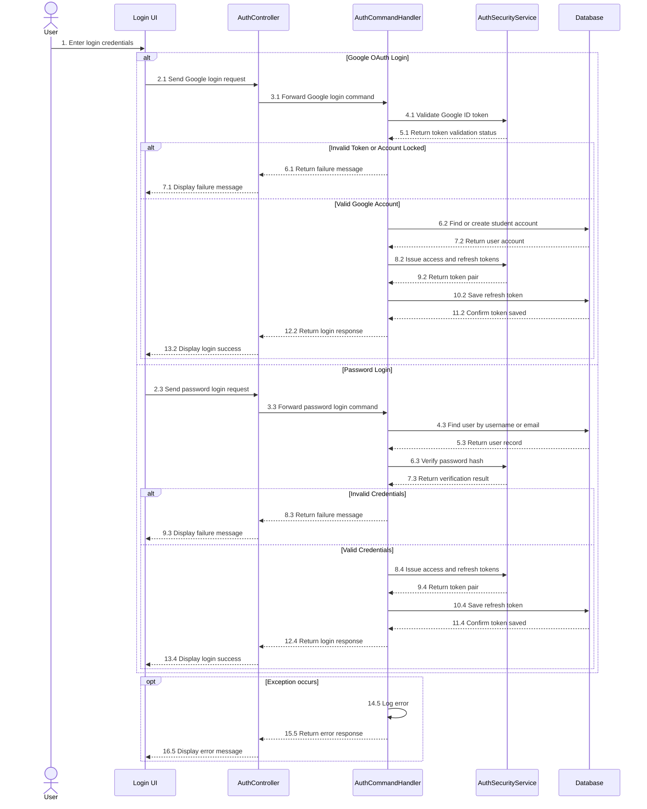

# REPORT 4 — SOFTWARE DESIGN DOCUMENT (DETAILED DESIGN)
## PHẦN PHỤ TRÁCH: NGUYỄN QUANG THÀNH — GÓI `DD-01` (SIGN IN, DUAL AUTH, REFRESH TOKEN & RBAC 6 ROLES)

> **Thông tin tài liệu:**
> - **Dự án:** Hệ Thống Luyện Thi & Đánh Giá Vấn Đáp Bằng LLM Cho Ngành Kỹ Thuật Phần Mềm (`FA26SE166`)
> - **Người thực hiện:** Nguyễn Quang Thành | **Người review chéo:** Phạm Nguyễn Đăng Hải
> - **Phạm vi bàn giao:** **`DD-01`:** Sign in, Dual Authentication, Refresh Token Rotation & RBAC 6 Roles
> - **Tệp sơ đồ Draw.io trong cùng thư mục:**
>   - `DD-01 Sequence Diagrams`: [`DD01_01_Google_Login_Sequence.drawio`](./DD01_01_Google_Login_Sequence.drawio) | [`DD01_02_Password_Login_Sequence.drawio`](./DD01_02_Password_Login_Sequence.drawio) | [`DD01_03_Must_Change_Password_Sequence.drawio`](./DD01_03_Must_Change_Password_Sequence.drawio) | [`DD01_04_Refresh_Token_Rotation_Sequence.drawio`](./DD01_04_Refresh_Token_Rotation_Sequence.drawio) | [`DD01_Auth_Sequence_Diagram.drawio`](./DD01_Auth_Sequence_Diagram.drawio)
>   - `DD-01 Class Diagram`: [`DD01_Auth_Class_Diagram.drawio`](./DD01_Auth_Class_Diagram.drawio)

---

## 3.1. Gói Thiết Kế Chi Tiết `DD-01`: Đăng Nhập, Xác Thực Kép, Xoay Vòng Refresh Token & Phân Quyền 6 Vai Trò RBAC
*(Feature Design Package DD-01 — Sign in, Dual Authentication, Refresh Token Rotation & RBAC 6 Roles)*

### 3.1.1. Tổng Quan Nghiệp Vụ & Kiến Trúc (`DD-01 Overview`)
Gói `DD-01` xử lý đăng nhập, quản lý phiên truy cập và phân quyền theo 6 vai trò (`admin`, `department_head`, `examination_officer`, `lecturer`, `proctor`, `student`) cho cả **Web Application** và **Desktop Kiosk Application**:
1. **Hai phương thức đăng nhập (Dual Authentication):**
   - **Đăng nhập Google (`POST /api/v1/auth/google-login`):** Xác thực `IdToken` từ Google. Nếu email chưa có trong bảng `users`, hệ thống tự động tạo tài khoản `student` (trích xuất `StudentCode` từ email `@fpt.edu.vn`); nếu đã có tài khoản thì giữ nguyên `Role` trong CSDL.
   - **Đăng nhập tài khoản trường cấp (`POST /api/v1/auth/password-login`):** Đăng nhập bằng `Username` và mật khẩu mã hóa `PBKDF2-SHA256`.
2. **Đổi mật khẩu lần đầu (`MustChangePasswordMiddleware` + `POST /api/v1/auth/change-password`):**
   - Tài khoản trường cấp mới khởi tạo có cờ `MustChangePassword = true`. Middleware sẽ yêu cầu người dùng đổi mật khẩu trước khi truy cập các chức năng khác.
3. **Làm mới phiên đăng nhập (`POST /api/v1/auth/refresh-token`):**
   - Khi làm mới phiên, Refresh Token cũ được đánh dấu thu hồi (`RevokedAt = UtcNow`) và hệ thống cấp cặp Access Token (15 phút) + Refresh Token mới (7 ngày). Nếu một Refresh Token đã thu hồi bị gửi lại, hệ thống sẽ thu hồi toàn bộ phiên đang mở của tài khoản đó để bảo vệ an toàn.

---

### 3.1.2. Sơ Đồ Tuần Tự (`DD-01 Sequence Diagrams — Các Tính Năng / Use Case Con Độc Lập`)

Nhằm đảm bảo tính trực quan và khả năng truy vết kiến trúc, luồng tuần tự của gói `DD-01` được phân rã thành **4 sơ đồ Use Case / sub-flow con độc lập** và 01 sơ đồ tổng quan kế thừa, toàn bộ tuân thủ quy chuẩn đơn sắc (Monochrome Grayscale) và cú pháp lifeline chuẩn UML (`: <u>Tên Đối Tượng</u>`):

1. **Google OAuth 2.0 PKCE Login (`DD01_01`):**
   - **Tệp sơ đồ Draw.io:** [`DD01_01_Google_Login_Sequence.drawio`](./DD01_01_Google_Login_Sequence.drawio)
   - **Mô tả kỹ thuật:** Xử lý đăng nhập thông qua Google Identity Services. Client gửi `IdToken` qua `POST /api/v1/auth/google-login`. `GoogleLoginCommandHandler` phối hợp cùng `IGoogleIdTokenValidator` (`GoogleJsonWebSignature.ValidateAsync`) để xác thực chữ ký số RSA. Nếu email thuộc định dạng `@fpt.edu.vn`, hệ thống tự động bóc tách mã sinh viên (`StudentCode`), tự động kích hoạt tài khoản `student` trong CSDL nếu chưa tồn tại. Sau đó, `IAccessTokenIssuer` phát hành JWT Access Token (15 phút) kèm Refresh Token mới (7 ngày) được băm một chiều `SHA-256` trước khi lưu vào bảng `refresh_tokens`.

2. **School Account Password Login (`DD01_02`):**
   - **Tệp sơ đồ Draw.io:** [`DD01_02_Password_Login_Sequence.drawio`](./DD01_02_Password_Login_Sequence.drawio)
   - **Mô tả kỹ thuật:** Xử lý đăng nhập bằng tài khoản nhà trường cấp cho 6 vai trò RBAC qua `POST /api/v1/auth/password-login`. `PasswordLoginCommandHandler` chuẩn hóa tên đăng nhập, truy vấn tài khoản từ bảng `users`, xác thực mật khẩu qua `IPasswordHasher.Verify` sử dụng thuật toán `PBKDF2-HMAC-SHA256` (210.000 vòng lặp) kết hợp hàm so sánh hằng thời gian `CryptographicOperations.FixedTimeEquals` chống tấn công đo thời gian (Timing Attack). Nếu tài khoản có cờ `MustChangePassword == true`, hệ thống nhúng claim tương ứng vào JWT để buộc đổi mật khẩu.

3. **Mandatory First-Time Password Change (`DD01_03`):**
   - **Tệp sơ đồ Draw.io:** [`DD01_03_Must_Change_Password_Sequence.drawio`](./DD01_03_Must_Change_Password_Sequence.drawio)
   - **Mô tả kỹ thuật:** Cơ chế bảo vệ cưỡng chế thông qua `MustChangePasswordMiddleware`. Khi người dùng sở hữu token có claim `must_change_password == "true"`, middleware chặn mọi yêu cầu tới các endpoint nghiệp vụ khác với mã lỗi `HTTP 403 Forbidden` (`application/problem+json`). Người dùng bắt buộc gửi yêu cầu tới `POST /api/v1/auth/change-password`. `ChangePasswordCommandHandler` kiểm tra mật khẩu hiện tại, bắt buộc mật khẩu mới phải khác mật khẩu cũ, băm lại bằng PBKDF2, cập nhật `MustChangePassword = false` và cấp phát cặp token mới để gỡ bỏ hạn chế.

4. **Refresh Token Rotation — RTR (`DD01_04`):**
   - **Tệp sơ đồ Draw.io:** [`DD01_04_Refresh_Token_Rotation_Sequence.drawio`](./DD01_04_Refresh_Token_Rotation_Sequence.drawio)
   - **Mô tả kỹ thuật:** Cơ chế xoay vòng Refresh Token phòng chống tấn công phát lại theo chuẩn `RFC 6819 §5.2.2.3` qua `POST /api/v1/auth/refresh-token`. Khi nhận Refresh Token, `RefreshTokenCommandHandler` băm SHA-256 và tìm trong bảng `refresh_tokens`. Nếu phát hiện token đã từng bị thu hồi trước đó (`IsRevoked == true`), hệ thống xác định đây là hành vi chiếm đoạt token (Replay Attack), lập tức thu hồi toàn bộ các Refresh Token đang hoạt động của người dùng đó và từ chối với `HTTP 401 Unauthorized`. Nếu token hợp lệ, hệ thống đánh dấu thu hồi token cũ (`RevokedAt = UtcNow`, gán `ReplacedByTokenHash`) và phát hành một cặp Access Token + Refresh Token mới hoàn toàn.

- **Sơ đồ tổng quan kế thừa:** [`DD01_Auth_Sequence_Diagram.drawio`](./DD01_Auth_Sequence_Diagram.drawio)

*Hình 3.1.2 — Sơ đồ tuần tự gói `DD-01` (Xác thực Kép, Cưỡng chế đổi mật khẩu lần đầu & Xoay vòng Refresh Token).*

---

### 3.1.3. Sơ Đồ Lớp (`DD-01 Class Diagram`)

> **Tệp Draw.io:** [`DD01_Auth_Class_Diagram.drawio`](./DD01_Auth_Class_Diagram.drawio)

```mermaid
classDiagram
    direction TB

    class AuthController {
        <<API Controller>>
        -ISender _sender
        +GoogleLogin(GoogleLoginRequest, CancellationToken) Task~IActionResult~
        +PasswordLogin(PasswordLoginRequest, CancellationToken) Task~IActionResult~
        +ChangePassword(ChangePasswordRequest, CancellationToken) Task~IActionResult~
        +RefreshToken(RefreshTokenRequest, CancellationToken) Task~IActionResult~
        +SignOut(SignOutRequest, CancellationToken) Task~IActionResult~
        -AuthProblem(string error) IActionResult
    }

    class MustChangePasswordMiddleware {
        <<API Middleware>>
        -RequestDelegate _next
        +InvokeAsync(HttpContext context) Task
        +IsAllowed(PathString path)$ bool
    }

    class GoogleLoginCommandHandler {
        <<Application Handler>>
        -IApplicationDbContext _context
        -IGoogleIdTokenValidator _googleIdTokenValidator
        -IAccessTokenIssuer _accessTokenIssuer
        -IValidator~GoogleLoginCommand~ _validator
        +Handle(GoogleLoginCommand, CancellationToken) Task~Result~GoogleLoginResponse~~
        +HashToken(string token)$ string
        +GenerateRawToken()$ string
    }

    class PasswordLoginCommandHandler {
        <<Application Handler>>
        -IApplicationDbContext _context
        -IPasswordHasher _passwordHasher
        -IAccessTokenIssuer _accessTokenIssuer
        -IValidator~PasswordLoginCommand~ _validator
        +Handle(PasswordLoginCommand, CancellationToken) Task~Result~PasswordLoginResponse~~
    }

    class ChangePasswordCommandHandler {
        <<Application Handler>>
        -IApplicationDbContext _context
        -IPasswordHasher _passwordHasher
        -IAccessTokenIssuer _accessTokenIssuer
        -IValidator~ChangePasswordCommand~ _validator
        +Handle(ChangePasswordCommand, CancellationToken) Task~Result~ChangePasswordResponse~~
    }

    class RefreshTokenCommandHandler {
        <<Application Handler>>
        -IApplicationDbContext _context
        -IAccessTokenIssuer _accessTokenIssuer
        -IValidator~RefreshTokenCommand~ _validator
        +Handle(RefreshTokenCommand, CancellationToken) Task~Result~RefreshTokenResponse~~
        +HashToken(string token)$ string
    }

    class SignOutCommandHandler {
        <<Application Handler>>
        -IApplicationDbContext _context
        -IValidator~SignOutCommand~ _validator
        +Handle(SignOutCommand, CancellationToken) Task~Result~bool~~
    }

    class IGoogleIdTokenValidator {
        <<Interface>>
        +ValidateAsync(string idToken, CancellationToken) Task~GoogleUserIdentity~
    }

    class IAccessTokenIssuer {
        <<Interface>>
        +Issue(Guid userId, string email, string fullName, string role, bool mustChangePassword) IssuedAccessToken
    }

    class IPasswordHasher {
        <<Interface>>
        +Hash(string password) string
        +Verify(string password, string passwordHash) bool
    }

    class GoogleIdTokenValidator {
        <<Infrastructure Service>>
        -IConfiguration _configuration
        +ValidateAsync(string idToken, CancellationToken) Task~GoogleUserIdentity~
    }

    class JwtAccessTokenIssuer {
        <<Infrastructure Service>>
        -IConfiguration _configuration
        +Issue(Guid userId, string email, string fullName, string role, bool mustChangePassword) IssuedAccessToken
    }

    class Pbkdf2PasswordHasher {
        <<Infrastructure Service>>
        +int Iterations = 210000$
        +Hash(string password) string
        +Verify(string password, string passwordHash) bool
    }

    class User {
        <<Domain Entity>>
        +Guid Id
        +string Email
        +string FullName
        +string? StudentCode
        +string? Username
        +string Role
        +string? PasswordHash
        +bool MustChangePassword
        +bool IsActive
        +DateTime CreatedAt
        +DateTime UpdatedAt
    }

    class RefreshToken {
        <<Domain Entity>>
        +Guid Id
        +Guid UserId
        +string TokenHash
        +DateTime ExpiresAt
        +DateTime? RevokedAt
        +string? ReplacedByTokenHash
        +bool IsExpired
        +bool IsRevoked
        +bool IsActive
    }

    class IApplicationDbContext {
        <<Interface>>
        +DbSet~User~ Users
        +DbSet~RefreshToken~ RefreshTokens
        +SaveChangesAsync(CancellationToken ct) Task~int~
    }

    class OralExamDbContext {
        +DbSet~User~ Users
        +DbSet~RefreshToken~ RefreshTokens
        +SaveChangesAsync(CancellationToken ct) Task~int~
    }

    AuthController ..> GoogleLoginCommandHandler : Uses
    AuthController ..> PasswordLoginCommandHandler : Uses
    AuthController ..> ChangePasswordCommandHandler : Uses
    AuthController ..> RefreshTokenCommandHandler : Uses
    AuthController ..> SignOutCommandHandler : Uses

    GoogleLoginCommandHandler ..> IGoogleIdTokenValidator : Uses
    GoogleLoginCommandHandler ..> IAccessTokenIssuer : Uses
    GoogleLoginCommandHandler ..> IApplicationDbContext : Uses
    PasswordLoginCommandHandler ..> IPasswordHasher : Uses
    PasswordLoginCommandHandler ..> IAccessTokenIssuer : Uses
    PasswordLoginCommandHandler ..> IApplicationDbContext : Uses
    ChangePasswordCommandHandler ..> IPasswordHasher : Uses
    ChangePasswordCommandHandler ..> IAccessTokenIssuer : Uses
    ChangePasswordCommandHandler ..> IApplicationDbContext : Uses
    RefreshTokenCommandHandler ..> IAccessTokenIssuer : Uses
    RefreshTokenCommandHandler ..> IApplicationDbContext : Uses
    SignOutCommandHandler ..> IApplicationDbContext : Uses

    GoogleIdTokenValidator ..|> IGoogleIdTokenValidator : Implements
    JwtAccessTokenIssuer ..|> IAccessTokenIssuer : Implements
    Pbkdf2PasswordHasher ..|> IPasswordHasher : Implements
    OralExamDbContext ..|> IApplicationDbContext : Implements

    IApplicationDbContext ..> User : Uses
    IApplicationDbContext ..> RefreshToken : Uses
    User "1" --> "*" RefreshToken : RefreshTokens
```

*Hình 3.1.3 — Sơ đồ lớp gói `DD-01` (Xác thực Kép, Xoay vòng Refresh Token & Phân quyền 6 Roles).*

---

### 3.1.4. Đặc Tả Chi Tiết Các Lớp (`DD-01 Class Specifications`)

#### A. Bảng Tổng Hợp Kiến Trúc Các Lớp (`Architectural Summary Table`)

| STT | Tên Lớp / Giao Diện | Tầng & Đường Dẫn Nguồn | Thuộc Tính & Phụ Thuộc Chính (Attributes) | Phương Thức Chính (Methods) | Quy Tắc Kiểm Tra & Mã Lỗi Phản Hồi (Validations & Error Responses) |
|:---:|:---|:---|:---|:---|:---|
| **01** | **`AuthController`** | `API Layer` [`AuthController.cs`](file:///d:/Đồ%20Án/05_Source_Code/backend/src/API/Controllers/v1/AuthController.cs) | `- _sender: ISender` | `+ GoogleLogin(GoogleLoginRequest, CancellationToken)` `+ PasswordLogin(PasswordLoginRequest, CancellationToken)` `+ ChangePassword(ChangePasswordRequest, CancellationToken)` `+ RefreshToken(RefreshTokenRequest, CancellationToken)` `+ SignOut(SignOutRequest, CancellationToken)` | • Không nhận `Role` từ request body (luôn lấy từ bảng `users`). • Trả về chuẩn **RFC 7807 `ProblemDetails`**:   - `400 Bad Request`: Dữ liệu rỗng hoặc mật khẩu mới trùng mật khẩu cũ.   - `401 Unauthorized`: Token Google lỗi, sai mật khẩu, hoặc Refresh Token hết hạn/bị thu hồi.   - `403 Forbidden`: Tài khoản có `IsActive == false`.   - `404 Not Found`: Không tìm thấy `username`. |
| **02** | **`MustChangePasswordMiddleware`** | `API Layer` [`MustChangePasswordMiddleware.cs`](file:///d:/Đồ%20Án/05_Source_Code/backend/src/API/Middlewares/MustChangePasswordMiddleware.cs) | `- _next: RequestDelegate` | `+ InvokeAsync(HttpContext): Task` `+ IsAllowed(PathString): bool` | • Kiểm tra claim `must_change_password == "true"` trên JWT. • Chỉ cho phép đi qua `/api/v1/auth/change-password`, `/refresh-token`, `/sign-out`, `/health`, `/swagger`. • Mọi đường dẫn khác bị chặn lại với mã **`HTTP 403 Forbidden`** (`application/problem+json`). |
| **03** | **`GoogleLoginCommandHandler`** | `Application Layer` [`GoogleLoginCommandHandler.cs`](file:///d:/Đồ%20Án/05_Source_Code/backend/src/Application/Features/Auth/Commands/GoogleLogin/GoogleLoginCommandHandler.cs) | `- _context: IApplicationDbContext` `- _googleIdTokenValidator: IGoogleIdTokenValidator` `- _accessTokenIssuer: IAccessTokenIssuer` `- _validator: IValidator<GoogleLoginCommand>` | `+ Handle(GoogleLoginCommand, CancellationToken): Task<Result<GoogleLoginResponse>>` `- EnsureStudentEnrolledInActiveClassesAsync(...)` `- TryExtractFptStudentCode(string email)` | • Kiểm tra `IdToken` không rỗng (`GoogleLoginCommandValidator`). • Tự động trích xuất `StudentCode` theo Regex `([a-zA-Z]{2}\d{6})@fpt\.edu\.vn$`. • Băm Refresh Token bằng `SHA-256` trước khi lưu vào bảng `refresh_tokens`. |
| **04** | **`PasswordLoginCommandHandler`** | `Application Layer` [`PasswordLoginCommandHandler.cs`](file:///d:/Đồ%20Án/05_Source_Code/backend/src/Application/Features/Auth/Commands/PasswordLogin/PasswordLoginCommandHandler.cs) | `- _context: IApplicationDbContext` `- _passwordHasher: IPasswordHasher` `- _accessTokenIssuer: IAccessTokenIssuer` `- _validator: IValidator<PasswordLoginCommand>` | `+ Handle(PasswordLoginCommand, CancellationToken): Task<Result<PasswordLoginResponse>>` | • Chuẩn hóa tên đăng nhập qua `StudentUsername.Normalize(username)`. • Kiểm tra `IsActive == true`, `PasswordHash != null` và đối chiếu mật khẩu qua `_passwordHasher.Verify()`. |
| **05** | **`ChangePasswordCommandHandler`** | `Application Layer` [`ChangePasswordCommandHandler.cs`](file:///d:/Đồ%20Án/05_Source_Code/backend/src/Application/Features/Auth/Commands/ChangePassword/ChangePasswordCommandHandler.cs) | `- _context: IApplicationDbContext` `- _passwordHasher: IPasswordHasher` `- _accessTokenIssuer: IAccessTokenIssuer` `- _validator: IValidator<ChangePasswordCommand>` | `+ Handle(ChangePasswordCommand, CancellationToken): Task<Result<ChangePasswordResponse>>` | • Yêu cầu mật khẩu mới tối thiểu 8 ký tự, khác mật khẩu hiện tại (`AuthErrors.PasswordUnchanged` $\to$ `HTTP 400`). • Cập nhật `MustChangePassword = false` và cấp cặp JWT + Refresh Token mới ngay lập tức. |
| **06** | **`RefreshTokenCommandHandler`** | `Application Layer` [`RefreshTokenCommandHandler.cs`](file:///d:/Đồ%20Án/05_Source_Code/backend/src/Application/Features/Auth/Commands/RefreshToken/RefreshTokenCommandHandler.cs) | `- _context: IApplicationDbContext` `- _accessTokenIssuer: IAccessTokenIssuer` `- _validator: IValidator<RefreshTokenCommand>` | `+ Handle(RefreshTokenCommand, CancellationToken): Task<Result<RefreshTokenResponse>>` `+ HashToken(string): string` `+ GenerateRawToken(): string` | • **Replay Attack Detection (`RFC 6819 §5.2.2.3`):** Nếu `existingToken.IsRevoked == true`, thu hồi toàn bộ Refresh Token đang hoạt động của `UserId` đó và trả `401 Unauthorized`. • Nếu hợp lệ: đánh dấu `RevokedAt = UtcNow`, gán `ReplacedByTokenHash` và tạo bản ghi `RefreshToken` mới. |
| **07** | **`SignOutCommandHandler`** | `Application Layer` [`SignOutCommandHandler.cs`](file:///d:/Đồ%20Án/05_Source_Code/backend/src/Application/Features/Auth/Commands/SignOut/SignOutCommandHandler.cs) | `- _context: IApplicationDbContext` `- _validator: IValidator<SignOutCommand>` | `+ Handle(SignOutCommand, CancellationToken): Task<Result<bool>>` | • Băm `RefreshToken` đầu vào, tìm bản ghi đang hoạt động và cập nhật `RevokedAt = DateTime.UtcNow`. |
| **08** | **`GoogleIdTokenValidator`** | `Infrastructure Layer` [`GoogleIdTokenValidator.cs`](file:///d:/Đồ%20Án/05_Source_Code/backend/src/Infrastructure/Authentication/GoogleIdTokenValidator.cs) | `- _configuration: IConfiguration` | `+ ValidateAsync(string idToken, CancellationToken): Task<GoogleUserIdentity>` | • Xác thực chữ ký RSA của Google qua `GoogleJsonWebSignature.ValidateAsync` với `Audience = [GOOGLE_OAUTH_CLIENT_ID]` và `EmailVerified == true`. |
| **09** | **`JwtAccessTokenIssuer`** | `Infrastructure Layer` [`JwtAccessTokenIssuer.cs`](file:///d:/Đồ%20Án/05_Source_Code/backend/src/Infrastructure/Authentication/JwtAccessTokenIssuer.cs) | `- _configuration: IConfiguration` | `+ Issue(Guid userId, string email, string fullName, string role, bool mustChangePassword): IssuedAccessToken` | • Ký JWT bằng thuật toán `HmacSha256` (khóa ký tối thiểu 32 bytes). • Nhúng các claims: `sub`, `email`, `name`, `role` (1 trong 6 roles) và `must_change_password` (nếu `true`). |
| **10** | **`Pbkdf2PasswordHasher`** | `Infrastructure Layer` [`Pbkdf2PasswordHasher.cs`](file:///d:/Đồ%20Án/05_Source_Code/backend/src/Infrastructure/Authentication/Pbkdf2PasswordHasher.cs) | `+ Iterations: int = 210_000` `- SaltSize: int = 16` `- KeySize: int = 32` | `+ Hash(string password): string` `+ Verify(string password, string passwordHash): bool` | • Sinh chuỗi băm theo định dạng `pbkdf2-sha256.210000.<base64_salt>.<base64_key>`. • So sánh mảng byte bằng `CryptographicOperations.FixedTimeEquals` để chống tấn công đo thời gian (Timing Attack). |
| **11** | **`User` & `RefreshToken`** | `Domain Layer` [`User.cs`](file:///d:/Đồ%20Án/05_Source_Code/backend/src/Domain/Entities/User.cs), [`RefreshToken.cs`](file:///d:/Đồ%20Án/05_Source_Code/backend/src/Domain/Entities/RefreshToken.cs) | `User`: `Id`, `Email`, `FullName`, `StudentCode`, `Username`, `Role`, `PasswordHash`, `MustChangePassword`, `IsActive` `RefreshToken`: `Id`, `UserId`, `TokenHash`, `ExpiresAt`, `RevokedAt`, `ReplacedByTokenHash` | Thuộc tính tính toán trên `RefreshToken`: `+ IsExpired: bool` `+ IsRevoked: bool` `+ IsActive: bool` | • Ánh xạ tới bảng `users` và `refresh_tokens` chuẩn 3NF. • Ràng buộc `users.role` chỉ nhận 1 trong 6 vai trò chuẩn hóa tại `UserRole`. |

*Bảng 3.1.4 — Đặc tả chi tiết các lớp trong gói `DD-01`.*

---

#### B. Đặc Tả Chi Tiết Phương Thức Từng Lớp (`Method-Level Class Specifications`)

##### 1. Lớp `AuthController`
- **Mô tả:** Điểm truy cập REST API xử lý xác thực kép (Google OAuth 2.0 & Tài khoản trường cấp), đổi mật khẩu bắt buộc lần đầu, xoay vòng Refresh Token và đăng xuất.

| No | Method | Description |
|:---:|:---|:---|
| **01** | `GoogleLogin` | Tiếp nhận `POST /api/v1/auth/google-login`, gửi `GoogleLoginCommand` qua MediatR để xác thực `IdToken` và trả về cặp Access Token + Refresh Token. |
| **02** | `PasswordLogin` | Tiếp nhận `POST /api/v1/auth/password-login`, xác thực tài khoản trường cấp qua `PasswordLoginCommand` và trả về trạng thái `MustChangePassword`. |
| **03** | `ChangePassword` | Tiếp nhận `POST /api/v1/auth/change-password`, cập nhật mật khẩu mới, gỡ cờ `MustChangePassword` và cấp lại cặp token mới. |
| **04** | `RefreshToken` | Tiếp nhận `POST /api/v1/auth/refresh-token`, thu hồi Refresh Token cũ, kiểm tra chống phát lại (Replay Attack) và cấp cặp token xoay vòng mới. |
| **05** | `SignOut` | Tiếp nhận `POST /api/v1/auth/sign-out`, đánh dấu thu hồi (`RevokedAt = UtcNow`) đối với Refresh Token hiện tại của phiên đăng nhập. |

##### 2. Lớp `AuthCommandHandler` (`GoogleLogin` / `PasswordLogin` / `ChangePassword` / `RefreshToken` / `SignOut`)
- **Mô tả:** Tầng xử lý nghiệp vụ xác thực, tự động cấp tài khoản `student` khi đăng nhập Google `@fpt.edu.vn`, kiểm tra mật khẩu `PBKDF2-SHA256` và xoay vòng `RefreshToken`.

| No | Method | Description |
|:---:|:---|:---|
| **01** | `Handle(GoogleLoginCommand)` | Xác thực `IdToken` với Google, tự động khởi tạo tài khoản `student` nếu email chưa tồn tại, lưu `RefreshToken` băm `SHA-256` và phát hành JWT. |
| **02** | `Handle(PasswordLoginCommand)` | Tìm tài khoản theo `Username` chuẩn hóa, kiểm tra `IsActive`, đối chiếu băm mật khẩu qua `IPasswordHasher.Verify` và cấp cặp token. |
| **03** | `Handle(ChangePasswordCommand)` | Kiểm tra mật khẩu hiện tại, đảm bảo mật khẩu mới khác mật khẩu cũ, băm mật khẩu mới bằng `PBKDF2-SHA256` và đặt `MustChangePassword = false`. |
| **04** | `Handle(RefreshTokenCommand)` | Đối chiếu mã băm `SHA-256` của Refresh Token; nếu phát hiện token đã thu hồi bị dùng lại thì thu hồi toàn bộ phiên của người dùng đó, ngược lại xoay vòng sang token mới. |
| **05** | `Handle(SignOutCommand)` | Tìm bản ghi `RefreshToken` đang hoạt động theo mã băm và cập nhật thời điểm thu hồi `RevokedAt = DateTime.UtcNow`. |

##### 3. Lớp `GoogleIdTokenValidator` (`IGoogleIdTokenValidator`)
- **Mô tả:** Dịch vụ hạ tầng kiểm tra chữ ký số RSA và thông tin định danh của Google ID Token.

| No | Method | Description |
|:---:|:---|:---|
| **01** | `ValidateAsync` | Xác thực chữ ký và `Audience` của `idToken` qua `GoogleJsonWebSignature.ValidateAsync`, trả về `GoogleUserIdentity` (`Email`, `FullName`, `Subject`). |

##### 4. Lớp `Pbkdf2PasswordHasher` (`IPasswordHasher`)
- **Mô tả:** Dịch vụ mã hóa và kiểm tra mật khẩu một chiều bằng thuật toán `PBKDF2-HMAC-SHA256` với `210.000` vòng lặp.

| No | Method | Description |
|:---:|:---|:---|
| **01** | `Hash` | Sinh muối ngẫu nhiên 16 bytes (`RandomNumberGenerator`) và băm mật khẩu thành chuỗi chuẩn `pbkdf2-sha256.210000.<salt>.<key>`. |
| **02** | `Verify` | Tách muối từ chuỗi băm lưu trữ, tính lại khóa băm và so sánh hằng thời gian qua `CryptographicOperations.FixedTimeEquals`. |

##### 5. Lớp `JwtAccessTokenIssuer` (`IAccessTokenIssuer`)
- **Mô tả:** Dịch vụ phát hành chuỗi JSON Web Token (JWT) chứa thông tin định danh và 1 trong 6 vai trò RBAC của người dùng.

| No | Method | Description |
|:---:|:---|:---|
| **01** | `Issue` | Tạo và ký số JWT (`HmacSha256`) chứa các claims `sub`, `email`, `name`, `role` và `must_change_password` cùng thời hạn hiệu lực chuẩn. |
