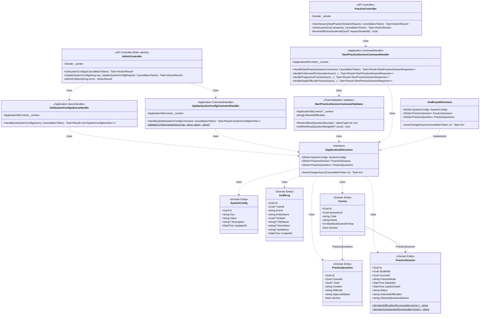
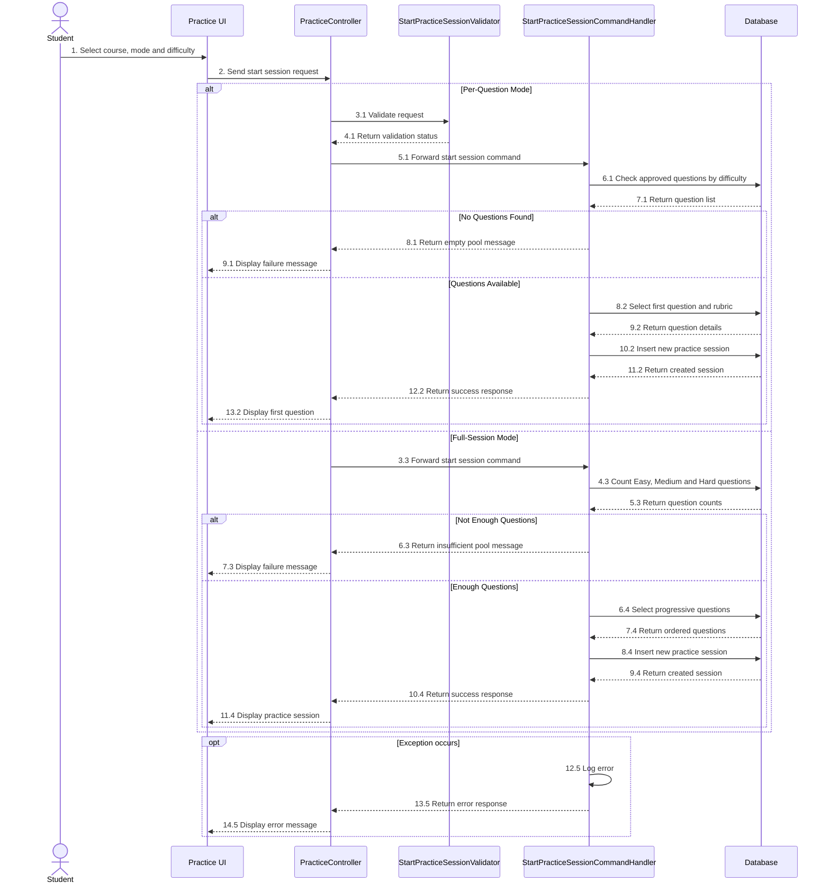

# REPORT 4 — SOFTWARE DESIGN DOCUMENT (DETAILED DESIGN)
## PHẦN PHỤ TRÁCH: NGUYỄN QUANG THÀNH — GÓI `DD-02` (PRACTICE CONFIGURATION & SESSION INITIALIZATION — MF-01)

> **Thông tin tài liệu:**
> - **Dự án:** Hệ Thống Luyện Thi & Đánh Giá Vấn Đáp Bằng LLM Cho Ngành Kỹ Thuật Phần Mềm (`FA26SE166`)
> - **Người thực hiện:** Nguyễn Quang Thành | **Người review chéo:** Phạm Nguyễn Đăng Hải
> - **Phạm vi bàn giao:** **`DD-02`:** Practice Configuration & Session Initialization (`MF-01`)
> - **Tệp sơ đồ Draw.io & PNG trong cùng thư mục:**
>   - `DD-02 Class Diagram`: [`DD02_PracticeInit_Class_Diagram.drawio`](./DD02_PracticeInit_Class_Diagram.drawio) | [`DD02_PracticeInit_Class_Diagram.png`](./DD02_PracticeInit_Class_Diagram.png)
>   - `DD-02 Sequence Diagram`: [`DD02_PracticeInit_Sequence_Diagram.drawio`](./DD02_PracticeInit_Sequence_Diagram.drawio) | [`DD02_PracticeInit_Sequence_Diagram.png`](./DD02_PracticeInit_Sequence_Diagram.png)

---

## 3.2. Gói Thiết Kế Chi Tiết `DD-02`: Cấu Hình Tham Số Luyện Tập & Khởi Tạo Phiên Luyện Tập (`MF-01`)
*(Feature Design Package DD-02 — Practice Configuration & Session Initialization)*

### 3.2.1. Tổng Quan Nghiệp Vụ & Kiến Trúc (`DD-02 Overview`)
Gói `DD-02` quản lý các tham số cấu hình của luồng **Luyện tập Tương tác Tự do (MF-01)** và khởi tạo phiên luyện tập cho sinh viên từ ngân hàng câu hỏi `practice_questions`:
1. **Cấu hình tham số luyện tập (`GET/PUT /api/v1/admin/system-configs/{key}`):**
   - Admin quản lý các tham số trong bảng `system_configs` và lưu lịch sử thay đổi vào `audit_logs`:
     - `TranscriptBufferSeconds`: Thời gian đếm ngược để sinh viên xem và sửa lại văn bản trả lời (**10–300 giây**, mặc định `60s`).
     - `MaxPracticeFollowUpQuestions`: Số câu hỏi phụ tối đa khi điểm câu chính đạt $4.0 \le \text{Score} \le 8.0$ (**1–5 câu**, mặc định `2`).
     - `MinMixedPracticeQuestions` & `MaxMixedPracticeQuestions`: Giới hạn số câu hỏi cho chế độ *Full-Session* (**3–10 câu**).
     - `SessionInactivityTimeoutMinutes`: Thời gian tự động đóng phiên khi không tương tác (mặc định **5 phút**).
2. **Khởi tạo phiên luyện tập (`POST /api/v1/practice/sessions`):**
   - Hệ thống đọc cấu hình từ `system_configs` và tạo phiên `PracticeSession` (`status = "in_progress"`) theo 2 chế độ:
     - **Chế độ `per_question` (Từng câu):** Sinh viên chọn 1 hoặc nhiều mức độ khó (`easy`, `medium`, `hard`). Hệ thống chọn ngẫu nhiên 1 câu hỏi đã duyệt (`APPROVED`) kèm tiêu chí `Rubric` để mở đầu phiên luyện tập.
     - **Chế độ `full_session` (Theo bộ 3–10 câu):** Chia đều số câu hỏi theo thứ tự tăng dần **Dễ $\to$ Trung bình $\to$ Khó**. Nếu ngân hàng câu hỏi của môn học chưa đủ số lượng theo từng mức độ, hệ thống trả về thông báo lỗi `HTTP 400 Bad Request`.

---

### 3.2.2. Sơ Đồ Lớp (`DD-02 Class Diagram`)

> **Tệp Draw.io & PNG:** [`DD02_PracticeInit_Class_Diagram.drawio`](./DD02_PracticeInit_Class_Diagram.drawio) | [`DD02_PracticeInit_Class_Diagram.png`](./DD02_PracticeInit_Class_Diagram.png)

*Hình 3.2.2 — Sơ đồ lớp gói `DD-02` (Cấu hình Tham số Luyện tập & Khởi tạo Phiên Luyện tập).*

---

### 3.2.3. Sơ Đồ Tuần Tự (`DD-02 Sequence Diagram — Luồng Chính & Luồng Lỗi/Rẽ Nhánh`)

> **Tệp Draw.io & PNG:** [`DD02_PracticeInit_Sequence_Diagram.drawio`](./DD02_PracticeInit_Sequence_Diagram.drawio) | [`DD02_PracticeInit_Sequence_Diagram.png`](./DD02_PracticeInit_Sequence_Diagram.png)

*Hình 3.2.3 — Sơ đồ tuần tự gói `DD-02` (Cấu hình Tham số Luyện tập bởi Admin & Khởi tạo Phiên Luyện tập 2 chế độ).*

---

### 3.2.4. Đặc Tả Chi Tiết Các Lớp (`DD-02 Class Specifications`)

#### A. Bảng Tổng Hợp Kiến Trúc Các Lớp (`Architectural Summary Table`)

| STT | Tên Lớp | Tầng & Đường Dẫn Nguồn | Thuộc Tính & Phụ Thuộc Chính (Attributes) | Phương Thức Chính (Methods) | Quy Tắc Kiểm Tra & Mã Lỗi Phản Hồi (Validations & Error Responses) |
|:---:|:---|:---|:---|:---|:---|
| **01** | **`AdminController`** | `API Layer` [`AdminController.cs`](file:///d:/Đồ%20Án/05_Source_Code/backend/src/API/Controllers/v1/AdminController.cs) | `- _sender: ISender` `[Authorize(Roles = "admin")]` | `+ GetSystemConfigs(CancellationToken)` `+ UpdateSystemConfig(string key, UpdateSystemConfigRequest, CancellationToken)` | • Giới hạn độc quyền cho vai trò `admin` (`HTTP 403` nếu vai trò khác gọi). • Chuyển lỗi `VALIDATION:` thành `HTTP 400 Bad Request` chuẩn RFC 7807. |
| **02** | **`UpdateSystemConfigCommandHandler`** | `Application Layer` [`UpdateSystemConfigCommand.cs`](file:///d:/Đồ%20Án/05_Source_Code/backend/src/Application/Features/Admin/Commands/UpdateSystemConfig/UpdateSystemConfigCommand.cs) | `- _context: IApplicationDbContext` | `+ Handle(UpdateSystemConfigCommand, CancellationToken): Task<Result<SystemConfigItemDto>>` `- ValidateConfigInvariant(string key, string value): string?` | • Kiểm tra miền giá trị bất biến:   - `TranscriptBufferSeconds` $\in [10, 300]$ giây.   - `MaxPracticeFollowUpQuestions` $\in [1, 5]$ câu.   - `MinMixedPracticeQuestions`, `MaxMixedPracticeQuestions` $\in [3, 10]$ câu và `Min <= Max`.   - `SessionInactivityTimeoutMinutes` $\in [1, 60]$ phút. • Ghi `AuditLog` (`SYSTEM_CONFIG_UPDATED`) trong cùng 1 transaction. |
| **03** | **`PracticeController`** | `API Layer` [`PracticeController.cs`](file:///d:/Đồ%20Án/05_Source_Code/backend/src/API/Controllers/v1/PracticeController.cs) | `- _sender: ISender` | `+ StartSession(StartPracticeSessionRequest): Task<IActionResult>` `+ GetSession(Guid sessionId): Task<IActionResult>` `- ResolveEffectiveStudentId(Guid?): Guid` | • Nếu người gọi là `student`, luôn ép `studentId` theo JWT claim `sub` (chống giả mạo ID sinh viên khác). • Trả về `404 Not Found` nếu môn học không tồn tại; `400 Bad Request` nếu kho đề thiếu câu hỏi hoặc sai cấu hình. |
| **04** | **`StartPracticeSessionCommandValidator`** | `Application Layer` [`StartPracticeSessionCommandValidator.cs`](file:///d:/Đồ%20Án/05_Source_Code/backend/src/Application/Features/Practice/Commands/StartPracticeSession/StartPracticeSessionCommandValidator.cs) | `- _context: IApplicationDbContext?` `- AllowedDifficulties: ["easy", "medium", "hard", "progressive"]` | `+ ResolveMixedQuestionBounds(): (int Min, int Max)` `+ IsWithinMixedQuestionRange(int? count): bool` | • Kiểm tra `StudentId` và `CourseId` khác `Guid.Empty`. • Khi `IsFullSession == true` hoặc `Difficulty == "progressive"`, bắt buộc `QuestionCount` nằm trong khoảng `[MinMixedPracticeQuestions, MaxMixedPracticeQuestions]` (mặc định `3..10`). |
| **05** | **`StartPracticeSessionCommandHandler`** | `Application Layer` [`StartPracticeSessionCommandHandler.cs`](file:///d:/Đồ%20Án/05_Source_Code/backend/src/Application/Features/Practice/Commands/StartPracticeSession/StartPracticeSessionCommandHandler.cs) | `- _context: IApplicationDbContext` | `+ Handle(StartPracticeSessionCommand, CancellationToken)` `- HandleOnDemandPerQuestionAsync(...)` `- HandleProgressivePracticeAsync(...)` `- HandleSingleDifficultyPracticeAsync(...)` | • **Tối ưu truy vấn 2 pha:** Pha 1 chỉ chiếu `(Id, Difficulty)` nhẹ trên Index của bảng `practice_questions` (`ApprovalStatus == "APPROVED"` & `IsActive`); Pha 2 chỉ tải `Content` và `Rubric.Criteria` cho đúng các ID câu hỏi được chọn. • Chế độ Progressive chia đều theo công thức `base = N/3, rem = N%3` và sắp xếp `Easy -> Medium -> Hard`; thiếu câu ở bất kỳ mức nào trả lỗi `HTTP 400`. |
| **06** | **`PracticeSession` & `SystemConfig`** | `Domain Layer` [`PracticeSession.cs`](file:///d:/Đồ%20Án/05_Source_Code/backend/src/Domain/Entities/PracticeSession.cs), [`SystemConfig.cs`](file:///d:/Đồ%20Án/05_Source_Code/backend/src/Domain/Entities/SystemConfig.cs) | `PracticeSession`: `Id`, `StudentId`, `CourseId`, `PracticeMode`, `StartedAt`, `LastActivityAt`, `Status`, `SelectedDifficulties`, `SelectedQuestionIdsJson` `SystemConfig`: `Id`, `Key`, `Value`, `Description`, `UpdatedAt` | `+ SerializeDifficulties(IEnumerable<string>): string` `+ SerializeQuestionIds(IEnumerable<Guid>): string` | • Lưu tách biệt danh sách độ khó (`SelectedDifficulties`) và danh sách mã câu hỏi đã cấp (`SelectedQuestionIdsJson`) chuẩn 3NF. • Khởi tạo `Status = "in_progress"` và `LastActivityAt = DateTime.UtcNow` để phục vụ kiểm tra timeout 5 phút (`HTTP 410 Gone`). |

*Bảng 3.2.4 — Đặc tả chi tiết các lớp trong gói `DD-02`.*

---

#### B. Đặc Tả Chi Tiết Phương Thức Từng Lớp (`Method-Level Class Specifications`)

##### 1. Lớp `AdminController` (Nhóm cấu hình `DD-02`)
- **Mô tả:** Cung cấp API cho Quản trị viên (`admin`) tra cứu và cập nhật các tham số cấu hình luyện tập trong bảng `system_configs`.

| No | Method | Description |
|:---:|:---|:---|
| **01** | `GetSystemConfigs` | Tiếp nhận `GET /api/v1/admin/system-configs`, trả về danh sách toàn bộ cấu hình hệ thống hiện hành. |
| **02** | `UpdateSystemConfig` | Tiếp nhận `PUT /api/v1/admin/system-configs/{key}`, kiểm tra miền giá trị hợp lệ, lưu cấu hình mới và ghi nhật ký `AuditLog`. |

##### 2. Lớp `UpdateSystemConfigCommandHandler`
- **Mô tả:** Kiểm tra ràng buộc miền giá trị của từng khóa cấu hình (`TranscriptBufferSeconds`, `MaxPracticeFollowUpQuestions`, `Min/MaxMixedPracticeQuestions`, `SessionInactivityTimeoutMinutes`) và lưu vết kiểm toán.

| No | Method | Description |
|:---:|:---|:---|
| **01** | `Handle` | Xác thực giá trị mới theo khóa cấu hình, cập nhật bản ghi `SystemConfig`, thêm bản ghi `AuditLog` (`SYSTEM_CONFIG_UPDATED`) và lưu xuống CSDL. |
| **02** | `ValidateConfigInvariant` | Kiểm tra ngưỡng hợp lệ: Buffer `10..300s`, Follow-up `1..5` câu, Progressive `3..10` câu (`Min <= Max`) và Timeout `1..60` phút. |

##### 3. Lớp `PracticeController` (Nhóm khởi tạo phiên `DD-02`)
- **Mô tả:** Tiếp nhận yêu cầu bắt đầu phiên luyện tập mới từ sinh viên và trả về câu hỏi mở đầu kèm thông số cấu hình phiên.

| No | Method | Description |
|:---:|:---|:---|
| **01** | `StartSession` | Tiếp nhận `POST /api/v1/practice/sessions`, gắn `StudentId` từ JWT và chuyển `StartPracticeSessionCommand` tới tầng Application. |
| **02** | `ResolveEffectiveStudentId` | Đảm bảo tài khoản `student` chỉ có thể khởi tạo hoặc truy vấn phiên luyện tập của chính mình dựa trên định danh trong JWT. |

##### 4. Lớp `StartPracticeSessionCommandValidator`
- **Mô tả:** Bộ kiểm tra dữ liệu đầu vào bằng FluentValidation trước khi khởi tạo phiên luyện tập.

| No | Method | Description |
|:---:|:---|:---|
| **01** | `ResolveMixedQuestionBounds` | Đọc cặp cấu hình `(MinMixedPracticeQuestions, MaxMixedPracticeQuestions)` từ bảng `system_configs` (mặc định `3..10`). |
| **02** | `IsWithinMixedQuestionRange` | Xác nhận số lượng câu hỏi sinh viên yêu cầu trong chế độ `FullSession` nằm trong khoảng `[Min, Max]` cho phép. |

##### 5. Lớp `StartPracticeSessionCommandHandler`
- **Mô tả:** Xử lý khởi tạo phiên luyện tập ở cả 2 chế độ (`Per-Question On-Demand` và `Full-Session Progressive`) từ kho câu hỏi `practice_questions` đã được duyệt (`APPROVED`).

| No | Method | Description |
|:---:|:---|:---|
| **01** | `Handle` | Kiểm tra môn học đang hoạt động, đọc cấu hình từ `system_configs` và điều phối sang nhánh khởi tạo `Per-Question` hoặc `Full-Session Progressive`. |
| **02** | `HandleOnDemandPerQuestionAsync` | Lọc các câu hỏi `APPROVED` thuộc tập độ khó sinh viên chọn, bốc ngẫu nhiên câu mở đầu kèm `Rubric` và tạo bản ghi `PracticeSession` (`per_question`). |
| **03** | `HandleProgressivePracticeAsync` | Chia đều số lượng câu hỏi theo thứ tự `Easy -> Medium -> Hard` (tối thiểu đủ câu ở cả 3 mức độ khó), nạp `Rubric` và tạo phiên `full_session`. |
