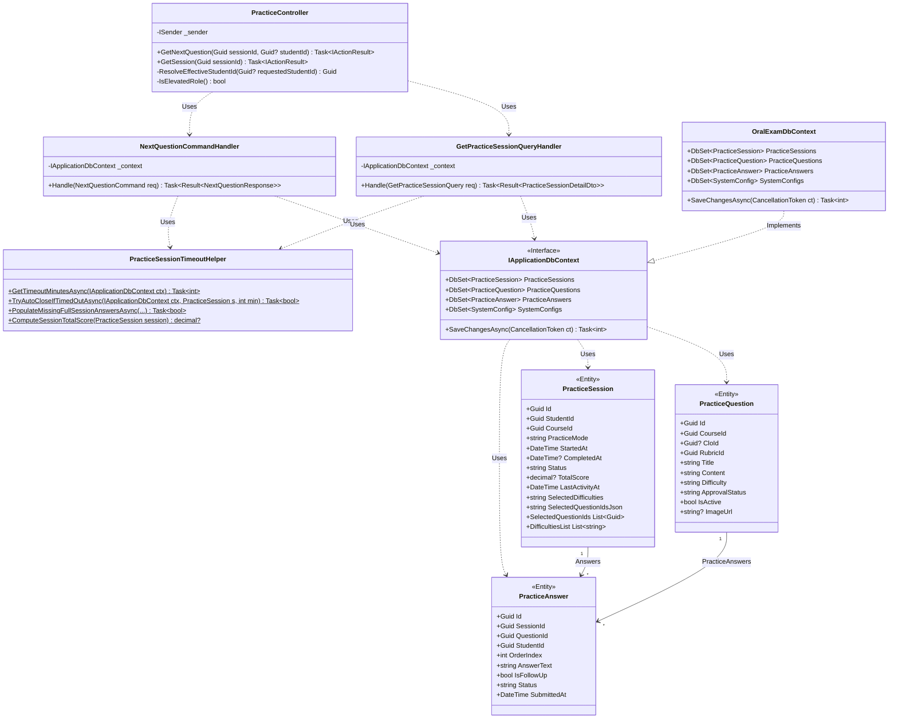
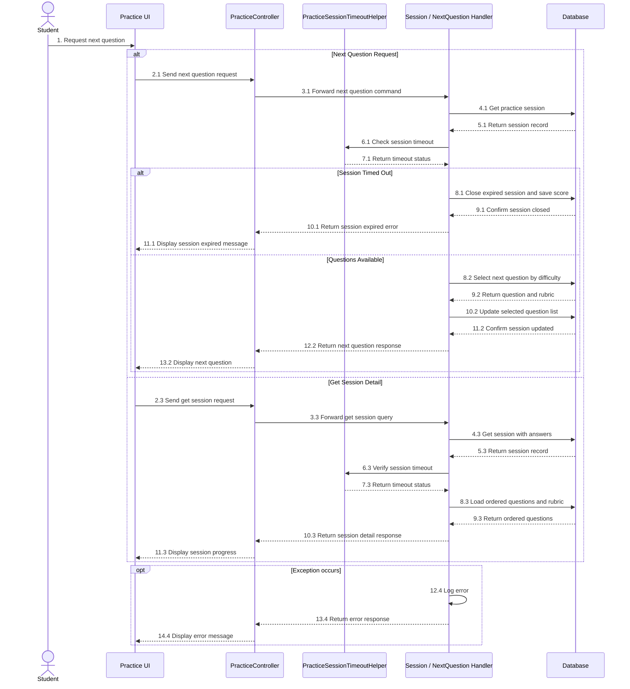

# REPORT 4 — SOFTWARE DESIGN DOCUMENT (DETAILED DESIGN)
## PHẦN PHỤ TRÁCH: NGUYỄN QUANG THÀNH — GÓI `DD-03` (PRACTICE MODE & QUESTION SELECTION: PER-QUESTION / FULL PROGRESSIVE — MF-01)

> **Thông tin tài liệu:**
> - **Dự án:** Hệ Thống Luyện Thi & Đánh Giá Vấn Đáp Bằng LLM Cho Ngành Kỹ Thuật Phần Mềm (`FA26SE166`)
> - **Người thực hiện:** Nguyễn Quang Thành | **Người review chéo:** Phạm Nguyễn Đăng Hải
> - **Phạm vi bàn giao:** **`DD-03`:** Practice Mode & Question Selection: Per-Question / Full Progressive (`MF-01`)
> - **Tệp sơ đồ Draw.io & PNG trong cùng thư mục:**
>   - `DD-03 Class Diagram`: [`DD03_QuestionSelection_Class_Diagram.drawio`](./DD03_QuestionSelection_Class_Diagram.drawio) | [`DD03_QuestionSelection_Class_Diagram.png`](./DD03_QuestionSelection_Class_Diagram.png)
>   - `DD-03 Sequence Diagram`: [`DD03_QuestionSelection_Sequence_Diagram.drawio`](./DD03_QuestionSelection_Sequence_Diagram.drawio) | [`DD03_QuestionSelection_Sequence_Diagram.png`](./DD03_QuestionSelection_Sequence_Diagram.png)

---

## 3.3. Gói Thiết Kế Chi Tiết `DD-03`: Chế Độ Luyện Tập, Thuật Toán Bốc Câu Hỏi & Kiểm Tra Quá Hạn Tương Tác (`MF-01`)
*(Feature Design Package DD-03 — Practice Mode & Question Selection: Per-Question / Full Progressive)*

### 3.3.1. Tổng Quan Nghiệp Vụ & Kiến Trúc (`DD-03 Overview`)
Gói `DD-03` xử lý việc lấy câu hỏi tiếp theo và tải chi tiết phiên luyện tập (`MF-01`) từ ngân hàng câu hỏi `practice_questions`:

1. **Lấy câu hỏi tiếp theo ở chế độ `per_question` (`POST /api/v1/practice/sessions/{sessionId}/next-question`):**
   - **Không lặp lại câu hỏi đã làm:** Hệ thống loại trừ các câu hỏi chính đã xuất hiện trong `session.SelectedQuestionIds` và `practice_answers`.
   - **Giới hạn tối đa 2 câu liên tiếp cùng độ khó:** Khi sinh viên chọn từ 2 mức độ khó trở lên, nếu 2 câu hỏi chính gần nhất có cùng độ khó `D` thì câu tiếp theo sẽ ưu tiên chọn ở mức độ khó khác. Nếu các mức khác đã hết câu hỏi, hệ thống mới lấy tiếp từ mức còn lại; khi toàn bộ câu hỏi đều đã làm hết thì trả về `HasMoreQuestions = false`.

2. **Xem chi tiết phiên luyện tập (`GET /api/v1/practice/sessions/{sessionId}`):**
   - Trả về danh sách câu hỏi theo đúng thứ tự trong `session.SelectedQuestionIds`, kèm câu trả lời của sinh viên, kết quả chấm điểm AI và thời gian đếm ngược `TranscriptBufferSeconds`.

3. **Tự động đóng phiên khi ngừng tương tác quá 5 phút (`PracticeSessionTimeoutHelper`):**
   - Trước khi lấy câu hỏi mới hoặc mở lại phiên đang làm dở (`in_progress`), hệ thống kiểm tra khoảng thời gian kể từ `LastActivityAt` so với cấu hình `SessionInactivityTimeoutMinutes` (mặc định 5 phút).
   - Nếu đã quá 5 phút: hệ thống tự động chuyển phiên sang `completed`, giữ nguyên điểm các câu đã nộp (với chế độ `full_session`, các câu bỏ trống được tính `0đ`) và trả về mã `HTTP 410 Gone`.

---

### 3.3.2. Sơ Đồ Lớp (`DD-03 Class Diagram`)

> **Tệp Draw.io & PNG:** [`DD03_QuestionSelection_Class_Diagram.drawio`](./DD03_QuestionSelection_Class_Diagram.drawio) | [`DD03_QuestionSelection_Class_Diagram.png`](./DD03_QuestionSelection_Class_Diagram.png)

*Hình 3.3.2 — Sơ đồ lớp gói `DD-03` (Chế độ Luyện tập, Bốc câu hỏi On-Demand / Progressive & Kiểm tra Quá hạn 5 phút).*

---

### 3.3.3. Sơ Đồ Tuần Tự (`DD-03 Sequence Diagram — Luồng Chính & Luồng Lỗi/Rẽ Nhánh`)

> **Tệp Draw.io & PNG:** [`DD03_QuestionSelection_Sequence_Diagram.drawio`](./DD03_QuestionSelection_Sequence_Diagram.drawio) | [`DD03_QuestionSelection_Sequence_Diagram.png`](./DD03_QuestionSelection_Sequence_Diagram.png)

*Hình 3.3.3 — Sơ đồ tuần tự gói `DD-03` (Bốc câu hỏi On-Demand, Chống 3 câu cùng độ khó liên tiếp & Tự đóng phiên quá hạn 5 phút).*

---

### 3.3.4. Đặc Tả Chi Tiết Các Lớp (`DD-03 Class Specifications`)

#### A. Bảng Tổng Hợp Kiến Trúc Các Lớp (`Architectural Summary Table`)

| STT | Tên Lớp / Giao Diện | Tầng & Đường Dẫn Nguồn | Thuộc Tính & Phụ Thuộc Chính (Attributes) | Phương Thức Chính (Methods) | Quy Tắc Kiểm Tra & Mã Lỗi Phản Hồi (Validations & Error Responses) |
|:---:|:---|:---|:---|:---|:---|
| **01** | **`PracticeController`** | `API Layer` [`PracticeController.cs`](file:///d:/Đồ%20Án/05_Source_Code/backend/src/API/Controllers/v1/PracticeController.cs) | `- _sender: ISender` | `+ GetNextQuestion(Guid sessionId, Guid? studentId)` `+ GetSession(Guid sessionId)` `- ResolveEffectiveStudentId(Guid?): Guid` `- IsElevatedRole(): bool` | • Ánh xạ lỗi tiền tố `SESSION_TIMEOUT_410:` sang mã trạng thái **`HTTP 410 Gone`** chuẩn RFC 7807. • Trả về `403 Forbidden` nếu sinh viên cố truy cập phiên luyện tập của người khác; `404 Not Found` nếu phiên không tồn tại; `400 Bad Request` nếu gọi `next-question` trên phiên `full_session`. |
| **02** | **`NextQuestionCommandHandler`** | `Application Layer` [`NextQuestionCommandHandler.cs`](file:///d:/Đồ%20Án/05_Source_Code/backend/src/Application/Features/Practice/Commands/NextQuestion/NextQuestionCommandHandler.cs) | `- _context: IApplicationDbContext` | `+ Handle(NextQuestionCommand, CancellationToken): Task<Result<NextQuestionResponse>>` | • Kiểm tra `session.PracticeMode == "per_question"` và `session.Status == "in_progress"`. • Thực thi thuật toán **Anti-3-Consecutive-Same-Level**: nếu 2 câu chính liền trước cùng độ khó `D`, loại `D` khỏi tập ứng viên kế tiếp (tự động fallback nếu các mức khác đã hết câu hỏi). • Cập nhật `session.SelectedQuestionIds` và `session.LastActivityAt = DateTime.UtcNow`. |
| **03** | **`GetPracticeSessionQueryHandler`** | `Application Layer` [`GetPracticeSessionQueryHandler.cs`](file:///d:/Đồ%20Án/05_Source_Code/backend/src/Application/Features/Practice/Queries/GetPracticeSession/GetPracticeSessionQueryHandler.cs) | `- _context: IApplicationDbContext` | `+ Handle(GetPracticeSessionQuery, CancellationToken): Task<Result<PracticeSessionDetailDto>>` | • Sử dụng `.AsSplitQuery()` để tránh nhân bản dữ liệu Cartesian khi tải `Answers -> AiEvaluations -> Details -> Criterion`. • Khôi phục đúng thứ tự câu hỏi trong `session.SelectedQuestionIds` và tính cờ `NeedsFollowUp` dựa trên điểm $4.0 \le \text{Score} \le 8.0$ cùng cấu hình `MaxPracticeFollowUpQuestions`. |
| **04** | **`PracticeSessionTimeoutHelper`** | `Application Layer` [`PracticeSessionTimeoutHelper.cs`](file:///d:/Đồ%20Án/05_Source_Code/backend/src/Application/Features/Practice/Common/PracticeSessionTimeoutHelper.cs) | *(Lớp tĩnh tiện ích nghiệp vụ)* | `+ GetTimeoutMinutesAsync(IApplicationDbContext, CancellationToken): Task<int>` `+ TryAutoCloseIfTimedOutAsync(...)` `+ PopulateMissingFullSessionAnswersAsync(...)` `+ ComputeSessionTotalScore(...)` | • Đọc `SessionInactivityTimeoutMinutes` từ bảng `system_configs` (mặc định `5` phút). • Khi quá hạn: tự động đóng phiên (`status = "completed"`), tính điểm trung bình các câu đã hoàn thành; với chế độ `full_session` tự động sinh bản ghi `0.0đ` cho các câu bỏ trống trước khi chia trung bình trên tổng số câu đã cấp. |
| **05** | **`PracticeSession` & `PracticeQuestion`** | `Domain Layer` [`PracticeSession.cs`](file:///d:/Đồ%20Án/05_Source_Code/backend/src/Domain/Entities/PracticeSession.cs), [`PracticeQuestion.cs`](file:///d:/Đồ%20Án/05_Source_Code/backend/src/Domain/Entities/PracticeQuestion.cs) | `PracticeSession`: `Id`, `StudentId`, `CourseId`, `PracticeMode`, `Status`, `LastActivityAt`, `SelectedDifficulties`, `SelectedQuestionIdsJson` `PracticeQuestion`: `Id`, `CourseId`, `CloId`, `Content`, `Difficulty`, `ApprovalStatus`, `IsActive` | `+ SelectedQuestionIds: List<Guid>` `+ DifficultiesList: IReadOnlyList<string>` | • Lưu trữ tách biệt mảng độ khó (`SelectedDifficulties`) và danh sách ID câu hỏi đã bốc (`SelectedQuestionIdsJson`) chuẩn 3NF, không nhồi dữ liệu ngoại lai vào một cột. |

*Bảng 3.3.4 — Đặc tả chi tiết các lớp trong gói `DD-03`.*

---

#### B. Đặc Tả Chi Tiết Phương Thức Từng Lớp (`Method-Level Class Specifications`)

##### 1. Lớp `PracticeController` (Nhóm bốc câu hỏi `DD-03`)
- **Mô tả:** Cung cấp API lấy câu hỏi tiếp theo theo yêu cầu (`On-Demand`) và truy vấn trạng thái câu hỏi trong phiên luyện tập.

| No | Method | Description |
|:---:|:---|:---|
| **01** | `GetNextQuestion` | Tiếp nhận `POST /api/v1/practice/sessions/{id}/next-question`, gửi `NextQuestionCommand` để bốc câu hỏi mới hoặc trả về `HTTP 410 Gone` nếu phiên đã quá hạn 5 phút. |
| **02** | `GetSession` | Tiếp nhận `GET /api/v1/practice/sessions/{id}`, trả về danh sách câu hỏi theo đúng thứ tự đã cấp cùng trạng thái làm bài hiện tại của phiên. |

##### 2. Lớp `NextQuestionCommandHandler`
- **Mô tả:** Thực thi thuật toán bốc câu hỏi tiếp theo trong chế độ `per_question`, đảm bảo không trùng câu hỏi đã làm và chống lặp quá 2 câu liên tiếp cùng độ khó (`Anti-3-Consecutive`).

| No | Method | Description |
|:---:|:---|:---|
| **01** | `Handle` | Kiểm tra hạn chờ 5 phút (`410 Gone`), loại trừ các ID câu hỏi đã làm, áp dụng quy tắc đổi mức độ khó nếu 2 câu chính liền trước trùng mức độ, cập nhật `SelectedQuestionIds` và trả về câu hỏi mới kèm `Rubric`. |

##### 3. Lớp `GetPracticeSessionQueryHandler`
- **Mô tả:** Nạp chi tiết phiên luyện tập và khôi phục danh sách câu hỏi theo đúng thứ tự lưu trong `SelectedQuestionIdsJson`.

| No | Method | Description |
|:---:|:---|:---|
| **01** | `Handle` | Kiểm tra hạn chờ không tương tác 5 phút, tải danh sách câu hỏi cùng tiêu chí chấm điểm `Rubric` và ánh xạ sang `PracticeSessionDetailDto`. |

##### 4. Lớp `PracticeSessionTimeoutHelper`
- **Mô tả:** Kiểm tra thời gian ngừng tương tác của sinh viên và tự động đóng phiên luyện tập khi vượt quá ngưỡng `SessionInactivityTimeoutMinutes` (mặc định 5 phút).

| No | Method | Description |
|:---:|:---|:---|
| **01** | `GetTimeoutMinutesAsync` | Truy vấn số phút timeout từ bảng `system_configs` (mặc định `5` phút). |
| **02** | `TryAutoCloseIfTimedOutAsync` | Tự động chuyển trạng thái phiên sang `completed` nếu quá 5 phút không tương tác, bảo toàn điểm các câu đã làm và gán `0.0` điểm cho các câu bỏ trống trong `FullSession`. |
