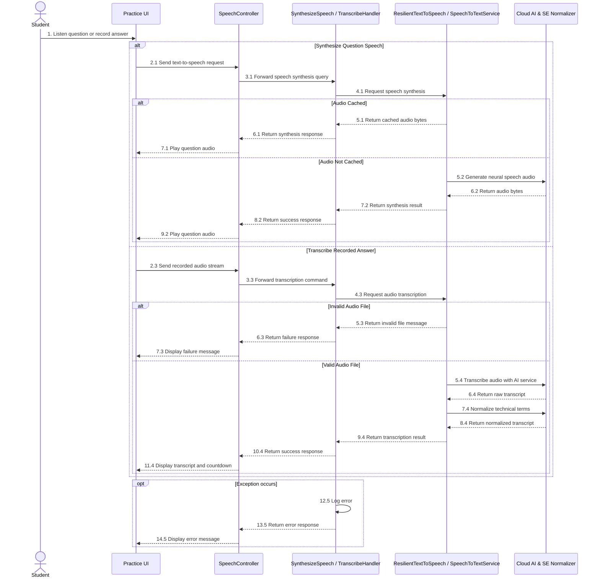

# REPORT 4 — SOFTWARE DESIGN DOCUMENT (DETAILED DESIGN)
## PHẦN PHỤ TRÁCH: NGUYỄN QUANG THÀNH — GÓI `DD-04` (PRACTICE VOICE/TEXT CAPTURE, STT & TRANSCRIPT REVIEW BUFFER — MF-01)

> **Thông tin tài liệu:**
> - **Dự án:** Hệ Thống Luyện Thi & Đánh Giá Vấn Đáp Bằng LLM Cho Ngành Kỹ Thuật Phần Mềm (`FA26SE166`)
> - **Người thực hiện:** Nguyễn Quang Thành | **Người review chéo:** Phạm Nguyễn Đăng Hải
> - **Phạm vi bàn giao:** **`DD-04`:** Practice Voice/Text Capture, STT & Transcript Review Buffer (`MF-01`)
> - **Tệp sơ đồ Draw.io & PNG trong cùng thư mục:**
>   - `DD-04 Class Diagram`: [`DD04_VoiceSttBuffer_Class_Diagram.drawio`](./DD04_VoiceSttBuffer_Class_Diagram.drawio) | [`DD04_VoiceSttBuffer_Class_Diagram.png`](./DD04_VoiceSttBuffer_Class_Diagram.png)
>   - `DD-04 Sequence Diagram`: [`DD04_VoiceSttBuffer_Sequence_Diagram.drawio`](./DD04_VoiceSttBuffer_Sequence_Diagram.drawio) | [`DD04_VoiceSttBuffer_Sequence_Diagram.png`](./DD04_VoiceSttBuffer_Sequence_Diagram.png)

---

## 3.4. Gói Thiết Kế Chi Tiết `DD-04`: Thu Âm Trả Lời Trên RAM, Tổng Hợp Giọng Đọc TTS, Bóc Băng STT & Bộ Đệm Chỉnh Sửa Thuật Ngữ SE (`MF-01`)
*(Feature Design Package DD-04 — Practice Voice/Text Capture, STT & Transcript Review Buffer)*

### 3.4.1. Tổng Quan Nghiệp Vụ & Kiến Trúc (`DD-04 Overview`)
Gói `DD-04` xử lý chức năng đọc câu hỏi tự động (TTS), nhận diện giọng nói trả lời của sinh viên (STT) và bước xem lại văn bản trước khi nộp trong luồng **Luyện tập (MF-01)**:

1. **Đọc câu hỏi bằng giọng nói AI (`GET/POST /api/v1/speech/tts` — `ResilientTextToSpeechService`):**
   - Hỗ trợ 2 giọng đọc Tiếng Việt (`vi-VN-HoaiMyNeural` và `vi-VN-NamMinhNeural`) với tốc độ đọc từ `0.75x` đến `1.35x`.
   - Lưu tạm âm thanh câu hỏi trên bộ nhớ đệm RAM (`SharedProductionCache`, tối đa 250 câu hỏi trong 6 giờ) để phát lại nhanh không cần gọi lại dịch vụ ngoài.
   - Tự động chuyển sang Google TTS dự phòng nếu kết nối Edge TTS gặp sự cố.

2. **Chuyển giọng nói thành văn bản (`POST /api/v1/speech/stt` — `ResilientSpeechToTextService`):**
   - Xử lý trực tiếp luồng âm thanh trên RAM ($\le 25\text{ MB}$), **không lưu file ghi âm lên Cloudflare R2** đối với luồng luyện tập.
   - Sử dụng dịch vụ **Cloudflare Whisper (`whisper-large-v3-turbo`)** làm phương án chính và tự động chuyển sang **Gemini Multimodal STT** khi cần dự phòng.
   - Chuẩn hóa các thuật ngữ chuyên ngành Kỹ thuật Phần mềm thường gặp (`SeTerminologyNormalizer`: *Clean Architecture*, *Dependency Injection*, *CQRS*, *MediatR*, *SHA-256*...).

3. **Đếm ngược xem và chỉnh sửa văn bản (`TranscriptBufferSeconds` 10–300 giây):**
   - Sau khi chuyển giọng nói sang văn bản, giao diện hiển thị đồng hồ đếm ngược theo cấu hình `TranscriptBufferSeconds` (mặc định 60 giây) để sinh viên kiểm tra và sửa lại các thuật ngữ bị nhận diện sai trước khi nộp bài.

---

### 3.4.2. Sơ Đồ Lớp (`DD-04 Class Diagram`)

> **Tệp Draw.io & PNG:** [`DD04_VoiceSttBuffer_Class_Diagram.drawio`](./DD04_VoiceSttBuffer_Class_Diagram.drawio) | [`DD04_VoiceSttBuffer_Class_Diagram.png`](./DD04_VoiceSttBuffer_Class_Diagram.png)

```mermaid
classDiagram
    direction TB

    class SpeechController {
        -ISender _sender
        -long MaxAudioFileSizeBytes = 26214400
        +GetVoices(CancellationToken ct) Task~IActionResult~
        +SynthesizeSpeechPost(SynthesizeSpeechHttpRequest req) Task~IActionResult~
        +SynthesizeSpeechGet(string? text, string? voiceName) Task~IActionResult~
        +TranscribeSpeech(IFormFile? file, string? hint) Task~IActionResult~
    }

    class SynthesizeSpeechQueryHandler {
        -ITextToSpeechService _textToSpeechService
        +Handle(SynthesizeSpeechQuery req) Task~Result~SpeechSynthesisResult~~
    }

    class TranscribeSpeechCommandHandler {
        -ISpeechToTextService _speechToTextService
        +Handle(TranscribeSpeechCommand req) Task~Result~SpeechTranscriptionResult~~
    }

    class UploadAudioPracticeCommandHandler {
        -ISpeechToTextService _speechToTextService
        +Handle(UploadAudioPracticeCommand req) Task~Result~UploadAudioPracticeResponse~~
    }

    class ITextToSpeechService {
        <<Interface>>
        +SynthesizeSpeechAsync(string text, string? voiceName, double rate) Task~SpeechSynthesisResult~
        +GetAvailableVoices() IReadOnlyList~TtsVoiceOptionDto~
    }

    class ISpeechToTextService {
        <<Interface>>
        +TranscribeAudioAsync(Stream stream, string fileName) Task~string~
        +TranscribeDetailedAsync(Stream stream, string fileName, string? hint) Task~SpeechTranscriptionResult~
        +NormalizeTranscript(string? rawTranscript) string
    }

    class SeTerminologyNormalizer {
        +string DefaultSeWhisperPrompt$
        +IReadOnlyList~string~ DefaultSeCustomVocabulary$
        +Normalize(string? rawTranscript)$ string
        +NormalizeWithContext(string? rawTranscript, string? hint)$ string
        +SanitizeHallucinations(string? rawText)$ string
    }

    class ResilientTextToSpeechService {
        -HttpClient _httpClient
        -IConfiguration _configuration
        -ConcurrentDictionary~string, CachedTtsEntry~ _cache
        +SynthesizeSpeechAsync(string text, string? voiceName, double rate) Task~SpeechSynthesisResult~
        +GetAvailableVoices() IReadOnlyList~TtsVoiceOptionDto~
        +ResetEdgeCooldown()$ void
    }

    class ResilientSpeechToTextService {
        -CloudflareWhisperService _primaryWhisperService
        -GeminiSpeechToTextService _fallbackGeminiService
        -IConfiguration? _configuration
        +TranscribeAudioAsync(Stream stream, string fileName) Task~string~
        +TranscribeDetailedAsync(Stream stream, string fileName, string? hint) Task~SpeechTranscriptionResult~
        +NormalizeTranscript(string? rawTranscript) string
    }

    class CloudflareWhisperService {
        -HttpClient _httpClient
        -string _accountId
        -string _apiToken
        -ResiliencePipeline _resiliencePipeline
        +TranscribeAudioAsync(Stream stream, string fileName) Task~string~
        +TranscribeDetailedAsync(Stream stream, string fileName, string? hint) Task~SpeechTranscriptionResult~
    }

    class GeminiSpeechToTextService {
        -HttpClient _httpClient
        -string _apiKey
        -string _modelName
        +TranscribeAudioAsync(Stream stream, string fileName) Task~string~
        +TranscribeDetailedAsync(Stream stream, string fileName, string? hint) Task~SpeechTranscriptionResult~
    }

    SpeechController ..> SynthesizeSpeechQueryHandler : Uses
    SpeechController ..> TranscribeSpeechCommandHandler : Uses
    SynthesizeSpeechQueryHandler ..> ITextToSpeechService : Uses
    TranscribeSpeechCommandHandler ..> ISpeechToTextService : Uses
    UploadAudioPracticeCommandHandler ..> ISpeechToTextService : Uses
    ResilientTextToSpeechService ..|> ITextToSpeechService : Implements
    ResilientSpeechToTextService ..|> ISpeechToTextService : Implements
    ResilientSpeechToTextService ..> SeTerminologyNormalizer : Uses
    ResilientSpeechToTextService ..> CloudflareWhisperService : Uses
    ResilientSpeechToTextService ..> GeminiSpeechToTextService : Uses
```

*Hình 3.4.2 — Sơ đồ lớp gói `DD-04` (Thu âm trên RAM, Tổng hợp giọng đọc TTS, Bóc băng STT dự phòng kép & Chuẩn hóa thuật ngữ SE).*

---

### 3.4.3. Sơ Đồ Tuần Tự (`DD-04 Sequence Diagram — Luồng Chính & Luồng Lỗi/Rẽ Nhánh`)

> **Tệp Draw.io & PNG:** [`DD04_VoiceSttBuffer_Sequence_Diagram.drawio`](./DD04_VoiceSttBuffer_Sequence_Diagram.drawio) | [`DD04_VoiceSttBuffer_Sequence_Diagram.png`](./DD04_VoiceSttBuffer_Sequence_Diagram.png)

*Hình 3.4.3 — Sơ đồ tuần tự gói `DD-04` (Tổng hợp giọng đọc TTS có bộ nhớ đệm, Bóc băng STT dự phòng kép trên RAM & Đếm ngược sửa thuật ngữ SE).*

---

### 3.4.4. Đặc Tả Chi Tiết Các Lớp (`DD-04 Class Specifications`)

#### A. Bảng Tổng Hợp Kiến Trúc Các Lớp (`Architectural Summary Table`)

| STT | Tên Lớp / Giao Diện | Tầng & Đường Dẫn Nguồn | Thuộc Tính & Phụ Thuộc Chính (Attributes) | Phương Thức Chính (Methods) | Quy Tắc Kiểm Tra & Mã Lỗi Phản Hồi (Validations & Error Responses) |
|:---:|:---|:---|:---|:---|:---|
| **01** | **`SpeechController`** | `API Layer` [`SpeechController.cs`](file:///d:/Đồ%20Án/05_Source_Code/backend/src/API/Controllers/v1/SpeechController.cs) | `- _sender: ISender` `- MaxAudioFileSizeBytes: long = 26214400` (`25 MB`) | `+ GetVoices(CancellationToken)` `+ SynthesizeSpeechPost(SynthesizeSpeechHttpRequest, CancellationToken)` `+ SynthesizeSpeechGet(string?, string?, double, CancellationToken)` `+ TranscribeSpeech(IFormFile?, string?, string?, CancellationToken)` | • Chặn file ghi âm rỗng hoặc vượt quá `25 MB` (`HTTP 400 Bad Request`). • Đính kèm các HTTP Headers chẩn đoán trên phản hồi TTS: `X-TTS-Provider`, `X-TTS-Voice`, `X-TTS-Fallback`, `X-TTS-Cache` (`HIT`/`MISS`). • **Không lưu tệp âm thanh lên R2** cho luồng luyện tập `MF-01` (chỉ đọc vào `MemoryStream` trên RAM rồi giải phóng ngay sau khi bóc băng). |
| **02** | **`SynthesizeSpeechQueryHandler`** | `Application Layer` [`SynthesizeSpeechQuery.cs`](file:///d:/Đồ%20Án/05_Source_Code/backend/src/Application/Features/Speech/Queries/SynthesizeSpeech/SynthesizeSpeechQuery.cs) | `- _textToSpeechService: ITextToSpeechService` | `+ Handle(SynthesizeSpeechQuery, CancellationToken): Task<Result<SpeechSynthesisResult>>` | • Kiểm tra văn bản cần đọc không rỗng và $\le 4,000$ ký tự (`SynthesizeSpeechQueryValidator`). • Giới hạn an toàn tốc độ đọc bằng `Math.Clamp(request.SpeakingRate, 0.75, 1.35)`. |
| **03** | **`TranscribeSpeechCommandHandler`** | `Application Layer` [`TranscribeSpeechCommand.cs`](file:///d:/Đồ%20Án/05_Source_Code/backend/src/Application/Features/Speech/Commands/TranscribeSpeech/TranscribeSpeechCommand.cs) | `- _speechToTextService: ISpeechToTextService` | `+ Handle(TranscribeSpeechCommand, CancellationToken): Task<Result<SpeechTranscriptionResult>>` | • Kiểm tra 256 bytes đầu của luồng âm thanh qua `TranscriptHelper.HasRealAudioContainerHeader` để phát hiện luồng giả mạo. • Ưu tiên tuyệt đối kết quả từ AI Server STT; chỉ dùng `ClientTranscript` khi có xác thực hợp lệ và Server không báo im lặng (`IsServerConfirmedSilence == false`). |
| **04** | **`UploadAudioPracticeCommandHandler`** | `Application Layer` [`UploadAudioPracticeCommandHandler.cs`](file:///d:/Đồ%20Án/05_Source_Code/backend/src/Application/Features/Practice/Commands/UploadAudioPractice/UploadAudioPracticeCommandHandler.cs) | `- _speechToTextService: ISpeechToTextService` | `+ Handle(UploadAudioPracticeCommand, CancellationToken): Task<Result<UploadAudioPracticeResponse>>` | • Xử lý luồng âm thanh luyện tập trực tiếp trong bộ nhớ (`MemoryStream`), giải phóng bộ nhớ trong khối `finally` (`Zero R2 Storage` cho MF-01/02). |
| **05** | **`ResilientTextToSpeechService`** | `Infrastructure Layer` [`ResilientTextToSpeechService.cs`](file:///d:/Đồ%20Án/05_Source_Code/backend/src/Infrastructure/Services/ResilientTextToSpeechService.cs) | `- _httpClient: HttpClient` `- _configuration: IConfiguration` `- _cache: ConcurrentDictionary<string, CachedTtsEntry>` (`Max = 250`, `TTL = 6h`) | `+ SynthesizeSpeechAsync(string, string?, double, CancellationToken)` `+ GetAvailableVoices(): IReadOnlyList<TtsVoiceOptionDto>` `+ ResetEdgeCooldown(): void` | • Tra cứu bộ nhớ đệm RAM theo khóa băm `SHA-256(voice + rate + normalizedText)`. • Tự động chuyển đổi dự phòng từ **Edge Neural WebSocket TTS** sang **Google Neural HTTP TTS** khi gặp lỗi kết nối. |
| **06** | **`ResilientSpeechToTextService`** | `Infrastructure Layer` [`ResilientSpeechToTextService.cs`](file:///d:/Đồ%20Án/05_Source_Code/backend/src/Infrastructure/Services/ResilientSpeechToTextService.cs) | `- _primaryWhisperService: CloudflareWhisperService` `- _fallbackGeminiService: GeminiSpeechToTextService` `- _configuration: IConfiguration?` | `+ TranscribeAudioAsync(Stream, string, CancellationToken)` `+ TranscribeDetailedAsync(Stream, string, string?, CancellationToken)` `+ NormalizeTranscript(string?): string` | • Điều phối hai chiều giữa `CloudflareWhisperService` (`@cf/openai/whisper-large-v3-turbo`) và `GeminiSpeechToTextService`, đảm bảo không gián đoạn khi một nhà cung cấp AI bị lỗi hoặc chạm giới hạn băng thông. |
| **07** | **`CloudflareWhisperService` & `GeminiSpeechToTextService`** | `Infrastructure Layer` [`CloudflareWhisperService.cs`](file:///d:/Đồ%20Án/05_Source_Code/backend/src/Infrastructure/Services/CloudflareWhisperService.cs), [`GeminiSpeechToTextService.cs`](file:///d:/Đồ%20Án/05_Source_Code/backend/src/Infrastructure/Services/GeminiSpeechToTextService.cs) | `- _httpClient: HttpClient` `- _resiliencePipeline: ResiliencePipeline` (Polly Exponential Backoff) | `+ TranscribeAudioAsync(Stream, string, CancellationToken)` `+ TranscribeDetailedAsync(Stream, string, string?, CancellationToken)` | • Chỉ thực hiện Polly Retry trên các lỗi mạng tạm thời (`HTTP 5xx`, `429 Too Many Requests`, `408 Request Timeout`), không retry vô ích với `400 Bad Request`. |
| **08** | **`SeTerminologyNormalizer`** | `Infrastructure Layer` [`SeTerminologyNormalizer.cs`](file:///d:/Đồ%20Án/05_Source_Code/backend/src/Infrastructure/Services/SeTerminologyNormalizer.cs) | `+ DefaultSeWhisperPrompt: string` `+ DefaultSeCustomVocabulary: IReadOnlyList<string>` | `+ Normalize(string?): string` `+ NormalizeWithContext(string?, string?): string` `+ SanitizeHallucinations(string?): string` | • Khử các chuỗi ảo giác đặc trưng của Whisper khi thu âm khoảng lặng và chuẩn hóa hơn 65 thuật ngữ Kỹ thuật Phần mềm (*Clean Architecture*, *SOLID*, *CQRS*, *MediatR*, *BoundedChannel*, *Polly Retry*, *Dead-Letter Queue*...) trước khi trả về bộ đệm `TranscriptBufferSeconds` cho sinh viên kiểm tra. |

*Bảng 3.4.4 — Đặc tả chi tiết các lớp trong gói `DD-04`.*

---

#### B. Đặc Tả Chi Tiết Phương Thức Từng Lớp (`Method-Level Class Specifications`)

##### 1. Lớp `SpeechController`
- **Mô tả:** Cung cấp các endpoint tổng hợp giọng đọc câu hỏi (TTS) và chuyển đổi giọng nói trả lời của sinh viên thành văn bản (STT) trực tiếp trên RAM.

| No | Method | Description |
|:---:|:---|:---|
| **01** | `GetVoices` | Tiếp nhận `GET /api/v1/speech/voices`, trả về danh sách các giọng đọc Tiếng Việt Neural được hỗ trợ. |
| **02** | `SynthesizeSpeechPost` | Tiếp nhận `POST /api/v1/speech/tts`, tổng hợp âm thanh MP3 từ văn bản câu hỏi và trả về luồng âm thanh kèm header trạng thái bộ nhớ đệm (`X-TTS-Cache`). |
| **03** | `TranscribeSpeech` | Tiếp nhận `POST /api/v1/speech/stt` (`multipart/form-data`, $\le 25\text{ MB}$), đọc luồng âm thanh trên RAM và trả về văn bản đã chuẩn hóa thuật ngữ SE. |

##### 2. Lớp `SynthesizeSpeechQueryHandler` & `ResilientTextToSpeechService`
- **Mô tả:** Xử lý yêu cầu đọc câu hỏi bằng giọng nói AI với bộ nhớ đệm RAM (`SHA-256` key) và cơ chế tự động chuyển đổi dự phòng giữa Edge Neural TTS và Google TTS.

| No | Method | Description |
|:---:|:---|:---|
| **01** | `Handle(SynthesizeSpeechQuery)` | Kiểm tra độ dài văn bản ($\le 4.000$ ký tự), chuẩn hóa tốc độ đọc trong khoảng `[0.75, 1.35]` và gọi `ITextToSpeechService.SynthesizeSpeechAsync`. |
| **02** | `SynthesizeSpeechAsync` | Tra cứu âm thanh câu hỏi trong bộ nhớ đệm RAM; nếu chưa có thì gọi Edge Neural TTS (hoặc fallback sang Google TTS) và lưu vào bộ nhớ đệm. |
| **03** | `GetAvailableVoices` | Trả về danh sách cấu hình giọng đọc (`vi-VN-HoaiMyNeural`, `vi-VN-NamMinhNeural`). |

##### 3. Lớp `TranscribeSpeechCommandHandler` & `ResilientSpeechToTextService`
- **Mô tả:** Điều phối nhận diện giọng nói trên RAM (không lưu tệp âm thanh lên R2 cho `MF-01`), tự động dự phòng giữa Cloudflare Whisper (`whisper-large-v3-turbo`) và Gemini Multimodal STT.

| No | Method | Description |
|:---:|:---|:---|
| **01** | `Handle(TranscribeSpeechCommand)` | Kiểm tra định dạng header của luồng âm thanh, gọi dịch vụ STT bóc băng và trả về `SpeechTranscriptionResult`. |
| **02** | `TranscribeDetailedAsync` | Gọi `CloudflareWhisperService` làm kênh chính; nếu gặp lỗi mạng hoặc quá tải thì tự động chuyển sang `GeminiSpeechToTextService`, sau đó chuẩn hóa qua `SeTerminologyNormalizer`. |
| **03** | `NormalizeTranscript` | Làm sạch văn bản nhận diện và áp dụng bộ từ điển chuẩn hóa thuật ngữ chuyên ngành Kỹ thuật Phần mềm. |

##### 4. Lớp `SeTerminologyNormalizer`
- **Mô tả:** Bộ chuẩn hóa hậu kỳ giúp khử ảo giác âm thanh khoảng lặng của Whisper và sửa chính xác các thuật ngữ tiếng Anh chuyên ngành SE trong câu trả lời tiếng Việt (Code-Switching).

| No | Method | Description |
|:---:|:---|:---|
| **01** | `Normalize` | Chuẩn hóa các thuật ngữ SE phổ biến (*Clean Architecture*, *Dependency Injection*, *CQRS*, *MediatR*, *BoundedChannel*, *SHA-256*...) trong văn bản bóc băng. |
| **02** | `NormalizeWithContext` | Kết hợp từ khóa gợi ý từ nội dung câu hỏi (`hint`) để ưu tiên khớp chính xác các thuật ngữ chuyên ngành có trong đề bài. |
| **03** | `SanitizeHallucinations` | Loại bỏ các câu lặp vô nghĩa hoặc chuỗi phụ đề ảo giác thường sinh ra khi micro thu khoảng lặng. |
