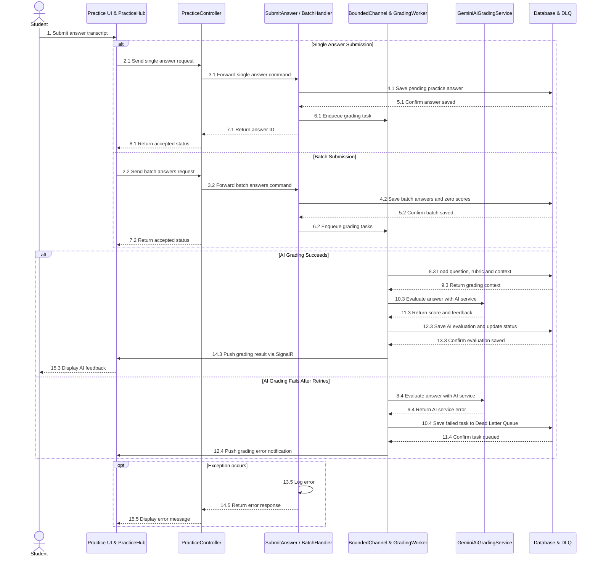

# REPORT 4 — SOFTWARE DESIGN DOCUMENT (DETAILED DESIGN)
## PHẦN PHỤ TRÁCH: NGUYỄN QUANG THÀNH — GÓI `DD-05` (PRACTICE ANSWER SUBMISSION, BACKGROUND AI GRADING & SIGNALR RESULT — `MF-01`)

> **Thông tin tài liệu:**
> - **Dự án:** Hệ Thống Luyện Thi & Đánh Giá Vấn Đáp Bằng LLM Cho Ngành Kỹ Thuật Phần Mềm (`FA26SE166`)
> - **Người thực hiện:** Nguyễn Quang Thành | **Người review chéo:** Phạm Nguyễn Đăng Hải
> - **Phạm vi bàn giao:** **`DD-05`:** Practice Answer Submission, Background AI Grading & SignalR Result (`MF-01`)
> - **Tệp sơ đồ Draw.io trong cùng thư mục:**
>   - `DD-05 Sequence Diagrams`: [`DD05_01_Answer_Submission_PersistFirst_Sequence.drawio`](./DD05_01_Answer_Submission_PersistFirst_Sequence.drawio) | [`DD05_02_Background_AI_Grading_SignalR_Sequence.drawio`](./DD05_02_Background_AI_Grading_SignalR_Sequence.drawio) | [`DD05_PracticeGrading_Sequence_Diagram.drawio`](./DD05_PracticeGrading_Sequence_Diagram.drawio)
>   - `DD-05 Class Diagram`: [`DD05_PracticeGrading_Class_Diagram.drawio`](./DD05_PracticeGrading_Class_Diagram.drawio)

---

## 3.5. Gói Thiết Kế Chi Tiết `DD-05`: Nộp Câu Trả Lời Luyện Tập, Chấm Điểm AI Bất Đồng Bộ & Đẩy Kết Quả Thời Gian Thực Qua SignalR (`MF-01`)
*(Feature Design Package DD-05 — Practice Answer Submission, Background AI Grading & SignalR Result)*

### 3.5.1. Tổng Quan Nghiệp Vụ & Kiến Trúc (`DD-05 Overview`)
Gói `DD-05` thực thi cơ chế **Persist-First (< 100ms)** kết hợp hàng đợi bộ nhớ trong **`BoundedChannel<GradingTask>` (1.000 slots, `BoundedChannelFullMode.Wait`)**, tiến trình nền **`GradingQueueWorker`**, cơ chế chịu lỗi **Polly Exponential Backoff (2s, 4s, 8s) + Dead-Letter Queue (`dead_letter_queues`)** và thông báo thời gian thực qua **`PracticeHub` (`/hubs/practice`)**:
1. **Nộp đơn lẻ (`POST /api/v1/practice/sessions/{id}/answers`) và nộp trọn gói (`POST /api/v1/practice/sessions/{id}/batch-answers`):**
   - Kiểm tra hạn chờ không tương tác 5 phút (`PracticeSessionTimeoutHelper.TryAutoCloseIfTimedOutAsync` $\to$ trả mã **`HTTP 410 Gone`** nếu phiên đã quá hạn).
   - Lưu ngay bản ghi `PracticeAnswer` (`Status = "pending"`, không lưu tệp âm thanh lên Cloudflare R2 đối với `MF-01`), cập nhật `LastActivityAt = DateTime.UtcNow`, đẩy `GradingTask` vào `IGradingQueueChannel` và phản hồi **`HTTP 202 Accepted`** trong `< 100ms`.
   - Với chế độ `FullSession` (`SubmitPracticeBatchCommandHandler`), những câu sinh viên bỏ trống được tự động tạo bản ghi `PracticeAnswer` (`Status = "graded"`) kèm `AiEvaluation` (`TotalScore = 0m`) mà không tiêu tốn lượt gọi LLM.
2. **Chấm điểm AI ngầm song song đa luồng (`GradingQueueWorker` + `GeminiAiGradingService`) & Đẩy sự kiện SignalR (`PracticeHub`):**
   - `GradingQueueWorker` tiêu thụ từ `IGradingQueueChannel` bằng **`Parallel.ForEachAsync` (`_maxDegreeOfParallelism = 12`)**, điều phối sang `ProcessGradingTaskAsync` (cho `MF-01`) hoặc `ProcessInClassGradingTaskAsync` (cho `MF-05`), nạp câu hỏi `PracticeQuestion`, tiêu chí `RubricCriterion` ($\sum = 10.0$) và lịch sử câu trả lời trong phiên để xây dựng ngữ cảnh chấm điểm đa lượt (Multi-turn Chain-of-Thought).
   - Gọi `IAiGradingService.GradeAnswerAsync` với chính sách **Polly Retry 3 lần (2s, 4s, 8s)**. Nếu thành công: lưu `AiEvaluation` (gắn `StudentId` có chỉ mục `ix_ai_evaluations_student` và `PracticeAnswerId` theo ràng buộc XOR 4 luồng `ck_ai_evaluations_xor`) + `AiEvaluationDetail`, cập nhật `PracticeAnswer.Status = "graded"` và phát sự kiện `ReceiveGradingResult` tới nhóm SignalR `session_{sessionId}`.
   - Nếu hết 3 lần thử vẫn gặp lỗi tạm thời (`HTTP 429` / `503` / `TimeoutException`): cô lập tác vụ vào bảng `dead_letter_queues` (`TaskType = "PracticeGrading"`, `FlowType = "PRACTICE"`, `ManagedByRole = "admin"`, `NextRetryAt = UtcNow + 5 minutes`, `Status = "pending"`) và phát sự kiện `ReceiveGradingError` qua SignalR để giao diện hiển thị thông báo an toàn (Zero Data Loss).

---

### 3.5.2. Sơ Đồ Tuần Tự (`DD-05 Sequence Diagrams — Các Tính Năng / Use Case Con Độc Lập`)

Gói `DD-05` được phân rã thành **2 sơ đồ Use Case con độc lập** và 01 sơ đồ tổng quan kế thừa:

1. **Answer Submission Persist-First & BoundedChannel (`DD05_01`):**
   - **Tệp sơ đồ Draw.io:** [`DD05_01_Answer_Submission_PersistFirst_Sequence.drawio`](./DD05_01_Answer_Submission_PersistFirst_Sequence.drawio)
   - **Mô tả kỹ thuật:** Thí sinh nộp câu trả lời đơn lẻ qua `POST /api/v1/practice/sessions/{id}/answers` hoặc nộp trọn gói qua `POST .../batch-answers`. `SubmitPracticeAnswerCommandHandler` kiểm tra hạn chờ 5 phút qua `PracticeSessionTimeoutHelper` (nếu quá hạn trả `HTTP 410 Gone`). Nếu hợp lệ, hệ thống áp dụng cơ chế Persist-First: lưu bản ghi `PracticeAnswer` (`status = "pending"`) xuống PostgreSQL trong $< 100	ext{ms}$ (không lưu audio lên R2), đẩy tác vụ `GradingTask` vào hàng đợi RAM `BoundedChannel` 1.000 slots (`BoundedChannelFullMode.Wait`) và phản hồi ngay `HTTP 202 Accepted`.

2. **Background Gemini CoT Grading & SignalR Notification (`DD05_02`):**
   - **Tệp sơ đồ Draw.io:** [`DD05_02_Background_AI_Grading_SignalR_Sequence.drawio`](./DD05_02_Background_AI_Grading_SignalR_Sequence.drawio)
   - **Mô tả kỹ thuật:** Tiến trình nền `GradingQueueWorker` vận hành song song đa luồng (`MaxDegreeOfParallelism = 12`) tiêu thụ các tác vụ từ `BoundedChannel`. Worker nạp tiêu chí Rubric ($\sum = 10.0$) và lịch sử câu trả lời, gọi `GeminiAiGradingService` thực hiện chấm điểm theo chuỗi suy luận CoT. Cơ chế Polly Retry tự động thử lại 3 lần (khoảng cách 2s, 4s, 8s). Nếu thành công, kết quả được lưu vào `ai_evaluations` và `ai_evaluation_details`, cập nhật `PracticeAnswer.Status = "graded"`, đồng thời phát sự kiện `ReceiveGradingResult` qua SignalR `PracticeHub` (`/hubs/practice`) đến nhóm `session_{sessionId}`. Nếu lỗi kéo dài, tác vụ được cách ly an toàn vào Dead-Letter Queue `dead_letter_queues` (`Status = "pending"`, `NextRetryAt = UtcNow + 5 minutes`) để Admin xử lý sau (Zero Data Loss).

- **Sơ đồ tổng quan kế thừa:** [`DD05_PracticeGrading_Sequence_Diagram.drawio`](./DD05_PracticeGrading_Sequence_Diagram.drawio)

*Hình 3.5.2 — Sơ đồ tuần tự gói `DD-05` (Nộp bài Persist-First, Chấm điểm AI ngầm & Đẩy SignalR).*

---

### 3.5.3. Sơ Đồ Lớp (`DD-05 Class Diagram`)

> **Tệp Draw.io:** [`DD05_PracticeGrading_Class_Diagram.drawio`](./DD05_PracticeGrading_Class_Diagram.drawio)

```mermaid
classDiagram
    direction TB

    class PracticeController {
        <<API Controller>>
        +SubmitAnswer(Guid sessionId, SubmitAnswerRequest req)
        +SubmitBatch(Guid sessionId, SubmitBatchRequest req)
    }

    class SubmitPracticeAnswerCommandHandler {
        <<Application Handler>>
        +Handle(SubmitPracticeAnswerCommand req) Result~Guid~
    }

    class SubmitPracticeBatchCommandHandler {
        <<Application Handler>>
        +Handle(SubmitPracticeBatchCommand req) Result~Unit~
    }

    class IGradingQueueChannel {
        <<Interface>>
        +EnqueueAsync(GradingTask task) ValueTask
        +ReadAllAsync() IAsyncEnumerable~GradingTask~
    }

    class BoundedGradingQueueChannel {
        <<Infrastructure Channel>>
        +EnqueueAsync(GradingTask task) ValueTask
        +ReadAllAsync() IAsyncEnumerable~GradingTask~
    }

    class GradingQueueWorker {
        <<BackgroundService>>
        -int _maxDegreeOfParallelism = 12
        #ExecuteAsync(CancellationToken stoppingToken) Task
        -ProcessGradingTaskAsync(GradingTask task) Task
        -ProcessInClassGradingTaskAsync(GradingTask task) Task
    }

    class IAiGradingService {
        <<Interface>>
        +GradeAnswerAsync(AiGradingRequest req) AiGradingResult
    }

    class GeminiAiGradingService {
        <<Infrastructure Service>>
        +GradeAnswerAsync(AiGradingRequest req) AiGradingResult
        -NormalizeGradingResult(AiGradingResult res) AiGradingResult
    }

    class PracticeHub {
        <<SignalR Hub>>
        +JoinSession(string sessionId) Task
        +LeaveSession(string sessionId) Task
    }

    class PracticeAnswer {
        <<Entity>>
        -Guid id
        -Guid sessionId
        -Guid questionId
        -Guid studentId
        -int orderIndex
        -string answerText
        -bool isFollowUp
        -Guid? parentAnswerId
        -string? promptText
        -string status
        -DateTime submittedAt
        +getter()
        +setter()
    }

    class AiEvaluation {
        <<Entity>>
        -Guid id
        -string answerType
        -Guid? studentId
        -Guid? practiceAnswerId
        -Guid? inClassSubmissionId
        -decimal totalScore
        -decimal? confidenceScore
        -string? feedback
        -string? cotTrace
        -string? followUpPrompt
        -DateTime evaluatedAt
        +getter()
        +setter()
    }

    class AiEvaluationDetail {
        <<Entity>>
        -Guid id
        -Guid evaluationId
        -Guid criterionId
        -decimal score
        -string? comment
        +getter()
        +setter()
    }

    class DeadLetterQueue {
        <<Entity>>
        -Guid id
        -string taskType
        -Guid? correlationId
        -string flowType
        -string managedByRole
        -string payloadJson
        -string errorMessage
        -int retryCount
        -string status
        -DateTime? nextRetryAt
        +getter()
        +setter()
    }

    PracticeController ..> SubmitPracticeAnswerCommandHandler : Uses
    PracticeController ..> SubmitPracticeBatchCommandHandler : Uses
    SubmitPracticeAnswerCommandHandler ..> IGradingQueueChannel : Uses
    SubmitPracticeBatchCommandHandler ..> IGradingQueueChannel : Uses
    BoundedGradingQueueChannel ..|> IGradingQueueChannel : Implements
    GradingQueueWorker ..> IGradingQueueChannel : Uses
    GradingQueueWorker ..> IAiGradingService : Uses
    GradingQueueWorker ..> PracticeHub : Uses
    GeminiAiGradingService ..|> IAiGradingService : Implements
    SubmitPracticeAnswerCommandHandler ..> PracticeAnswer : Uses
    GradingQueueWorker ..> AiEvaluation : Uses
    GradingQueueWorker ..> AiEvaluationDetail : Uses
    AiEvaluation "1" --> "*" AiEvaluationDetail : Details
    GradingQueueWorker ..> DeadLetterQueue : Uses
```

*Hình 3.5.3 — Sơ đồ lớp gói `DD-05` (Nộp bài luyện tập Persist-First, Hàng đợi BoundedChannel, Chấm điểm AI & SignalR).*

---

### 3.5.4. Đặc Tả Chi Tiết Các Lớp (`DD-05 Class Specifications`)

#### A. Bảng Tổng Hợp Kiến Trúc Các Lớp (`Architectural Summary Table`)

| STT | Tên Lớp / Giao Diện | Tầng & Đường Dẫn Nguồn | Thuộc Tính & Phụ Thuộc Chính (Attributes) | Phương Thức Chính (Methods) | Quy Tắc Kiểm Tra & Mã Lỗi Phản Hồi (Validations & Error Responses) |
|:---:|:---|:---|:---|:---|:---|
| **01** | **`PracticeController`** | `API Layer` [`PracticeController.cs`](file:///d:/Đồ%20Án/05_Source_Code/backend/src/API/Controllers/v1/PracticeController.cs) | `- _sender: ISender` | `+ SubmitAnswer(Guid sessionId, SubmitAnswerRequest, CancellationToken)` `+ SubmitBatch(Guid sessionId, SubmitBatchRequest, CancellationToken)` | • Trích xuất `StudentId` từ JWT claims (`ClaimTypes.NameIdentifier`). • Phản hồi **`HTTP 202 Accepted`** kèm `answerId` ngay khi lưu `PracticeAnswer` thành công. • Phản hồi **`HTTP 410 Gone`** nếu phiên quá 5 phút không tương tác (`SESSION_TIMEOUT`). |
| **02** | **`SubmitPracticeAnswerCommandHandler`** | `Application Layer` [`SubmitPracticeAnswerCommandHandler.cs`](file:///d:/Đồ%20Án/05_Source_Code/backend/src/Application/Features/Practice/Commands/SubmitPracticeAnswer/SubmitPracticeAnswerCommandHandler.cs) | `- _context: IApplicationDbContext` `- _gradingQueue: IGradingQueueChannel` `- _validator: IValidator<SubmitPracticeAnswerCommand>` | `+ Handle(SubmitPracticeAnswerCommand, CancellationToken): Task<Result<Guid>>` | • Kiểm tra quyền sở hữu phiên (`403 Forbidden`), trạng thái phiên và hạn chờ 5 phút (`410 Gone`). • Nếu `IsFollowUp == true`: kiểm tra chế độ `per_question` (`PracticeModes.PerQuestion`), câu trả lời gốc đã chấm nằm trong ngưỡng $4.0 \le \text{Score} \le 8.0$ và chưa vượt `MaxPracticeFollowUpQuestions` (1–5, mặc định 2). |
| **03** | **`SubmitPracticeBatchCommandHandler`** | `Application Layer` [`SubmitPracticeBatchCommandHandler.cs`](file:///d:/Đồ%20Án/05_Source_Code/backend/src/Application/Features/Practice/Commands/SubmitPracticeBatch/SubmitPracticeBatchCommandHandler.cs) | `- _context: IApplicationDbContext` `- _gradingQueue: IGradingQueueChannel` `- _validator: IValidator<SubmitPracticeBatchCommand>` | `+ Handle(SubmitPracticeBatchCommand, CancellationToken): Task<Result<Unit>>` | • Chỉ áp dụng cho chế độ `full_session` (`PracticeModes.FullSession`). • Các câu có nội dung trả lời được lưu `Status = "pending"` và đẩy vào `IGradingQueueChannel`; các câu bỏ trống được gán `Status = "graded"` và tạo `AiEvaluation` `0.0` điểm. |
| **04** | **`BoundedGradingQueueChannel`** | `Infrastructure Layer` [`BoundedGradingQueueChannel.cs`](file:///d:/Đồ%20Án/05_Source_Code/backend/src/Infrastructure/Channels/BoundedGradingQueueChannel.cs) | `- _channel: Channel<GradingTask>` `+ DefaultCapacity: int = 1000` | `+ EnqueueAsync(GradingTask, CancellationToken): ValueTask` `+ ReadAllAsync(CancellationToken): IAsyncEnumerable<GradingTask>` | • Khởi tạo `Channel.CreateBounded<GradingTask>(1000)` với `FullMode = BoundedChannelFullMode.Wait` (Backpressure tự nhiên, không làm rơi bài nộp khi lưu lượng tăng đột biến). |
| **05** | **`GradingQueueWorker`** | `API Worker Layer` [`GradingQueueWorker.cs`](file:///d:/Đồ%20Án/05_Source_Code/backend/src/API/Workers/GradingQueueWorker.cs) | `- _queueChannel: IGradingQueueChannel` `- _serviceProvider: IServiceProvider` `- _hubContext: IHubContext<PracticeHub, IPracticeClient>` `- _maxDegreeOfParallelism: int = 12` `- _resiliencePipeline: ResiliencePipeline` | `# ExecuteAsync(CancellationToken): Task` `- ProcessGradingTaskAsync(GradingTask, CancellationToken): Task` `- ProcessInClassGradingTaskAsync(GradingTask, CancellationToken): Task` | • Xử lý song song đa luồng qua **`Parallel.ForEachAsync` (`MaxDegreeOfParallelism = 12`)** kèm Polly Retry 3 lần (`2s, 4s, 8s`). • Khi hết 3 lần retry: lưu bản ghi `DeadLetterQueue` (`TaskType = "PracticeGrading"`, `FlowType = "PRACTICE"`, `ManagedByRole = "admin"`, `Status = "pending"`, `NextRetryAt = UtcNow + 5m`) và gửi `ReceiveGradingError` qua SignalR. |
| **06** | **`GeminiAiGradingService`** | `Infrastructure Layer` [`GeminiAiGradingService.cs`](file:///d:/Đồ%20Án/05_Source_Code/backend/src/Infrastructure/Services/GeminiAiGradingService.cs) | `- _httpClient: HttpClient` `- _configuration: IConfiguration` `- _logger: ILogger<GeminiAiGradingService>` | `+ GradeAnswerAsync(AiGradingRequest, CancellationToken): Task<AiGradingResult>` `- NormalizeGradingResult(AiGradingResult, AiGradingRequest): AiGradingResult` | • Gọi Gemini 1.5 Flash/Pro với `responseSchema` định kiểu chặt (Structured JSON Output). • Chuẩn hóa điểm từng tiêu chí nằm trong `[0, MaxScore]`, bảo toàn tổng điểm $\sum \in [0.0, 10.0]$ và trích xuất `FollowUpPrompt` phục vụ câu hỏi phụ ngữ cảnh. |
| **07** | **`PracticeHub`** | `API Hub Layer` [`PracticeHub.cs`](file:///d:/Đồ%20Án/05_Source_Code/backend/src/API/Hubs/PracticeHub.cs) | `Groups: IGroupManager` `Context: HubCallerContext` | `+ JoinSession(string sessionId): Task` `+ LeaveSession(string sessionId): Task` | • Yêu cầu xác thực JWT (`[Authorize]`). • Quản lý kết nối WebSocket theo nhóm `session_{sessionId}` để nhận sự kiện `ReceiveGradingResult` và `ReceiveGradingError`. |

*Bảng 3.5.1 — Tổng hợp kiến trúc các lớp trong gói `DD-05`.*

---

#### B. Đặc Tả Chi Tiết Phương Thức Từng Lớp (`Method-Level Class Specifications`)

##### 1. Lớp `PracticeController` (Nhóm phương thức `DD-05`)
- **Mô tả:** Tiếp nhận yêu cầu nộp câu trả lời đơn lẻ (`Per-Question`) hoặc nộp hàng loạt (`Full-Session Progressive`) từ sinh viên và trả về mã `HTTP 202 Accepted` theo cơ chế Persist-First.

| No | Method | Description |
|:---:|:---|:---|
| **01** | `SubmitAnswer` | Tiếp nhận yêu cầu `POST /api/v1/practice/sessions/{id}/answers`, đóng gói `SubmitPracticeAnswerCommand` và trả về `HTTP 202 Accepted` kèm `answerId` để giao diện lắng nghe kết quả chấm qua SignalR. |
| **02** | `SubmitBatch` | Tiếp nhận yêu cầu `POST /api/v1/practice/sessions/{id}/batch-answers`, gửi `SubmitPracticeBatchCommand` qua MediatR để lưu toàn bộ câu trả lời trong chế độ `FullSession` và trả về `HTTP 202 Accepted`. |

##### 2. Lớp `SubmitPracticeAnswerCommandHandler`
- **Mô tả:** Xác thực điều kiện nộp câu trả lời chính hoặc câu hỏi phụ (Follow-up), lưu bền vững `PracticeAnswer` xuống PostgreSQL trong `< 100ms` và đẩy tác vụ vào `IGradingQueueChannel`.

| No | Method | Description |
|:---:|:---|:---|
| **01** | `Handle` | Kiểm tra hạn chờ 5 phút (`410 Gone`), xác thực quy tắc câu hỏi phụ ($4.0 \le \text{Score} \le 8.0$, tối đa `MaxPracticeFollowUpQuestions`), lưu bản ghi `PracticeAnswer` (`Status = "pending"`) và đẩy `GradingTask` vào hàng đợi bộ nhớ. |

##### 3. Lớp `SubmitPracticeBatchCommandHandler`
- **Mô tả:** Xử lý nộp trọn gói danh sách câu trả lời cho chế độ `Full-Session Progressive`, tự động chấm `0.0` điểm cho các câu bỏ trống và đẩy các câu có trả lời vào hàng đợi chấm AI.

| No | Method | Description |
|:---:|:---|:---|
| **01** | `Handle` | Kiểm tra phiên `FullSession` hợp lệ, tạo hàng loạt bản ghi `PracticeAnswer` cho các câu có trả lời, tự động ghi nhận `0.0` điểm cho các câu bỏ qua và đẩy danh sách `GradingTask` vào `IGradingQueueChannel`. |

##### 4. Lớp `BoundedGradingQueueChannel` (`IGradingQueueChannel`)
- **Mô tả:** Hàng đợi bất đồng bộ trong bộ nhớ (`BoundedChannel<GradingTask>` sức chứa 1.000 phần tử) đóng vai trò bộ đệm điều tiết tải giữa tầng API và tiến trình chấm điểm AI.

| No | Method | Description |
|:---:|:---|:---|
| **01** | `EnqueueAsync` | Đẩy một `GradingTask` vào `BoundedChannel` với chế độ `BoundedChannelFullMode.Wait` nhằm bảo toàn 100% bài nộp khi có nhiều sinh viên nộp bài đồng thời. |
| **02** | `ReadAllAsync` | Cung cấp luồng dữ liệu bất đồng bộ (`IAsyncEnumerable<GradingTask>`) để `GradingQueueWorker` tiêu thụ liên tục trong nền. |

##### 5. Lớp `GradingQueueWorker`
- **Mô tả:** Tiến trình nền (`BackgroundService`) tiêu thụ `GradingTask` song song đa luồng (`MaxDegreeOfParallelism = 12`), thực thi chấm điểm AI với cơ chế thử lại Polly (2s, 4s, 8s), cô lập lỗi vào `DeadLetterQueue` và đẩy thông báo thời gian thực qua `PracticeHub`.

| No | Method | Description |
|:---:|:---|:---|
| **01** | `ExecuteAsync` | Chạy `Parallel.ForEachAsync` (`_maxDegreeOfParallelism = 12`) lắng nghe `IGradingQueueChannel.ReadAllAsync` và điều phối xử lý từng tác vụ chấm điểm qua `ResiliencePipeline`. |
| **02** | `ProcessGradingTaskAsync` | Nạp dữ liệu câu hỏi/rubric cho bài luyện tập `MF-01`, gọi `IAiGradingService.GradeAnswerAsync`, lưu `AiEvaluation` (gắn `StudentId`, `PracticeAnswerId`) + `AiEvaluationDetail`, hoặc cô lập vào `DeadLetterQueue` (`FlowType = "PRACTICE"`, `Status = "pending"`, hẹn thử lại sau 5 phút) và phát sự kiện SignalR. |
| **03** | `ProcessInClassGradingTaskAsync` | Xử lý chấm điểm song song cho bài kiểm tra vấn đáp trong lớp (`MF-05` / `InClassGrading`), lưu `AiEvaluation` (`InClassSubmissionId`, `StudentId`) và publish điểm thời gian thực. |

##### 6. Lớp `GeminiAiGradingService` (`IAiGradingService`)
- **Mô tả:** Dịch vụ tích hợp Google Gemini 1.5 Flash/Pro thực hiện chấm điểm vấn đáp theo tiêu chí Rubric ($\sum = 10.0$), phân tích lập luận từng bước (Chain-of-Thought) và sinh câu hỏi phụ thăm dò.

| No | Method | Description |
|:---:|:---|:---|
| **01** | `GradeAnswerAsync` | Xây dựng prompt chấm điểm đa lượt kèm schema JSON chặt, gửi yêu cầu tới Gemini API và phân tích kết quả trả về. |
| **02** | `NormalizeGradingResult` | Ràng buộc điểm số từng tiêu chí không vượt quá `MaxScore`, làm tròn điểm chuẩn xác và chuẩn hóa `FollowUpPrompt` trước khi lưu vào CSDL. |

##### 7. Lớp `PracticeHub`
- **Mô tả:** SignalR Hub tại đường dẫn `/hubs/practice` quản lý nhóm kết nối theo phiên luyện tập và phát kết quả chấm điểm tức thì về trình duyệt của sinh viên.

| No | Method | Description |
|:---:|:---|:---|
| **01** | `JoinSession` | Đăng ký `ConnectionId` hiện tại vào nhóm SignalR `session_{sessionId}` khi sinh viên mở màn hình luyện tập. |
| **02** | `LeaveSession` | Gỡ `ConnectionId` khỏi nhóm `session_{sessionId}` khi sinh viên rời khỏi hoặc kết thúc phiên luyện tập. |
