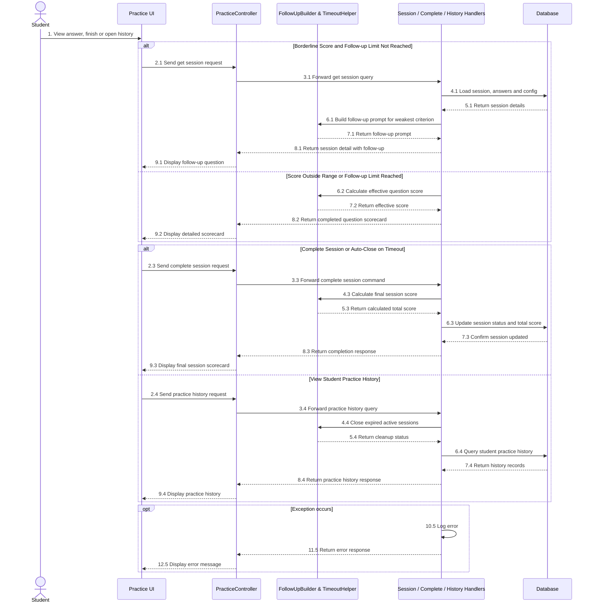
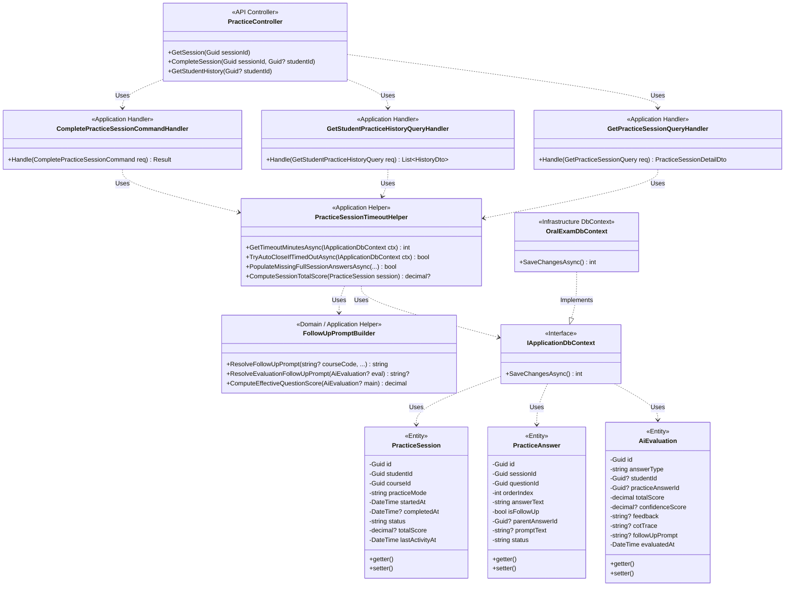

# REPORT 4 — SOFTWARE DESIGN DOCUMENT (DETAILED DESIGN)
## PHẦN PHỤ TRÁCH: NGUYỄN QUANG THÀNH — GÓI `DD-06` (CONTEXTUAL FOLLOW-UP, SCORECARD, HISTORY & SESSION TIMEOUT — `MF-01`)

> **Thông tin tài liệu:**
> - **Dự án:** Hệ Thống Luyện Thi & Đánh Giá Vấn Đáp Bằng LLM Cho Ngành Kỹ Thuật Phần Mềm (`FA26SE166`)
> - **Người thực hiện:** Nguyễn Quang Thành | **Người review chéo:** Phạm Nguyễn Đăng Hải
> - **Phạm vi bàn giao:** **`DD-06`:** Contextual Follow-up, Scorecard, History & Session Timeout (`MF-01`)
> - **Tệp sơ đồ Draw.io trong cùng thư mục:**
>   - `DD-06 Sequence Diagrams`: [`DD06_01_Contextual_FollowUp_QA_Sequence.drawio`](./DD06_01_Contextual_FollowUp_QA_Sequence.drawio) | [`DD06_02_Session_Timeout_Scorecard_Sequence.drawio`](./DD06_02_Session_Timeout_Scorecard_Sequence.drawio) | [`DD06_FollowUpTimeout_Sequence_Diagram.drawio`](./DD06_FollowUpTimeout_Sequence_Diagram.drawio)
>   - `DD-06 Class Diagram`: [`DD06_FollowUpTimeout_Class_Diagram.drawio`](./DD06_FollowUpTimeout_Class_Diagram.drawio)

---

## 3.6. Gói Thiết Kế Chi Tiết `DD-06`: Câu Hỏi Phụ Ngữ Cảnh, Bảng Điểm Chi Tiết, Lịch Sử Luyện Tập & Tự Động Đóng Phiên Quá Hạn (`MF-01`)
*(Feature Design Package DD-06 — Contextual Follow-up, Scorecard, History & Session Timeout)*

### 3.6.1. Tổng Quan Nghiệp Vụ & Kiến Trúc (`DD-06 Overview`)
Gói `DD-06` hoàn thiện vòng đời phiên luyện tập tương tác tự do (`MF-01`), bao gồm sinh câu hỏi phụ theo điểm số và tiêu chí yếu nhất, tổng hợp bảng điểm chi tiết (Scorecard), tra cứu lịch sử luyện tập tại Student Portal (`FE-02`) và tự động đóng phiên khi quá 5 phút không tương tác:
1. **Quyết định hỏi thêm câu hỏi phụ ngữ cảnh (`FollowUpPromptBuilder` — chỉ áp dụng cho `per_question` / `PracticeModes.PerQuestion`):**
   - Sau khi câu trả lời chính được chấm điểm, nếu tổng điểm nằm trong khoảng biên **$4.0 \le \text{Score} \le 8.0$** và số câu hỏi phụ đã hỏi cho câu chính đó nhỏ hơn `MaxPracticeFollowUpQuestions` (1–5 câu do Admin cấu hình trong `system_configs`, mặc định 2): hệ thống bật cờ `NeedsFollowUp = true` và trả về `FollowUpPrompt` xoáy sâu vào tiêu chí Rubric đạt tỷ lệ điểm thấp nhất (`WeakestCriterion`).
   - Nếu điểm số nằm ngoài khoảng $[4.0, 8.0]$ (`< 4.0` hoặc `> 8.0`) hoặc đã đạt số câu hỏi phụ tối đa: hệ thống đóng chu trình hỏi đáp của câu đó (`NeedsFollowUp = false`) và mở toàn bộ **Scorecard** (điểm từng tiêu chí, nhận xét AI, lập luận `CotTrace` và `SampleAnswer`).
2. **Công thức tính điểm hiệu lực có thưởng câu hỏi phụ (`FollowUpPromptBuilder.ComputeEffectiveQuestionScore`):**
   - Điểm gốc câu trả lời chính chiếm tối đa $10.0$ điểm; nếu sinh viên trả lời thêm các câu hỏi phụ, điểm trung bình các câu hỏi phụ ($\overline{S}_{\text{followUp}}$) sẽ cộng thưởng tối đa $+20\%$ phần điểm thưởng (nhưng không vượt trần $10.0$):
     $$S_{\text{effective}} = \min\left(10.0,\; \text{round}\left(S_{\text{main}} + \overline{S}_{\text{followUp}} \times 0.20,\; 2\right)\right)$$
3. **Tự động đóng phiên quá hạn 5 phút (`PracticeSessionTimeoutHelper`) & Kết thúc phiên (`CompletePracticeSessionCommandHandler`):**
   - Admin cấu hình `SessionInactivityTimeoutMinutes` (mặc định `5` phút). Nếu `DateTime.UtcNow - session.LastActivityAt > 5 phút`, `PracticeSessionTimeoutHelper.TryAutoCloseIfTimedOutAsync` tự động chuyển `session.Status = "completed"`, điền `0.0` điểm cho các câu chưa làm trong chế độ `FullSession`, tính `TotalScore` trung bình từ các câu đã chấm và trả mã **`HTTP 410 Gone`** cho các thao tác phát sinh tiếp theo.

---

### 3.6.2. Sơ Đồ Tuần Tự (`DD-06 Sequence Diagrams — Các Tính Năng / Use Case Con Độc Lập`)

Gói `DD-06` được phân rã thành **2 sơ đồ Use Case con độc lập** và 01 sơ đồ tổng quan kế thừa:

1. **Contextual Follow-up Q&A (`DD06_01`):**
   - **Tệp sơ đồ Draw.io:** [`DD06_01_Contextual_FollowUp_QA_Sequence.drawio`](./DD06_01_Contextual_FollowUp_QA_Sequence.drawio)
   - **Mô tả kỹ thuật:** Áp dụng riêng cho chế độ `per_question`. Sau khi câu trả lời chính có điểm, nếu tổng điểm rơi vào khoảng biên $4.0 \le 	ext{Score} \le 8.0$ và số câu phụ chưa vượt quá `MaxPracticeFollowUpQuestions` (1–5 câu do Admin cấu hình, mặc định 2 câu): `FollowUpPromptBuilder` xác định tiêu chí Rubric có tỷ lệ điểm thấp nhất (`WeakestCriterion`) để sinh câu hỏi phụ xoáy sâu vào lỗ hổng kiến thức của sinh viên. Điểm các câu phụ đóng góp tối đa $+20\%$ điểm thưởng vào điểm hiệu lực cuối cùng của câu hỏi: $S_{\text{effective}} = \min(10.0, \text{round}(S_{\text{main}} + \overline{S}_{\text{followUp}} \times 0.20, 2))$.

2. **Session Inactivity Timeout & Scorecard Generation (`DD06_02`):**
   - **Tệp sơ đồ Draw.io:** [`DD06_02_Session_Timeout_Scorecard_Sequence.drawio`](./DD06_02_Session_Timeout_Scorecard_Sequence.drawio)
   - **Mô tả kỹ thuật:** Khi điểm số nằm ngoài khoảng $[4.0, 8.0]$ hoặc đã hoàn tất số câu phụ tối đa, hệ thống đóng chu trình và hiển thị đầy đủ Scorecard (điểm thành phần, nhận xét AI, CoT trace, model answer). Khi sinh viên bấm hoàn thành hoặc khi ngừng tương tác quá `SessionInactivityTimeoutMinutes` (mặc định 5 phút), `PracticeSessionTimeoutHelper` tự động đóng phiên (`status = "completed"`), tính điểm trung bình các câu đã làm (các câu chưa làm ở chế độ `full_session` tính 0 điểm) và trả mã `HTTP 410 Gone` nếu có thao tác tiếp theo. Lịch sử luyện tập được lưu trữ và truy vấn phục vụ Student Portal (`FE-02`).

- **Sơ đồ tổng quan kế thừa:** [`DD06_FollowUpTimeout_Sequence_Diagram.drawio`](./DD06_FollowUpTimeout_Sequence_Diagram.drawio)

*Hình 3.6.2 — Sơ đồ tuần tự gói `DD-06` (Câu hỏi phụ ngữ cảnh, Đóng phiên quá hạn & Bảng điểm Scorecard).*

---

### 3.6.3. Sơ Đồ Lớp (`DD-06 Class Diagram`)

> **Tệp Draw.io:** [`DD06_FollowUpTimeout_Class_Diagram.drawio`](./DD06_FollowUpTimeout_Class_Diagram.drawio)

*Hình 3.6.3 — Sơ đồ lớp gói `DD-06` (Câu hỏi phụ ngữ cảnh, Tổng hợp Scorecard, Lịch sử luyện tập & Tự động đóng phiên).*

---

### 3.6.4. Đặc Tả Chi Tiết Các Lớp (`DD-06 Class Specifications`)

#### A. Bảng Tổng Hợp Kiến Trúc Các Lớp (`Architectural Summary Table`)

| STT | Tên Lớp / Giao Diện | Tầng & Đường Dẫn Nguồn | Thuộc Tính & Phụ Thuộc Chính (Attributes) | Phương Thức Chính (Methods) | Quy Tắc Kiểm Tra & Mã Lỗi Phản Hồi (Validations & Error Responses) |
|:---:|:---|:---|:---|:---|:---|
| **01** | **`PracticeController`** | `API Layer` [`PracticeController.cs`](file:///d:/Đồ%20Án/05_Source_Code/backend/src/API/Controllers/v1/PracticeController.cs) | `- _sender: ISender` | `+ GetSession(Guid sessionId, CancellationToken)` `+ CompleteSession(Guid sessionId, Guid? studentId, CancellationToken)` `+ GetStudentHistory(Guid? studentId, CancellationToken)` | • `GET /api/v1/practice/sessions/{id}`: Trả chi tiết phiên, trạng thái `NeedsFollowUp`, `FollowUpPrompt` và `Scorecard`. • `POST /api/v1/practice/sessions/{id}/complete`: Chốt phiên luyện tập hoặc trả **`HTTP 410 Gone`** nếu phiên đã bị đóng tự động do quá hạn 5 phút. |
| **02** | **`GetPracticeSessionQueryHandler`** | `Application Layer` [`GetPracticeSessionQueryHandler.cs`](file:///d:/Đồ%20Án/05_Source_Code/backend/src/Application/Features/Practice/Queries/GetPracticeSession/GetPracticeSessionQueryHandler.cs) | `- _context: IApplicationDbContext` `- _validator: IValidator<GetPracticeSessionQuery>` | `+ Handle(GetPracticeSessionQuery, CancellationToken): Task<Result<PracticeSessionDetailDto>>` | • Kiểm tra quyền truy cập phiên (`403 Forbidden` nếu khác `StudentId` và không phải `admin`/`lecturer`). • Chỉ mở `SampleAnswer` của một câu hỏi khi câu đó đã hoàn tất chấm điểm và không còn câu hỏi phụ đang chờ (`NeedsFollowUp == false`). |
| **03** | **`CompletePracticeSessionCommandHandler`** | `Application Layer` [`CompletePracticeSessionCommandHandler.cs`](file:///d:/Đồ%20Án/05_Source_Code/backend/src/Application/Features/Practice/Commands/CompletePracticeSession/CompletePracticeSessionCommandHandler.cs) | `- _context: IApplicationDbContext` `- _validator: IValidator<CompletePracticeSessionCommand>` | `+ Handle(CompletePracticeSessionCommand, CancellationToken): Task<Result>` | • Nếu phiên quá 5 phút không tương tác: tự động chốt điểm câu đã làm và trả mã lỗi `SESSION_TIMEOUT` (`HTTP 410 Gone`). • Nếu hợp lệ: điền `0.0` cho câu chưa nộp trong `FullSession`, tính `TotalScore` và đặt `Status = "completed"`. |
| **04** | **`GetStudentPracticeHistoryQueryHandler`** | `Application Layer` [`GetStudentPracticeHistoryQueryHandler.cs`](file:///d:/Đồ%20Án/05_Source_Code/backend/src/Application/Features/Practice/Queries/GetStudentPracticeHistory/GetStudentPracticeHistoryQueryHandler.cs) | `- _context: IApplicationDbContext` `- _validator: IValidator<GetStudentPracticeHistoryQuery>` | `+ Handle(GetStudentPracticeHistoryQuery, CancellationToken): Task<Result<List<PracticeHistoryItemDto>>>` | • Tự động quét và đóng các phiên `in_progress` đã quá 5 phút không tương tác của sinh viên trước khi trả danh sách lịch sử sắp xếp giảm dần theo `StartedAt`. |
| **05** | **`FollowUpPromptBuilder`** | `Application Helper` [`IAiGradingService.cs`](file:///d:/Đồ%20Án/05_Source_Code/backend/src/Application/Common/Interfaces/IAiGradingService.cs) | `Static Pure Functions` | `+ ResolveFollowUpPrompt(string? courseCode, ...): string` `+ ResolveEvaluationFollowUpPrompt(AiEvaluation?, ...): string?` `+ ComputeEffectiveQuestionScore(AiEvaluation?, IEnumerable<AiEvaluation>?): decimal` | • Chọn tiêu chí Rubric có tỷ lệ `Score / MaxScore` thấp nhất làm trọng tâm hỏi xoáy. • Tính điểm hiệu lực câu hỏi kết hợp điểm câu chính và điểm thưởng tối đa $+20\%$ từ các câu hỏi phụ (trần $10.0$). |
| **06** | **`PracticeSessionTimeoutHelper`** | `Application Helper` [`PracticeSessionTimeoutHelper.cs`](file:///d:/Đồ%20Án/05_Source_Code/backend/src/Application/Features/Practice/Common/PracticeSessionTimeoutHelper.cs) | `DefaultInactivityTimeoutMinutes = 5` | `+ GetTimeoutMinutesAsync(IApplicationDbContext, CancellationToken): Task<int>` `+ TryAutoCloseIfTimedOutAsync(IApplicationDbContext, PracticeSession, ...): Task<bool>` `+ PopulateMissingFullSessionAnswersAsync(...): Task<bool>` `+ ComputeSessionTotalScore(PracticeSession): decimal?` | • Đọc cấu hình `SessionInactivityTimeoutMinutes` (1–120 phút, mặc định 5 phút). • Bảo toàn 100% điểm các câu đã làm khi tự động đóng phiên do hết thời gian chờ. |

*Bảng 3.6.1 — Tổng hợp kiến trúc các lớp trong gói `DD-06`.*

---

#### B. Đặc Tả Chi Tiết Phương Thức Từng Lớp (`Method-Level Class Specifications`)

##### 1. Lớp `PracticeController` (Nhóm phương thức `DD-06`)
- **Mô tả:** Cung cấp các endpoint truy vấn chi tiết phiên luyện tập kèm Scorecard/Follow-up, kết thúc phiên luyện tập và lấy danh sách lịch sử luyện tập tại Student Portal.

| No | Method | Description |
|:---:|:---|:---|
| **01** | `GetSession` | Tiếp nhận `GET /api/v1/practice/sessions/{id}`, gửi `GetPracticeSessionQuery` và trả về chi tiết phiên cùng trạng thái câu hỏi phụ (`NeedsFollowUp`), nội dung `FollowUpPrompt` hoặc bảng điểm `Scorecard`. |
| **02** | `CompleteSession` | Tiếp nhận `POST /api/v1/practice/sessions/{id}/complete`, gửi `CompletePracticeSessionCommand` để khóa phiên, tổng hợp `TotalScore` hoặc trả về `HTTP 410 Gone` nếu phiên đã hết hạn chờ. |
| **03** | `GetStudentHistory` | Tiếp nhận `GET /api/v1/practice/student/history`, trả về danh sách lịch sử tất cả các phiên luyện tập của sinh viên kèm điểm tổng kết và số câu đã hoàn thành. |

##### 2. Lớp `GetPracticeSessionQueryHandler`
- **Mô tả:** Truy vấn đồ thị dữ liệu của phiên luyện tập, tự động kiểm tra hạn chờ 5 phút, đánh giá điều kiện sinh câu hỏi phụ ($4.0 \le \text{Score} \le 8.0$) và tổng hợp Scorecard theo từng tiêu chí Rubric.

| No | Method | Description |
|:---:|:---|:---|
| **01** | `Handle` | Nạp thông tin `PracticeSession`, `PracticeAnswers`, `AiEvaluation` và cấu hình hệ thống; xác định `NeedsFollowUp`, `FollowUpPrompt`, điểm hiệu lực từng câu và trả về `PracticeSessionDetailDto`. |

##### 3. Lớp `CompletePracticeSessionCommandHandler`
- **Mô tả:** Xử lý yêu cầu kết thúc phiên luyện tập chủ động từ sinh viên, điền điểm `0.0` cho các câu bỏ trống trong chế độ `FullSession` và chốt điểm tổng kết của toàn phiên.

| No | Method | Description |
|:---:|:---|:---|
| **01** | `Handle` | Kiểm tra quyền sở hữu và thời gian không tương tác; nếu chưa quá hạn thì điền các câu thiếu trong `FullSession`, tính `TotalScore` trung bình và cập nhật `Status = "completed"`. |

##### 4. Lớp `GetStudentPracticeHistoryQueryHandler`
- **Mô tả:** Truy vấn danh sách lịch sử các phiên luyện tập của sinh viên để hiển thị trên Student Portal (`FE-02`).

| No | Method | Description |
|:---:|:---|:---|
| **01** | `Handle` | Tự động đóng các phiên `in_progress` đã quá hạn 5 phút của sinh viên, sau đó truy vấn và trả về danh sách `PracticeHistoryItemDto` sắp xếp theo thời gian mới nhất. |

##### 5. Lớp `FollowUpPromptBuilder`
- **Mô tả:** Bộ công cụ tính toán điểm hiệu lực của câu hỏi và xây dựng câu hỏi phụ ngữ cảnh bám sát tiêu chí Rubric yếu nhất của sinh viên.

| No | Method | Description |
|:---:|:---|:---|
| **01** | `ResolveFollowUpPrompt` | Sinh câu hỏi phụ thăm dò theo mã môn học, nội dung câu trả lời của sinh viên, tiêu chí Rubric đạt điểm thấp nhất (`WeakestCriterion`) và thứ tự lượt hỏi phụ. |
| **02** | `ResolveEvaluationFollowUpPrompt` | Trích xuất `FollowUpPrompt` do Gemini sinh ra trong `AiEvaluation` hoặc tự động tổng hợp câu hỏi phụ chuẩn hóa nếu phản hồi AI chưa có câu hỏi phụ. |
| **03** | `ComputeEffectiveQuestionScore` | Tính điểm hiệu lực của câu hỏi chính cộng thêm tối đa $20\%$ điểm trung bình của các câu trả lời phụ (giới hạn tối đa $10.0$ điểm). |

##### 6. Lớp `PracticeSessionTimeoutHelper`
- **Mô tả:** Lớp tiện ích quản lý thời gian chờ không tương tác 5 phút (`SessionInactivityTimeoutMinutes`), tự động đóng phiên quá hạn và tính điểm tổng kết phiên luyện tập.

| No | Method | Description |
|:---:|:---|:---|
| **01** | `GetTimeoutMinutesAsync` | Đọc giá trị `SessionInactivityTimeoutMinutes` từ bảng `system_configs` (nếu chưa cấu hình hoặc ngoài khoảng hợp lệ thì dùng mặc định `5` phút). |
| **02** | `TryAutoCloseIfTimedOutAsync` | Kiểm tra khoảng thời gian kể từ `LastActivityAt`; nếu vượt quá ngưỡng timeout thì tự động hoàn tất phiên, bảo toàn điểm các câu đã làm và lưu xuống CSDL. |
| **03** | `PopulateMissingFullSessionAnswersAsync` | Tự động sinh các bản ghi `PracticeAnswer` (`Status = "graded"`) và `AiEvaluation` (`AnswerType = "practice"`, `StudentId = session.StudentId` phục vụ truy vấn index `ix_ai_evaluations_student`, `TotalScore = 0m`) cho những câu hỏi chưa trả lời khi đóng phiên `FullSession`. |
| **04** | `ComputeSessionTotalScore` | Tính điểm trung bình cộng (làm tròn 2 chữ số thập phân) trên toàn bộ các câu hỏi chính trong phiên dựa trên điểm hiệu lực của từng câu. |
