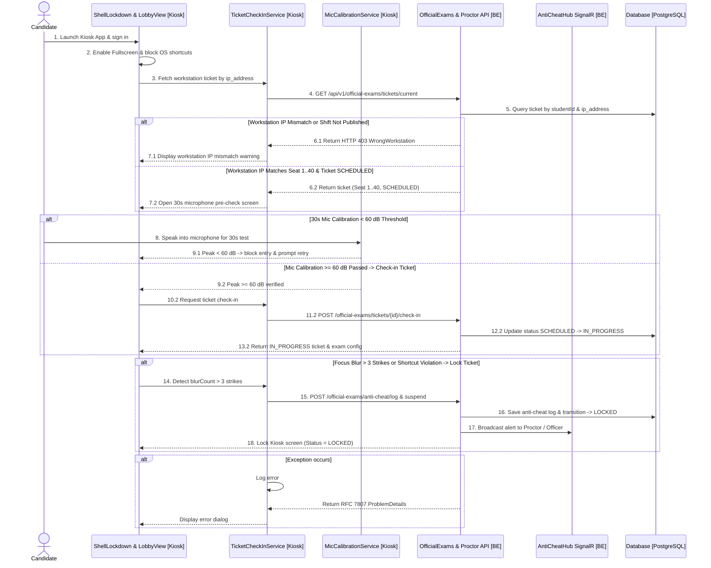
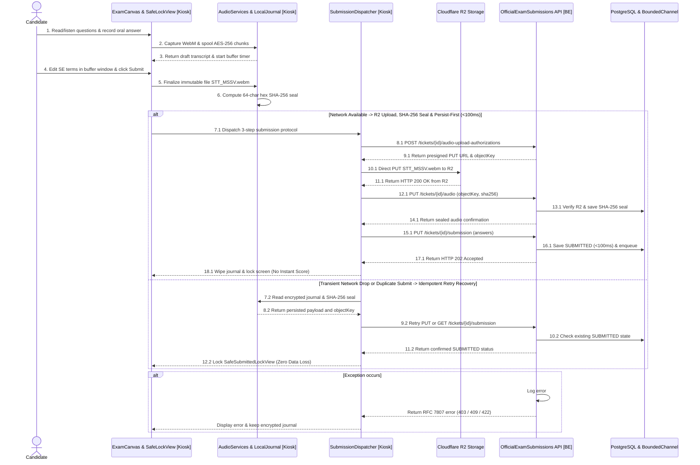

# REPORT 4 — SOFTWARE DESIGN DOCUMENT (DETAILED DESIGN)
## PHẦN PHỤ TRÁCH: NGUYỄN QUANG THÀNH — SƠ ĐỒ TUẦN TỰ DESKTOP KIOSK `D-09` & `D-10` (`[Target Design / Proposed]` — `MF-04`)

> **Thông tin tài liệu:**
> - **Dự án:** Hệ Thống Luyện Thi & Đánh Giá Vấn Đáp Bằng LLM Cho Ngành Kỹ Thuật Phần Mềm (`FA26SE166`)
> - **Người thực hiện:** Nguyễn Quang Thành | **Người review chéo:** Phạm Nguyễn Đăng Hải
> - **Phạm vi bàn giao:** 02 Sơ đồ Tuần tự Desktop Kiosk (`D-09` & `D-10`) gắn nhãn minh bạch **`[Target Design / Proposed]`** cho phần Kiosk Client (`OralExam.DesktopKiosk`) kết nối trực tiếp với hệ thống Backend API thật đã triển khai trong `05_Source_Code`.
> - **Tệp sơ đồ Draw.io & PNG trong cùng thư mục:**
>   - `D-09 Sequence Diagram`: [`D09_Kiosk_Startup_PreCheck_CheckIn_Sequence.drawio`](./D09_Kiosk_Startup_PreCheck_CheckIn_Sequence.drawio) | [`D09_Kiosk_Startup_PreCheck_CheckIn_Sequence.png`](./D09_Kiosk_Startup_PreCheck_CheckIn_Sequence.png)
>   - `D-10 Sequence Diagram`: [`D10_Kiosk_Exam_Execution_Persist_First_Sequence.drawio`](./D10_Kiosk_Exam_Execution_Persist_First_Sequence.drawio) | [`D10_Kiosk_Exam_Execution_Persist_First_Sequence.png`](./D10_Kiosk_Exam_Execution_Persist_First_Sequence.png)

---

## 2.9. Sơ Đồ Tuần Tự `D-09`: Khởi Động Desktop Kiosk, Kiểm Tra Phần Cứng ($\ge 60\text{ dB}$), Đối Chiếu IP Máy Trạm (`ip_address`), Check-in Vé Thi & Khóa Chống Gian Lận (`[Target Design / Proposed]`)
*(Sequence Diagram D-09 — Desktop Kiosk Startup, Hardware Pre-Check, Workstation IP Binding, Check-in & Anti-Cheat Lockdown)*

### 2.9.1. Tổng Quan Nghiệp Vụ & Kiến Trúc (`D-09 Overview`)
Sơ đồ `D-09` mô tả luồng tương tác từ lúc thí sinh khởi chạy ứng dụng **Desktop Kiosk (`[Target Design / Proposed]`)** tại phòng Lab cho đến khi hoàn tất kiểm tra phần cứng, nhận vé thi và chịu sự giám sát chống gian lận thời gian thực:
1. **Khóa màn hình Kiosk & Đối chiếu IP máy trạm (`ip_address`):**
   - Ngay khi khởi động, `ShellLockdown & LobbyView [Kiosk]` kích hoạt chế độ toàn màn hình (`Fullscreen Lockdown`), chặn các tổ hợp phím hệ thống (`Alt+Tab`, `Win`, `F11`, `F12`, `DevTools`).
   - `TicketCheckInService [Kiosk]` gọi `GET /api/v1/official-exams/tickets/current` tới [`OfficialExamCheckInController`](file:///d:/Đồ%20Án/05_Source_Code/backend/src/API/Controllers/v1/OfficialExamCheckInController.cs). Backend đối chiếu địa chỉ IP máy trạm của vé thi thông qua cột chuẩn **`ip_address`** (`SeatNumber` `1..40`) và trạng thái ca thi đã xuất bản đề (`is_exam_published == true`). Nếu sai máy trạm hoặc ca thi chưa mở, hệ thống trả về **`HTTP 403 Forbidden` (`WrongWorkstation`)**.
2. **Kiểm tra Microphone 30 giây ($\ge 60\text{ dB}$) & Check-in vé thi (`SCHEDULED` $\to$ `IN_PROGRESS`):**
   - `MicCalibrationService [Kiosk]` yêu cầu thí sinh nói thử trong 30 giây. Nếu biên độ âm thanh đỉnh đạt ngưỡng **$\ge 60\text{ dB}$**, Kiosk gọi `POST /api/v1/official-exams/tickets/{id}/check-in` để chuyển trạng thái vé thi từ `SCHEDULED` sang `IN_PROGRESS`.
3. **Phát hiện vi phạm tiêu điểm (`Blur > 3 lần`) & Đình chỉ vé thi (`LOCKED`):**
   - Trong suốt quá trình làm bài, nếu thí sinh làm mất tiêu điểm cửa sổ quá 3 lần (`blurCount > 3`) hoặc cố tình can thiệp phím tắt hệ thống, Kiosk gửi sự kiện `POST /api/v1/official-exams/anti-cheat/log` (hoặc Giám thị lập biên bản qua `POST /api/v1/proctor/shifts/{shiftId}/violations`). Backend ghi nhận vào bảng `exam_anti_cheat_logs`, chuyển trạng thái vé thi sang **`LOCKED`** và phát cảnh báo thời gian thực qua [`AntiCheatHub`](file:///d:/Đồ%20Án/05_Source_Code/backend/src/API/Hubs/AntiCheatHub.cs) (`/hubs/anti-cheat`).

---

### 2.9.2. Sơ Đồ Tuần Tự `D-09` (`D-09 Sequence Diagram`)

> **Tệp Draw.io & PNG:** [`D09_Kiosk_Startup_PreCheck_CheckIn_Sequence.drawio`](./D09_Kiosk_Startup_PreCheck_CheckIn_Sequence.drawio) | [`D09_Kiosk_Startup_PreCheck_CheckIn_Sequence.png`](./D09_Kiosk_Startup_PreCheck_CheckIn_Sequence.png)

*Hình 2.9.1 — Sơ đồ tuần tự `D-09` (Khởi động Desktop Kiosk, Kiểm tra Mic $\ge 60\text{ dB}$, Đối chiếu `ip_address`, Check-in & Chống gian lận).*

---

## 2.10. Sơ Đồ Tuần Tự `D-10`: Thực Thi Bài Thi Kiosk, Ghi Âm Bất Biến `STT_MSSV.webm` + Băm SHA-256, Tải Lên Cloudflare R2 & Nộp Bài Persist-First (`< 100\text{ms}`) (`[Target Design / Proposed]`)
*(Sequence Diagram D-10 — Desktop Kiosk Exam Execution, Immutable Audio Sealing, R2 Upload & Persist-First Submission)*

### 2.10.1. Tổng Quan Nghiệp Vụ & Kiến Trúc (`D-10 Overview`)
Sơ đồ `D-10` đặc tả luồng làm bài vấn đáp chính thức trên **Desktop Kiosk (`[Target Design / Proposed]`)**, cơ chế ghi nhật ký mã hóa cục bộ chống mất điện/rớt mạng, niêm phong tệp âm thanh bất biến và giao thức nộp bài 3 bước với [`OfficialExamSubmissionsController`](file:///d:/Đồ%20Án/05_Source_Code/backend/src/API/Controllers/v1/OfficialExamSubmissionsController.cs):
1. **Ghi âm chống mất dữ liệu & Niêm phong `STT_MSSV.webm` + `SHA-256` tại Kiosk:**
   - Khi thí sinh trả lời từng câu hỏi chính và câu hỏi phụ (`has_follow_up` 1–5 câu do Trưởng Bộ Môn cấu hình, mặc định 2), `AudioServices & LocalJournal [Kiosk]` vừa thu âm vừa lưu tạm các mảnh dữ liệu mã hóa `AES-256` xuống đĩa cục bộ (`EncryptedLocalJournal`).
   - Trong khoảng đếm ngược `TranscriptBufferSeconds` (10–300 giây, mặc định 60 giây) nếu ca thi bật chế độ `VoiceWithTranscriptEdit`, thí sinh chỉ được phép rà soát và sửa các thuật ngữ chuyên ngành Kỹ thuật Phần mềm (Code-Switching).
   - Khi kết thúc trả lời, Kiosk đóng gói tệp âm thanh theo đúng định danh bất biến **`STT_MSSV.webm`** (ví dụ: `01_SE170123.webm`, với `STT` là `SeatNumber` `01..40` định dạng 2 chữ số) và tính mã băm **`SHA-256` (64 ký tự hex)** ngay tại máy trạm trước khi truyền qua mạng.
2. **Giao thức nộp bài 3 bước & Persist-First (`< 100ms`, Không chấm điểm liền tại Kiosk):**
   - **Bước 1 (`POST /api/v1/official-exams/tickets/{ticketId}/audio-upload-authorizations`):** Xin cấp URL tải lên có chữ ký (`Presigned PUT URL`) từ Cloudflare R2 tương ứng với `STT_MSSV.webm`.
   - **Bước 2 (`Direct PUT to R2` + `PUT /api/v1/official-exams/tickets/{ticketId}/audio`):** Tải trực tiếp tệp `STT_MSSV.webm` lên Cloudflare R2, sau đó gửi `objectKey` và `audioSha256` về Backend để đối chiếu sự tồn tại của đối tượng trên R2 và khóa niêm phong `AudioSha256` vào vé thi.
   - **Bước 3 (`PUT /api/v1/official-exams/tickets/{ticketId}/submission`):** Lưu bền vững toàn bộ `exam_question_submissions` và chuyển trạng thái vé thi sang **`SUBMITTED` trong `< 100ms`**, đồng thời đẩy tác vụ chấm điểm vào `BoundedChannel<GradingTask>` (1.000 slots) và trả về **`HTTP 202 Accepted`**.
   - **Quy tắc bất biến phòng thi (`MF-04`):** Ngay khi nhận `HTTP 202 Accepted`, Kiosk xóa bản ghi tạm cục bộ và khóa màn hình ở trạng thái **`SafeSubmittedLockView`** báo đã lưu bài an toàn; **tuyệt đối không hiển thị điểm số ngay tại Kiosk và không mở form khiếu nại tại chỗ**.
3. **Khôi phục an toàn khi đứt mạng tạm thời (`Idempotent Retry Recovery`):**
   - Nếu xảy ra lỗi mạng tạm thời trong lúc nộp, `SubmissionDispatcher [Kiosk]` đọc lại gói dữ liệu và mã băm `SHA-256` từ `LocalJournal`, thực hiện gọi lại một cách bất biến (Idempotent) tới `PUT /submission` hoặc kiểm tra trạng thái qua `GET /submission` để đảm bảo **Zero Data Loss**.

---

### 2.10.2. Sơ Đồ Tuần Tự `D-10` (`D-10 Sequence Diagram`)

> **Tệp Draw.io & PNG:** [`D10_Kiosk_Exam_Execution_Persist_First_Sequence.drawio`](./D10_Kiosk_Exam_Execution_Persist_First_Sequence.drawio) | [`D10_Kiosk_Exam_Execution_Persist_First_Sequence.png`](./D10_Kiosk_Exam_Execution_Persist_First_Sequence.png)

*Hình 2.10.1 — Sơ đồ tuần tự `D-10` (Thực thi bài thi Kiosk, Niêm phong `STT_MSSV.webm` + `SHA-256`, Tải lên R2 & Nộp bài Persist-First `< 100\text{ms}`).*

---

## 2.11. Bảng Đặc Tả Các Thành Phần Tham Gia Trong `D-09` & `D-10` (`Component & API Specifications`)

| STT | Tên Thành Phần / Lớp | Phân Loại & Đường Dẫn Nguồn | Phương Thức / Endpoint Chính | Trách Nhiệm & Quy Tắc Nghiệp Vụ Cốt Lõi |
|:---:|:---|:---|:---|:---|
| **01** | **`ShellLockdown & LobbyView`** | `Desktop Kiosk Client` **`[Target Design / Proposed]`** | `+ EnableFullscreenLockdown()` `+ MonitorWindowFocusBlur()` `+ LockScreenOnViolation()` | • Khóa toàn màn hình Kiosk, chặn `Alt+Tab`, `Win`, `F11`, `F12`, `DevTools`. • Đếm số lần mất tiêu điểm (`blurCount`); vượt quá 3 lần sẽ tự động gửi yêu cầu khóa vé thi (`LOCKED`). |
| **02** | **`MicCalibrationService`** | `Desktop Kiosk Client` **`[Target Design / Proposed]`** | `+ Run30SecondMicTestAsync()` `+ MeasurePeakDecibels()` | • Đo cường độ tín hiệu âm thanh đầu vào trong 30 giây. • Chỉ mở nút Check-in vào phòng thi khi cường độ đạt ngưỡng **$\ge 60\text{ dB}$**. |
| **03** | **`AudioServices & LocalJournal`** | `Desktop Kiosk Client` **`[Target Design / Proposed]`** | `+ SpoolEncryptedChunkAsync()` `+ FinalizeImmutableWebmAsync(seat, mssv)` `+ ComputeSha256HexAsync()` | • Lưu tạm các mảnh âm thanh mã hóa `AES-256` xuống đĩa cục bộ. • Xuất tệp âm thanh bất biến **`STT_MSSV.webm`** (vd `01_SE170123.webm`) và tính mã băm **`SHA-256` (64 ký tự hex)**. |
| **04** | **`SubmissionDispatcher`** | `Desktop Kiosk Client` **`[Target Design / Proposed]`** | `+ ExecuteThreeStepSubmitAsync()` `+ RecoverFromJournalAsync()` | • Điều phối tuần tự 3 bước: xin Presigned URL $\to$ PUT tệp lên R2 + xác nhận SHA-256 $\to$ PUT bài nộp Persist-First. • Tự động thử lại bất biến (Idempotent Retry) từ nhật ký cục bộ nếu rớt mạng tạm thời. |
| **05** | **`OfficialExamCheckInController`** | `Backend API Layer` *(Đã hiện thực)* [`OfficialExamCheckInController.cs`](file:///d:/Đồ%20Án/05_Source_Code/backend/src/API/Controllers/v1/OfficialExamCheckInController.cs) | `GET /api/v1/official-exams/tickets/current` `POST /api/v1/official-exams/tickets/{id}/check-in` | • Kiểm tra vé thi của thí sinh theo `ip_address` máy trạm và trạng thái `is_exam_published`. • Chuyển trạng thái vé thi từ `SCHEDULED` sang `IN_PROGRESS` sau khi vượt qua bước kiểm tra phần cứng. |
| **06** | **`OfficialExamsController` & `ProctorController`** | `Backend API Layer` *(Đã hiện thực)* [`OfficialExamsController.cs`](file:///d:/Đồ%20Án/05_Source_Code/backend/src/API/Controllers/v1/OfficialExamsController.cs) [`ProctorController.cs`](file:///d:/Đồ%20Án/05_Source_Code/backend/src/API/Controllers/v1/ProctorController.cs) | `POST /api/v1/official-exams/anti-cheat/log` `POST /api/v1/proctor/shifts/{shiftId}/violations` `POST /api/v1/official-exams/tickets/{id}/suspend` | • Ghi nhật ký vi phạm vào bảng `exam_anti_cheat_logs`. • Khi `blur > 3` hoặc vi phạm nghiêm trọng, chuyển trạng thái vé thi sang `LOCKED` và phát cảnh báo qua `AntiCheatHub`. |
| **07** | **`OfficialExamSubmissionsController`** | `Backend API Layer` *(Đã hiện thực)* [`OfficialExamSubmissionsController.cs`](file:///d:/Đồ%20Án/05_Source_Code/backend/src/API/Controllers/v1/OfficialExamSubmissionsController.cs) | `POST .../audio-upload-authorizations` `PUT .../tickets/{ticketId}/audio` `PUT .../tickets/{ticketId}/submission` `GET .../tickets/{ticketId}/submission` | • Cấp Presigned URL tải tệp `STT_MSSV.webm` lên Cloudflare R2. • Xác thực tệp trên R2, khóa mã băm `AudioSha256`, lưu bài nộp ở trạng thái `SUBMITTED` trong `< 100ms`, đẩy vào `BoundedChannel` và trả `HTTP 202 Accepted`. |

*Bảng 2.11.1 — Đặc tả các thành phần Kiosk Client (`[Target Design / Proposed]`) và Backend API trong `D-09` & `D-10`.*
