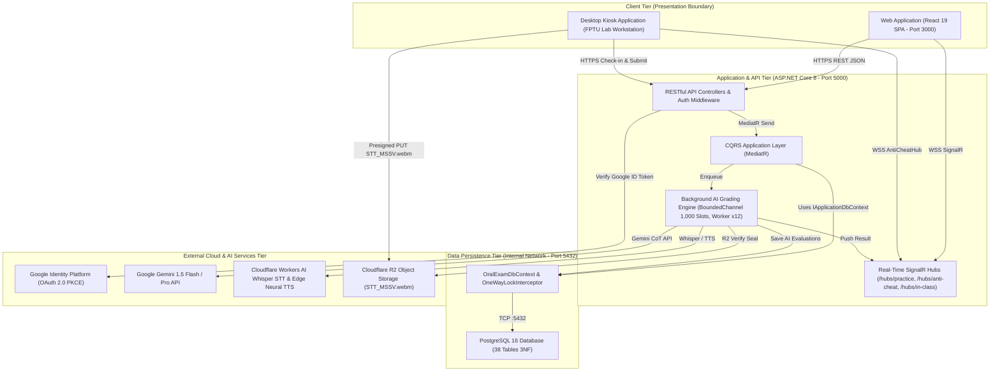

# ĐẶC TẢ KIẾN TRÚC TỔNG THỂ, TRIỂN KHAI HỆ THỐNG & GÓI LƯU TRỮ DỮ LIỆU (SECTIONS 1.1.1, 1.1.2 & 1.2.5)

> **Tài liệu:** Report 4 — System & Detailed Design Specification (SP25/FA26 FPTU Capstone Template)  
> **Dự án:** Hệ Thống Luyện Thi & Đánh Giá Vấn Đáp Bằng LLM Cho Ngành Kỹ Thuật Phần Mềm (`FA26SE166`)  
> **Tác giả (Author):** Phạm Nguyễn Đăng Hải (DB Specialist & Frontend Developer)  
> **Người kiểm tra chéo (Cross-Reviewer):** Lê Vũ Hoàng (Lead Frontend Architect)

---

## 1.1.1 Kiến Trúc Tổng Thể Hệ Thống (`D01_Overall_System_Architecture`)

### 1. Sơ Đồ Kiến Trúc Tổng Thể
- **Tệp nguồn Draw.io:** [D01_Overall_System_Architecture.drawio](file:///d:/Đồ%20Án/05_Source_Code/docs/Task%20Daily/Report4_PhamNguyenDangHai/01_Section_1.1.1_1.1.2_1.2.5_Architecture_Deployment_Persistence/D01_Overall_System_Architecture.drawio)
- **Tệp ảnh PNG:** [D01_Overall_System_Architecture.png](file:///d:/Đồ%20Án/05_Source_Code/docs/Task%20Daily/Report4_PhamNguyenDangHai/01_Section_1.1.1_1.1.2_1.2.5_Architecture_Deployment_Persistence/D01_Overall_System_Architecture.png)

### 2. Đặc Tả Các Tầng Kiến Trúc (Architectural Tiers)

| Tầng Kiến Trúc | Thành Phần Cốt Lõi | Trách Nhiệm Kỹ Thuật & Quy Chuẩn Bất Biến |
| :--- | :--- | :--- |
| **Client Tier** | `Web Application (React 19 SPA - Port 3000)` & `Desktop Kiosk Application` | Cung cấp giao diện Web SPA cho 6 roles RBAC (`student`, `lecturer`, `department_head`, `examination_officer`, `proctor`, `admin`) trên cổng `3000` và ứng dụng Kiosk khóa toàn màn hình cho kỳ thi thật phòng Lab (`MF-04`). |
| **Application & API Tier** | `RESTful API Controllers`, `SignalR Hubs`, `CQRS MediatR`, `Background AI Grading Engine` | Thực thi xác thực kép (Google OAuth 2.0 PKCE & PBKDF2-SHA256 kèm `MustChangePasswordGuardMiddleware`), hàng đợi chấm ngầm `BoundedChannel<GradingTask>` 1.000 slots RAM (`FullMode.Wait`) và `GradingQueueWorker` đa luồng (`MaxDegreeOfParallelism = 12`). |
| **Data Persistence Tier** | `OralExamDbContext`, `OneWayLockInterceptor`, `PostgreSQL 16` | Quản lý 38 bảng chuẩn hóa 3NF thuộc 7 Bounded Contexts trên cổng nội bộ `5432`; cưỡng chế khóa sổ một chiều `OneWayLockInterceptor` chặn mọi thao tác sửa/xóa trái phép (`HTTP 403 Forbidden`) khi `is_locked = true`. |
| **External Cloud & AI Services Tier** | `Google Identity`, `Gemini 1.5 Flash/Pro`, `Cloudflare Whisper STT / TTS`, `Cloudflare R2` | Xác thực định danh `@fpt.edu.vn`, chấm điểm theo Rubric $\sum \equiv 10.0$ bằng Chain-of-Thought, nhận diện giọng nói tiếng Việt pha thuật ngữ SE và lưu trữ bất biến tệp ghi âm `STT_MSSV.webm` kèm mã băm SHA-256. |

---

## 1.1.2 Sơ Đồ Triển Khai Hệ Thống (`D02_Deployment_Diagram`)

### 1. Sơ Đồ Triển Khai Vật Lý
- **Tệp nguồn Draw.io:** [D02_Deployment_Diagram.drawio](file:///d:/Đồ%20Án/05_Source_Code/docs/Task%20Daily/Report4_PhamNguyenDangHai/01_Section_1.1.1_1.1.2_1.2.5_Architecture_Deployment_Persistence/D02_Deployment_Diagram.drawio)
- **Tệp ảnh PNG:** [D02_Deployment_Diagram.png](file:///d:/Đồ%20Án/05_Source_Code/docs/Task%20Daily/Report4_PhamNguyenDangHai/01_Section_1.1.1_1.1.2_1.2.5_Architecture_Deployment_Persistence/D02_Deployment_Diagram.png)

### 2. Đặc Tả Nút Triển Khai (Deployment Nodes & Infrastructure Specifications)

| Node / Container | Cấu Hình Hạ Tầng & Môi Trường | Giao Thức & Bảo Mật Mạng |
| :--- | :--- | :--- |
| **`<<device>> Student / Staff Browser`** | Trình duyệt hiện đại chạy gói SPA `React 19 + Vite` (Port `3000`), tích hợp `Web Audio API` và `SignalR WebSocket Client`. | Kết nối qua `HTTPS / WSS :443` (TLS 1.3 Let's Encrypt) tới `Nginx Reverse Proxy`. |
| **`<<device>> Lab Workstation (Seat 01..40)`** | Máy trạm phòng Lab FPTU chạy `OralExam.DesktopKiosk` (Windows), gắn `USB Condenser Microphone` (ngưỡng kiểm tra $\ge 60\text{ dB}$ trong 30 giây). | Gửi gói điểm danh/nộp bài qua `HTTPS :443`, sự kiện chống gian lận qua `WSS :443` và tải thẳng tệp `STT_MSSV.webm` lên `Cloudflare R2` qua Presigned PUT URL. |
| **`<<device>> Ubuntu 24.04 LTS Docker Host`** | Máy chủ VPS Production (`oralexam.io.vn` — IP `103.90.226.9`): 4 vCPU AMD EPYC, 6GB RAM vật lý + 4GB Swap NVMe, 50GB NVMe, băng thông quốc tế 50Mbps. | Tường lửa UFW chỉ mở cổng `22`, `80`, `443`; khóa hoàn toàn cổng `5432` khỏi Internet công cộng. |
| **`<<container>> Nginx Reverse Proxy`** | Phục vụ tệp tĩnh React 19 và chuyển tiếp `/api/v1/*`, `/hubs/*` (hỗ trợ nâng cấp kết nối `Upgrade: websocket`) vào container `Backend API (:5000)`. | Chấm dứt SSL/TLS tại `/etc/letsencrypt/live/oralexam.io.vn/`, chuyển tiếp nội bộ qua mạng Docker Bridge. |
| **`<<container>> Backend API (:5000)`** | Container `.NET 8 ASP.NET Core` thực thi các Controllers, MediatR Handlers, SignalR Hubs và `GradingQueueWorker` (`x12` luồng song song). | Kết nối tới `PostgreSQL 16` qua `TCP :5432` (`Maximum Pool Size = 200`) và gọi ra Cloud AI qua `HTTPS :443` kèm Polly Retry `2s, 4s, 8s`. |
| **`<<container>> PostgreSQL 16 (:5432)`** | Hệ quản trị CSDL quan hệ lưu trữ 38 bảng 3NF trên phân vùng bền vững `pgdata`, cấu hình `max_connections = 300`. | Cô lập hoàn toàn trong mạng nội bộ Docker (`internal bridge`), chỉ cho phép `Backend API (:5000)` truy cập. |

---

## 1.2.5 Kiến Trúc Gói Lưu Trữ Dữ Liệu (`D07_Persistence_Package_Diagram`)

### 1. Sơ Đồ Gói Lưu Trữ (Persistence Package Diagram)
- **Tệp nguồn Draw.io:** [D07_Persistence_Package_Diagram.drawio](file:///d:/Đồ%20Án/05_Source_Code/docs/Task%20Daily/Report4_PhamNguyenDangHai/01_Section_1.1.1_1.1.2_1.2.5_Architecture_Deployment_Persistence/D07_Persistence_Package_Diagram.drawio)
- **Tệp ảnh PNG:** [D07_Persistence_Package_Diagram.png](file:///d:/Đồ%20Án/05_Source_Code/docs/Task%20Daily/Report4_PhamNguyenDangHai/01_Section_1.1.1_1.1.2_1.2.5_Architecture_Deployment_Persistence/D07_Persistence_Package_Diagram.png)

### 2. Đặc Tả Chi Tiết Các Thành Phần Trong `Infrastructure.Persistence`

| Thành Phần | Tệp Nguồn Thực Tế | Vai Trò & Cơ Chế Kỹ Thuật |
| :--- | :--- | :--- |
| **`IApplicationDbContext`** | [IApplicationDbContext.cs](file:///d:/Đồ%20Án/05_Source_Code/backend/src/Application/Common/Interfaces/IApplicationDbContext.cs) | Hợp đồng giao diện tại tầng `Application` khai báo 38 tập thực thể `DbSet<TEntity>` và phương thức `SaveChangesAsync(CancellationToken)` giúp tách biệt hoàn toàn logic nghiệp vụ khỏi EF Core Npgsql. |
| **`OralExamDbContext`** | [OralExamDbContext.cs](file:///d:/Đồ%20Án/05_Source_Code/backend/src/Infrastructure/Persistence/OralExamDbContext.cs) | Thực thi `IApplicationDbContext`, ánh xạ 38 bảng chuẩn 3NF trong `OnModelCreating`, định nghĩa các ràng buộc toàn vẹn (`ck_ai_evaluations_xor`, `uq_tickets_shift_exam_set`) và hệ thống chỉ mục phức hợp theo quy tắc ESR (`Equality - Sort - Range`). |
| **`OneWayLockInterceptor`** | [OneWayLockInterceptor.cs](file:///d:/Đồ%20Án/05_Source_Code/backend/src/Infrastructure/Persistence/Interceptors/OneWayLockInterceptor.cs) | Kế thừa `SaveChangesInterceptor`, kiểm tra mọi thực thể cài đặt `ILockableEntity` (`RealExamSessionShift`, `StudentExamTicket`, `ExamQuestionSubmission`, `LecturerAudit`, `InClassExamShift`). Khi `IsLocked == true`, tự động chặn mọi thao tác `Modified`/`Deleted` trái phép bằng ngoại lệ `OneWayLockViolationException` (`HTTP 403 Forbidden`), chỉ mở ngoại lệ hợp pháp khi Cán bộ Khảo thí phê duyệt đơn phúc khảo (`AppealRequest.Status == "APPROVED"`) hoặc sinh viên xác nhận điểm (`ACKNOWLEDGED`). |
| **`ValueConverters & SeedConfiguration`** | [OralExamDbContext.cs](file:///d:/Đồ%20Án/05_Source_Code/backend/src/Infrastructure/Persistence/OralExamDbContext.cs) | Chuyển đổi an toàn các cột cấu trúc JSONB (`slot_definitions`, `selected_question_ids`, `cot_trace`) và khởi tạo dữ liệu gốc (`system_configs`, tài khoản quản trị mặc định băm bằng `Pbkdf2PasswordHasher`). |
| **`Migrations`** | `Infrastructure/Persistence/Migrations` | Quản lý lịch sử tiến hóa lược đồ CSDL PostgreSQL 16 đảm bảo đồng bộ 100% giữa `Domain Entities` $\leftrightarrow$ `OralExamDbContext` $\leftrightarrow$ `Physical Schema`. |
