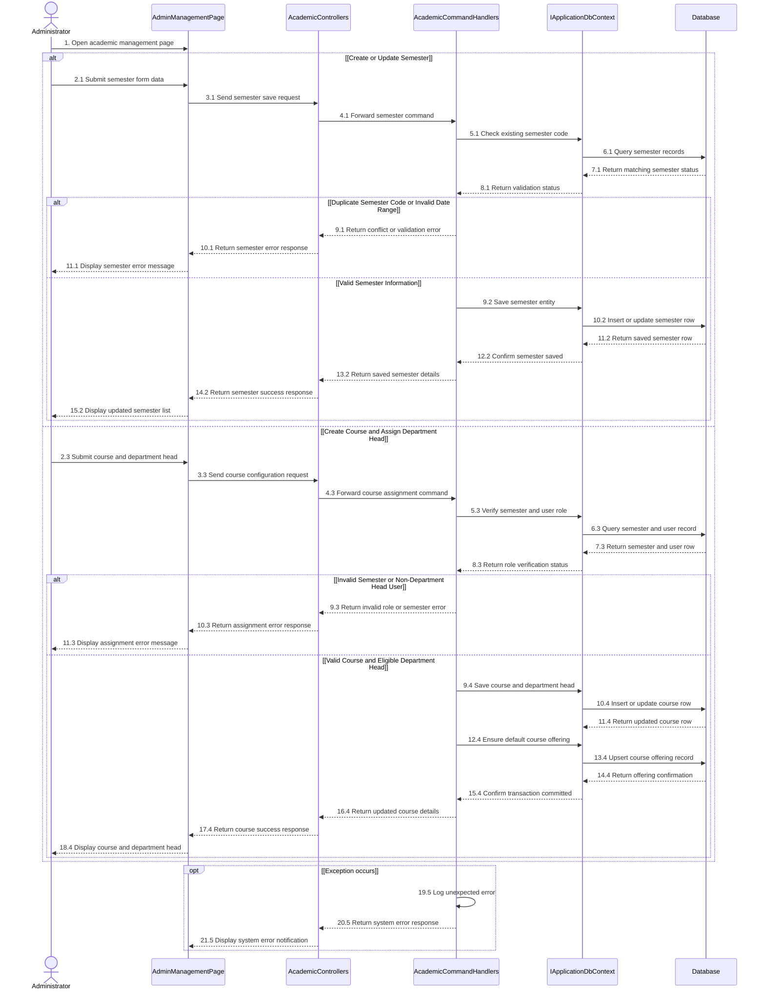

# 3.7 ĐẶC TẢ THIẾT KẾ CHI TIẾT DD-07 — QUẢN LÝ HỌC KỲ, MÔN HỌC & PHÂN CÔNG TRƯỞNG BỘ MÔN (R5)

> **Tài liệu:** Report 4 — Detailed Design Specification (`DD-07`)  
> **Dự án:** Hệ Thống Luyện Thi & Đánh Giá Vấn Đáp Bằng LLM Cho Ngành Kỹ Thuật Phần Mềm (`FA26SE166`)  
> **Tác giả (Author):** Phạm Nguyễn Đăng Hải (DB Specialist & Frontend Developer)  
> **Người kiểm tra chéo (Cross-Reviewer):** Lê Vũ Hoàng (Lead Frontend Architect)  
> **Mã nguồn đối chiếu:** [SemestersController.cs](file:///d:/Đồ%20Án/05_Source_Code/backend/src/API/Controllers/v1/SemestersController.cs), [CoursesController.cs](file:///d:/Đồ%20Án/05_Source_Code/backend/src/API/Controllers/v1/CoursesController.cs)

---

## 3.7.1 Class Diagram (`DD07_SemesterCourse_Class_Diagram`)

- **Tệp nguồn Draw.io:** [DD07_SemesterCourse_Class_Diagram.drawio](file:///d:/Đồ%20Án/05_Source_Code/docs/Task%20Daily/Report4_PhamNguyenDangHai/02_DD07_R5_Semester_Course_DeptHead_Assignment/DD07_SemesterCourse_Class_Diagram.drawio)
- **Tệp ảnh PNG:** [DD07_SemesterCourse_Class_Diagram.png](file:///d:/Đồ%20Án/05_Source_Code/docs/Task%20Daily/Report4_PhamNguyenDangHai/02_DD07_R5_Semester_Course_DeptHead_Assignment/DD07_SemesterCourse_Class_Diagram.png)

```mermaid
classDiagram
    class SemestersController {
        <<controller>>
        -ISender _sender
        +GetSemesters(bool? isActive, CancellationToken ct) Task~IActionResult~
        +CreateSemester(CreateSemesterRequest request, CancellationToken ct) Task~IActionResult~
        +UpdateSemester(Guid id, UpdateSemesterRequest request, CancellationToken ct) Task~IActionResult~
    }
    class CoursesController {
        <<controller>>
        -ISender _sender
        +GetCourses(Guid? semId, bool? active, CancellationToken ct) Task~IActionResult~
        +CreateCourse(CreateCourseRequest request, CancellationToken ct) Task~IActionResult~
        +UpdateCourse(Guid id, UpdateCourseRequest request, CancellationToken ct) Task~IActionResult~
        +AssignDepartmentHead(Guid id, AssignDepartmentHeadRequest req, CancellationToken ct) Task~IActionResult~
    }
    class CreateSemesterCommandHandler {
        <<handler>>
        -IApplicationDbContext _context
        +Handle(CreateSemesterCommand cmd, CancellationToken ct) Task~SemesterDto~
        -NormalizeSemesterCode(string code) string
    }
    class UpdateSemesterCommandHandler {
        <<handler>>
        -IApplicationDbContext _context
        +Handle(UpdateSemesterCommand cmd, CancellationToken ct) Task~SemesterDto~
        -ValidateDateRange(DateOnly start, DateOnly end) void
    }
    class CreateCourseCommandHandler {
        <<handler>>
        -IApplicationDbContext _context
        +Handle(CreateCourseCommand cmd, CancellationToken ct) Task~CourseDto~
        -ValidateDepartmentHeadAsync(Guid? id, CancellationToken ct) Task
    }
    class UpdateCourseCommandHandler {
        <<handler>>
        -IApplicationDbContext _context
        +Handle(UpdateCourseCommand cmd, CancellationToken ct) Task~CourseDto~
    }
    class AssignDeptHeadCommandHandler {
        <<handler>>
        -IApplicationDbContext _context
        +Handle(AssignDepartmentHeadCommand cmd, CancellationToken ct) Task~CourseDto~
        -VerifyDeptHeadRoleAsync(Guid id, CancellationToken ct) Task
    }
    class IApplicationDbContext {
        <<interface>>
        +DbSet~Semester~ Semesters
        +DbSet~Course~ Courses
        +DbSet~User~ Users
        +DbSet~CourseOffering~ CourseOfferings
        +SaveChangesAsync(CancellationToken ct) Task~int~
    }
    class OralExamDbContext {
        <<persistence>>
        +SaveChangesAsync(CancellationToken ct) Task~int~
    }
    class Semester {
        <<entity>>
        +Guid Id
        +string Code
        +string Name
        +DateOnly StartDate
        +DateOnly EndDate
        +bool IsActive
    }
    class Course {
        <<entity>>
        +Guid Id
        +string Code
        +string Name
        +int Credits
        +Guid? SemesterId
        +Guid? DepartmentHeadUserId
        +int MaxMockExamsPerDay
    }
    class User {
        <<entity>>
        +Guid Id
        +string Email
        +string FullName
        +string Role
        +bool IsActive
    }

    SemestersController ..> CreateSemesterCommandHandler : Uses
    SemestersController ..> UpdateSemesterCommandHandler : Uses
    CoursesController ..> CreateCourseCommandHandler : Uses
    CoursesController ..> UpdateCourseCommandHandler : Uses
    CoursesController ..> AssignDeptHeadCommandHandler : Uses
    CreateSemesterCommandHandler ..> IApplicationDbContext : Uses
    UpdateSemesterCommandHandler ..> IApplicationDbContext : Uses
    CreateCourseCommandHandler ..> IApplicationDbContext : Uses
    UpdateCourseCommandHandler ..> IApplicationDbContext : Uses
    AssignDeptHeadCommandHandler ..> IApplicationDbContext : Uses
    OralExamDbContext ..|> IApplicationDbContext : Implements
    IApplicationDbContext ..> Semester : Uses
    IApplicationDbContext ..> Course : Uses
    IApplicationDbContext ..> User : Uses
```

---

## 3.7.2 Đặc Tả Chi Tiết Lớp & Phương Thức (Class Specifications)

### 1. Bảng Tóm Tắt Các Lớp Thiết Kế

| STT | Tên Lớp / Giao Diện | Phân Tầng | Trách Nhiệm Nghiệp Vụ |
| :--- | :--- | :--- | :--- |
| 1 | `SemestersController` | `API Layer` | Cung cấp các endpoint RESTful cho `admin` khởi tạo, cập nhật học kỳ (`FA26`, `SP26`) và cho phép mọi vai trò đã xác thực tra cứu danh sách học kỳ; tuân thủ quy tắc bảo toàn lịch sử (không hỗ trợ xóa vật lý học kỳ). |
| 2 | `CoursesController` | `API Layer` | Cung cấp endpoint tạo môn học, cập nhật thông tin môn học, cấu hình hạn ngạch thi thử mỗi ngày (`MaxMockExamsPerDay`) và phân công Trưởng bộ môn (`department_head`) phụ trách chuyên môn môn học. |
| 3 | `CreateSemesterCommandHandler` | `Application Layer` | Kiểm tra tính duy nhất của mã học kỳ (`Semesters.Code`), kiểm tra tính hợp lệ của khoảng thời gian (`StartDate < EndDate`) và lưu bản ghi `Semester` mới. |
| 4 | `UpdateSemesterCommandHandler` | `Application Layer` | Cập nhật tên, ngày bắt đầu/kết thúc và trạng thái hoạt động (`IsActive`) của học kỳ hiện hữu mà không làm đứt gãy khóa ngoại của các môn học và lớp học phần. |
| 5 | `CreateCourseCommandHandler` | `Application Layer` | Xác thực mã môn học (`Courses.Code`), kiểm tra học kỳ đích, xác minh người dùng được gán làm Trưởng bộ môn có đúng vai trò `department_head` và tự động khởi tạo `CourseOffering` mặc định. |
| 6 | `AssignDeptHeadCommandHandler` | `Application Layer` | Cho phép `admin` gán hoặc thay đổi Trưởng bộ môn phụ trách môn học (`courses.department_head_user_id`), kiểm tra chặt chẽ trạng thái hoạt động và role `department_head`. |
| 7 | `Semester` / `Course` / `User` | `Domain Layer` | Các thực thể chuẩn 3NF ánh xạ vào bảng `semesters`, `courses` và `users` trong PostgreSQL 16. |

### 2. Đặc Tả Phương Thức Trọng Tâm (Method Specifications)

| Lớp | Phương Thức | Tham Số Đầu Vào | Kiểu Trả Về | Mô Tả Xử Lý & Quy Tắc Nghiệp Vụ |
| :--- | :--- | :--- | :--- | :--- |
| `SemestersController` | `CreateSemester` | `CreateSemesterRequest request, CancellationToken ct` | `Task<IActionResult>` | Chỉ cho phép `admin`; gửi `CreateSemesterCommand` qua MediatR và trả về `201 Created` kèm `SemesterDto` (hoặc `409 Conflict` nếu trùng mã học kỳ). |
| `SemestersController` | `UpdateSemester` | `Guid id, UpdateSemesterRequest request, CancellationToken ct` | `Task<IActionResult>` | Chỉ cho phép `admin`; cập nhật thông tin học kỳ theo `id` và trả về `200 OK` (hoặc `404 Not Found` / `400 Bad Request`). |
| `CoursesController` | `CreateCourse` | `CreateCourseRequest request, CancellationToken ct` | `Task<IActionResult>` | Chỉ cho phép `admin`; tạo môn học mới gắn với học kỳ, cấu hình `MaxMockExamsPerDay` và gán `DepartmentHeadUserId` nếu có. |
| `CoursesController` | `AssignDepartmentHead` | `Guid id, AssignDepartmentHeadRequest req, CancellationToken ct` | `Task<IActionResult>` | Chỉ cho phép `admin`; gán người dùng có vai trò `department_head` vào quản lý môn học `id`, đảm bảo mỗi môn học có đúng 1 Trưởng bộ môn chịu trách nhiệm duyệt câu hỏi/đề thi. |

---

## 3.7.3 Sequence Diagram (`DD07_SemesterCourse_Sequence_Diagram`)

- **Tệp nguồn Draw.io:** [DD07_SemesterCourse_Sequence_Diagram.drawio](file:///d:/Đồ%20Án/05_Source_Code/docs/Task%20Daily/Report4_PhamNguyenDangHai/02_DD07_R5_Semester_Course_DeptHead_Assignment/DD07_SemesterCourse_Sequence_Diagram.drawio)
- **Tệp ảnh PNG:** [DD07_SemesterCourse_Sequence_Diagram.png](file:///d:/Đồ%20Án/05_Source_Code/docs/Task%20Daily/Report4_PhamNguyenDangHai/02_DD07_R5_Semester_Course_DeptHead_Assignment/DD07_SemesterCourse_Sequence_Diagram.png)

### thuyết Minh Luồng Tuần Tự (`DD-07`)
1. **Nhánh 1 — Khởi tạo hoặc cập nhật Học kỳ (`2.1` $\to$ `15.2`):** Quản trị viên (`Administrator`) nhập thông tin học kỳ trên `AdminManagementPage` và gửi yêu cầu (`2.1`, `3.1`). `AcademicControllers` chuyển tiếp lệnh xuống `AcademicCommandHandlers` (`4.1`) để kiểm tra trùng mã học kỳ và tính hợp lệ của ngày bắt đầu/kết thúc trong `Database` (`5.1` $\to$ `8.1`). Nếu trùng mã hoặc ngày không hợp lệ, hệ thống trả về thông báo lỗi (`9.1` $\to$ `11.1`). Nếu hợp lệ, bản ghi học kỳ được lưu vào bảng `semesters` (`9.2` $\to$ `15.2`).
2. **Nhánh 2 — Khởi tạo Môn học và Gán Trưởng bộ môn (`2.3` $\to$ `18.4`):** Quản trị viên gửi thông tin môn học kèm định danh Trưởng bộ môn (`2.3` $\to$ `4.3`). Handler truy vấn `Database` để xác minh học kỳ tồn tại và tài khoản được chọn mang đúng vai trò `department_head` (`5.3` $\to$ `8.3`). Nếu sai vai trò hoặc thiếu học kỳ, hệ thống từ chối yêu cầu (`9.3` $\to$ `11.3`). Nếu hợp lệ, hệ thống lưu bản ghi `courses`, tự động đảm bảo `course_offerings` tương ứng tồn tại và trả kết quả thành công (`9.4` $\to$ `18.4`).
3. **Khung ngoại lệ `opt [Exception occurs]` (`19.5` $\to$ `21.5`):** Mọi lỗi hệ thống bất ngờ phát sinh trong quá trình xử lý đều được ghi nhận nhật ký (`19.5`) và trả về thông báo lỗi chuẩn hóa cho giao diện quản trị (`20.5`, `21.5`).
