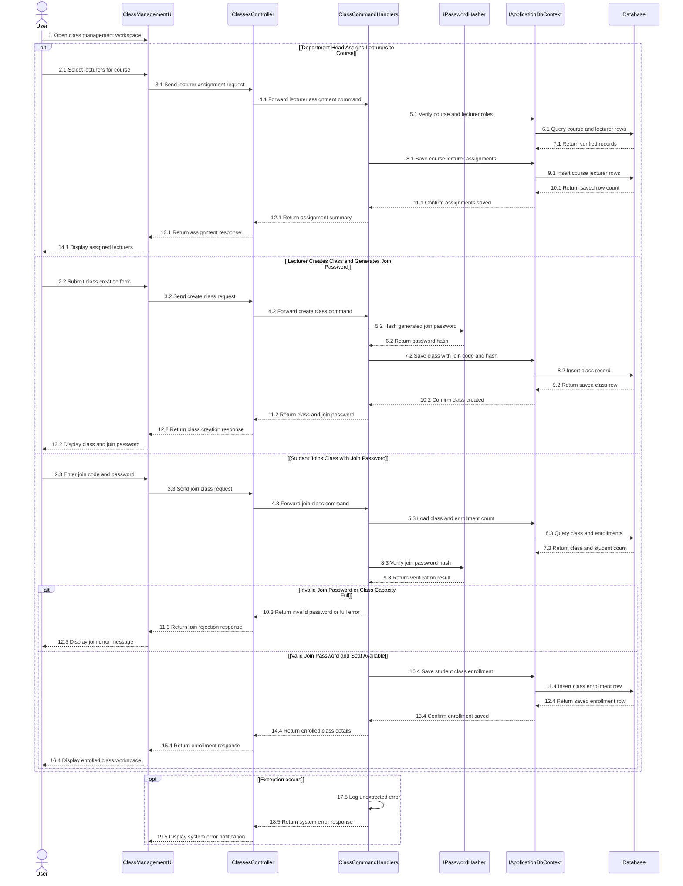

# 3.8 ĐẶC TẢ THIẾT KẾ CHI TIẾT DD-08 — PHÂN CÔNG GIẢNG VIÊN, TẠO LỚP HỌC PHẦN & SINH VIÊN THAM GIA LỚP (R5)

> **Tài liệu:** Report 4 — Detailed Design Specification (`DD-08`)  
> **Dự án:** Hệ Thống Luyện Thi & Đánh Giá Vấn Đáp Bằng LLM Cho Ngành Kỹ Thuật Phần Mềm (`FA26SE166`)  
> **Tác giả (Author):** Phạm Nguyễn Đăng Hải (DB Specialist & Frontend Developer)  
> **Người kiểm tra chéo (Cross-Reviewer):** Lê Vũ Hoàng (Lead Frontend Architect)  
> **Mã nguồn đối chiếu:** [CoursesController.cs](file:///d:/Đồ%20Án/05_Source_Code/backend/src/API/Controllers/v1/CoursesController.cs), [ClassesController.cs](file:///d:/Đồ%20Án/05_Source_Code/backend/src/API/Controllers/v1/ClassesController.cs)

---

## 3.8.1 Class Diagram (`DD08_ClassEnrollment_Class_Diagram`)

- **Tệp nguồn Draw.io:** [DD08_ClassEnrollment_Class_Diagram.drawio](file:///d:/Đồ%20Án/05_Source_Code/docs/Task%20Daily/Report4_PhamNguyenDangHai/03_DD08_R5_Lecturer_Assignment_Class_Student_Enrollment/DD08_ClassEnrollment_Class_Diagram.drawio)
- **Tệp ảnh PNG:** [DD08_ClassEnrollment_Class_Diagram.png](file:///d:/Đồ%20Án/05_Source_Code/docs/Task%20Daily/Report4_PhamNguyenDangHai/03_DD08_R5_Lecturer_Assignment_Class_Student_Enrollment/DD08_ClassEnrollment_Class_Diagram.png)

```mermaid
classDiagram
    class CoursesController {
        <<controller>>
        -ISender _sender
        +GetCourseLecturers(Guid courseId, CancellationToken ct) Task~IActionResult~
        +AssignLecturersToCourse(Guid id, AssignLecturersRequest req, CancellationToken ct) Task~IActionResult~
        +RemoveLecturerFromCourse(Guid id, Guid lid, CancellationToken ct) Task~IActionResult~
    }
    class ClassesController {
        <<controller>>
        -ISender _sender
        +GetClasses(Guid? courseId, Guid? semId, CancellationToken ct) Task~IActionResult~
        +CreateClass(CreateClassRequest request, CancellationToken ct) Task~IActionResult~
        +ResetClassPassword(Guid id, CancellationToken ct) Task~IActionResult~
        +JoinClass(JoinClassRequest request, CancellationToken ct) Task~IActionResult~
    }
    class AssignLecturersToCourseCommandHandler {
        <<handler>>
        -IApplicationDbContext _context
        +Handle(AssignLecturersToCourseCommand cmd, CancellationToken ct) Task~AssignLecturersResultDto~
        -VerifyDepartmentHeadOwnershipAsync(Guid cid, Guid uid, CancellationToken ct) Task
    }
    class CreateClassCommandHandler {
        <<handler>>
        -IApplicationDbContext _context
        -IPasswordHasher _passwordHasher
        +Handle(CreateClassCommand cmd, CancellationToken ct) Task~CreateClassResultDto~
        -GeneratePlaintextJoinPassword() string
    }
    class ResetClassPasswordCommandHandler {
        <<handler>>
        -IApplicationDbContext _context
        -IPasswordHasher _passwordHasher
        +Handle(ResetClassPasswordCommand cmd, CancellationToken ct) Task~ResetClassPasswordResultDto~
    }
    class JoinClassCommandHandler {
        <<handler>>
        -IApplicationDbContext _context
        -IPasswordHasher _passwordHasher
        +Handle(JoinClassCommand cmd, CancellationToken ct) Task~JoinClassResultDto~
        -VerifyEnrollmentCapacityAsync(Class cls, CancellationToken ct) Task
    }
    class IPasswordHasher {
        <<interface>>
        +HashPassword(string plain) string
        +VerifyPassword(string plain, string hash) bool
    }
    class IApplicationDbContext {
        <<interface>>
        +DbSet~CourseLecturer~ CourseLecturers
        +DbSet~Class~ Classes
        +DbSet~ClassEnrollment~ ClassEnrollments
        +SaveChangesAsync(CancellationToken ct) Task~int~
    }
    class OralExamDbContext {
        <<persistence>>
        +SaveChangesAsync(CancellationToken ct) Task~int~
    }
    class CourseLecturer {
        <<entity>>
        +Guid Id
        +Guid CourseId
        +Guid LecturerUserId
        +Guid? AssignedByUserId
        +DateTimeOffset AssignedAt
    }
    class Class {
        <<entity>>
        +Guid Id
        +Guid CourseId
        +Guid SemesterId
        +Guid LecturerUserId
        +string Code
        +string Name
        +string JoinCode
        +string JoinPasswordHash
        +int MaxStudents
        +bool IsActive
    }
    class ClassEnrollment {
        <<entity>>
        +Guid Id
        +Guid ClassId
        +Guid StudentUserId
        +string Status
        +DateTimeOffset EnrolledAt
    }

    CoursesController ..> AssignLecturersToCourseCommandHandler : Uses
    ClassesController ..> CreateClassCommandHandler : Uses
    ClassesController ..> ResetClassPasswordCommandHandler : Uses
    ClassesController ..> JoinClassCommandHandler : Uses
    AssignLecturersToCourseCommandHandler ..> IApplicationDbContext : Uses
    CreateClassCommandHandler ..> IPasswordHasher : Uses
    CreateClassCommandHandler ..> IApplicationDbContext : Uses
    ResetClassPasswordCommandHandler ..> IPasswordHasher : Uses
    JoinClassCommandHandler ..> IPasswordHasher : Uses
    JoinClassCommandHandler ..> IApplicationDbContext : Uses
    OralExamDbContext ..|> IApplicationDbContext : Implements
    IApplicationDbContext ..> CourseLecturer : Uses
    IApplicationDbContext ..> Class : Uses
    IApplicationDbContext ..> ClassEnrollment : Uses
```

---

## 3.8.2 Đặc Tả Chi Tiết Lớp & Phương Thức (Class Specifications)

### 1. Bảng Tóm Tắt Các Lớp Thiết Kế

| STT | Tên Lớp / Giao Diện | Phân Tầng | Trách Nhiệm Nghiệp Vụ |
| :--- | :--- | :--- | :--- |
| 1 | `CoursesController` | `API Layer` | Cho phép Trưởng bộ môn (`department_head`) hoặc `admin` phân công danh sách Giảng viên phụ trách giảng dạy môn học vào bảng `course_lecturers` (`POST /api/v1/courses/{id}/lecturers`). |
| 2 | `ClassesController` | `API Layer` | Cho phép Giảng viên tạo lớp học phần thuộc môn được giao, sinh/cấp lại mật khẩu tham gia lớp và cho phép Sinh viên tự tham gia lớp bằng mã lớp + mật khẩu (`POST /api/v1/classes/join`). |
| 3 | `AssignLecturersToCourseCommandHandler` | `Application Layer` | Kiểm tra quyền sở hữu môn học của Trưởng bộ môn (`courses.department_head_user_id`), lọc các tài khoản có role `lecturer` hợp lệ và lưu các bản ghi `CourseLecturer` chống trùng lặp (`uq_course_lecturers_course_user`). |
| 4 | `CreateClassCommandHandler` | `Application Layer` | Kiểm tra Giảng viên đã được phân công vào môn học trong `course_lecturers`, sinh mã tham gia lớp (`JoinCode`) cùng mật khẩu lớp ngẫu nhiên, băm mật khẩu qua `IPasswordHasher` (`JoinPasswordHash`) và trả về mật khẩu rõ 1 lần cho Giảng viên. |
| 5 | `ResetClassPasswordCommandHandler` | `Application Layer` | Cho phép Giảng viên sở hữu lớp sinh lại mật khẩu tham gia lớp mới khi cần bảo mật lại lớp học phần. |
| 6 | `JoinClassCommandHandler` | `Application Layer` | Xác thực `ClassCode`/`JoinCode` và mật khẩu lớp của Sinh viên bằng `IPasswordHasher.VerifyPassword`, kiểm tra sĩ số tối đa (`MaxStudents`) và ghi nhận `ClassEnrollment` (`status = 'active'`). |
| 7 | `CourseLecturer` / `Class` / `ClassEnrollment` | `Domain Layer` | Các thực thể 3NF ánh xạ vào 3 bảng `course_lecturers`, `classes`, `class_enrollments`. |

### 2. Đặc Tả Phương Thức Trọng Tâm (Method Specifications)

| Lớp | Phương Thức | Tham Số Đầu Vào | Kiểu Trả Về | Mô Tả Xử Lý & Quy Tắc Nghiệp Vụ |
| :--- | :--- | :--- | :--- | :--- |
| `CoursesController` | `AssignLecturersToCourse` | `Guid id, AssignLecturersRequest req, CancellationToken ct` | `Task<IActionResult>` | Chỉ cho phép `department_head` (của chính môn đó) hoặc `admin`; thêm danh sách Giảng viên vào bảng `course_lecturers`. |
| `ClassesController` | `CreateClass` | `CreateClassRequest request, CancellationToken ct` | `Task<IActionResult>` | Chỉ cho phép `lecturer` (đã được gán vào môn) hoặc `admin`; tạo lớp học phần mới, lưu `JoinPasswordHash` và trả về `201 Created` kèm mật khẩu rõ để Giảng viên cung cấp cho lớp. |
| `ClassesController` | `ResetClassPassword` | `Guid id, CancellationToken ct` | `Task<IActionResult>` | Sinh mật khẩu lớp mới, cập nhật `JoinPasswordHash` và trả mật khẩu mới cho Giảng viên phụ trách lớp. |
| `ClassesController` | `JoinClass` | `JoinClassRequest request, CancellationToken ct` | `Task<IActionResult>` | Chỉ cho phép `student`; đối chiếu mật khẩu lớp, kiểm tra sĩ số lớp và tạo bản ghi `ClassEnrollment` (hoặc kích hoạt lại nếu trước đó ở trạng thái `dropped`). |

---

## 3.8.3 Sequence Diagram (`DD08_ClassEnrollment_Sequence_Diagram`)

- **Tệp nguồn Draw.io:** [DD08_ClassEnrollment_Sequence_Diagram.drawio](file:///d:/Đồ%20Án/05_Source_Code/docs/Task%20Daily/Report4_PhamNguyenDangHai/03_DD08_R5_Lecturer_Assignment_Class_Student_Enrollment/DD08_ClassEnrollment_Sequence_Diagram.drawio)
- **Tệp ảnh PNG:** [DD08_ClassEnrollment_Sequence_Diagram.png](file:///d:/Đồ%20Án/05_Source_Code/docs/Task%20Daily/Report4_PhamNguyenDangHai/03_DD08_R5_Lecturer_Assignment_Class_Student_Enrollment/DD08_ClassEnrollment_Sequence_Diagram.png)

### Thuyết Minh Luồng Tuần Tự (`DD-08`)
1. **Nhánh 1 — Trưởng Bộ môn phân công Giảng viên vào môn học (`2.1` $\to$ `14.1`):** Trưởng bộ môn chọn các Giảng viên phụ trách môn học (`2.1` $\to$ `4.1`). Handler truy vấn `Database` để kiểm tra quyền phụ trách môn và vai trò `lecturer` (`5.1` $\to$ `7.1`), sau đó lưu danh sách phân công vào bảng `course_lecturers` (`8.1` $\to$ `14.1`).
2. **Nhánh 2 — Giảng viên tạo Lớp học phần và sinh Mật khẩu lớp (`2.2` $\to$ `13.2`):** Giảng viên gửi biểu mẫu tạo lớp thuộc môn được phân công (`2.2` $\to$ `4.2`). Hệ thống sinh mật khẩu tham gia lớp, băm qua `IPasswordHasher` (`5.2`, `6.2`), lưu bản ghi `classes` vào `Database` (`7.2` $\to$ `10.2`) và trả về thông tin lớp kèm mật khẩu rõ để Giảng viên thông báo cho sinh viên (`11.2` $\to$ `13.2`).
3. **Nhánh 3 — Sinh viên tham gia Lớp học phần bằng Mật khẩu lớp (`2.3` $\to$ `16.4`):** Sinh viên nhập mã lớp và mật khẩu tham gia (`2.3` $\to$ `4.3`). Handler tải thông tin lớp cùng sĩ số hiện tại từ `Database` (`5.3` $\to$ `7.3`) và đối chiếu mật khẩu qua `IPasswordHasher` (`8.3`, `9.3`). Nếu sai mật khẩu hoặc lớp đã đủ sĩ số tối đa, hệ thống trả lỗi từ chối (`10.3` $\to$ `12.3`). Nếu hợp lệ, hệ thống lưu bản ghi `class_enrollments` và mở không gian lớp học cho sinh viên (`10.4` $\to$ `16.4`).
4. **Khung ngoại lệ `opt [Exception occurs]` (`17.5` $\to$ `19.5`):** Ghi nhận nhật ký lỗi hệ thống (`17.5`) và trả về thông báo lỗi chuẩn hóa cho người dùng (`18.5`, `19.5`).
