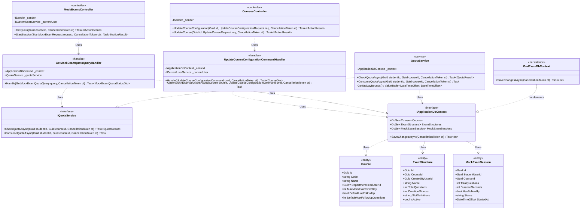
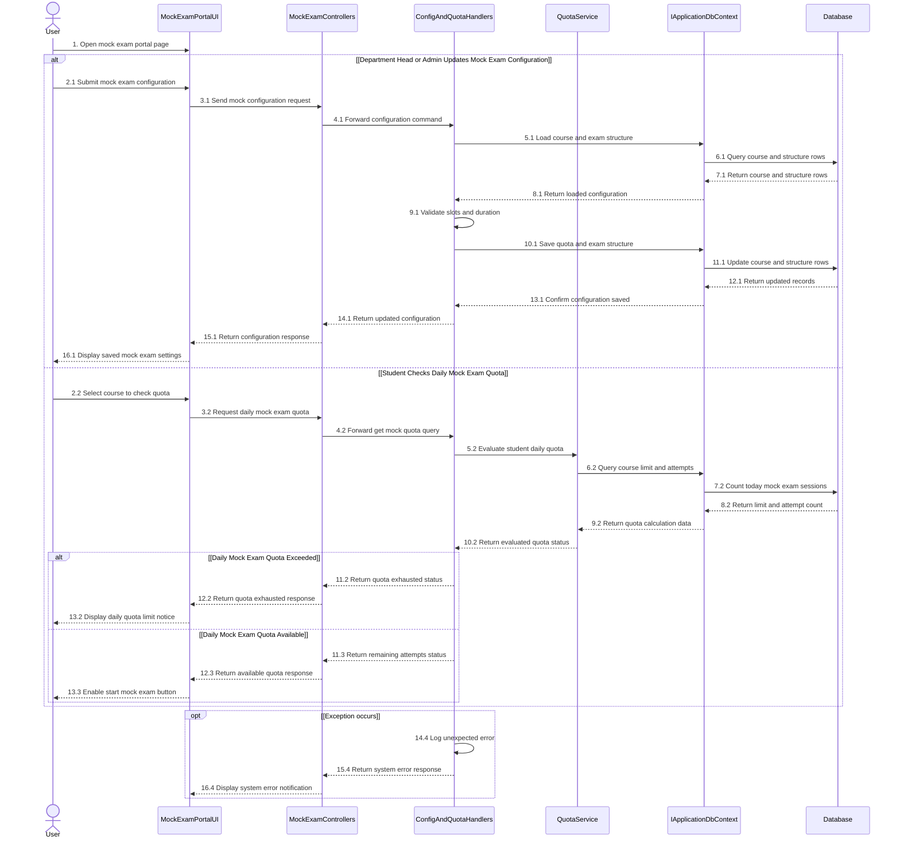

# 3.9 ĐẶC TẢ THIẾT KẾ CHI TIẾT DD-09 — CẤU HÌNH ĐỀ THI THỬ & KIỂM SOÁT HẠN NGẠCH THEO NGÀY (MF-02)

> **Tài liệu:** Report 4 — Detailed Design Specification (`DD-09`)  
> **Dự án:** Hệ Thống Luyện Thi & Đánh Giá Vấn Đáp Bằng LLM Cho Ngành Kỹ Thuật Phần Mềm (`FA26SE166`)  
> **Tác giả (Author):** Phạm Nguyễn Đăng Hải (DB Specialist & Frontend Developer)  
> **Người kiểm tra chéo (Cross-Reviewer):** Lê Vũ Hoàng (Lead Frontend Architect)  
> **Mã nguồn đối chiếu:** [CoursesController.cs](file:///d:/Đồ%20Án/05_Source_Code/backend/src/API/Controllers/v1/CoursesController.cs), [MockExamsController.cs](file:///d:/Đồ%20Án/05_Source_Code/backend/src/API/Controllers/v1/MockExamsController.cs)

---

## 3.9.1 Class Diagram (`DD09_MockConfigQuota_Class_Diagram`)

- **Tệp nguồn Draw.io:** [DD09_MockConfigQuota_Class_Diagram.drawio](file:///d:/Đồ%20Án/05_Source_Code/docs/Task%20Daily/Report4_PhamNguyenDangHai/04_DD09_MockExam_Config_Daily_Quota_Guard/DD09_MockConfigQuota_Class_Diagram.drawio)
- **Tệp ảnh PNG:** [DD09_MockConfigQuota_Class_Diagram.png](file:///d:/Đồ%20Án/05_Source_Code/docs/Task%20Daily/Report4_PhamNguyenDangHai/04_DD09_MockExam_Config_Daily_Quota_Guard/DD09_MockConfigQuota_Class_Diagram.png)

---

## 3.9.2 Đặc Tả Chi Tiết Lớp & Phương Thức (Class Specifications)

### 1. Bảng Tóm Tắt Các Lớp Thiết Kế

| STT | Tên Lớp / Giao Diện | Phân Tầng | Trách Nhiệm Nghiệp Vụ |
| :--- | :--- | :--- | :--- |
| 1 | `CoursesController` | `API Layer` | Cho phép `admin` cấu hình hạn ngạch thi thử mỗi ngày (`max_mock_exams_per_day`) theo môn học và cho phép Trưởng bộ môn (`department_head`) cấu hình cấu trúc đề thi thử, tỷ lệ mức độ khó/Bloom và thời lượng làm bài (`PUT /api/v1/courses/{id}/configuration`). |
| 2 | `MockExamsController` | `API Layer` | Cung cấp endpoint kiểm tra hạn ngạch thi thử còn lại trong ngày của sinh viên theo từng môn học (`GET /api/v1/mock-exams/quota?courseId={id}`). |
| 3 | `UpdateCourseConfigurationCommandHandler` | `Application Layer` | Kiểm tra phân quyền giữa `admin` và `department_head`, xác thực tổng số câu hỏi khớp với phân bổ độ khó (`EasyCount + MediumCount + HardCount == TotalQuestions`) và lưu cấu hình vào `courses` cùng `exam_structures`. |
| 4 | `GetMockExamQuotaQueryHandler` | `Application Layer` | Phối hợp với `IQuotaService` và `IApplicationDbContext` để trả về hạn ngạch tối đa trong ngày, số lượt đã sử dụng, số lượt còn lại và thời điểm làm mới hạn ngạch (`ResetsAtUtc`). |
| 5 | `QuotaService` | `Infrastructure / Application` | Thực thi `IQuotaService`, tính toán số lượt thi thử trong ngày của sinh viên theo môn dựa trên `courses.max_mock_exams_per_day` (không khóa cứng $K=3$), chặn vượt ngưỡng bằng ngoại lệ `HTTP 429 Too Many Requests`. |
| 6 | `Course` / `ExamStructure` / `MockExamSession` | `Domain Layer` | Thực thể lưu trữ hạn ngạch môn học, ma trận cấu trúc đề (`slot_definitions` JSONB) và phiên thi thử của sinh viên. |

### 2. Đặc Tả Phương Thức Trọng Tâm (Method Specifications)

| Lớp | Phương Thức | Tham Số Đầu Vào | Kiểu Trả Về | Mô Tả Xử Lý & Quy Tắc Nghiệp Vụ |
| :--- | :--- | :--- | :--- | :--- |
| `CoursesController` | `UpdateCourseConfiguration` | `Guid id, UpdateCourseConfigurationRequest req, CancellationToken ct` | `Task<IActionResult>` | Cập nhật cấu hình đề thi thử (`MockExamTotalQuestions`, `MockExamDurationMinutes`, phân bổ độ khó) và hạn ngạch `MaxMockExamsPerDay`. |
| `MockExamsController` | `GetQuota` | `Guid courseId, CancellationToken ct` | `Task<IActionResult>` | Trả về `MockExamQuotaStatusDto` chứa `MaxAllowedPerDay`, `AttemptsUsedToday`, `RemainingToday`, `IsExhausted` và `ResetsAtUtc`. |
| `QuotaService` | `CheckQuotaAsync` | `Guid studentId, Guid courseId, CancellationToken ct` | `Task<QuotaResult>` | Đếm các phiên thi thử trong ngày hiện tại của sinh viên đối với môn `courseId` và đối chiếu với `Course.MaxMockExamsPerDay`. |

---

## 3.9.3 Sequence Diagram (`DD09_MockConfigQuota_Sequence_Diagram`)

- **Tệp nguồn Draw.io:** [DD09_MockConfigQuota_Sequence_Diagram.drawio](file:///d:/Đồ%20Án/05_Source_Code/docs/Task%20Daily/Report4_PhamNguyenDangHai/04_DD09_MockExam_Config_Daily_Quota_Guard/DD09_MockConfigQuota_Sequence_Diagram.drawio)
- **Tệp ảnh PNG:** [DD09_MockConfigQuota_Sequence_Diagram.png](file:///d:/Đồ%20Án/05_Source_Code/docs/Task%20Daily/Report4_PhamNguyenDangHai/04_DD09_MockExam_Config_Daily_Quota_Guard/DD09_MockConfigQuota_Sequence_Diagram.png)

### Thuyết Minh Luồng Tuần Tự (`DD-09`)
1. **Nhánh 1 — Trưởng Bộ môn hoặc Admin cập nhật cấu hình Thi thử & Hạn ngạch (`2.1` $\to$ `16.1`):** Người dùng quản trị gửi cấu hình thời lượng, cơ cấu câu hỏi và hạn ngạch ngày (`2.1` $\to$ `4.1`). Handler tải bản ghi môn học và cấu trúc đề hiện tại từ `Database` (`5.1` $\to$ `8.1`), kiểm tra tổng số câu hỏi và thời lượng hợp lệ (`9.1`), sau đó lưu cập nhật vào `courses` và `exam_structures` (`10.1` $\to$ `16.1`).
2. **Nhánh 2 — Sinh viên kiểm tra hạn ngạch Thi thử trong ngày (`2.2` $\to$ `13.3`):** Khi sinh viên chọn môn học trên cổng thi thử (`2.2` $\to$ `4.2`), `QuotaService` truy vấn `Database` để lấy định mức `max_mock_exams_per_day` của môn học và đếm số phiên thi thử đã thực hiện trong ngày của sinh viên (`5.2` $\to$ `10.2`). Nếu đã hết lượt, giao diện hiển thị thông báo hết hạn ngạch kèm thời gian đặt lại (`11.2` $\to$ `13.2`); nếu còn lượt, hệ thống mở nút bắt đầu thi thử (`11.3` $\to$ `13.3`).
3. **Khung ngoại lệ `opt [Exception occurs]` (`14.4` $\to$ `16.4`):** Ghi nhật ký lỗi bất ngờ (`14.4`) và trả thông báo lỗi chuẩn hóa về giao diện (`15.4`, `16.4`).
