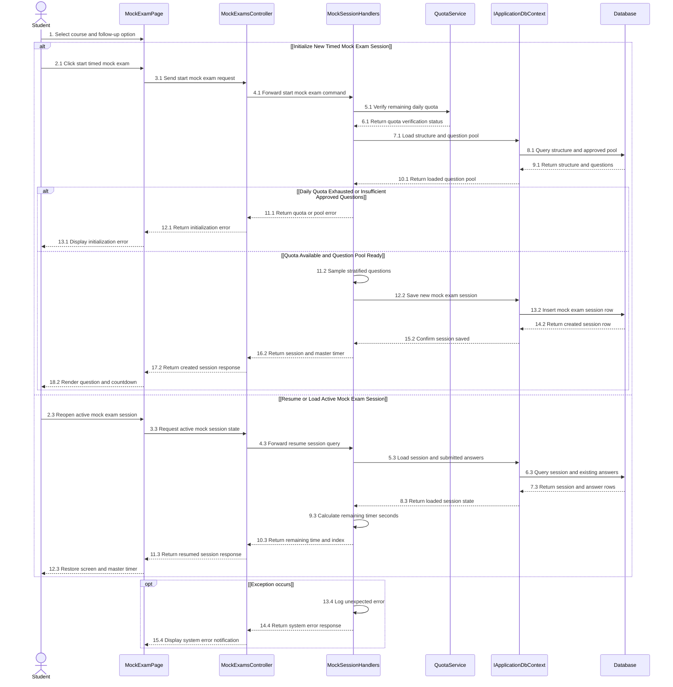

# 3.10 ĐẶC TẢ THIẾT KẾ CHI TIẾT DD-10 — KHỞI TẠO PHIÊN THI THỬ, BỐC CÂU HỒI PHÂN TẦNG & ĐỒNG HỒ TỔNG (MF-02)

> **Tài liệu:** Report 4 — Detailed Design Specification (`DD-10`)  
> **Dự án:** Hệ Thống Luyện Thi & Đánh Giá Vấn Đáp Bằng LLM Cho Ngành Kỹ Thuật Phần Mềm (`FA26SE166`)  
> **Tác giả (Author):** Phạm Nguyễn Đăng Hải (DB Specialist & Frontend Developer)  
> **Người kiểm tra chéo (Cross-Reviewer):** Lê Vũ Hoàng (Lead Frontend Architect)  
> **Mã nguồn đối chiếu:** [MockExamsController.cs](file:///d:/Đồ%20Án/05_Source_Code/backend/src/API/Controllers/v1/MockExamsController.cs)

---

## 3.10.1 Class Diagram (`DD10_MockSessionInit_Class_Diagram`)

- **Tệp nguồn Draw.io:** [DD10_MockSessionInit_Class_Diagram.drawio](file:///d:/Đồ%20Án/05_Source_Code/docs/Task%20Daily/Report4_PhamNguyenDangHai/05_DD10_MockSession_Generation_Questions_MasterTimer/DD10_MockSessionInit_Class_Diagram.drawio)
- **Tệp ảnh PNG:** [DD10_MockSessionInit_Class_Diagram.png](file:///d:/Đồ%20Án/05_Source_Code/docs/Task%20Daily/Report4_PhamNguyenDangHai/05_DD10_MockSession_Generation_Questions_MasterTimer/DD10_MockSessionInit_Class_Diagram.png)

```mermaid
classDiagram
    class MockExamsController {
        <<controller>>
        -ISender _sender
        -ICurrentUserService _currentUser
        +StartSession(StartMockExamRequest request, CancellationToken ct) Task~IActionResult~
        +GetSessionDetail(Guid id, CancellationToken ct) Task~IActionResult~
        +ResumeSession(Guid id, CancellationToken ct) Task~IActionResult~
    }
    class StartMockExamCommandHandler {
        <<handler>>
        -IApplicationDbContext _context
        -IQuotaService _quotaService
        +Handle(StartMockExamCommand cmd, CancellationToken ct) Task~StartMockExamResultDto~
        -SelectStratifiedQuestionsAsync(Guid cid, string slots, CancellationToken ct) Task
    }
    class GetMockExamSessionDetailQueryHandler {
        <<handler>>
        -IApplicationDbContext _context
        +Handle(GetMockExamSessionDetailQuery query, CancellationToken ct) Task~MockExamSessionDetailDto~
        -ComputeRemainingSeconds(MockExamSession session, DateTimeOffset now) int
    }
    class ResumeMockExamSessionQueryHandler {
        <<handler>>
        -IApplicationDbContext _context
        +Handle(ResumeMockExamSessionQuery query, CancellationToken ct) Task~MockExamResumeDto~
        -AutoExpireIfTimeoutAsync(MockExamSession session, CancellationToken ct) Task
    }
    class StartMockExamCommandValidator {
        <<validator>>
        +Validate(StartMockExamCommand cmd) ValidationResult
        -ValidateCourseIdNotEmpty(Guid id) bool
    }
    class IQuotaService {
        <<interface>>
        +CheckQuotaAsync(Guid studentId, Guid courseId, CancellationToken ct) Task
        +ConsumeQuotaAsync(Guid studentId, Guid courseId, CancellationToken ct) Task
    }
    class IApplicationDbContext {
        <<interface>>
        +DbSet~MockExamSession~ MockExamSessions
        +DbSet~PracticeQuestion~ PracticeQuestions
        +DbSet~RubricCriterion~ RubricCriteria
        +SaveChangesAsync(CancellationToken ct) Task~int~
    }
    class OralExamDbContext {
        <<persistence>>
        +SaveChangesAsync(CancellationToken ct) Task~int~
    }
    class MockExamSession {
        <<entity>>
        +Guid Id
        +Guid StudentUserId
        +Guid CourseId
        +int TotalQuestions
        +int DurationSeconds
        +bool HasFollowUp
        +string SelectedQuestionIds
        +string Status
        +DateTimeOffset StartedAt
    }
    class PracticeQuestion {
        <<entity>>
        +Guid Id
        +Guid CourseId
        +Guid? CloId
        +Guid RubricId
        +string Content
        +string Difficulty
        +string ReviewStatus
        +bool IsActive
    }
    class RubricCriterion {
        <<entity>>
        +Guid Id
        +Guid RubricId
        +string CriterionName
        +string Description
        +decimal MaxScore
        +int OrderIndex
    }

    MockExamsController ..> StartMockExamCommandHandler : Uses
    MockExamsController ..> GetMockExamSessionDetailQueryHandler : Uses
    MockExamsController ..> ResumeMockExamSessionQueryHandler : Uses
    StartMockExamCommandHandler ..> StartMockExamCommandValidator : Uses
    StartMockExamCommandHandler ..> IQuotaService : Uses
    StartMockExamCommandHandler ..> IApplicationDbContext : Uses
    GetMockExamSessionDetailQueryHandler ..> IApplicationDbContext : Uses
    ResumeMockExamSessionQueryHandler ..> IApplicationDbContext : Uses
    OralExamDbContext ..|> IApplicationDbContext : Implements
    IApplicationDbContext ..> MockExamSession : Uses
    IApplicationDbContext ..> PracticeQuestion : Uses
    IApplicationDbContext ..> RubricCriterion : Uses
```

---

## 3.10.2 Đặc Tả Chi Tiết Lớp & Phương Thức (Class Specifications)

### 1. Bảng Tóm Tắt Các Lớp Thiết Kế

| STT | Tên Lớp / Giao Diện | Phân Tầng | Trách Nhiệm Nghiệp Vụ |
| :--- | :--- | :--- | :--- |
| 1 | `MockExamsController` | `API Layer` | Cung cấp các endpoint bắt đầu phiên thi thử (`POST /api/v1/mock-exams/sessions`), tải chi tiết phiên thi và khôi phục phiên thi đang diễn ra (`GET /api/v1/mock-exams/sessions/{id}/resume`). |
| 2 | `StartMockExamCommandHandler` | `Application Layer` | Kiểm tra hạn ngạch thi thử qua `IQuotaService`, tải ma trận cấu trúc đề (`exam_structures`), bốc ngẫu nhiên phân tầng các câu hỏi đã duyệt (`APPROVED`) từ kho `practice_questions` (cô lập tuyệt đối khỏi kho đề thi thật `exam_questions`) và tạo `MockExamSession` kèm đồng hồ tổng (`DurationSeconds`). |
| 3 | `ResumeMockExamSessionQueryHandler` | `Application Layer` | Khôi phục trạng thái phiên thi thử khi trình duyệt tải lại trang, tính toán thời gian còn lại theo dấu thời gian máy chủ (`StartedAt + DurationSeconds - UtcNow`) và tự động chuyển trạng thái nếu đã hết giờ. |
| 4 | `StartMockExamCommandValidator` | `Application Layer` | Kiểm tra hợp lệ `CourseId` và tùy chọn `HasFollowUp` của sinh viên trước khi khởi tạo phiên thi thử. |
| 5 | `MockExamSession` / `PracticeQuestion` / `RubricCriterion` | `Domain Layer` | Các thực thể lưu trữ phiên thi thử, ngân hàng câu hỏi ôn tập/thi thử và tiêu chí chấm điểm Rubric 10.0. |

### 2. Đặc Tả Phương Thức Trọng Tâm (Method Specifications)

| Lớp | Phương Thức | Tham Số Đầu Vào | Kiểu Trả Về | Mô Tả Xử Lý & Quy Tắc Nghiệp Vụ |
| :--- | :--- | :--- | :--- | :--- |
| `MockExamsController` | `StartSession` | `StartMockExamRequest request, CancellationToken ct` | `Task<IActionResult>` | Khởi tạo phiên thi thử mới với tùy chọn Có/Không câu hỏi phụ (`HasFollowUp`); trả về `201 Created` (hoặc `429 Too Many Requests` nếu vượt hạn ngạch ngày). |
| `StartMockExamCommandHandler` | `Handle` | `StartMockExamCommand cmd, CancellationToken ct` | `Task<StartMockExamResultDto>` | Thực thi bốc câu hỏi phân tầng từ `practice_questions`, lưu danh sách câu hỏi vào `SelectedQuestionIds` (JSONB) và ghi nhận `StartedAt = DateTimeOffset.UtcNow`. |
| `MockExamsController` | `ResumeSession` | `Guid id, CancellationToken ct` | `Task<IActionResult>` | Đồng bộ lại đồng hồ đếm ngược (`RemainingSeconds`) và vị trí câu hỏi hiện tại khi sinh viên mở lại phiên thi đang làm dở. |

---

## 3.10.3 Sequence Diagram (`DD10_MockSessionInit_Sequence_Diagram`)

- **Tệp nguồn Draw.io:** [DD10_MockSessionInit_Sequence_Diagram.drawio](file:///d:/Đồ%20Án/05_Source_Code/docs/Task%20Daily/Report4_PhamNguyenDangHai/05_DD10_MockSession_Generation_Questions_MasterTimer/DD10_MockSessionInit_Sequence_Diagram.drawio)
- **Tệp ảnh PNG:** [DD10_MockSessionInit_Sequence_Diagram.png](file:///d:/Đồ%20Án/05_Source_Code/docs/Task%20Daily/Report4_PhamNguyenDangHai/05_DD10_MockSession_Generation_Questions_MasterTimer/DD10_MockSessionInit_Sequence_Diagram.png)

### Thuyết Minh Luồng Tuần Tự (`DD-10`)
1. **Nhánh 1 — Khởi tạo Phiên thi thử mới và Bốc câu hỏi phân tầng (`2.1` $\to$ `18.2`):** Sinh viên chọn môn học, tùy chọn Có/Không câu hỏi phụ và bấm bắt đầu thi thử (`1`, `2.1` $\to$ `4.1`). Handler kiểm tra hạn ngạch ngày qua `QuotaService` (`5.1`, `6.1`) và tải cấu trúc đề cùng danh sách câu hỏi đã duyệt trong `practice_questions` từ `Database` (`7.1` $\to$ `10.1`). Nếu hết hạn ngạch hoặc kho câu hỏi chưa đủ số lượng theo ma trận, hệ thống trả về thông báo lỗi (`11.1` $\to$ `13.1`). Nếu hợp lệ, Handler bốc câu hỏi phân tầng theo độ khó (`11.2`), lưu phiên thi mới vào bảng `mock_exam_sessions` (`12.2` $\to$ `15.2`) và trả về đề thi kèm đồng hồ đếm ngược tổng (`16.2` $\to$ `18.2`).
2. **Nhánh 2 — Khôi phục Phiên thi thử đang diễn ra (`2.3` $\to$ `12.3`):** Khi sinh viên mở lại phiên thi đang làm dở (`2.3` $\to$ `4.3`), Handler truy vấn `Database` để tải thông tin phiên thi và các câu trả lời đã nộp (`5.3` $\to$ `8.3`), tính toán chính xác số giây còn lại của đồng hồ tổng (`9.3`) và đồng bộ lại màn hình làm bài cho sinh viên (`10.3` $\to$ `12.3`).
3. **Khung ngoại lệ `opt [Exception occurs]` (`13.4` $\to$ `15.4`):** Ghi nhật ký lỗi hệ thống (`13.4`) và hiển thị thông báo lỗi trên giao diện (`14.4`, `15.4`).
