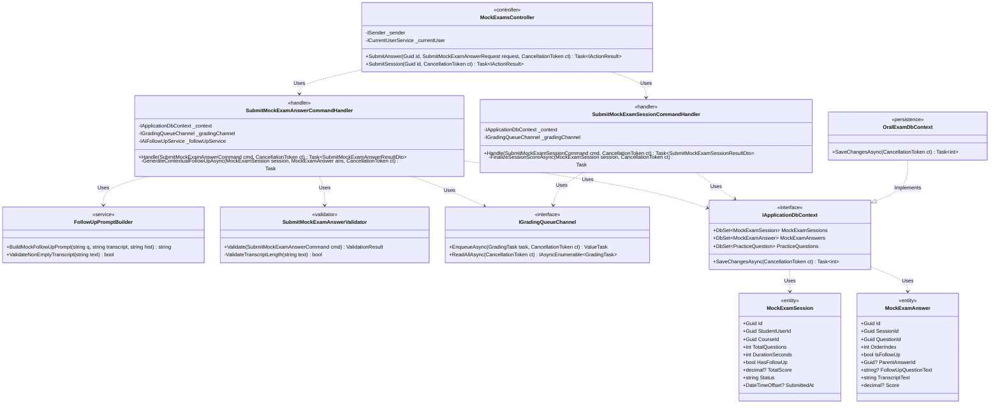
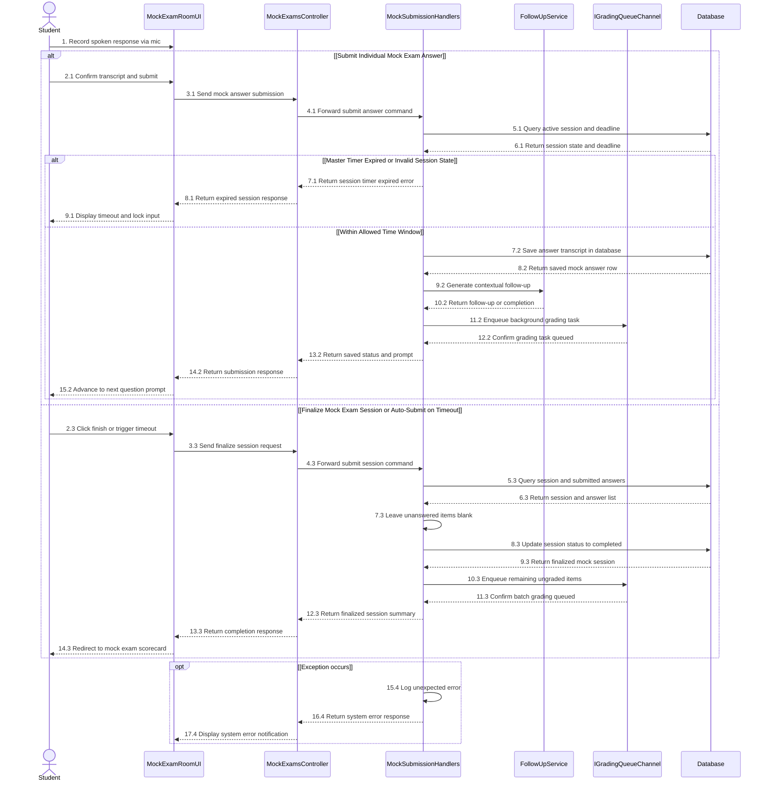

# 3.11 ĐẶC TẢ THIẾT KẾ CHI TIẾT DD-11 — NỘP CÂU TRẢ LỜI THI THỬ, PHÁT VẤN THEO NGỮ CẢNH & TỰ ĐỘNG NỘP KHI HẾT GIỜ (MF-02)

> **Tài liệu:** Report 4 — Detailed Design Specification (`DD-11`)  
> **Dự án:** Hệ Thống Luyện Thi & Đánh Giá Vấn Đáp Bằng LLM Cho Ngành Kỹ Thuật Phần Mềm (`FA26SE166`)  
> **Tác giả (Author):** Phạm Nguyễn Đăng Hải (DB Specialist & Frontend Developer)  
> **Người kiểm tra chéo (Cross-Reviewer):** Lê Vũ Hoàng (Lead Frontend Architect)  
> **Mã nguồn đối chiếu:** [MockExamsController.cs](file:///d:/Đồ%20Án/05_Source_Code/backend/src/API/Controllers/v1/MockExamsController.cs)

---

## 3.11.1 Class Diagram (`DD11_MockSubmission_Class_Diagram`)

- **Tệp nguồn Draw.io:** [DD11_MockSubmission_Class_Diagram.drawio](file:///d:/Đồ%20Án/05_Source_Code/docs/Task%20Daily/Report4_PhamNguyenDangHai/06_DD11_MockAnswer_Submission_AutoFinalSubmit/DD11_MockSubmission_Class_Diagram.drawio)
- **Tệp ảnh PNG:** [DD11_MockSubmission_Class_Diagram.png](file:///d:/Đồ%20Án/05_Source_Code/docs/Task%20Daily/Report4_PhamNguyenDangHai/06_DD11_MockAnswer_Submission_AutoFinalSubmit/DD11_MockSubmission_Class_Diagram.png)

---

## 3.11.2 Đặc Tả Chi Tiết Lớp & Phương Thức (Class Specifications)

### 1. Bảng Tóm Tắt Các Lớp Thiết Kế

| STT | Tên Lớp / Giao Diện | Phân Tầng | Trách Nhiệm Nghiệp Vụ |
| :--- | :--- | :--- | :--- |
| 1 | `MockExamsController` | `API Layer` | Tiếp nhận yêu cầu nộp từng câu trả lời (`POST /api/v1/mock-exams/sessions/{id}/answers`) và nộp kết thúc phiên thi thử (`POST /api/v1/mock-exams/sessions/{id}/submit`). |
| 2 | `SubmitMockExamAnswerCommandHandler` | `Application Layer` | Kiểm tra thời hạn của đồng hồ tổng, lưu văn bản trả lời (`TranscriptText`) vào bảng `mock_exam_answers` (**Zero-R2 Invariant**: tuyệt đối không lưu tệp ghi âm lên Cloudflare R2 cho thi thử), sinh câu hỏi phụ theo ngữ cảnh nếu sinh viên bật `HasFollowUp` và đẩy tác vụ chấm điểm vào `IGradingQueueChannel`. |
| 3 | `SubmitMockExamSessionCommandHandler` | `Application Layer` | Chốt kết thúc phiên thi thử khi sinh viên bấm nộp bài hoặc khi đồng hồ tổng hết giờ; giữ nguyên các câu chưa trả lời ở trạng thái trống (không phạt âm điểm), đóng phiên thi (`status = "completed"`) và đẩy các câu chưa chấm vào hàng đợi AI. |
| 4 | `FollowUpPromptBuilder` | `Application Layer` | Xây dựng prompt ngữ cảnh cho câu hỏi phụ trong thi thử (phát vấn dựa trên nội dung câu trả lời chính thay vì giới hạn trong khoảng điểm $4.0 - 8.0$ như luyện tập). |
| 5 | `MockExamSession` / `MockExamAnswer` | `Domain Layer` | Thực thể 3NF lưu trữ phiên thi thử và câu trả lời chính/phụ (`IsFollowUp`, `ParentAnswerId`, `FollowUpQuestionText`). |

### 2. Đặc Tả Phương Thức Trọng Tâm (Method Specifications)

| Lớp | Phương Thức | Tham Số Đầu Vào | Kiểu Trả Về | Mô Tả Xử Lý & Quy Tắc Nghiệp Vụ |
| :--- | :--- | :--- | :--- | :--- |
| `MockExamsController` | `SubmitAnswer` | `Guid id, SubmitMockExamAnswerRequest request, CancellationToken ct` | `Task<IActionResult>` | Lưu câu trả lời văn bản sau bước kiểm tra giọng nói (`Voice-First Gate`), trả về câu hỏi phụ tiếp theo (nếu có) và đưa bài trả lời vào hàng đợi chấm điểm. |
| `MockExamsController` | `SubmitSession` | `Guid id, CancellationToken ct` | `Task<IActionResult>` | Đóng phiên thi thử `id`, ghi nhận `SubmittedAt = DateTimeOffset.UtcNow` và kích hoạt tổng hợp điểm cho các câu đã trả lời. |

---

## 3.11.3 Sequence Diagram (`DD11_MockSubmission_Sequence_Diagram`)

- **Tệp nguồn Draw.io:** [DD11_MockSubmission_Sequence_Diagram.drawio](file:///d:/Đồ%20Án/05_Source_Code/docs/Task%20Daily/Report4_PhamNguyenDangHai/06_DD11_MockAnswer_Submission_AutoFinalSubmit/DD11_MockSubmission_Sequence_Diagram.drawio)
- **Tệp ảnh PNG:** [DD11_MockSubmission_Sequence_Diagram.png](file:///d:/Đồ%20Án/05_Source_Code/docs/Task%20Daily/Report4_PhamNguyenDangHai/06_DD11_MockAnswer_Submission_AutoFinalSubmit/DD11_MockSubmission_Sequence_Diagram.png)

### Thuyết Minh Luồng Tuần Tự (`DD-11`)
1. **Nhánh 1 — Nộp từng câu trả lời Thi thử và Phát vấn ngữ cảnh (`2.1` $\to$ `15.2`):** Sau khi trả lời qua micro (`1`), sinh viên xác nhận văn bản transcript và bấm nộp câu trả lời (`2.1` $\to$ `4.1`). Handler truy vấn `Database` để kiểm tra trạng thái phiên thi và thời hạn đồng hồ tổng (`5.1`, `6.1`). Nếu đã quá hạn, hệ thống trả lỗi hết giờ và khóa ô nhập (`7.1` $\to$ `9.1`). Nếu còn trong thời gian cho phép, Handler lưu văn bản trả lời vào bảng `mock_exam_answers` mà không lưu tệp âm thanh lên R2 (`7.2`, `8.2`), gọi `FollowUpService` sinh câu hỏi phụ theo ngữ cảnh nếu phiên thi bật `HasFollowUp` (`9.2`, `10.2`), đẩy tác vụ chấm điểm vào `IGradingQueueChannel` (`11.2`, `12.2`) và chuyển sinh viên sang câu hỏi kế tiếp (`13.2` $\to$ `15.2`).
2. **Nhánh 2 — Kết thúc Phiên thi thử hoặc Tự động nộp khi hết giờ (`2.3` $\to$ `14.3`):** Khi sinh viên bấm hoàn thành bài thi hoặc đồng hồ đếm ngược chạm 0 (`2.3` $\to$ `4.3`), Handler tải phiên thi cùng danh sách các câu đã nộp từ `Database` (`5.3`, `6.3`), giữ trống các câu chưa làm (`7.3`), cập nhật trạng thái phiên thi sang hoàn thành (`8.3`, `9.3`), đẩy các câu trả lời còn lại vào hàng đợi chấm AI (`10.3`, `11.3`) và điều hướng sinh viên tới màn hình bảng điểm tổng hợp (`12.3` $\to$ `14.3`).
3. **Khung ngoại lệ `opt [Exception occurs]` (`15.4` $\to$ `17.4`):** Ghi nhận lỗi bất ngờ (`15.4`) và trả thông báo lỗi chuẩn hóa về giao diện phòng thi thử (`16.4`, `17.4`).
