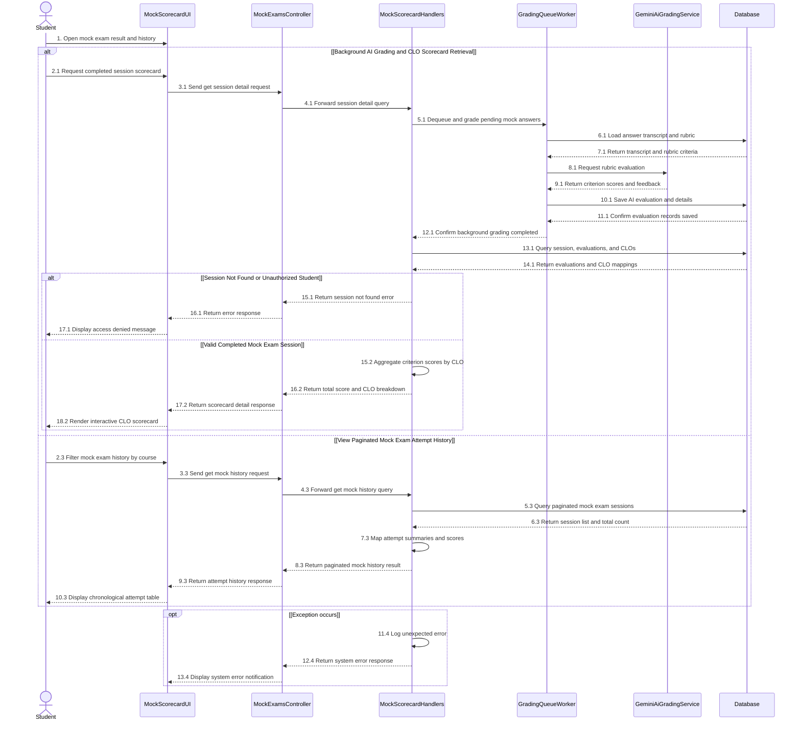

# 3.12 ĐẶC TẢ THIẾT KẾ CHI TIẾT DD-12 — CHẤM ĐIỂM AI THEO RUBRIC 10.0, BẢNG ĐIỂM CLO SCORECARD & LỊCH SỬ THI THỬ (MF-02)

> **Tài liệu:** Report 4 — Detailed Design Specification (`DD-12`)  
> **Dự án:** Hệ Thống Luyện Thi & Đánh Giá Vấn Đáp Bằng LLM Cho Ngành Kỹ Thuật Phần Mềm (`FA26SE166`)  
> **Tác giả (Author):** Phạm Nguyễn Đăng Hải (DB Specialist & Frontend Developer)  
> **Người kiểm tra chéo (Cross-Reviewer):** Lê Vũ Hoàng (Lead Frontend Architect)  
> **Mã nguồn đối chiếu:** [MockExamsController.cs](file:///d:/Đồ%20Án/05_Source_Code/backend/src/API/Controllers/v1/MockExamsController.cs)

---

## 3.12.1 Class Diagram (`DD12_MockGradingScorecard_Class_Diagram`)

- **Tệp nguồn Draw.io:** [DD12_MockGradingScorecard_Class_Diagram.drawio](file:///d:/Đồ%20Án/05_Source_Code/docs/Task%20Daily/Report4_PhamNguyenDangHai/07_DD12_MockAiGrading_CloScorecard_AttemptHistory/DD12_MockGradingScorecard_Class_Diagram.drawio)
- **Tệp ảnh PNG:** [DD12_MockGradingScorecard_Class_Diagram.png](file:///d:/Đồ%20Án/05_Source_Code/docs/Task%20Daily/Report4_PhamNguyenDangHai/07_DD12_MockAiGrading_CloScorecard_AttemptHistory/DD12_MockGradingScorecard_Class_Diagram.png)

```mermaid
classDiagram
    class MockExamsController {
        <<controller>>
        -ISender _sender
        +GetSessionDetail(Guid id, CancellationToken ct) Task~IActionResult~
        +GetHistory(Guid? courseId, int p, int ps, CancellationToken ct) Task~IActionResult~
    }
    class GetMockExamSessionDetailQueryHandler {
        <<handler>>
        -IApplicationDbContext _context
        +Handle(GetMockExamSessionDetailQuery query, CancellationToken ct) Task~MockExamSessionDetailDto~
        -BuildCloBreakdown(List~MockExamAnswer~ answers, List~CourseClo~ clos) List~CloScoreDto~
    }
    class GetMockExamHistoryQueryHandler {
        <<handler>>
        -IApplicationDbContext _context
        +Handle(GetMockExamHistoryQuery query, CancellationToken ct) Task~PagedResult_MockHistoryDto~
    }
    class GradingQueueWorker {
        <<worker>>
        -IGradingQueueChannel _channel
        -IServiceScopeFactory _scopeFactory
        #ExecuteAsync(CancellationToken stoppingToken) Task
        -ProcessMockGradingAsync(GradingTask task, CancellationToken ct) Task
    }
    class IAiGradingService {
        <<interface>>
        +GradeAnswerAsync(AiGradingRequest req, CancellationToken ct) Task~AiGradingResult~
        +ParseRubricScorecard(string json) List~CriterionScore~
    }
    class GeminiAiGradingService {
        <<service>>
        -HttpClient _httpClient
        -CoTPromptBuilder _promptBuilder
        +GradeAnswerAsync(AiGradingRequest req, CancellationToken ct) Task~AiGradingResult~
        -ExecuteWithPollyRetryAsync(string payload, CancellationToken ct) Task
    }
    class IApplicationDbContext {
        <<interface>>
        +DbSet~MockExamSession~ MockExamSessions
        +DbSet~MockExamAnswer~ MockExamAnswers
        +DbSet~AiEvaluation~ AiEvaluations
        +DbSet~CourseClo~ CourseClos
        +SaveChangesAsync(CancellationToken ct) Task~int~
    }
    class OralExamDbContext {
        <<persistence>>
        +SaveChangesAsync(CancellationToken ct) Task~int~
    }
    class MockExamAnswer {
        <<entity>>
        +Guid Id
        +Guid SessionId
        +Guid QuestionId
        +string TranscriptText
        +decimal? Score
        +string? AiFeedback
        +DateTimeOffset AnsweredAt
    }
    class AiEvaluation {
        <<entity>>
        +Guid Id
        +Guid? PracticeAnswerId
        +Guid? MockExamAnswerId
        +Guid? ExamQuestionSubmissionId
        +string ModelName
        +decimal TotalScore
        +decimal ConfidenceScore
        +string CotTrace
    }
    class AiEvaluationDetail {
        <<entity>>
        +Guid Id
        +Guid EvaluationId
        +Guid RubricCriterionId
        +decimal AwardedScore
        +decimal MaxScore
        +string Feedback
    }
    class CourseClo {
        <<entity>>
        +Guid Id
        +Guid CourseId
        +string Code
        +string Description
        +string BloomLevel
        +decimal WeightPercentage
    }

    MockExamsController ..> GetMockExamSessionDetailQueryHandler : Uses
    MockExamsController ..> GetMockExamHistoryQueryHandler : Uses
    GetMockExamSessionDetailQueryHandler ..> IApplicationDbContext : Uses
    GetMockExamHistoryQueryHandler ..> IApplicationDbContext : Uses
    GradingQueueWorker ..> IAiGradingService : Uses
    GradingQueueWorker ..> IApplicationDbContext : Uses
    GeminiAiGradingService ..|> IAiGradingService : Implements
    OralExamDbContext ..|> IApplicationDbContext : Implements
    IApplicationDbContext ..> MockExamAnswer : Uses
    IApplicationDbContext ..> AiEvaluation : Uses
    IApplicationDbContext ..> AiEvaluationDetail : Uses
    IApplicationDbContext ..> CourseClo : Uses
```

---

## 3.12.2 Đặc Tả Chi Tiết Lớp & Phương Thức (Class Specifications)

### 1. Bảng Tóm Tắt Các Lớp Thiết Kế

| STT | Tên Lớp / Giao Diện | Phân Tầng | Trách Nhiệm Nghiệp Vụ |
| :--- | :--- | :--- | :--- |
| 1 | `MockExamsController` | `API Layer` | Cung cấp endpoint xem chi tiết bảng điểm CLO Scorecard của phiên thi thử (`GET /api/v1/mock-exams/sessions/{id}`) và xem lịch sử các lần thi thử có phân trang (`GET /api/v1/mock-exams/history`). |
| 2 | `GradingQueueWorker` | `Infrastructure Layer` | Tiêu thụ các tác vụ chấm điểm từ `BoundedChannel<GradingTask>`, gọi `IAiGradingService` chấm theo Rubric $\sum \equiv 10.0$, lưu bản ghi `AiEvaluation` (thỏa mãn ràng buộc XOR `ck_ai_evaluations_xor` với `mock_exam_answer_id IS NOT NULL`) và cập nhật điểm tổng của phiên thi thử. |
| 3 | `GeminiAiGradingService` | `Infrastructure Layer` | Gọi Gemini 1.5 Flash/Pro với cơ chế Chain-of-Thought (CoT) và Polly Exponential Backoff Retry (`2s, 4s, 8s`); nếu quá tải hoặc lỗi mạng sau 3 lần thử, tự động cách ly tác vụ vào bảng `dead_letter_queues` để Admin giám sát và replay. |
| 4 | `GetMockExamSessionDetailQueryHandler` | `Application Layer` | Truy xuất phiên thi thử, các câu trả lời, chi tiết tiêu chí `AiEvaluationDetail` và tổng hợp điểm đạt được theo từng Chuẩn đầu ra môn học (`CourseClo`). |
| 5 | `GetMockExamHistoryQueryHandler` | `Application Layer` | Truy vấn danh sách lịch sử các phiên thi thử của sinh viên theo môn học kèm phân trang (`page`, `pageSize`). |

### 2. Đặc Tả Phương Thức Trọng Tâm (Method Specifications)

| Lớp | Phương Thức | Tham Số Đầu Vào | Kiểu Trả Về | Mô Tả Xử Lý & Quy Tắc Nghiệp Vụ |
| :--- | :--- | :--- | :--- | :--- |
| `MockExamsController` | `GetSessionDetail` | `Guid id, CancellationToken ct` | `Task<IActionResult>` | Trả về `MockExamSessionDetailDto` gồm điểm tổng, điểm từng câu trả lời, nhận xét chi tiết theo từng tiêu chí Rubric và bảng tổng hợp theo CLO. |
| `MockExamsController` | `GetHistory` | `Guid? courseId, int page, int pageSize, CancellationToken ct` | `Task<IActionResult>` | Trả về danh sách phân trang lịch sử các lần thi thử của sinh viên trên Student Portal (`FE-02`). |
| `GeminiAiGradingService` | `GradeAnswerAsync` | `AiGradingRequest req, CancellationToken ct` | `Task<AiGradingResult>` | Đánh giá câu trả lời của sinh viên đối chiếu với `ModelAnswer` và các tiêu chí `RubricCriterion` ($\sum \equiv 10.0$), trả về JSON có cấu trúc gồm điểm từng tiêu chí, nhận xét và độ tự tin (`ConfidenceScore`). |

---

## 3.12.3 Sequence Diagram (`DD12_MockGradingScorecard_Sequence_Diagram`)

- **Tệp nguồn Draw.io:** [DD12_MockGradingScorecard_Sequence_Diagram.drawio](file:///d:/Đồ%20Án/05_Source_Code/docs/Task%20Daily/Report4_PhamNguyenDangHai/07_DD12_MockAiGrading_CloScorecard_AttemptHistory/DD12_MockGradingScorecard_Sequence_Diagram.drawio)
- **Tệp ảnh PNG:** [DD12_MockGradingScorecard_Sequence_Diagram.png](file:///d:/Đồ%20Án/05_Source_Code/docs/Task%20Daily/Report4_PhamNguyenDangHai/07_DD12_MockAiGrading_CloScorecard_AttemptHistory/DD12_MockGradingScorecard_Sequence_Diagram.png)

### Thuyết Minh Luồng Tuần Tự (`DD-12`)
1. **Nhánh 1 — Chấm điểm AI theo Rubric 10.0 và Xem Bảng điểm CLO Scorecard (`2.1` $\to$ `18.2`):** Khi sinh viên mở xem kết quả phiên thi thử (`2.1` $\to$ `4.1`), `GradingQueueWorker` hoàn tất chấm điểm các câu trả lời trong hàng đợi bằng cách tải transcript cùng tiêu chí Rubric từ `Database` (`5.1` $\to$ `7.1`), gọi `GeminiAiGradingService` chấm điểm Chain-of-Thought (`8.1`, `9.1`) và lưu kết quả vào bảng `ai_evaluations`, `ai_evaluation_details` cùng `mock_exam_answers` (`10.1` $\to$ `12.1`). Tiếp đó, `MockScorecardHandlers` truy vấn `Database` để lấy toàn bộ kết quả chấm cùng danh mục `course_clos` (`13.1`, `14.1`). Nếu phiên thi không tồn tại hoặc không thuộc quyền sở hữu của sinh viên, hệ thống trả lỗi từ chối truy cập (`15.1` $\to$ `17.1`). Nếu hợp lệ, Handler tổng hợp tỷ lệ đạt theo từng CLO (`15.2`) và hiển thị bảng điểm CLO Scorecard trực quan (`16.2` $\to$ `18.2`).
2. **Nhánh 2 — Xem Lịch sử các lần Thi thử có phân trang (`2.3` $\to$ `10.3`):** Sinh viên lọc lịch sử thi thử theo môn học và trang (`2.3` $\to$ `4.3`). Handler truy vấn danh sách phiên thi thử của sinh viên từ `Database` (`5.3`, `6.3`), ánh xạ thông tin thời lượng, tổng điểm và trạng thái (`7.3`) rồi hiển thị bảng lịch sử thi thử theo thứ tự thời gian (`8.3` $\to$ `10.3`).
3. **Khung ngoại lệ `opt [Exception occurs]` (`11.4` $\to$ `13.4`):** Ghi nhật ký lỗi bất ngờ (`11.4`) và trả thông báo lỗi hệ thống về giao diện (`12.4`, `13.4`).
