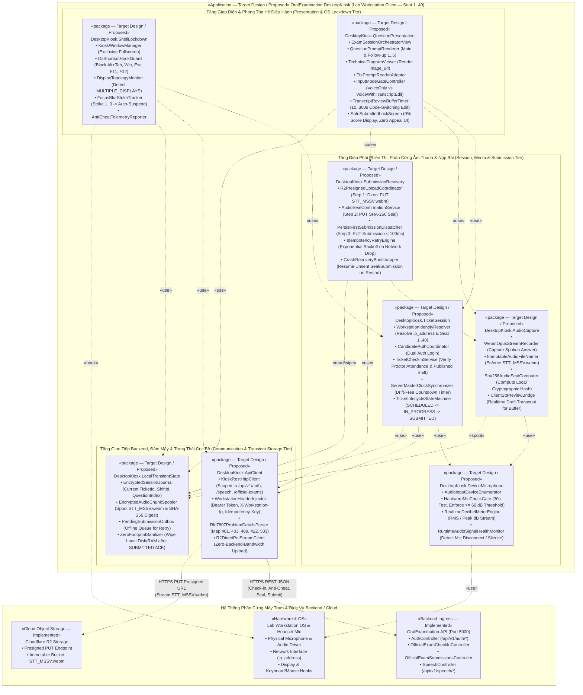

# BÁO CÁO REPORT 4 — SOFTWARE DESIGN DOCUMENT (BẢN TIẾNG VIỆT ĐỂ DUYỆT)
## PHẦN PHỤ TRÁCH: NGUYỄN QUANG THÀNH — MỤC 1.2.1 (`D-03`) & MỤC 1.2.3 (`D-05`)

> **Thông tin kiểm soát tài liệu:**
> - **Dự án:** Hệ Thống Luyện Thi & Đánh Giá Vấn Đáp Bằng LLM Cho Ngành Kỹ Thuật Phần Mềm (`FA26SE166`)
> - **Người thực hiện:** Nguyễn Quang Thành (Team Leader & Lead Backend Architect)
> - **Người phản biện chéo (Peer Reviewer):** Phạm Nguyễn Đăng Hải
> - **Phạm vi bàn giao:**
>   1. **Mục `1.2.1` (`D-03`) — Backend Package Diagram & Package Descriptions:** Truy vết 100% về mã nguồn hiện hành tại [`05_Source_Code/backend/src/`](file:///d:/Đồ%20Án/05_Source_Code/backend/src/), thể hiện rõ 4 tầng Clean Architecture (`API`, `Application`, `Domain`, `Infrastructure`), các tiến trình nền (`Workers`), hàng đợi bộ nhớ (`Channels` / `Queue`) và ranh giới phục vụ song song hai ứng dụng khách (**Web Application** và **Desktop Kiosk Application**).
>   2. **Mục `1.2.3` (`D-05`) — Desktop Kiosk Package/Component Diagram & Package Descriptions:** Thiết kế kiến trúc gói và thành phần cho ứng dụng máy trạm phòng thi (`OralExamination.DesktopKiosk`). Do tại thời điểm hiện tại workspace chưa tách project mã nguồn Desktop riêng, toàn bộ các gói thuộc Desktop Kiosk được gắn nhãn tường minh **`[Target Design / Proposed]`** theo đúng quy định của *Mục 1 & Mục 7 — Definition of Done*.

---

## 1.2. Sơ Đồ Gói Hệ Thống (Package Diagrams)

Phần này trình bày cấu trúc tổ chức các gói phần mềm (packages), chiều phụ thuộc tĩnh (compile-time dependencies) và ranh giới trách nhiệm giữa các thành phần có thể triển khai của hệ thống. Kiến trúc hệ thống tuân thủ bất biến phân tách ứng dụng khách:
- **Web Application (`React 19 Vite SPA` — Mục 1.2.2):** Phục vụ toàn bộ luồng Luyện tập tự do (**MF-01**), Thi thử tính giờ (**MF-02**), Ngân hàng câu hỏi & Rubric Studio (**MF-03**), Ca thi vấn đáp trong lớp (**MF-05 / R6**), cùng các phân hệ quản trị học thuật (**R5**), thiết lập kỳ thi/ca thi, điểm danh giám thị (**R4**), hậu kiểm bằng chứng của giảng viên, công bố điểm khóa một chiều, phúc khảo 5 bước (**R7**) và giám sát Dead-Letter Queue (**R2**) của **MF-04**.
- **Desktop Kiosk Application (`Target Design / Proposed` — Mục 1.2.3):** Chuyên trách duy nhất luồng **thí sinh thực hiện bài thi thật tại phòng Lab (MF-04 Candidate Execution)**, bao gồm: khóa toàn màn hình máy trạm, kiểm tra phần cứng microphone 30 giây ($\ge 60\text{ dB}$), check-in đối chiếu ghế ngồi (`SeatNumber` 1–40) và địa chỉ IP máy trạm (`ip_address`), nhận đề thi đã xuất bản, ghi âm `.webm` theo định danh `STT_MSSV.webm`, băm niêm phong SHA-256, tải lên Cloudflare R2 và nộp bài theo chiến lược Persist-First ($< 100\text{ ms}$).
- **Backend Application (`.NET 8 Clean Architecture` — Mục 1.2.1):** Đóng vai trò hạt nhân xử lý nghiệp vụ và cổng giao tiếp hợp nhất (Unified API & Real-Time Ingress) phục vụ đồng thời cả **Web Application** lẫn **Desktop Kiosk Application** thông qua các ranh giới endpoint và chính sách phân quyền 6 vai trò RBAC (`admin`, `department_head`, `examination_officer`, `lecturer`, `proctor`, `student`).

---

### 1.2.1. Sơ Đồ Gói Phân Hệ Backend (Backend Package Diagram — `D-03`)

#### a) Nguyên lý tổ chức gói và quy tắc chiều phụ thuộc (Dependency Rule)
Phân hệ Backend ([`OralExamination.sln`](file:///d:/Đồ%20Án/05_Source_Code/backend/OralExamination.sln)) được xây dựng trên nền tảng **ASP.NET Core 8 (.NET 8 / C# 12)**, tổ chức nghiêm ngặt theo kiến trúc **Clean Architecture 4 tầng** kết hợp mẫu thiết kế **CQRS (Command Query Responsibility Segregation)** qua MediatR và đường ống xử lý bất đồng bộ **Persist-First + BoundedChannel + Background Workers**.

Mọi mũi tên phụ thuộc giữa các gói lớn đều tuân thủ **Nguyên lý Đảo ngược Phụ thuộc (Dependency Inversion Principle — DIP)** và được kiểm chứng tự động bởi bộ kiểm thử kiến trúc [`CleanArchitectureRulesTests.cs`](file:///d:/Đồ%20Án/05_Source_Code/backend/tests/OralExamination.UnitTests/Architecture/CleanArchitectureRulesTests.cs):
1. **`OralExamination.Domain`** nằm ở tâm kiến trúc, chứa các thực thể nghiệp vụ chuẩn 3NF, kiểu liệt kê, quy tắc bất biến và ngoại lệ miền. Tầng này **không phụ thuộc vào bất kỳ gói hay thư viện ngoại vi nào**.
2. **`OralExamination.Application`** chỉ phụ thuộc vào `OralExamination.Domain`. Tầng này định nghĩa toàn bộ các ca sử dụng (Use Cases) theo cấu trúc **Vertical Feature Slices** (`Commands`, `Queries`, `Handlers`, `Validators`, `DTOs`) và công bố các giao diện trừu tượng (`Common.Interfaces`: `IApplicationDbContext`, `IGradingQueueChannel`, `IOfficialExamGradingQueue`, `IAiGradingService`, `ISpeechToTextService`, `IStorageService`...) để tầng hạ tầng triển khai.
3. **`OralExamination.Infrastructure`** phụ thuộc vào `OralExamination.Application` và `OralExamination.Domain`. Tầng này cung cấp các bộ điều hợp (Adapters) cụ thể: ngữ cảnh cơ sở dữ liệu EF Core PostgreSQL 16 (`OralExamDbContext`), bộ chặn khóa điểm một chiều (`OneWayLockInterceptor`), hai kênh hàng đợi giới hạn bộ nhớ RAM 1,000 slots (`BoundedGradingQueueChannel`, `BoundedOfficialExamGradingQueue`), dịch vụ chấm điểm/sinh câu hỏi Google Gemini (`GeminiAiGradingService`, `GeminiQuestionGenerationService`), dịch vụ bóc băng giọng nói có khả năng chịu lỗi Polly (`CloudflareWhisperService`, `ResilientSpeechToTextService`), lưu trữ đám mây Cloudflare R2 (`CloudflareR2StorageService`) và bộ xuất báo cáo Excel/PDF (`ExamGradeReportExporter`).
4. **`OralExamination.API`** là điểm khởi chạy (Composition Root) và tầng giao tiếp cổng vào (Ingress Layer), phụ thuộc vào `OralExamination.Application` và `OralExamination.Infrastructure` (để đăng ký Dependency Injection container trong [`Program.cs`](file:///d:/Đồ%20Án/05_Source_Code/backend/src/API/Program.cs)). Tầng này chứa các REST Controllers (`/api/v1/*`), SignalR Hubs (`/hubs/practice`, `/hubs/anti-cheat`), Middlewares (`GlobalExceptionMiddleware` chuẩn RFC 7807, `MustChangePasswordMiddleware`) và 4 tiến trình nền `BackgroundService` (`Workers`) tiêu thụ hàng đợi chấm điểm và phục hồi lỗi Dead-Letter Queue.

#### b) Sơ đồ Backend Package Diagram (`Figure 1.2.1` / `D-03`)

> **Tệp nguồn có thể chỉnh sửa (Editable Source File):** [`05_Source_Code/docs/05_diagrams/D03_Backend_Package_Diagram.drawio`](file:///d:/Đồ%20Án/05_Source_Code/docs/05_diagrams/D03_Backend_Package_Diagram.drawio)

```mermaid
flowchart TB
    %% =========================================================================
    %% EXTERNAL CLIENTS (OUTSIDE BACKEND BOUNDARY - FOR CONTEXT & INGRESS TRACE)
    %% =========================================================================
    subgraph Clients ["Tầng Ứng Dụng Khách (Client Applications — Trust Boundary)"]
        direction LR
        WebClient["«Client Application»\nWeb Application (React 19 Vite SPA)\n• MF-01 Practice & MF-02 Mock Exam\n• MF-03 Question Bank & Rubric 10.0\n• MF-04 Setup, Proctor, Audit, Publish, Appeal (R7)\n• R5 Academic Hierarchy & R6 In-Class TOTP Shifts\n• R2 DLQ Console (Admin & Exam Officer)"]
        DesktopClient["«Client Application — Target Design / Proposed»\nDesktop Kiosk Application (Lab Workstation)\n• MF-04 Candidate Exam Execution ONLY\n• Seat 1–40 & ip_address Check-in\n• 30s Hardware Mic Check (>= 60 dB)\n• Fullscreen Lockdown & Anti-Cheat Telemetry\n• STT_MSSV.webm + SHA-256 R2 Seal & Persist-First Submit"]
    end

    %% =========================================================================
    %% LAYER 1: API LAYER (OralExamination.API)
    %% =========================================================================
    subgraph APILayer ["«Package» OralExamination.API (backend/src/API — Port 5000 Ingress & Hosted Workers)"]
        direction TB
        subgraph API_Ingress ["Ingress & Cross-Cutting Packages"]
            direction LR
            PKG_Config["«package»\nAPI.Configuration\n& Program.cs\n(DI, CORS, JWT, RBAC)"]
            PKG_Middleware["«package»\nAPI.Middlewares\n• GlobalExceptionMiddleware (RFC 7807)\n• MustChangePasswordMiddleware"]
            PKG_Hubs["«package»\nAPI.Hubs & API.Services\n• PracticeHub (/hubs/practice)\n• AntiCheatHub (/hubs/anti-cheat)\n• AntiCheatSignalRNotifier"]
        end

        subgraph API_Controllers ["«package» API.Controllers.v1 (Phân tách ranh giới phục vụ Web vs Desktop Kiosk)"]
            direction LR
            CTRL_Shared["«sub-package»\nShared Client Controllers\n(Phục vụ Web & Desktop Kiosk)\n• AuthController\n• SpeechController\n• StorageController"]
            CTRL_WebOnly["«sub-package»\nWeb Portal Controllers (Chỉ phục vụ Web Application)\n• PracticeController (MF-01) | MockExamsController (MF-02)\n• QuestionsController | RubricsController | ExamStructuresController (MF-03)\n• OfficialExamsController (Setup, Audit, Publish, Export — MF-04 Web)\n• ProctorController (R4) | AppealsController (R7) | DeadLetterQueueController (R2)\n• AdminController | SemestersController | CoursesController | ClassesController (R5)\n• LecturerController | StudentController | NotificationsController | VerificationController\n• InClassShiftsController [Target Design / Proposed — R6]"]
            CTRL_DesktopKiosk["«sub-package»\nDesktop Kiosk Controllers\n(Phục vụ Desktop Kiosk MF-04)\n• OfficialExamCheckInController\n  (workstation-ticket, check-in, anti-cheat)\n• OfficialExamSubmissionsController\n  (audio-upload-auth, seal-audio, submission)"]
        end

        subgraph API_Workers ["«package» API.Workers (BackgroundService Hosted Workers)"]
            direction LR
            WKR_Practice["GradingQueueWorker\n• Tiêu thụ IGradingQueueChannel\n• Polly Retry 3x (2s, 4s, 8s)\n• Cách ly DLQ (FlowType=PRACTICE/MOCK_EXAM)\n• Push kết quả qua PracticeHub"]
            WKR_Official["OfficialExamGradingDispatcher\nOfficialExamGradingWorker\nOfficialExamDlqReplayWorker (Chu kỳ 5 phút)\n• Tiêu thụ IOfficialExamGradingQueue\n• Xác thực SHA-256 R2 & AI Doubt Guard (<0.70)\n• Cách ly & Replay DLQ (FlowType=OFFICIAL_EXAM)"]
        end
    end

    %% =========================================================================
    %% LAYER 2: APPLICATION LAYER (OralExamination.Application)
    %% =========================================================================
    subgraph AppLayer ["«Package» OralExamination.Application (backend/src/Application — CQRS Use Cases & Contracts)"]
        direction TB
        subgraph App_Common ["«package» Application.Common (Cross-Cutting Pipeline & Inversion Contracts)"]
            direction LR
            APP_Behaviors["«sub-package»\nCommon.Behaviors\n• ValidationBehavior<TReq,TRes>\n(FluentValidation Gate)"]
            APP_Models["«sub-package»\nCommon.Models & Auth\n• Result<T>, GradingTask\n• OfficialExamGradingTask\n• SpeechModels, AuthTokenDefaults"]
            APP_Interfaces["«sub-package»\nCommon.Interfaces (DIP Ports)\n• IApplicationDbContext\n• IAccessTokenIssuer, IGoogleIdTokenValidator, IPasswordHasher\n• IGradingQueueChannel, IOfficialExamGradingQueue\n• IAiGradingService, IAiQuestionGenerationService\n• ISpeechToTextService, ITextToSpeechService\n• IStorageService, IExamGradeReportExporter\n• IAntiCheatNotifier, IPracticeClient"]
        end

        subgraph App_Features ["«package» Application.Features (Vertical CQRS Slices: Commands, Queries, Handlers, Validators, DTOs)"]
            direction LR
            FEAT_Core["Identity & Academic Slices\n• Features.Auth (Dual Auth, Refresh, RBAC)\n• Features.AcademicHierarchy (R5)\n• Features.Semesters & Features.Courses (CLOs 3NF)\n• Features.Admin & Features.Notifications"]
            FEAT_Learning["Practice, Mock & Question Bank Slices\n• Features.Practice (MF-01 On-Demand, Progressive, 410 Timeout)\n• Features.MockExams (MF-02 Quota 429, Master Timer, CLO Card)\n• Features.QuestionBank (MF-03 Dual Streams R8, Rubric 10.0, Multimodal)\n• Features.Speech (STT/TTS Orchestration)"]
            FEAT_Exam["Official Exam, Proctor, Appeals, DLQ & In-Class Slices\n• Features.OfficialExams (MF-04 Setup, Check-in, R2 Seal, Persist-First, Audit, Lock)\n• Features.Proctor (R4 Seat 1–40 Attendance & Anti-Cheat Logs)\n• Features.Appeals (R7 5-Step Appeal Workflow)\n• Features.DeadLetterQueue (R2 Admin vs Exam Officer DLQ)\n• Features.Lecturer & Features.Student\n• Features.InClassShifts [Target Design / Proposed — R6 TOTP 5m]"]
        end
    end

    %% =========================================================================
    %% LAYER 3: INFRASTRUCTURE LAYER (OralExamination.Infrastructure)
    %% =========================================================================
    subgraph InfraLayer ["«Package» OralExamination.Infrastructure (backend/src/Infrastructure — External Adapters & Queue Channels)"]
        direction LR
        INF_Auth["«package»\nInfrastructure.Authentication\n• GoogleIdTokenValidator\n• JwtAccessTokenIssuer\n• Pbkdf2PasswordHasher\n• AuthConfiguration"]
        INF_Channels["«package»\nInfrastructure.Channels\n(In-Memory Bounded Queues — 1,000 Slots)\n• BoundedGradingQueueChannel\n  (FullMode.Wait — MF-01/02/05)\n• BoundedOfficialExamGradingQueue\n  (FullMode.Wait — MF-04)"]
        INF_Persistence["«package»\nInfrastructure.Persistence\n• OralExamDbContext (PostgreSQL 16 — 38 Tables 3NF)\n• Interceptors.OneWayLockInterceptor (HTTP 403)\n• Migrations & DevelopmentDataSeeder"]
        INF_Services["«package»\nInfrastructure.Services & Reporting\n• GeminiAiGradingService (CoT + Multimodal Base64)\n• GeminiQuestionGenerationService\n• CloudflareWhisperService & ResilientSpeechToTextService\n• ResilientTextToSpeechService & SeTerminologyNormalizer\n• CloudflareR2StorageService (Presigned PUT & SHA-256 HeadObject)\n• Reporting.ExamGradeReportExporter (EPPlus .xlsx & QuestPDF)"]
    end

    %% =========================================================================
    %% LAYER 4: DOMAIN LAYER (OralExamination.Domain)
    %% =========================================================================
    subgraph DomainLayer ["«Package» OralExamination.Domain (backend/src/Domain — Pure Enterprise Core, Zero External Dependencies)"]
        direction LR
        DOM_Common["«package»\nDomain.Common & Identity\n• BaseEntity\n• IAggregateRoot\n• ILockableEntity (IsLocked)\n• StudentUsername"]
        DOM_Entities["«package»\nDomain.Entities (38 Entities 3NF across 7 Bounded Contexts)\n• Identity (2): User, RefreshToken\n• Academic R5 (6): Semester, Course, CourseClo, CourseLecturer, Class, ClassEnrollment\n• Assessment (2): Rubric, RubricCriterion (Sum = 10.00)\n• Practice MF-01 (5): PracticeQuestion, PracticeSession, PracticeAnswer, AiEvaluation, AiEvaluationDetail\n• Mock Exam MF-02 (6): ExamStructure, ExamSet, ExamSetQuestion, MockExamQuota, MockExamSession, MockExamAnswer\n• Official Exam MF-04 (9): ExamQuestion, OfficialExamSession, RealExamSessionShift, StudentExamTicket,\n  ExamQuestionSubmission, ExamAntiCheatLog, LecturerAudit, LecturerAuditDetail, GradingJob\n• Resilience & Governance (4): AppealRequest (R7), DeadLetterQueue (R2), AuditLog, SystemConfig\n• In-Class Exam R6 (4) [Target Design / Proposed]: InClassExamShift, InClassShiftPassword,\n  InClassShiftParticipant, InClassExamSubmission"]
        DOM_Enums["«package»\nDomain.Enums & Exceptions\n• Enums: UserRole (6 roles), ExamTicketStatus (7 CAPS),\n  ExamInputMode, DifficultyLevel, BloomLevel,\n  QuestionApprovalStatus, ExamSetStatus, AppealStatus\n• Exceptions: DomainValidationException,\n  OneWayLockException, QuotaExceededException"]
    end

    %% =========================================================================
    %% DEPENDENCY RELATIONSHIPS (<<import>> / <<use>> / <<implement>>)
    %% =========================================================================
    WebClient -.->|"HTTPS REST /api/v1/*\n& WSS /hubs/*"| CTRL_Shared
    WebClient -.->|"HTTPS REST /api/v1/*"| CTRL_WebOnly
    WebClient -.->|"WSS Subscribe"| PKG_Hubs
    DesktopClient -.->|"HTTPS REST /api/v1/auth, /speech"| CTRL_Shared
    DesktopClient -.->|"HTTPS REST /api/v1/official-exams/*\n(Check-in, R2 Auth, Seal, Submit)"| CTRL_DesktopKiosk

    API_Ingress -.->|"«import»"| App_Common
    API_Controllers -.->|"«send IRequest via MediatR»"| App_Features
    API_Workers -.->|"«consume & invoke»"| APP_Interfaces
    API_Workers -.->|"«broadcast realtime»"| PKG_Hubs
    PKG_Config -.->|"«register DI»"| InfraLayer

    App_Features -.->|"«use»"| App_Common
    App_Features -.->|"«import»"| DomainLayer
    APP_Interfaces -.->|"«import»"| DomainLayer

    INF_Auth -.->|"«implement»"| APP_Interfaces
    INF_Channels -.->|"«implement»"| APP_Interfaces
    INF_Persistence -.->|"«implement»"| APP_Interfaces
    INF_Services -.->|"«implement»"| APP_Interfaces
    InfraLayer -.->|"«import»"| DomainLayer
```

*Hình 1.2.1 — Sơ đồ gói phân hệ Backend (`D-03`: Clean Architecture 4 tầng, Workers, Queue Channels và Ranh giới phục vụ Web / Desktop Kiosk).*

---

#### c) Bảng Mô Tả Chi Tiết Các Gói Backend (Backend Package Descriptions — `Table 1.2.1a`)

Bảng dưới đây đặc tả chi tiết từng gói trong phân hệ Backend, ánh xạ trực tiếp tới đường dẫn thư mục vật lý trong [`05_Source_Code/backend/src/`](file:///d:/Đồ%20Án/05_Source_Code/backend/src/), các lớp/giao diện tiêu biểu và các gói phụ thuộc:

| STT | Tên Gói (Package / Namespace) | Đường dẫn Nguồn (Source Path) | Mô tả Trách nhiệm, Thành phần Cốt lõi & Ranh giới Phụ thuộc |
|:---:|:---|:---|:---|
| **01** | **`OralExamination.API`** *(Root Ingress & Host)* | `backend/src/API/` | **Điểm khởi chạy ứng dụng (Composition Root) trên cổng nội bộ `5000`.** Khởi tạo Kestrel Web Server, nạp biến môi trường qua `DotEnvLoader`, cấu hình chuỗi Middleware theo thứ tự bất biến (`GlobalExceptionMiddleware` $\to$ `UseCors("AllowFrontend")` $\to$ `UseStaticFiles()` $\to$ `UseAuthentication()` $\to$ `MustChangePasswordMiddleware` $\to$ `UseAuthorization()`), ánh xạ REST Controllers và các SignalR Hubs. Không chứa logic nghiệp vụ. |
| **02** | **`OralExamination.API.Controllers.v1`** *(RESTful API Gateway)* | `backend/src/API/Controllers/v1/` | **Tầng tiếp nhận HTTP Request (`/api/v1/*`) và điều phối MediatR.** Gồm 24 Controllers hiện hành và 1 Controller mở rộng R6 (*`InClassShiftsController` — Target Design/Proposed*), được phân vùng rõ theo đối tượng Client: • **Nhóm dùng chung (Web & Desktop Kiosk):** [`AuthController`](file:///d:/Đồ%20Án/05_Source_Code/backend/src/API/Controllers/v1/AuthController.cs), [`SpeechController`](file:///d:/Đồ%20Án/05_Source_Code/backend/src/API/Controllers/v1/SpeechController.cs), [`StorageController`](file:///d:/Đồ%20Án/05_Source_Code/backend/src/API/Controllers/v1/StorageController.cs). • **Nhóm chuyên biệt cho Web Application:** [`PracticeController`](file:///d:/Đồ%20Án/05_Source_Code/backend/src/API/Controllers/v1/PracticeController.cs) (MF-01), [`MockExamsController`](file:///d:/Đồ%20Án/05_Source_Code/backend/src/API/Controllers/v1/MockExamsController.cs) (MF-02), [`QuestionsController`](file:///d:/Đồ%20Án/05_Source_Code/backend/src/API/Controllers/v1/QuestionsController.cs), [`RubricsController`](file:///d:/Đồ%20Án/05_Source_Code/backend/src/API/Controllers/v1/RubricsController.cs), [`ExamStructuresController`](file:///d:/Đồ%20Án/05_Source_Code/backend/src/API/Controllers/v1/ExamStructuresController.cs) (MF-03), [`OfficialExamsController`](file:///d:/Đồ%20Án/05_Source_Code/backend/src/API/Controllers/v1/OfficialExamsController.cs) (khởi tạo kỳ/ca thi, hậu kiểm, công bố điểm One-Way Lock, xuất báo cáo Excel/PDF), [`ProctorController`](file:///d:/Đồ%20Án/05_Source_Code/backend/src/API/Controllers/v1/ProctorController.cs) (điểm danh ghế 1–40 & ghi vi phạm — R4), [`AppealsController`](file:///d:/Đồ%20Án/05_Source_Code/backend/src/API/Controllers/v1/AppealsController.cs) (phúc khảo 5 bước — R7), [`DeadLetterQueueController`](file:///d:/Đồ%20Án/05_Source_Code/backend/src/API/Controllers/v1/DeadLetterQueueController.cs) (R2), [`AdminController`](file:///d:/Đồ%20Án/05_Source_Code/backend/src/API/Controllers/v1/AdminController.cs), [`SemestersController`](file:///d:/Đồ%20Án/05_Source_Code/backend/src/API/Controllers/v1/SemestersController.cs), [`CoursesController`](file:///d:/Đồ%20Án/05_Source_Code/backend/src/API/Controllers/v1/CoursesController.cs), [`ClassesController`](file:///d:/Đồ%20Án/05_Source_Code/backend/src/API/Controllers/v1/ClassesController.cs) (R5), [`LecturerController`](file:///d:/Đồ%20Án/05_Source_Code/backend/src/API/Controllers/v1/LecturerController.cs), [`StudentController`](file:///d:/Đồ%20Án/05_Source_Code/backend/src/API/Controllers/v1/StudentController.cs), [`NotificationsController`](file:///d:/Đồ%20Án/05_Source_Code/backend/src/API/Controllers/v1/NotificationsController.cs), [`VerificationController`](file:///d:/Đồ%20Án/05_Source_Code/backend/src/API/Controllers/v1/VerificationController.cs). • **Nhóm chuyên biệt cho Desktop Kiosk Application (MF-04 Candidate Execution):** [`OfficialExamCheckInController`](file:///d:/Đồ%20Án/05_Source_Code/backend/src/API/Controllers/v1/OfficialExamCheckInController.cs) (lấy thông tin vé máy trạm, check-in theo `ip_address` & `SeatNumber` 1–40, nhận sự kiện anti-cheat từ Kiosk) và [`OfficialExamSubmissionsController`](file:///d:/Đồ%20Án/05_Source_Code/backend/src/API/Controllers/v1/OfficialExamSubmissionsController.cs) (cấp Presigned PUT URL R2, niêm phong SHA-256 tệp `STT_MSSV.webm` và nhận bài nộp Persist-First $< 100\text{ ms}$). |
| **03** | **`OralExamination.API.Middlewares`** *(HTTP Pipeline Guards)* | `backend/src/API/Middlewares/` | **Bộ chặn kiểm soát lỗi toàn cục và cưỡng bức bảo mật phiên:** • [`GlobalExceptionMiddleware`](file:///d:/Đồ%20Án/05_Source_Code/backend/src/API/Middlewares/GlobalExceptionMiddleware.cs): Bắt toàn bộ ngoại lệ miền/hệ thống và ánh xạ sang chuẩn **RFC 7807 `ProblemDetails`** (`DomainValidationException` $\to$ `422 Unprocessable Entity`, `QuotaExceededException` $\to$ `429 Too Many Requests`, `OneWayLockException` $\to$ `403 Forbidden`, `GoogleIdTokenRejectedException` $\to$ `401 Unauthorized`, phiên quá hạn 5 phút $\to$ `410 Gone`). • [`MustChangePasswordMiddleware`](file:///d:/Đồ%20Án/05_Source_Code/backend/src/API/Middlewares/MustChangePasswordMiddleware.cs): Chặn mọi request nghiệp vụ của tài khoản trường cấp có cờ `MustChangePassword == true` (trả `403 Forbidden`) cho đến khi hoàn tất đổi mật khẩu qua `/api/v1/auth/change-password`. |
| **04** | **`OralExamination.API.Hubs`** & **`API.Services`** *(Real-Time WebSocket Engine)* | `backend/src/API/Hubs/` `backend/src/API/Services/` | **Tầng truyền thông thời gian thực hai chiều qua ASP.NET Core SignalR:** • [`PracticeHub`](file:///d:/Đồ%20Án/05_Source_Code/backend/src/API/Hubs/PracticeHub.cs) (`/hubs/practice`): Typed Hub (`Hub<IPracticeClient>`) quản lý nhóm kết nối theo phiên `session_{sessionId}`, đẩy kết quả chấm điểm AI (`ReceiveGradingResult`) hoặc thông báo cách ly DLQ (`ReceiveGradingError`) về trình duyệt sinh viên ngay khi Worker hoàn tất. • [`AntiCheatHub`](file:///d:/Đồ%20Án/05_Source_Code/backend/src/API/Hubs/AntiCheatHub.cs) (`/hubs/anti-cheat`) & [`AntiCheatSignalRNotifier`](file:///d:/Đồ%20Án/05_Source_Code/backend/src/API/Services/AntiCheatSignalRNotifier.cs): Phát tán tức thời các cảnh báo vi phạm an ninh phòng thi (`WINDOW_BLUR`, `SHORTCUT_BLOCKED`, `DEVTOOLS_ATTEMPT`, `MULTIPLE_DISPLAYS`, `SUSPICIOUS_AUDIO`) từ Desktop Kiosk tới màn hình giám sát Web của Giám thị (`proctor`) và Cán bộ Khảo thí (`examination_officer`). |
| **05** | **`OralExamination.API.Workers`** *(Background Hosted Workers)* | `backend/src/API/Workers/` | **Các tiến trình nền `BackgroundService` xử lý bất đồng bộ và tự phục hồi (Zero Data Loss):** • [`GradingQueueWorker`](file:///d:/Đồ%20Án/05_Source_Code/backend/src/API/Workers/GradingQueueWorker.cs): Đọc tác vụ `GradingTask` từ `IGradingQueueChannel`, thực thi **Polly Resilience Pipeline** (Exponential Backoff 3 lần: `2s`, `4s`, `8s`) gọi `IAiGradingService`. Nếu thành công, lưu `AiEvaluation` + `AiEvaluationDetail`, sinh câu hỏi phụ A2 (khi $4.0 \le \text{Score} \le 8.0$ ở chế độ Per-Question) và bắn sự kiện SignalR. Nếu thất bại sau 3 lần thử, tự động cách ly vào bảng `dead_letter_queues` (`FlowType = 'PRACTICE'`, `ManagedByRole = 'admin'`). • [`OfficialExamGradingDispatcher`](file:///d:/Đồ%20Án/05_Source_Code/backend/src/API/Workers/OfficialExamGradingDispatcher.cs) & [`OfficialExamGradingWorker`](file:///d:/Đồ%20Án/05_Source_Code/backend/src/API/Workers/OfficialExamGradingWorker.cs): Quét và tiêu thụ hàng đợi chấm thi thật `IOfficialExamGradingQueue`, đối soát mã băm SHA-256 trên R2, gọi Gemini chấm điểm từng câu hỏi trong vé thi, tính điểm tổng kết, gắn cờ **AI Doubt Guard** (`confidence_score < 0.70` hoặc `is_suspicious == true` hoặc điểm liệt) để chuyển sang hàng đợi hậu kiểm của Giảng viên. • [`OfficialExamDlqReplayWorker`](file:///d:/Đồ%20Án/05_Source_Code/backend/src/API/Workers/OfficialExamDlqReplayWorker.cs): Định kỳ mỗi **5 phút** quét các bản ghi lỗi trong `dead_letter_queues` đến hạn `next_retry_at` để tự động tái nạp vào hàng đợi chấm bù một cách bất biến (idempotent). |
| **06** | **`OralExamination.Application.Common`** *(Pipeline Behaviors, Models & DIP Interfaces)* | `backend/src/Application/Common/` | **Hợp đồng đảo ngược phụ thuộc và hành vi đường ống dùng chung:** • `Common.Behaviors`: [`ValidationBehavior`](file:///d:/Đồ%20Án/05_Source_Code/backend/src/Application/Common/Behaviors/ValidationBehavior.cs) tự động chạy toàn bộ `IValidator<TRequest>` của FluentValidation trước khi bất kỳ `IRequestHandler` nào được thực thi. • `Common.Interfaces`: Định nghĩa 14 giao diện cổng (Ports) tách biệt hoàn toàn Application khỏi công nghệ hạ tầng (`IApplicationDbContext`, `IGradingQueueChannel`, `IOfficialExamGradingQueue`, `IAiGradingService`, `IAiQuestionGenerationService`, `ISpeechToTextService`, `ITextToSpeechService`, `IStorageService`, `IExamGradeReportExporter`, `IAccessTokenIssuer`, `IGoogleIdTokenValidator`, `IPasswordHasher`, `IAntiCheatNotifier`, `IPracticeClient`). • `Common.Models` & `Common.Auth`: Chứa `Result<T>`, `GradingTask`, `OfficialExamGradingTask`, `SpeechModels`, `AuthTokenDefaults`. |
| **07** | **`OralExamination.Application.Features`** *(Vertical CQRS Feature Slices)* | `backend/src/Application/Features/` | **Tầng thực thi nghiệp vụ cốt lõi được chia thành các gói dọc theo miền chức năng:** • **`Auth`**: Xác thực kép Google OAuth 2.0 & Mật khẩu trường cấp, đổi mật khẩu, xoay vòng Refresh Token SHA-256, thu hồi phiên đăng xuất và kiểm soát 6 vai trò RBAC. • **`AcademicHierarchy`** *(R5)*, **`Semesters`** & **`Courses`**: Quản lý chuỗi phân cấp học thuật 4 cấp (`Semester` $\to$ `Course` + gán Trưởng Bộ Môn $\to$ phân công nhiều Giảng viên `CourseLecturer` $\to$ tạo `Class` kèm `join_code`/`join_password_hash` $\to$ Sinh viên tự tham gia lớp) và quản lý danh mục Chuẩn đầu ra 3NF (`CourseClo`). • **`Practice`** *(MF-01)*: Khởi tạo phiên luyện tập (`Per-Question On-Demand` hoặc `Full-Session Progressive` 3–10 câu), chọn câu hỏi theo thuật toán **Anti-3-Consecutive**, nộp bài Persist-First $< 100\text{ ms}$, hoàn tất phiên, xem lịch sử và kiểm soát **Inactivity Timeout 5 phút** (`HTTP 410 Gone`). • **`MockExams`** *(MF-02)*: Kiểm tra hạn ngạch ngày theo môn (`Course.MaxMockExamsPerDay` $\to$ `HTTP 429`), sinh đề thi thử từ kho `practice_questions`, đồng bộ Server Master Timer, nộp bài Voice-First và trả bảng điểm tức thì theo CLO. • **`QuestionBank`** *(MF-03 & R8)*: Phân tách độc lập 2 luồng tạo câu hỏi (`practice_questions` tự do theo CLO và `exam_questions` bám sát ma trận `ExamStructure`), đính kèm ảnh sơ đồ kỹ thuật (`PNG/JPG/WEBP <= 5MB`), kiểm tra tổng điểm Rubric $\sum \equiv 10.00\text{đ}$ (`HTTP 422`) và máy trạng thái duyệt đề của Trưởng Bộ Môn (`DRAFT` $\to$ `SUBMITTED_FOR_REVIEW` $\to$ `APPROVED` / `NEEDS_REVISION` / `REJECTED`). • **`OfficialExams`** *(MF-04)*, **`Proctor`** *(R4)* & **`Appeals`** *(R7)*: Đóng gói & bàn giao bộ đề (`OFFICIAL` $\to$ `HANDED_OVER`), lập kỳ/ca thi, phân bổ đề không trùng (`uq_tickets_shift_exam_set`), xuất bản đề (`is_exam_published`), điểm danh ghế 1–40, check-in máy trạm Kiosk (`ip_address`), niêm phong audio R2 (`STT_MSSV.webm` + SHA-256), hậu kiểm Evidence Panel, công bố điểm kích hoạt khóa một chiều (`is_locked = true`), xuất báo cáo Excel/PDF và xử lý quy trình phúc khảo nội bộ 5 bước. • **`DeadLetterQueue`** *(R2)*: Giám sát và kích hoạt replay thủ công tách biệt giữa Admin (MF-01/02) và Cán bộ Khảo thí (MF-04). • **`InClassShifts`** *(`[Target Design / Proposed — R6 / MF-05]`)*: Tổ chức ca thi vấn đáp lấy điểm thành phần tại lớp học với mật khẩu TOTP 6 ký tự xoay vòng tự động mỗi 5 phút (kèm khoảng gia hạn 60 giây), chấm ngầm qua `BoundedChannel` và giảng viên hậu kiểm chốt điểm. • **`Admin`**, **`Lecturer`**, **`Student`**, **`Notifications`**, **`Speech`**: Quản trị người dùng, cấu hình hệ thống `system_configs`, thống kê Dashboard, thông báo in-app và điều phối STT/TTS. |
| **08** | **`OralExamination.Infrastructure.Channels`** *(In-Memory Bounded Queues)* | `backend/src/Infrastructure/Channels/` | **Cơ chế hàng đợi bộ nhớ trong (In-Memory Backpressure Queue) tách biệt tiếp nhận và xử lý:** • [`BoundedGradingQueueChannel`](file:///d:/Đồ%20Án/05_Source_Code/backend/src/Infrastructure/Channels/BoundedGradingQueueChannel.cs): Triển khai `IGradingQueueChannel` bằng `System.Threading.Channels.Channel.CreateBounded<GradingTask>(1000)` với chế độ `BoundedChannelFullMode.Wait` (`SingleReader = false`, `SingleWriter = false`). Đảm bảo API nộp bài luôn phản hồi `HTTP 202 Accepted` trong $< 100\text{ ms}$ và bảo vệ máy chủ khỏi tràn bộ nhớ RAM (OOM) khi hàng trăm sinh viên nộp bài cùng lúc. • [`BoundedOfficialExamGradingQueue`](file:///d:/Đồ%20Án/05_Source_Code/backend/src/Infrastructure/Channels/BoundedOfficialExamGradingQueue.cs): Triển khai `IOfficialExamGradingQueue` với sức chứa 1,000 slots RAM dành riêng cho luồng chấm điểm ngầm kỳ thi chính thức phòng Lab (MF-04). |
| **09** | **`OralExamination.Infrastructure.Persistence`** *(EF Core 8 & Database Interceptors)* | `backend/src/Infrastructure/Persistence/` | **Tầng truy cập dữ liệu quan hệ PostgreSQL 16 (38 bảng chuẩn hóa 3NF) và bảo vệ toàn vẹn điểm số:** • [`OralExamDbContext`](file:///d:/Đồ%20Án/05_Source_Code/backend/src/Infrastructure/Persistence/OralExamDbContext.cs): Triển khai `IApplicationDbContext`, cấu hình Fluent API, khóa ngoại, chỉ mục ESR (`Equality-Sort-Range`), Unique Index chống trùng đề ca thi (`uq_tickets_shift_exam_set`) và Check Constraints cho các bảng dữ liệu. • [`OneWayLockInterceptor`](file:///d:/Đồ%20Án/05_Source_Code/backend/src/Infrastructure/Persistence/Interceptors/OneWayLockInterceptor.cs): Kế thừa `SaveChangesInterceptor` của EF Core, kiểm tra mọi bản ghi `EntityState.Modified` hoặc `EntityState.Deleted` triển khai `ILockableEntity` (`StudentExamTicket`, `LecturerAudit`). Nếu `IsLocked == true` (đọc từ `OriginalValues`), lập tức chặn thao tác và ném `OneWayLockException` (`HTTP 403 Forbidden`), chỉ cho phép ngoại lệ duy nhất khi cập nhật điểm từ quyết định phê duyệt phúc khảo hợp lệ của Trưởng Bộ Môn (R7). |
| **10** | **`OralExamination.Infrastructure.Authentication`** *(Identity & Cryptography)* | `backend/src/Infrastructure/Authentication/` | **Triển khai xác thực kép và mã hóa mật khẩu/token:** • [`GoogleIdTokenValidator`](file:///d:/Đồ%20Án/05_Source_Code/backend/src/Infrastructure/Authentication/GoogleIdTokenValidator.cs): Xác thực chữ ký số RSA và thời hạn của Google ID Token. • [`JwtAccessTokenIssuer`](file:///d:/Đồ%20Án/05_Source_Code/backend/src/Infrastructure/Authentication/JwtAccessTokenIssuer.cs): Ký phát JWT Access Token ngắn hạn (15 phút) chứa claims định danh (`sub`, `email`, `role`) theo 6 vai trò RBAC. • [`Pbkdf2PasswordHasher`](file:///d:/Đồ%20Án/05_Source_Code/backend/src/Infrastructure/Authentication/Pbkdf2PasswordHasher.cs): Băm và kiểm chứng mật khẩu tài khoản trường cấp (cùng mật khẩu lớp học `join_password_hash`) bằng thuật toán PBKDF2-HMAC-SHA256 chống tấn công vét cạn. |
| **11** | **`OralExamination.Infrastructure.Services`** & **`Reporting`** *(AI, STT/TTS, R2 Storage & Document Export)* | `backend/src/Infrastructure/Services/` `backend/src/Infrastructure/Reporting/` | **Bộ điều hợp tích hợp dịch vụ đám mây bên ngoài và xuất chứng từ khảo thí:** • [`GeminiAiGradingService`](file:///d:/Đồ%20Án/05_Source_Code/backend/src/Infrastructure/Services/GeminiAiGradingService.cs) & [`GeminiQuestionGenerationService`](file:///d:/Đồ%20Án/05_Source_Code/backend/src/Infrastructure/Services/GeminiQuestionGenerationService.cs): Giao tiếp với Google Gemini 1.5 Flash/Pro để chấm điểm theo chuỗi suy luận 3 bước (Chain-of-Thought), nạp ảnh sơ đồ Base64 (`inline_data`) cho câu hỏi thủ công (Multimodal Grading) và sinh câu hỏi nháp từ CLO. • [`CloudflareWhisperService`](file:///d:/Đồ%20Án/05_Source_Code/backend/src/Infrastructure/Services/CloudflareWhisperService.cs), [`ResilientSpeechToTextService`](file:///d:/Đồ%20Án/05_Source_Code/backend/src/Infrastructure/Services/ResilientSpeechToTextService.cs), [`ResilientTextToSpeechService`](file:///d:/Đồ%20Án/05_Source_Code/backend/src/Infrastructure/Services/ResilientTextToSpeechService.cs) & [`SeTerminologyNormalizer`](file:///d:/Đồ%20Án/05_Source_Code/backend/src/Infrastructure/Services/SeTerminologyNormalizer.cs): Bóc băng giọng nói Whisper Large-v3 tích hợp Polly Retry (1s, 2s, 4s) và chuẩn hóa từ vựng chuyên ngành Kỹ thuật Phần mềm. • [`CloudflareR2StorageService`](file:///d:/Đồ%20Án/05_Source_Code/backend/src/Infrastructure/Services/CloudflareR2StorageService.cs): Sử dụng AWS S3 SDK kết nối Cloudflare R2 để cấp Presigned PUT URL (15 phút), xác thực sự tồn tại và kích thước tệp âm thanh `STT_MSSV.webm` qua `HeadObject` trước khi niêm phong SHA-256. • [`ExamGradeReportExporter`](file:///d:/Đồ%20Án/05_Source_Code/backend/src/Infrastructure/Reporting/ExamGradeReportExporter.cs): Kết xuất bảng điểm ca thi chính thức ra định dạng Excel (`.xlsx`) và biên bản PDF có mã băm xác thực QR. |
| **12** | **`OralExamination.Domain`** *(Enterprise Domain Core)* | `backend/src/Domain/` | **Tầng lõi miền nghiệp vụ tinh khiết (`Common`, `Entities`, `Enums`, `Exceptions`, `Identity`).** Chứa 38 thực thể chuẩn hóa 3NF (34 thực thể đã triển khai trong code và 4 thực thể ca thi trong lớp R6 *[Target Design/Proposed]*), các giao diện đánh dấu `IAggregateRoot`, `ILockableEntity`, bộ kiểu liệt kê trạng thái bất biến (`ExamTicketStatus` gồm đúng 7 trạng thái viết HOA: `SCHEDULED`, `IN_PROGRESS`, `SUBMITTED`, `AI_GRADED`, `AUDITED`, `PUBLISHED`, `LOCKED`) và các lớp ngoại lệ miền. Không phụ thuộc vào bất kỳ gói nào khác trong hệ thống. |

*Bảng 1.2.1a — Mô tả chi tiết các gói trong phân hệ Backend (`OralExamination.sln`).*

---

#### d) Ma Trận Ranh Giới Phục Vụ Hai Ứng Dụng Khách (Web Application vs. Desktop Kiosk Boundary — `Table 1.2.1b`)

Để đảm bảo tính nhất quán tuyệt đối giữa kiến trúc tổng thể (`1.1.1`), sơ đồ gói Web (`1.2.2`), sơ đồ gói Desktop Kiosk (`1.2.3`) và thiết kế chi tiết (`Section 3`), bảng dưới đây khóa chặt ranh giới phục vụ của từng nhóm gói Backend đối với hai ứng dụng khách:

| Phân hệ Nghiệp vụ | Ứng dụng Khách Tiêu thụ (Client) | Gói Controller & Hub tại `OralExamination.API` | Gói Use Cases tại `Application.Features` | Gói Queue / Worker / Adapter tại `Infrastructure` & `API.Workers` |
|:---|:---:|:---|:---|:---|
| **Xác thực Kép, Đổi mật khẩu & Phiên JWT (6 Roles RBAC)** | **Cả hai** *(Web App & Desktop Kiosk)* | `AuthController` (`/api/v1/auth/*`) | `Features.Auth` (`GoogleLogin`, `PasswordLogin`, `ChangePassword`, `RefreshToken`, `SignOut`) | `Infrastructure.Authentication` (`GoogleIdTokenValidator`, `JwtAccessTokenIssuer`, `Pbkdf2PasswordHasher`) |
| **MF-01: Luyện tập vấn đáp tương tác tự do** | **Chỉ Web Application** | `PracticeController`, `SpeechController`, `StorageController`, `PracticeHub` (`/hubs/practice`) | `Features.Practice`, `Features.Speech` | `BoundedGradingQueueChannel` $\to$ `GradingQueueWorker` $\to$ `GeminiAiGradingService` (Zero-R2: không lưu file âm thanh lên R2) |
| **MF-02: Thi thử tính giờ có hạn ngạch** | **Chỉ Web Application** | `MockExamsController`, `SpeechController`, `StorageController` | `Features.MockExams`, `Features.Speech` | `OralExamDbContext` (`MockExamQuotas`), `GeminiAiGradingService`, `CloudflareWhisperService` (Zero-R2) |
| **MF-03 & R8: Ngân hàng câu hỏi 2 luồng, CLO 3NF & Rubric Studio 10.0** | **Chỉ Web Application** | `QuestionsController`, `RubricsController`, `ExamStructuresController`, `CoursesController` | `Features.QuestionBank`, `Features.Courses` | `GeminiQuestionGenerationService`, `CloudflareR2StorageService` (chỉ lưu ảnh câu hỏi thủ công `questions/{yyyyMM}/`) |
| **R5 & R6 (MF-05): Phân cấp học thuật 4 cấp & Ca thi trong lớp TOTP 5 phút** | **Chỉ Web Application** | `AdminController`, `SemestersController`, `CoursesController`, `ClassesController`, `InClassShiftsController` *[Target Design]* | `Features.AcademicHierarchy`, `Features.Semesters`, `Features.InClassShifts` *[Target Design]* | `OralExamDbContext` (`course_lecturers`, `classes`, `in_class_exam_shifts` *[Target Design]*), `BoundedGradingQueueChannel` |
| **MF-04 (Quản trị, Coi thi, Hậu kiểm, Công bố điểm & Phúc khảo R7)** | **Chỉ Web Application** | `OfficialExamsController`, `ProctorController`, `AppealsController`, `DeadLetterQueueController`, `VerificationController`, `AntiCheatHub` | `Features.OfficialExams` (Setup, Audit, Publish, Export), `Features.Proctor` (R4), `Features.Appeals` (R7), `Features.DeadLetterQueue` (R2) | `OneWayLockInterceptor` (`is_locked = true` $\to$ `HTTP 403`), `ExamGradeReportExporter` (Excel/PDF), `OfficialExamDlqReplayWorker` |
| **MF-04 (Thí sinh làm bài thi thật tại phòng Lab — Candidate Execution)** | **Chỉ Desktop Kiosk Application** *(Target Design)* | `OfficialExamCheckInController`, `OfficialExamSubmissionsController` | `Features.OfficialExams` (`GetMyWorkstationTicket`, `CheckInExamTicket`, `LogAntiCheatEvent`, `CreateAudioUploadAuthorization`, `SealOfficialExamAudio`, `SubmitOfficialExam`) | `CloudflareR2StorageService` (Presigned PUT `STT_MSSV.webm` + `HeadObject` SHA-256), `BoundedOfficialExamGradingQueue` $\to$ `OfficialExamGradingWorker`, `AntiCheatSignalRNotifier` |

*Bảng 1.2.1b — Ma trận ranh giới phục vụ của Backend đối với Web Application và Desktop Kiosk Application.*

---

### 1.2.3. Sơ Đồ Gói và Thành Phần Ứng Dụng Desktop Kiosk (Desktop Kiosk Package/Component Diagram — `D-05`)

> [!IMPORTANT]
> **GHI CHÚ TRẠNG THÁI THIẾT KẾ (`TARGET DESIGN / PROPOSED`):**
> Tại thời điểm rà soát kho mã nguồn hiện tại (`05_Source_Code`), hệ thống chưa tách thư mục/project mã nguồn riêng cho ứng dụng Desktop Kiosk (trong `05_Source_Code/frontend/src/pages/kiosk/` hiện vẫn còn các trang giao diện mẫu trên nền Web). Tuân thủ nghiêm ngặt quy định tại **Mục 1 và Mục 7 (Definition of Done)** của văn bản phân công Report 4:
> 1. Toàn bộ sơ đồ gói và bảng đặc tả tại Mục `1.2.3` dưới đây được định danh rõ là **`[Target Design / Proposed]`** cho ứng dụng **Desktop Kiosk Application (`OralExamination.DesktopKiosk`)**.
> 2. Thiết kế này đặc tả kiến trúc mục tiêu độc lập của ứng dụng Desktop chạy trên máy trạm phòng Lab, **tuyệt đối không lấy tên các component/trang Web hiện tại đổi tên thành class Desktop**, nhưng vẫn **kết nối khớp 100% với các hợp đồng REST API thực tế đã có sẵn trên Backend** (`OfficialExamCheckInController` và `OfficialExamSubmissionsController`).

#### a) Mục tiêu kiến trúc và ranh giới trách nhiệm của Desktop Kiosk Application
Ứng dụng **Desktop Kiosk (`OralExamination.DesktopKiosk` — `[Target Design / Proposed]`)** là ứng dụng chuyên dụng được cài đặt trên các máy trạm vật lý tại phòng thi tập trung của trường đại học (ghế ngồi từ `SeatNumber = 1` đến `SeatNumber = 40`). Ứng dụng được thiết kế với 4 nguyên tắc cốt lõi:
1. **Cô lập tuyệt đối phạm vi nghiệp vụ (Single-Purpose Candidate Runtime):** Desktop Kiosk **chỉ** thực thi duy nhất luồng thí sinh làm bài thi vấn đáp chính thức (**MF-04 Candidate Execution**). Các chức năng luyện tập (MF-01), thi thử (MF-02), soạn/duyệt câu hỏi (MF-03), tạo ca thi, điểm danh của giám thị, hậu kiểm điểm của giảng viên hay nộp đơn phúc khảo đều nằm hoàn toàn trên Web Application và bị loại bỏ 100% khỏi Desktop Kiosk.
2. **Phong tỏa phần cứng và môi trường hệ điều hành (OS-Level Kiosk Lockdown):** Khác với trình duyệt web thông thường, ứng dụng Desktop Kiosk kiểm soát trực tiếp cửa sổ hệ điều hành ở chế độ toàn màn hình độc quyền (Exclusive Fullscreen Shell), chặn các tổ hợp phím thoát cửa sổ (`Alt+Tab`, `Win`, `Alt+F4`, `Esc`, `F11`, `F12`, PrintScreen), phát hiện màn hình phụ (`MULTIPLE_DISPLAYS`) và giám sát tiêu điểm cửa sổ (`WINDOW_BLUR`). Nếu thí sinh làm mất tiêu điểm cửa sổ quá 3 lần (`blurCount > 3`), ứng dụng tự động khóa phiên làm bài và gửi sự kiện vi phạm mức `CRITICAL` về Backend để thông báo tức thời cho Giám thị qua `AntiCheatHub`.
3. **Cổng kiểm định phần cứng và niêm phong bằng chứng tại nguồn (Hardware Gate & Source-Side Cryptographic Seal):** Trước khi nhận đề thi, thí sinh bắt buộc vượt qua bài kiểm tra microphone 30 giây đạt ngưỡng âm lượng tối thiểu **$\ge 60\text{ dB}$**. Trong quá trình trả lời, âm thanh được ghi trực tiếp thành tệp `.webm` theo quy ước bất biến **`STT_MSSV.webm`** (ví dụ: `01_SE170123.webm`), tính toán mã băm **SHA-256** ngay trên máy trạm trước khi tải trực tiếp lên Cloudflare R2 bằng Presigned PUT URL và gọi API niêm phong.
4. **Nộp bài Persist-First ($< 100\text{ ms}$), Khôi phục sự cố mạng và Xóa sạch dấu vết (Zero-Footprint Recovery):** Khi thí sinh bấm nộp bài (hoặc hết giờ làm bài), ứng dụng lưu tạm gói dữ liệu xuống vùng nhớ cục bộ mã hóa (`LocalTransientState`), gửi yêu cầu nộp bài kèm `Idempotency-Key` để Backend ghi nhận trạng thái `SUBMITTED` trong dưới $100\text{ ms}$, sau đó chuyển ngay sang màn hình khóa thông báo đã nộp bài an toàn (**tuyệt đối không hiển thị điểm số tại chỗ và không có chức năng khiếu nại tại máy thi**). Sau khi Backend xác nhận đã lưu và niêm phong thành công, toàn bộ dữ liệu tạm trên máy trạm được xóa sạch.

#### b) Sơ đồ Desktop Kiosk Package/Component Diagram (`Figure 1.2.3` / `D-05` — `[Target Design / Proposed]`)

> **Tệp nguồn có thể chỉnh sửa (Editable Source File):** [`05_Source_Code/docs/05_diagrams/D05_Desktop_Kiosk_Package_Diagram.drawio`](file:///d:/Đồ%20Án/05_Source_Code/docs/05_diagrams/D05_Desktop_Kiosk_Package_Diagram.drawio)

*Hình 1.2.3 — Sơ đồ gói và thành phần ứng dụng Desktop Kiosk (`D-05`: `[Target Design / Proposed]`).*

---

#### c) Bảng Mô Tả Chi Tiết Các Gói Trong Desktop Kiosk Application (`Table 1.2.3a` — `[Target Design / Proposed]`)

Toàn bộ 8 gói dưới đây cấu thành kiến trúc mục tiêu của ứng dụng Desktop Kiosk (`OralExamination.DesktopKiosk`), đảm bảo đáp ứng 100% các yêu cầu kỹ thuật của `D-05`, `D-09`, `D-10` và `DD-22`:

| STT | Tên Gói (Package) | Trạng thái Truy vết | Thành phần Bên trong (Internal Components) | Mô tả Trách nhiệm Nghiệp vụ & Ranh giới Tương tác |
|:---:|:---|:---:|:---|:---|
| **01** | **`DesktopKiosk.ShellLockdown`** | `[Target Design / Proposed]` | • `KioskWindowManager` • `OsShortcutHookGuard` • `DisplayTopologyMonitor` • `FocusBlurStrikeTracker` • `AntiCheatTelemetryReporter` | **Quản lý khung cửa sổ Kiosk và thực thi an ninh chống gian lận cấp hệ điều hành:** • Khởi chạy ứng dụng ở chế độ toàn màn hình khóa cứng (Exclusive Fullscreen), ẩn thanh tác vụ (Taskbar) và vô hiệu hóa menu ngữ cảnh chuột phải. • Cài đặt bộ chặn phím cấp thấp (`OsShortcutHookGuard`) để chặn `Alt+Tab`, `Alt+F4`, phím `Windows`, `Esc`, `F11`, `F12`, `Ctrl+Shift+I` và chụp màn hình. • Kiểm tra cấu hình màn hình (`DisplayTopologyMonitor`), từ chối vào thi và phát cảnh báo `MULTIPLE_DISPLAYS` nếu phát hiện máy trạm kết nối nhiều hơn 1 màn hình. • Đếm số lần cửa sổ mất tiêu điểm (`FocusBlurStrikeTracker`): cảnh báo ở lần 1 và lần 2; khi chạm ngưỡng **`blurCount > 3`**, lập tức khóa giao diện làm bài, chuyển sang màn hình đình chỉ và gọi `POST /api/v1/official-exams/tickets/{ticketId}/anti-cheat-events` để thông báo thời gian thực cho Giám thị. |
| **02** | **`DesktopKiosk.TicketSession`** | `[Target Design / Proposed]` | • `WorkstationIdentityResolver` • `CandidateAuthCoordinator` • `TicketCheckInService` • `ServerMasterClockSynchronizer` • `TicketLifecycleStateMachine` | **Quản lý định danh máy trạm, xác thực thí sinh, check-in vé thi và đồng bộ thời gian:** • Tự động lấy địa chỉ IP mạng nội bộ phòng Lab của máy trạm (`ip_address`) và số ghế cấu hình (`SeatNumber` từ `1` đến `40`). • Xác thực thí sinh qua `POST /api/v1/auth/password-login` hoặc `google-login`, sau đó truy vấn vé thi được phân bổ tại máy trạm qua `GET /api/v1/official-exams/workstation-ticket`. • Thực hiện check-in vào phòng thi qua `POST /api/v1/official-exams/tickets/{ticketId}/check-in`: chỉ cho phép vào thi khi (1) Giám thị đã điểm danh thí sinh, (2) Cán bộ Khảo thí đã mở xuất bản đề ca thi (`is_exam_published == true`), (3) `SeatNumber` và `ip_address` khớp với vé thi, và (4) đã vượt qua cổng kiểm tra microphone. • Đồng bộ độ lệch thời gian với máy chủ (`ServerMasterClockSynchronizer`) để đếm ngược thời lượng ca thi chính xác tuyệt đối, chuyển trạng thái phiên từ `SCHEDULED` $\to$ `IN_PROGRESS` $\to$ `SUBMITTED`. |
| **03** | **`DesktopKiosk.DeviceMicrophone`** | `[Target Design / Proposed]` | • `AudioInputDeviceEnumerator` • `HardwareMicCheckGate` • `RealtimeDecibelMeterEngine` • `RuntimeAudioSignalHealthMonitor` | **Quản lý thiết bị thu âm vật lý và cổng kiểm định phần cứng 30 giây:** • Liệt kê và khóa chọn thiết bị tai nghe/microphone chuẩn của máy trạm phòng Lab. • Thực thi **Cổng kiểm tra phần cứng 30 giây (`HardwareMicCheckGate`)**: yêu cầu thí sinh đọc đoạn văn mẫu kiểm tra âm lượng; tính toán mức áp suất âm thanh thời gian thực (`RealtimeDecibelMeterEngine`) và **bắt buộc đạt ngưỡng $\ge 60\text{ dB}$** mới mở khóa nút bước vào ca thi. Nếu dưới $60\text{ dB}$ hoặc không có tín hiệu, hiển thị cảnh báo đỏ để thí sinh báo Giám thị/Khảo thí kiểm tra thiết bị. • Trong suốt thời gian trả lời câu hỏi, `RuntimeAudioSignalHealthMonitor` liên tục theo dõi luồng âm thanh để phát hiện sự cố tuột giắc cắm mic hoặc khoảng lặng bất thường (`SUSPICIOUS_AUDIO`). |
| **04** | **`DesktopKiosk.QuestionPresentation`** | `[Target Design / Proposed]` | • `ExamSessionOrchestratorView` • `QuestionPromptRenderer` • `TechnicalDiagramViewer` • `TtsPromptReaderAdapter` • `InputModeGateController` • `TranscriptReviewBufferTimer` • `SafeSubmittedLockScreen` | **Hiển thị đề thi, điều khiển phương thức trả lời và khóa màn hình sau khi nộp:** • Kết xuất tuần tự các câu hỏi chính từ bộ đề `ExamSet` (được phân bổ không trùng lặp trong ca thi qua `uq_tickets_shift_exam_set`) và các câu hỏi phụ đào sâu (`Follow-up` 1–5 câu do Trưởng Bộ Môn cấu hình cho môn thi), kèm khung xem sơ đồ kỹ thuật độ phân giải cao (`TechnicalDiagramViewer` khi câu hỏi có `image_url`). • Đọc to nội dung câu hỏi qua `TtsPromptReaderAdapter`. • Thực thi nghiêm ngặt cấu hình `ExamInputMode` của ca thi: ở chế độ **`VoiceOnly`**, khóa 100% khả năng chỉnh sửa văn bản; ở chế độ **`VoiceWithTranscriptEdit`**, mở màn hình đệm đếm ngược theo `TranscriptBufferSeconds` (10–300 giây, mặc định 60 giây) để thí sinh chỉ hiệu đính các thuật ngữ tiếng Anh chuyên ngành SE bị nhận diện sai. • Ngay khi nộp bài hoàn tất (`SUBMITTED`), kích hoạt `SafeSubmittedLockScreen`: khóa màn hình báo đã lưu bài và niêm phong băng ghi âm an toàn, **tuyệt đối không hiển thị điểm số và không hiển thị nút khiếu nại/phúc khảo tại phòng thi**. |
| **05** | **`DesktopKiosk.AudioCapture`** | `[Target Design / Proposed]` | • `WebmOpusStreamRecorder` • `ImmutableAudioFileNamer` • `Sha256AudioSealComputer` • `ClientSttPreviewBridge` | **Thu âm định dạng `.webm`, định danh bất biến và băm niêm phong mật mã học SHA-256:** • Thu âm toàn bộ phần trả lời vấn đáp của thí sinh bằng bộ mã hóa WebM/Opus (`WebmOpusStreamRecorder`), ghi liên tục từng phân đoạn xuống vùng đệm mã hóa cục bộ để chống mất dữ liệu khi sập nguồn. • Đặt tên tệp âm thanh theo quy tắc bất biến **`STT_MSSV.webm`** (`ImmutableAudioFileNamer`, trong đó `STT` là số thứ tự ghế ngồi 2 chữ số `01..40` và `MSSV` là mã số sinh viên, ví dụ: `01_SE170123.webm`). • Ngay khi kết thúc thu âm, `Sha256AudioSealComputer` tính toán chuỗi băm **SHA-256 (64 ký tự hex)** trên toàn bộ mảng byte của tệp `STT_MSSV.webm` ngay tại máy trạm trước khi gửi đi, tạo bằng chứng chống chối bỏ (Non-Repudiation) cho công tác hậu kiểm và phúc khảo. |
| **06** | **`DesktopKiosk.SubmissionRecovery`** | `[Target Design / Proposed]` | • `R2PresignedUploadCoordinator` • `AudioSealConfirmationService` • `PersistFirstSubmissionDispatcher` • `IdempotencyRetryEngine` • `CrashRecoveryBootstrapper` | **Điều phối giao thức nộp bài 3 bước (R2 Upload $\to$ SHA-256 Seal $\to$ Persist-First Submit) và tự phục hồi:** • **Bước 1 (`R2PresignedUploadCoordinator`):** Gọi `POST /api/v1/official-exams/tickets/{ticketId}/audio-upload-authorizations` để lấy Presigned PUT URL (hiệu lực 15 phút) và tải trực tiếp tệp `STT_MSSV.webm` lên Cloudflare R2. • **Bước 2 (`AudioSealConfirmationService`):** Gọi `PUT /api/v1/official-exams/tickets/{ticketId}/audio` đính kèm `audioObjectKey`, `audioHashSha256`, `byteSize` và `durationSeconds` để Backend xác thực `HeadObject` trên R2 và khóa niêm phong âm thanh. • **Bước 3 (`PersistFirstSubmissionDispatcher`):** Gọi `PUT /api/v1/official-exams/tickets/{ticketId}/submission` để Backend lưu bản ghi bài nộp với trạng thái **`SUBMITTED` trong $< 100\text{ ms}$** và đẩy tác vụ chấm điểm vào `BoundedOfficialExamGradingQueue`. • **Cơ chế chịu lỗi (`IdempotencyRetryEngine` & `CrashRecoveryBootstrapper`):** Mọi yêu cầu nộp bài đều mang khóa `Idempotency-Key` duy nhất theo `ticketId`. Nếu mạng phòng Lab bị ngắt tạm thời hoặc máy trạm khởi động lại trước khi nhận phản hồi `200 OK`, tiến trình khôi phục tự động đọc `LocalTransientState` và gửi lại phần việc chưa hoàn tất mà không tạo bản ghi trùng lặp. |
| **07** | **`DesktopKiosk.ApiClient`** | `[Target Design / Proposed]` | • `KioskRestHttpClient` • `WorkstationHeaderInjector` • `Rfc7807ProblemDetailsParser` • `R2DirectPutStreamClient` | **Tầng giao tiếp mạng an toàn tới Backend API và Cloudflare R2:** • Cung cấp HTTP Client cấu hình sẵn Timeouts và TLS 1.3, chỉ được phép gọi tới nhóm API dành cho Kiosk (`/api/v1/auth/*`, `/api/v1/speech/*`, `/api/v1/official-exams/workstation-ticket`, `/api/v1/official-exams/tickets/{ticketId}/*`). • `WorkstationHeaderInjector` tự động gắn header `Authorization: Bearer <token>`, `X-Workstation-Ip` (`ip_address`) và `Idempotency-Key` vào từng request. • `Rfc7807ProblemDetailsParser` giải mã cấu trúc lỗi chuẩn RFC 7807 từ `GlobalExceptionMiddleware` của Backend để hiển thị thông báo tiếng Việt rõ ràng hoặc kích hoạt cơ chế thử lại khi gặp lỗi mạng/503. • `R2DirectPutStreamClient` truyền luồng nhị phân `audio/webm` trực tiếp lên Cloudflare R2 bằng Presigned URL, giải phóng 100% băng thông I/O cho máy chủ Backend. |
| **08** | **`DesktopKiosk.LocalTransientState`** | `[Target Design / Proposed]` | • `EncryptedSessionJournal` • `EncryptedAudioChunkSpooler` • `PendingSubmissionOutbox` • `ZeroFootprintSanitizer` | **Quản lý trạng thái tạm thời mã hóa cục bộ và xóa sạch sau ca thi:** • Lưu trữ nhật ký phiên thi đang diễn ra (`EncryptedSessionJournal`: `ticketId`, `shiftId`, `seatNumber`, danh sách câu hỏi, chỉ số câu hiện tại, số lần mất tiêu điểm `blurCount`) và các phân đoạn âm thanh đang thu (`EncryptedAudioChunkSpooler`) dưới dạng mã hóa AES-256 trên ổ đĩa cục bộ của máy trạm. • Duy trì hộp thư đi cục bộ (`PendingSubmissionOutbox`) giữ tệp `STT_MSSV.webm`, mã băm SHA-256 và văn bản transcript đã hiệu đính cho đến khi nhận được xác nhận `SUBMITTED` từ Backend. • Ngay sau khi nộp bài thành công và khóa màn hình kết thúc ca thi, `ZeroFootprintSanitizer` xóa sạch toàn bộ tệp âm thanh tạm, khóa phiên và bộ nhớ đệm trên máy trạm phòng Lab để bảo mật đề thi cho ca thi kế tiếp. |

*Bảng 1.2.3a — Mô tả chi tiết các gói trong ứng dụng Desktop Kiosk (`OralExamination.DesktopKiosk` — `[Target Design / Proposed]`).*

---

#### d) Bảng Ánh Xạ Truy Vết Giao Tiếp Giữa Desktop Kiosk (`Target Design`) và Backend (`Implemented Source`) (`Table 1.2.3b`)

Mặc dù ứng dụng Desktop Kiosk mang nhãn `[Target Design / Proposed]`, toàn bộ các điểm tích hợp từ các gói của Desktop Kiosk sang Backend đều được **neo chặt vào các Controller, Command/Query và Entity đã được triển khai thực tế trong `05_Source_Code/backend`**:

| STT | Gói tại Desktop Kiosk (`[Target Design / Proposed]`) | Giao thức & Endpoint Backend Kết nối | Controller & Handler Thực tế tại Backend (`[Implemented Source]`) | Thực thể CSDL (`OralExamDbContext`) Cập nhật |
|:---:|:---|:---|:---|:---|
| **1** | `DesktopKiosk.TicketSession` (`CandidateAuthCoordinator`) | `POST /api/v1/auth/password-login` `POST /api/v1/auth/google-login` `POST /api/v1/auth/refresh-token` | [`AuthController.cs`](file:///d:/Đồ%20Án/05_Source_Code/backend/src/API/Controllers/v1/AuthController.cs) • `PasswordLoginCommandHandler` • `GoogleLoginCommandHandler` • `RefreshTokenCommandHandler` | `users`, `refresh_tokens` |
| **2** | `DesktopKiosk.TicketSession` (`TicketCheckInService`) | `GET /api/v1/official-exams/workstation-ticket` `POST /api/v1/official-exams/tickets/{ticketId}/check-in` | [`OfficialExamCheckInController.cs`](file:///d:/Đồ%20Án/05_Source_Code/backend/src/API/Controllers/v1/OfficialExamCheckInController.cs) • `GetMyWorkstationTicketQueryHandler` • `CheckInExamTicketCommandHandler` | `student_exam_tickets` (`seat_number`, `ip_address`, `status = 'IN_PROGRESS'`), `real_exam_session_shifts` |
| **3** | `DesktopKiosk.ShellLockdown` (`AntiCheatTelemetryReporter`) | `POST /api/v1/official-exams/tickets/{ticketId}/anti-cheat-events` | [`OfficialExamCheckInController.cs`](file:///d:/Đồ%20Án/05_Source_Code/backend/src/API/Controllers/v1/OfficialExamCheckInController.cs) • `LogAntiCheatEventCommandHandler` • `AntiCheatSignalRNotifier` (`/hubs/anti-cheat`) | `exam_anti_cheat_logs`, `student_exam_tickets` |
| **4** | `DesktopKiosk.QuestionPresentation` & `AudioCapture` | `POST /api/v1/speech/transcribe` `POST /api/v1/speech/synthesize` | [`SpeechController.cs`](file:///d:/Đồ%20Án/05_Source_Code/backend/src/API/Controllers/v1/SpeechController.cs) • `TranscribeSpeechCommandHandler` • `SynthesizeSpeechQueryHandler` | *(Không lưu DB — phục vụ đọc đề TTS & tạo bản nháp STT cho màn hình đệm)* |
| **5** | `DesktopKiosk.SubmissionRecovery` (`R2PresignedUploadCoordinator`) | `POST /api/v1/official-exams/tickets/{ticketId}/audio-upload-authorizations` $\to$ `PUT <Cloudflare_R2_Presigned_URL>` | [`OfficialExamSubmissionsController.cs`](file:///d:/Đồ%20Án/05_Source_Code/backend/src/API/Controllers/v1/OfficialExamSubmissionsController.cs) • `CreateAudioUploadAuthorizationCommandHandler` • `CloudflareR2StorageService` | `student_exam_tickets` (Khởi tạo object key `STT_MSSV.webm`) |
| **6** | `DesktopKiosk.SubmissionRecovery` (`AudioSealConfirmationService`) | `PUT /api/v1/official-exams/tickets/{ticketId}/audio` | [`OfficialExamSubmissionsController.cs`](file:///d:/Đồ%20Án/05_Source_Code/backend/src/API/Controllers/v1/OfficialExamSubmissionsController.cs) • `SealOfficialExamAudioCommandHandler` | `student_exam_tickets`, `exam_question_submissions` (`audio_r2_url`, `audio_hash_sha256`) |
| **7** | `DesktopKiosk.SubmissionRecovery` (`PersistFirstSubmissionDispatcher`) | `PUT /api/v1/official-exams/tickets/{ticketId}/submission` `GET /api/v1/official-exams/tickets/{ticketId}/submission-status` | [`OfficialExamSubmissionsController.cs`](file:///d:/Đồ%20Án/05_Source_Code/backend/src/API/Controllers/v1/OfficialExamSubmissionsController.cs) • `SubmitOfficialExamCommandHandler` • `GetOfficialExamSubmissionStatusQueryHandler` | `student_exam_tickets` (`status = 'SUBMITTED'`), `exam_question_submissions`, `grading_jobs` |

*Bảng 1.2.3b — Ma trận truy vết giao tiếp giữa các gói Desktop Kiosk (`Target Design / Proposed`) và Backend (`Implemented Source`).*
