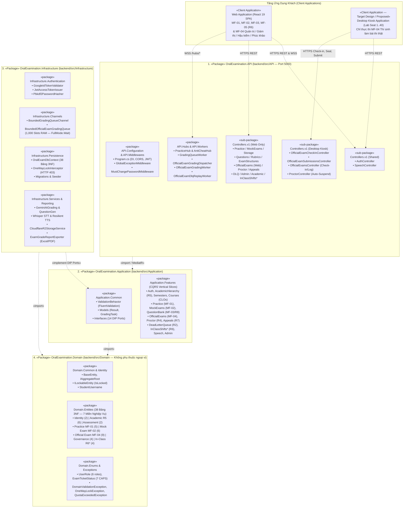
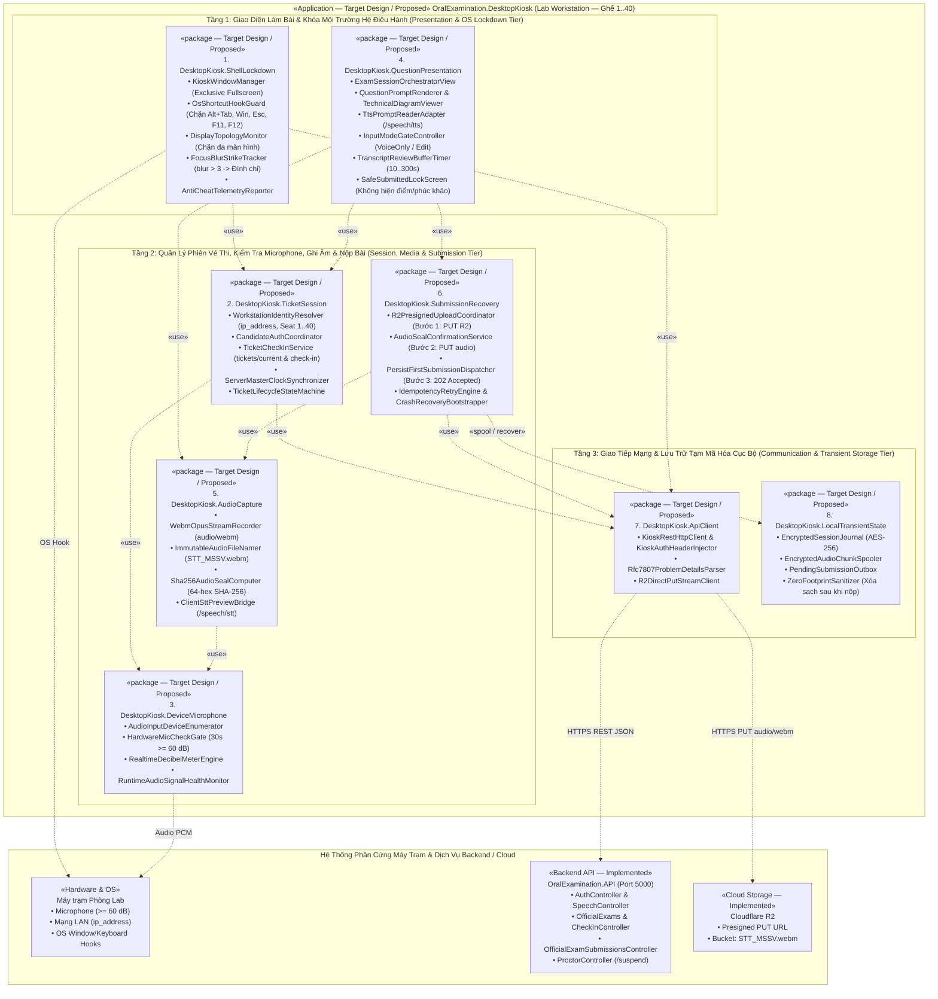

# REPORT 4 — SOFTWARE DESIGN DOCUMENT (BẢN TIẾNG VIỆT)
## PHẦN PHỤ TRÁCH: NGUYỄN QUANG THÀNH — MỤC 1.2.1 (`D-03`) & MỤC 1.2.3 (`D-05`)

> **Thông tin tài liệu:**
> - **Dự án:** Hệ Thống Luyện Thi & Đánh Giá Vấn Đáp Bằng LLM Cho Ngành Kỹ Thuật Phần Mềm (`FA26SE166`)
> - **Người thực hiện:** Nguyễn Quang Thành | **Người review chéo:** Phạm Nguyễn Đăng Hải
> - **File sơ đồ Draw.io đính kèm:**
>   - `D-03`: [`D03_Backend_Package_Diagram.drawio`](file:///d:/Đồ%20Án/05_Source_Code/docs/05_diagrams/D03_Backend_Package_Diagram.drawio)
>   - `D-05`: [`D05_Desktop_Kiosk_Package_Diagram.drawio`](file:///d:/Đồ%20Án/05_Source_Code/docs/05_diagrams/D05_Desktop_Kiosk_Package_Diagram.drawio)

---

## 1.2. Sơ Đồ Gói Hệ Thống (Package Diagrams)

Hệ thống được phân tách thành **3 phân hệ độc lập** với ranh giới trách nhiệm rõ ràng:
1. **Backend Application (`1.2.1` — `.NET 8 Clean Architecture`):** Máy chủ xử lý nghiệp vụ trung tâm và cổng API hợp nhất (`/api/v1/*`, `/hubs/*`), phục vụ đồng thời cả **Web Application** và **Desktop Kiosk Application** theo 6 vai trò RBAC (`admin`, `department_head`, `examination_officer`, `lecturer`, `proctor`, `student`).
2. **Web Application (`1.2.2` — `React 19 Vite SPA`):** Phục vụ Luyện tập tự do (**MF-01**), Thi thử tính giờ (**MF-02**), Ngân hàng câu hỏi & Rubric 10.0 (**MF-03 / R8**), Chuỗi học thuật (**R5**), Ca thi vấn đáp trong lớp (**MF-05 / R6**), cùng các nghiệp vụ quản lý kỳ/ca thi, điểm danh Giám thị (**R4**), hậu kiểm điểm, công bố điểm khóa một chiều, phúc khảo 5 bước (**R7**) và quản lý hàng đợi lỗi DLQ (**R2**) của **MF-04**.
3. **Desktop Kiosk Application (`1.2.3` — `[Target Design / Proposed]`):** Ứng dụng cài đặt trên máy trạm phòng Lab (ghế `1..40`), **chỉ phục vụ duy nhất luồng Thí sinh ngồi làm bài thi thật (MF-04 Candidate Execution)**.

---

### 1.2.1. Sơ Đồ Gói Phân Hệ Backend (Backend Package Diagram — `D-03`)

#### a) Cấu trúc 4 tầng và quy tắc phụ thuộc (Dependency Rule)
Backend ([`OralExamination.sln`](file:///d:/Đồ%20Án/05_Source_Code/backend/OralExamination.sln)) được thiết kế theo **Clean Architecture 4 tầng** kết hợp **CQRS (MediatR)** và đường ống chấm điểm bất đồng bộ **Persist-First + BoundedChannel + Background Workers**. Chiều phụ thuộc giữa các gói được kiểm chứng tự động qua [`CleanArchitectureRulesTests.cs`](file:///d:/Đồ%20Án/05_Source_Code/backend/tests/OralExamination.UnitTests/Architecture/CleanArchitectureRulesTests.cs):

- **`OralExamination.Domain` (Tầng lõi):** Chứa 38 thực thể chuẩn 3NF, kiểu liệt kê (`Enums`) và ngoại lệ nghiệp vụ. Không phụ thuộc vào bất kỳ gói nào khác.
- **`OralExamination.Application` (Tầng nghiệp vụ):** Chỉ phụ thuộc vào `Domain`. Chứa các ca sử dụng (`Features`) và 14 giao diện trừu tượng (`Common.Interfaces`).
- **`OralExamination.Infrastructure` (Tầng hạ tầng):** Phụ thuộc vào `Application` và `Domain`. Triển khai CSDL PostgreSQL (`OralExamDbContext`), khóa điểm một chiều (`OneWayLockInterceptor`), hàng đợi RAM 1,000 vị trí (`Channels`) và tích hợp Gemini AI, Whisper STT, Cloudflare R2, xuất báo cáo Excel/PDF.
- **`OralExamination.API` (Tầng giao tiếp):** Phụ thuộc vào `Application` và `Infrastructure`. Chứa REST Controllers, SignalR Hubs, Middlewares và 4 tiến trình nền `BackgroundService` (`Workers`).

#### b) Sơ đồ Backend Package Diagram (`Figure 1.2.1` / `D-03`)

*Hình 1.2.1 — Sơ đồ gói phân hệ Backend (`D-03`). Ghi chú: `*` là gói mở rộng thuộc `[Target Design / Proposed — R6]`.*

---

#### c) Bảng Mô Tả Các Gói Backend (`Table 1.2.1a`)

| STT | Tên Gói (Package) | Đường dẫn Nguồn | Thành phần Chính (Main Classes) | Trách nhiệm Nghiệp vụ & Kỹ thuật |
|:---:|:---|:---|:---|:---|
| **01** | **`OralExamination.API`** | [`backend/src/API/`](file:///d:/Đồ%20Án/05_Source_Code/backend/src/API/Program.cs) | `Program.cs`, `DotEnvLoader` | Khởi chạy Web API tại cổng `5000`, đăng ký DI và cấu hình chuỗi Middleware chuẩn (`GlobalExceptionMiddleware` $\to$ `CORS` $\to$ `StaticFiles` $\to$ `Auth` $\to$ `MustChangePasswordMiddleware`). |
| **02** | **`API.Controllers.v1`** *(Shared)* | [`Controllers/v1/`](file:///d:/Đồ%20Án/05_Source_Code/backend/src/API/Controllers/v1/AuthController.cs) | `AuthController`, `SpeechController` | Phục vụ **cả Web và Desktop Kiosk**: Xác thực kép (Google OAuth 2.0 & Mật khẩu trường cấp), đổi mật khẩu, làm mới JWT (`/api/v1/auth/*`); bóc băng STT và đọc câu hỏi TTS (`/api/v1/speech/stt`, `/tts`, `/voices`). |
| **03** | **`API.Controllers.v1`** *(Web Only)* | [`Controllers/v1/`](file:///d:/Đồ%20Án/05_Source_Code/backend/src/API/Controllers/v1/OfficialExamsController.cs) | `PracticeController`, `MockExamsController`, `StorageController`, `QuestionsController`, `RubricsController`, `OfficialExamsController`, `ProctorController`, `AppealsController`, `DeadLetterQueueController`, `AdminController`, `SemestersController`, `CoursesController`, `ClassesController`, `InClassShiftsController*` | Chỉ phục vụ **Web Application**: Luyện tập MF-01, Thi thử MF-02, tải âm thanh bóc băng tạm (`StorageController`), Ngân hàng đề 2 luồng & Rubric 10.0 (MF-03/R8), Quản lý kỳ/ca thi, Điểm danh Giám thị ghế 1–40 (R4), Hậu kiểm Evidence Panel, Công bố điểm khóa một chiều, Phúc khảo 5 bước (R7), Quản lý DLQ (R2), Chuỗi học thuật (R5) và Ca thi trong lớp (R6). |
| **04** | **`API.Controllers.v1`** *(Desktop Kiosk)* | [`Controllers/v1/`](file:///d:/Đồ%20Án/05_Source_Code/backend/src/API/Controllers/v1/OfficialExamSubmissionsController.cs) | `OfficialExamSubmissionsController`, `OfficialExamCheckInController`, `OfficialExamsController`, `ProctorController` | Phục vụ **Desktop Kiosk (MF-04 Candidate Execution)**: Lấy vé máy trạm (`GET tickets/current`), check-in theo `ip_address` (`POST tickets/{id}/check-in`), ghi log vi phạm (`POST anti-cheat/log`), đình chỉ khi `blur > 3` (`POST proctor/tickets/{id}/suspend`), cấp quyền tải R2, niêm phong SHA-256 (`PUT audio`) và nộp bài Persist-First (`PUT submission` $\to$ `202 Accepted`). |
| **05** | **`API.Middlewares`** | [`Middlewares/`](file:///d:/Đồ%20Án/05_Source_Code/backend/src/API/Middlewares/GlobalExceptionMiddleware.cs) | `GlobalExceptionMiddleware`, `MustChangePasswordMiddleware` | Bắt mọi ngoại lệ và chuẩn hóa về định dạng lỗi **RFC 7807 `ProblemDetails`** (`401`, `403`, `410 Gone`, `422`, `429`); chặn tài khoản trường cấp có `MustChangePassword = true` cho đến khi đổi mật khẩu. |
| **06** | **`API.Hubs`** & **`API.Services`** | [`Hubs/`](file:///d:/Đồ%20Án/05_Source_Code/backend/src/API/Hubs/PracticeHub.cs), [`Services/`](file:///d:/Đồ%20Án/05_Source_Code/backend/src/API/Services/AntiCheatSignalRNotifier.cs) | `PracticeHub`, `AntiCheatHub`, `AntiCheatSignalRNotifier` | Kênh WebSocket thời gian thực: đẩy kết quả chấm điểm AI về màn hình luyện tập (`/hubs/practice`) và phát cảnh báo vi phạm phòng thi từ Kiosk tới màn hình Giám thị/Khảo thí (`/hubs/anti-cheat`). |
| **07** | **`API.Workers`** | [`Workers/`](file:///d:/Đồ%20Án/05_Source_Code/backend/src/API/Workers/GradingQueueWorker.cs) | `GradingQueueWorker`, `OfficialExamGradingDispatcher`, `OfficialExamGradingWorker`, `OfficialExamDlqReplayWorker` | Các tiến trình nền `BackgroundService`: tiêu thụ hàng đợi chấm điểm, thử lại **Polly Retry 3 lần (2s, 4s, 8s)**, gắn cờ nghi ngờ **AI Doubt Guard** (`confidence < 0.70`), cách ly lỗi vào bảng `dead_letter_queues` và tự động chấm bù sau mỗi **5 phút**. |
| **08** | **`Application.Common`** | [`Application/Common/`](file:///d:/Đồ%20Án/05_Source_Code/backend/src/Application/Common/Behaviors/ValidationBehavior.cs) | `ValidationBehavior`, `Result<T>`, 14 giao diện `Common.Interfaces` | Tự động kiểm tra dữ liệu đầu vào bằng `FluentValidation` trước khi chạy `Handler`; định nghĩa 14 giao diện cổng (DIP Ports) để tách biệt tầng nghiệp vụ khỏi công nghệ hạ tầng. |
| **09** | **`Application.Features`** | [`Application/Features/`](file:///d:/Đồ%20Án/05_Source_Code/backend/src/Application/Features/) | 15 gói nghiệp vụ hiện hành + `Features.InClassShifts*` (R6) | Thực thi toàn bộ các ca sử dụng theo mô hình CQRS (`Commands`, `Queries`, `Handlers`, `Validators`, `DTOs`) cho 6 vai trò RBAC trên cả 4 luồng chính `MF-01..MF-04` và `MF-05 (R6)`. |
| **10** | **`Infrastructure.Channels`** | [`Infrastructure/Channels/`](file:///d:/Đồ%20Án/05_Source_Code/backend/src/Infrastructure/Channels/BoundedGradingQueueChannel.cs) | `BoundedGradingQueueChannel`, `BoundedOfficialExamGradingQueue` | Hàng đợi trong bộ nhớ RAM có sức chứa **1,000 vị trí** (`BoundedChannelFullMode.Wait`), giúp API nộp bài phản hồi trong $< 100\text{ ms}$ và bảo vệ máy chủ khỏi tràn RAM khi tải cao. |
| **11** | **`Infrastructure.Persistence`** | [`Infrastructure/Persistence/`](file:///d:/Đồ%20Án/05_Source_Code/backend/src/Infrastructure/Persistence/OralExamDbContext.cs) | `OralExamDbContext`, `OneWayLockInterceptor`, `Migrations` | Quản lý ánh xạ EF Core 8 tới 38 bảng PostgreSQL 16 chuẩn 3NF; tự động chặn mọi lệnh `UPDATE/DELETE` trên vé thi và bản ghi hậu kiểm đã khóa điểm (`is_locked = true` $\to$ `HTTP 403`), chỉ mở ngoại lệ khi Trưởng Bộ Môn duyệt phúc khảo (R7). |
| **12** | **`Infrastructure.Authentication`**, **`Services`** & **`Reporting`** | [`Infrastructure/Services/`](file:///d:/Đồ%20Án/05_Source_Code/backend/src/Infrastructure/Services/GeminiAiGradingService.cs), [`Reporting/`](file:///d:/Đồ%20Án/05_Source_Code/backend/src/Infrastructure/Reporting/ExamGradeReportExporter.cs) | `JwtAccessTokenIssuer`, `GeminiAiGradingService`, `CloudflareWhisperService`, `CloudflareR2StorageService`, `ExamGradeReportExporter` | Cấp phát JWT & băm mật khẩu PBKDF2; tích hợp Google Gemini 1.5 (chấm CoT & ảnh sơ đồ Base64), Whisper STT, lưu trữ Cloudflare R2 (`STT_MSSV.webm` + kiểm tra SHA-256) và xuất bảng điểm Excel (`.xlsx`) / PDF có mã băm chứng thực. |
| **13** | **`OralExamination.Domain`** | [`backend/src/Domain/`](file:///d:/Đồ%20Án/05_Source_Code/backend/src/Domain/) | 38 thực thể `Entities`, `ExamTicketStatus`, `UserRole`, `ILockableEntity` | Chứa các thực thể nghiệp vụ chuẩn 3NF thuộc 7 miền (Bounded Contexts), bộ 7 trạng thái vé thi viết HOA (`SCHEDULED` $\to$ `LOCKED`) và các quy tắc bất biến cốt lõi. |

*Bảng 1.2.1a — Mô tả các gói trong phân hệ Backend.*

---

#### d) Bảng Phân Định Ranh Giới Phục Vụ Client (`Table 1.2.1b`)

| Nhóm Nghiệp Vụ | Ứng dụng Khách (Client) | Controllers & Hubs Phục vụ (`OralExamination.API`) | Lưu trữ File Âm thanh |
|:---|:---:|:---|:---|
| **Xác thực Kép, Đổi mật khẩu & Làm mới Token (6 Roles)** | **Cả Web & Desktop Kiosk** | `AuthController` (`/api/v1/auth/*`) | Không áp dụng |
| **Nhận diện Giọng nói (STT) & Đọc Câu hỏi (TTS)** | **Cả Web & Desktop Kiosk** | `SpeechController` (`/api/v1/speech/stt`, `/tts`, `/voices`) | Xử lý trên luồng bộ nhớ (Zero-R2) |
| **MF-01 (Luyện tập) & MF-02 (Thi thử tính giờ)** | **Chỉ Web Application** | `PracticeController`, `MockExamsController`, `StorageController`, `PracticeHub` | **Không lưu R2** (chỉ lưu văn bản transcript vào DB) |
| **MF-03 (Ngân hàng đề 2 luồng R8), R5 (Học thuật) & R6 (Ca thi trong lớp)** | **Chỉ Web Application** | `QuestionsController`, `RubricsController`, `ExamStructuresController`, `SemestersController`, `CoursesController`, `ClassesController`, `InClassShiftsController*` | **Không lưu audio R2** (chỉ lưu ảnh sơ đồ câu hỏi thủ công) |
| **MF-04 Quản trị, Giám thị (R4), Hậu kiểm, Công bố điểm, Phúc khảo (R7) & DLQ (R2)** | **Chỉ Web Application** | `OfficialExamsController`, `ProctorController`, `AppealsController`, `DeadLetterQueueController`, `VerificationController`, `AntiCheatHub` | Nghe lại tệp âm thanh từ Cloudflare R2 |
| **MF-04 Thí sinh ngồi làm bài thi thật tại phòng Lab (Candidate Execution)** | **Chỉ Desktop Kiosk** *(Target Design)* | `OfficialExamSubmissionsController`, `OfficialExamsController` & `OfficialExamCheckInController` (`tickets/current`, `check-in`, `anti-cheat/log`), `ProctorController` (`suspend`) | **Bắt buộc lưu Cloudflare R2** (`STT_MSSV.webm` + niêm phong SHA-256) |

*Bảng 1.2.1b — Ranh giới phục vụ của Backend đối với Web Application và Desktop Kiosk Application.*

---

### 1.2.3. Sơ Đồ Gói và Thành Phần Ứng Dụng Desktop Kiosk (Desktop Kiosk Package Diagram — `D-05`)

> [!IMPORTANT]
> **GHI CHÚ TRẠNG THÁI THIẾT KẾ (`[Target Design / Proposed]`):**
> Hiện tại kho mã nguồn chưa tách project riêng cho ứng dụng Desktop Kiosk. Theo đúng quy định tại **Mục 1 và Mục 7 (Definition of Done)** của bảng phân công Report 4:
> - Toàn bộ các gói trong Mục `1.2.3` dưới đây được gắn nhãn **`[Target Design / Proposed]`** cho ứng dụng **Desktop Kiosk (`OralExamination.DesktopKiosk`)**.
> - Không lấy tên các component React của Web đổi tên thành class Desktop, nhưng **kết nối khớp 100% với các API Endpoint đã triển khai thực tế trên Backend**.

#### a) Mục tiêu thiết kế của Desktop Kiosk Application
Ứng dụng **Desktop Kiosk (`OralExamination.DesktopKiosk` — `[Target Design / Proposed]`)** chạy trên các máy trạm phòng Lab (ghế `1..40`), đảm nhiệm 4 vai trò cốt lõi:
1. **Cô lập phạm vi làm bài thi thật:** Chỉ thực hiện luồng thí sinh làm bài thi thật (**MF-04 Candidate Execution**). Loại bỏ hoàn toàn các tính năng luyện tập, thi thử, quản trị, coi thi, hậu kiểm và phúc khảo.
2. **Khóa chặt máy trạm (Kiosk Lockdown):** Chạy toàn màn hình khóa cứng, chặn phím tắt hệ thống (`Alt+Tab`, `Win`, `Esc`, `F11`, `F12`), chặn đa màn hình và đếm lỗi mất tiêu điểm (**`blurCount > 3` tự động khóa bài thi và gọi API đình chỉ**).
3. **Kiểm tra phần cứng & Niêm phong tại nguồn:** Bắt buộc kiểm tra microphone 30 giây đạt ngưỡng **$\ge 60\text{ dB}$** trước khi mở đề; ghi âm tệp **`STT_MSSV.webm`**, tính mã băm **SHA-256** tại máy trạm và tải trực tiếp lên Cloudflare R2.
4. **Nộp bài Persist-First ($< 100\text{ ms}$) & Khóa màn hình an toàn:** Lưu bài nộp với trạng thái `SUBMITTED` (`HTTP 202 Accepted`), khóa màn hình thông báo nộp bài thành công (**không hiển thị điểm số và không có nút khiếu nại tại chỗ**), sau đó xóa sạch dữ liệu tạm trên máy trạm.

#### b) Sơ đồ Desktop Kiosk Package/Component Diagram (`Figure 1.2.3` / `D-05`)

*Hình 1.2.3 — Sơ đồ gói và thành phần ứng dụng Desktop Kiosk (`D-05` — `[Target Design / Proposed]`).*

---

#### c) Bảng Mô Tả Các Gói Trong Desktop Kiosk (`Table 1.2.3a` — `[Target Design / Proposed]`)

| STT | Tên Gói (Package) | Các Thành phần Chính (Components) | Mô tả Trách nhiệm Nghiệp vụ & Kỹ thuật |
|:---:|:---|:---|:---|
| **01** | **`DesktopKiosk.ShellLockdown`** *`[Target Design]`* | `KioskWindowManager`, `OsShortcutHookGuard`, `DisplayTopologyMonitor`, `FocusBlurStrikeTracker`, `AntiCheatTelemetryReporter` | • Khóa toàn màn hình độc quyền (Exclusive Fullscreen), ẩn Taskbar và chặn chuột phải. • Chặn phím hệ thống (`Alt+Tab`, `Alt+F4`, `Win`, `Esc`, `F11`, `F12`, PrintScreen) và chặn gắn màn hình phụ (`MULTIPLE_DISPLAYS`). • Đếm số lần cửa sổ mất tiêu điểm: gửi cảnh báo qua `POST /api/v1/official-exams/anti-cheat/log`; khi **`blurCount > 3`**, tự động khóa bài thi và gọi `POST /api/v1/proctor/tickets/{ticketId}/suspend` để đình chỉ vé thi. |
| **02** | **`DesktopKiosk.TicketSession`** *`[Target Design]`* | `WorkstationIdentityResolver`, `CandidateAuthCoordinator`, `TicketCheckInService`, `ServerMasterClockSynchronizer`, `TicketLifecycleStateMachine` | • Đăng nhập thí sinh (`/api/v1/auth/*`) và lấy vé thi của máy trạm đang ngồi qua `GET /api/v1/official-exams/tickets/current` (Backend đối chiếu `ip_address` trực tiếp từ kết nối mạng). • Gọi `POST /api/v1/official-exams/tickets/{ticketId}/check-in`: chỉ mở đề khi Giám thị đã điểm danh ghế `1..40`, Khảo thí đã xuất bản đề (`is_exam_published = true`), khớp `ip_address` và đã đạt bài thử mic 30 giây. • Đồng bộ đồng hồ đếm ngược với máy chủ và quản lý trạng thái phiên (`SCHEDULED` $\to$ `IN_PROGRESS` $\to$ `SUBMITTED`). |
| **03** | **`DesktopKiosk.DeviceMicrophone`** *`[Target Design]`* | `AudioInputDeviceEnumerator`, `HardwareMicCheckGate`, `RealtimeDecibelMeterEngine`, `RuntimeAudioSignalHealthMonitor` | • Khóa chọn thiết bị microphone của máy trạm phòng Lab. • Thực hiện **cổng kiểm tra phần cứng 30 giây**: đo cường độ âm thanh thời gian thực và **bắt buộc đạt $\ge 60\text{ dB}$** mới cho phép vào ca thi. • Giám sát tín hiệu mic liên tục trong lúc làm bài để cảnh báo ngay nếu tuột giắc cắm hoặc mất âm thanh (`SUSPICIOUS_AUDIO`). |
| **04** | **`DesktopKiosk.QuestionPresentation`** *`[Target Design]`* | `ExamSessionOrchestratorView`, `QuestionPromptRenderer`, `TechnicalDiagramViewer`, `TtsPromptReaderAdapter`, `InputModeGateController`, `TranscriptReviewBufferTimer`, `SafeSubmittedLockScreen` | • Hiển thị tuần tự câu hỏi chính, câu hỏi phụ (`Follow-up` 1–5 câu do Trưởng Bộ Môn cấu hình) và ảnh sơ đồ kỹ thuật (`image_url`); phát giọng đọc đề qua `/api/v1/speech/tts`. • Thực thi chế độ nhập liệu của ca thi: khóa bàn phím hoàn toàn khi ở chế độ `VoiceOnly`, hoặc mở bộ đếm ngược `TranscriptBufferSeconds` (10–300s) để sửa thuật ngữ tiếng Anh chuyên ngành SE khi ở chế độ `VoiceWithTranscriptEdit`. • Sau khi nộp bài, bật màn hình khóa `SafeSubmittedLockScreen`: báo đã lưu an toàn, **không hiện điểm số và không có nút khiếu nại/phúc khảo tại chỗ**. |
| **05** | **`DesktopKiosk.AudioCapture`** *`[Target Design]`* | `WebmOpusStreamRecorder`, `ImmutableAudioFileNamer`, `Sha256AudioSealComputer`, `ClientSttPreviewBridge` | • Thu âm phần trả lời theo định dạng nén `audio/webm` và ghi đệm liên tục xuống đĩa cục bộ. • Đặt tên tệp âm thanh theo quy ước bất biến **`STT_MSSV.webm`** (ví dụ: `01_SE170123.webm`). • Tính mã băm **SHA-256 (64 ký tự hex)** trên toàn bộ tệp `STT_MSSV.webm` ngay tại máy trạm trước khi tải lên đám mây. |
| **06** | **`DesktopKiosk.SubmissionRecovery`** *`[Target Design]`* | `R2PresignedUploadCoordinator`, `AudioSealConfirmationService`, `PersistFirstSubmissionDispatcher`, `IdempotencyRetryEngine`, `CrashRecoveryBootstrapper` | Điều phối giao thức nộp bài 3 bước và tự động thử lại khi rớt mạng: • **Bước 1:** Gọi `POST .../audio-upload-authorizations` lấy Presigned PUT URL (15 phút) và tải tệp `STT_MSSV.webm` thẳng lên Cloudflare R2. • **Bước 2:** Gọi `PUT .../audio` gửi `{ objectKey, sha256 }` để Backend đối soát tệp trên R2 và niêm phong mã băm. • **Bước 3:** Gọi `PUT .../submission` để Backend lưu bền vững bài làm vào bảng `exam_question_submissions` + `grading_jobs`, chuyển vé sang **`SUBMITTED` trong $< 100\text{ ms}$** (`HTTP 202 Accepted`). • Nếu mất mạng tạm thời, tự động gửi lại an toàn nhờ cơ chế chống trùng theo trạng thái `TicketId` trên Backend. |
| **07** | **`DesktopKiosk.ApiClient`** *`[Target Design]`* | `KioskRestHttpClient`, `KioskAuthHeaderInjector`, `Rfc7807ProblemDetailsParser`, `R2DirectPutStreamClient` | • Giới hạn chỉ gọi tới nhóm API phục vụ Kiosk (`/auth`, `/speech`, `/official-exams`, `/proctor/tickets/*/suspend`), tự động gắn `Bearer JWT`. • Giải mã lỗi chuẩn RFC 7807 (`401`, `403 WrongWorkstation`, `404`, `409 Conflict`, `422`) và truyền trực tiếp luồng tệp `.webm` lên Cloudflare R2. |
| **08** | **`DesktopKiosk.LocalTransientState`** *`[Target Design]`* | `EncryptedSessionJournal`, `EncryptedAudioChunkSpooler`, `PendingSubmissionOutbox`, `ZeroFootprintSanitizer` | • Lưu nhật ký phiên làm bài và các mảnh âm thanh đang thu dưới dạng mã hóa AES-256 trên ổ đĩa máy trạm để chống mất bài khi tắt máy đột ngột. • Ngay sau khi nhận xác nhận `202 Accepted` (`SUBMITTED`), `ZeroFootprintSanitizer` xóa sạch 100% tệp âm thanh tạm và token trên máy trạm. |

*Bảng 1.2.3a — Mô tả các gói trong ứng dụng Desktop Kiosk (`OralExamination.DesktopKiosk` — `[Target Design / Proposed]`).*

---

#### d) Bảng Đối Chiếu Giao Tiếp Giữa Desktop Kiosk (`Target Design`) và Backend (`Implemented Source`) (`Table 1.2.3b`)

| STT | Gói tại Desktop Kiosk (`[Target Design]`) | Endpoint Thực tế trên Backend | Controller & Handler Thực tế (`05_Source_Code/backend`) | Bảng CSDL Cập nhật |
|:---:|:---|:---|:---|:---|
| **1** | `DesktopKiosk.TicketSession` *(Đăng nhập)* | `POST /api/v1/auth/password-login` `POST /api/v1/auth/google-login` `POST /api/v1/auth/refresh-token` | [`AuthController.cs`](file:///d:/Đồ%20Án/05_Source_Code/backend/src/API/Controllers/v1/AuthController.cs) (`PasswordLogin`, `GoogleLogin`, `RefreshToken`) | `users`, `refresh_tokens` |
| **2** | `DesktopKiosk.TicketSession` *(Lấy vé & Check-in)* | `GET /api/v1/official-exams/tickets/current` `POST /api/v1/official-exams/tickets/{ticketId}/check-in` | [`OfficialExamsController.cs`](file:///d:/Đồ%20Án/05_Source_Code/backend/src/API/Controllers/v1/OfficialExamsController.cs#L481-L523) & [`OfficialExamCheckInController.cs`](file:///d:/Đồ%20Án/05_Source_Code/backend/src/API/Controllers/v1/OfficialExamCheckInController.cs) (`GetMyWorkstationTicket`, `CheckInExamTicket`) | `student_exam_tickets` (`seat_number`, `ip_address`, `status = 'IN_PROGRESS'`) |
| **3** | `DesktopKiosk.ShellLockdown` *(Chống gian lận)* | `POST /api/v1/official-exams/anti-cheat/log` `POST /api/v1/proctor/tickets/{ticketId}/suspend` | [`OfficialExamsController.cs`](file:///d:/Đồ%20Án/05_Source_Code/backend/src/API/Controllers/v1/OfficialExamsController.cs#L548-L573) & [`ProctorController.cs`](file:///d:/Đồ%20Án/05_Source_Code/backend/src/API/Controllers/v1/ProctorController.cs#L94-L117) (`LogAntiCheatEvent`, `SuspendExamTicket`) | `exam_anti_cheat_logs`, `student_exam_tickets` |
| **4** | `QuestionPresentation` & `AudioCapture` | `POST /api/v1/speech/stt` `POST /api/v1/speech/tts` & `GET /api/v1/speech/voices` | [`SpeechController.cs`](file:///d:/Đồ%20Án/05_Source_Code/backend/src/API/Controllers/v1/SpeechController.cs#L31-L145) (`TranscribeSpeech`, `SynthesizeSpeech`) | *(Xử lý trên RAM — không lưu DB)* |
| **5** | `DesktopKiosk.SubmissionRecovery` *(Bước 1: Tải lên R2)* | `POST /api/v1/official-exams/tickets/{ticketId}/audio-upload-authorizations` $\to$ `PUT <Presigned_R2_URL>` | [`OfficialExamSubmissionsController.cs`](file:///d:/Đồ%20Án/05_Source_Code/backend/src/API/Controllers/v1/OfficialExamSubmissionsController.cs#L20-L45) (`CreateAudioUploadAuthorizationCommandHandler`) | `student_exam_tickets` (Khởi tạo `ObjectKey` chuẩn `STT_MSSV.webm`) |
| **6** | `DesktopKiosk.SubmissionRecovery` *(Bước 2: Niêm phong)* | `PUT /api/v1/official-exams/tickets/{ticketId}/audio` *(Body: `{ objectKey, sha256 }`)* | [`OfficialExamSubmissionsController.cs`](file:///d:/Đồ%20Án/05_Source_Code/backend/src/API/Controllers/v1/OfficialExamSubmissionsController.cs#L47-L67) ([`SealOfficialExamAudioCommandHandler.cs`](file:///d:/Đồ%20Án/05_Source_Code/backend/src/Application/Features/OfficialExams/Commands/SealOfficialExamAudio/SealOfficialExamAudioCommandHandler.cs)) | `student_exam_tickets` (`audio_object_key`, `audio_r2_url`, `audio_hash_sha256`, `audio_verified_at`) |
| **7** | `DesktopKiosk.SubmissionRecovery` *(Bước 3: Nộp bài)* | `PUT /api/v1/official-exams/tickets/{ticketId}/submission` *(`202 Accepted`)* `GET /api/v1/official-exams/tickets/{ticketId}/submission` | [`OfficialExamSubmissionsController.cs`](file:///d:/Đồ%20Án/05_Source_Code/backend/src/API/Controllers/v1/OfficialExamSubmissionsController.cs#L69-L108) ([`SubmitOfficialExamCommandHandler.cs`](file:///d:/Đồ%20Án/05_Source_Code/backend/src/Application/Features/OfficialExams/Commands/SubmitOfficialExam/SubmitOfficialExamCommandHandler.cs)) | `student_exam_tickets` (`SUBMITTED`), `exam_question_submissions`, `grading_jobs` |

*Bảng 1.2.3b — Đối chiếu giao tiếp giữa các gói Desktop Kiosk (`Target Design / Proposed`) và Backend (`Implemented Source`).*
